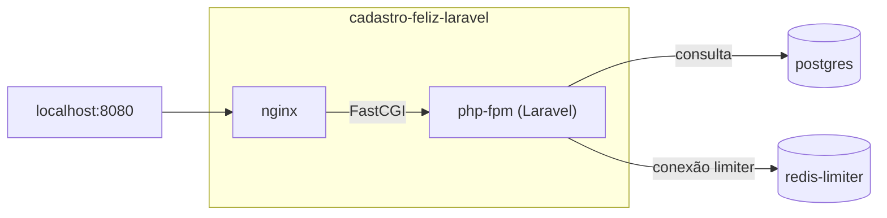

# Base da API Laravel

> Plan from this document. Each slice below carries its own shape - copy it, do not re-derive it.
> Status: decisão já tomada em docs/stacks.md e docs/infrastructure.md (responsável do projeto); forma em draft, com o endpoint, os containers, a cópia do código e o contrato de `/health` escolhidos pelo responsável do projeto em 2026-11-04

## Situation

- Project: in active construction. Os serviços comuns, o schema, o `Makefile`, o formulário e o CI existem e são testados; nenhuma stack tem uma linha de código, e `make up-laravel` recusa com `stack laravel ainda não implementada`.
- Decision: committed. A stack Laravel, com os containers `nginx`, `php-fpm`, `scheduler`, `horizon` e `redis` no projeto `cadastro-feliz-laravel`, está em docs/stacks.md e docs/infrastructure.md. Esta sessão decidiu só a forma da base e do primeiro endpoint.
- In flight: copia de .design/frontend-container.md o código por cópia com Compose Watch, as dependências mudando só por um alvo do `Makefile` e os testes num container descartável; copia de .design/shared-infrastructure.md as imagens oficiais em versão exata e a regra de que uma stack entra no `Makefile` só com o próprio compose. `POST /users`, o relay e o worker têm rodadas próprias.
- At stake: reverte-se em uma tarde, porque nada depende da stack ainda. O que pesa é o contrato de `GET /health`, que NestJS e Go vão copiar, e o fluxo de edição que as próximas rodadas da stack vão usar todos os dias.

## Problem

Construção. O README promete a mesma API nas três stacks, na porta 8080, e a primeira delas a ser construída é a Laravel. Hoje o `Makefile` já sabe subir `apis/laravel`, mas o diretório não existe. Sem uma base que suba, responda e alcance o PostgreSQL e o `redis-limiter`, a rodada de `POST /users` teria de resolver ao mesmo tempo a imagem, o compose, a configuração do framework e a regra de negócio, e um erro de rede apareceria misturado com um erro de validação.

A base vem antes de `POST /users` porque tudo o que essa rodada precisa (rede, `.env`, conexão com o banco, conexão com o contador, testes) pode ser provado por um endpoint sem regra de negócio. Nada foi medido, porque ainda não existe produto.

## Success

- Worked if: num clone limpo, `make up-laravel` sai com `0`, deixa `nginx` e `php-fpm` `healthy`, e `GET localhost:8080/health` responde `200` com os dois checks `ok`. Com o `redis-limiter` parado, a mesma chamada responde `503` com `limiter` em `fail` em menos de 3 s. A rodada de `POST /users` começa sem editar o Dockerfile, o compose da stack nem o `Makefile`.
- Going wrong: a rodada de `POST /users` precisa mexer na infraestrutura para acrescentar um pacote, uma edição em `app/` não aparece sem rebuild com o watch ativo, ou o Laravel tenta acessar uma tabela que o schema não tem.
- Review: no início da rodada de `POST /users` na stack Laravel, pelo responsável do projeto.

## Boundary

In: o projeto Laravel em `apis/laravel`, com o Dockerfile, o compose `cadastro-feliz-laravel` com `nginx` e `php-fpm` e a configuração do `nginx`; o endpoint `GET /health`; os alvos `make watch-laravel`, `make laravel-composer` e `make test-laravel`, e a reconstrução das imagens da stack em `make up-<stack>`; os testes da stack em `tests/infra` e o job do CI; a seção `GET /health` em docs/api-contract.md; duas decisões novas em docs/decisions.md (o `/health` comum e o código da stack por cópia); e as atualizações de status, alvos, versões e estrutura no README, em docs/stacks.md e em docs/infrastructure.md.

Out:
- `POST /users`, o contador de tentativas, a cota por IP, o proxy confiável e o CORS: ficam para a rodada do cadastro na stack Laravel.
- `scheduler`, `horizon`, `redis` e a conexão `default` da fila: entram com o outbox, porque sem o relay e o job não há o que verificar.
- `GET /health` em NestJS e Go: cada stack o implementa na própria rodada, seguindo o contrato.
- Build de produção do PHP: como no frontend, a POC estuda a API e o outbox.
- Forma do corpo de 404 e 405: continua nas limitações conhecidas do contrato.

Unchanged: porta 8080 e `API_PORT`; o nome `cadastro-feliz-laravel` e a rede `cadastro-feliz-net`; o schema e `database/migrations`; o contrato de `POST /users`; os serviços e alvos do projeto `cadastro-feliz-shared`; a recusa `stack <nome> ainda não implementada` para `nest` e `go`. Só o teste que espera essa recusa para `laravel` deixa de incluí-la.

## Prior art

- O Laravel 13 traz uma rota de saúde, `/up`, que responde `200` se a aplicação inicializa e `500` se não, com o evento `DiagnosingHealth` para checks extras. Não adotamos: ela não responde JSON, usa `500` em vez de `503` e não diz qual dependência falhou. A rota nativa sai, para não haver duas rotas de saúde.
- Um projeto novo do Laravel 13 usa o driver `database` para sessão, cache e fila, e traz migrations para essas tabelas. Aqui `artisan migrate` nunca roda (docs/database.md), então essas tabelas não existem e a primeira requisição falharia. A Key decision 6 existe para isso.
- `php-fpm` e `nginx` em containers separados, com as imagens oficiais, é o arranjo que docs/stacks.md já prevê e o mais comum para o Laravel em Docker. Adotamos.
- O healthcheck mais citado para `php-fpm` consulta a página de ping do FPM. Não adotamos: ele prova que o processo está vivo, mas não que o `nginx` alcança o FPM e que o Laravel inicializa. A Key decision 2 cobre o caminho inteiro.

## Shape

A stack Laravel desta rodada são dois containers, `nginx` na porta 8080 e `php-fpm` com o Laravel 13 sobre PHP 8.5. O único endpoint, `GET /health`, consulta o PostgreSQL e o `redis-limiter` e reporta cada um. A porta difícil de reabrir é o contrato de `/health`, que NestJS e Go vão copiar e os testes de infraestrutura vão usar com qualquer stack; mudá-lo depois custa as três implementações e os testes.

A alternativa pesada, subir já os cinco containers de docs/stacks.md, só ganharia se o outbox fosse a próxima rodada da stack, e a próxima é `POST /users`.

## Key decisions

1. **`GET /health` é contrato comum das três stacks, na raiz e sem prefixo, com o mesmo corpo no `200` e no `503`: só os valores mudam.** O contrato fica em docs/api-contract.md, ao lado de `POST /users`. O corpo não segue a forma de erro da decisão 14, que vale para os erros de `POST /users`: um `503` aqui é um relatório de estado, não um erro de entrada, e quem lê o `200` lê o `503` com o mesmo código.
2. **O container está saudável quando o Laravel responde `GET /health` pelo `nginx`, com `200` ou `503`; as dependências nunca o deixam `unhealthy`.** Um `502` ou `504` do `nginx`, ou nenhuma resposta, é `unhealthy`. Assim uma queda do `redis-limiter` aparece no corpo de `/health`, e não como uma stack que não sobe. O `Makefile` já garante o banco migrado antes da stack.
3. **`GET /health` responde em menos de 3 s mesmo com uma dependência travada; cada check desiste em 1 s.** É a mesma regra de falha rápida que docs/stacks.md pede para a conexão do contador, e é ela que deixa o check de dependência travada terminar dentro do healthcheck.
4. **O código chega ao `php-fpm` só por cópia, nunca por bind mount, e `vendor/` nunca existe na máquina.** A imagem leva o código e o `vendor/`; `make watch-laravel` sincroniza as edições, que valem na próxima requisição sem reiniciar o container, e reconstrói a imagem quando `composer.json` ou `composer.lock` mudam. As dependências mudam só por `make laravel-composer`, que grava apenas esses dois arquivos. O custo aceito é a IDE não enxergar `vendor/`.
5. **Depois de `make up-<stack>`, o que responde em 8080 é o código que está no diretório da stack naquele momento.** O alvo genérico passa a reconstruir as imagens da stack, como `make up-shared` faz com o frontend. Vale para as três stacks, e acrescentar uma stack continua exigindo só o compose dela.
6. **O Laravel não usa nenhuma tabela própria: sessão, cache e fila não usam o banco, e o projeto não traz as migrations do framework.** O schema só tem `users` e `users_outbox`, aplicadas pelo golang-migrate (decisão 15). Não copie os padrões de um projeto novo do Laravel (Prior art). A API não tem sessão; a fila chega com o outbox, já no Redis.
7. **O `.env` da raiz é a única fonte de variáveis; `apis/laravel` não tem `.env` próprio.** As variáveis do framework, como `APP_KEY`, entram em `.env.example` › Específicas de stack, com valores locais fixos e sem segredo real, como o resto do arquivo.

## Work

| Slice | Delivers | Status |
|---|---|---|
| [`cadastro-feliz-laravel`](#cadastro-feliz-laravel) | `make up-laravel` sobe `nginx` e `php-fpm` saudáveis com o Laravel, e o fluxo de edição e de dependências funciona sem PHP na máquina | clear |
| [`GET /health`](#get-health) | O endpoint comum, documentado no contrato, reportando PostgreSQL e `redis-limiter` | clear |
| [`make test-laravel`](#make-test-laravel) | Testes do Laravel num container descartável, também no CI | open — 1 default taken |

Order: `cadastro-feliz-laravel` e `GET /health` juntos, porque o healthcheck do primeiro chama o segundo → `make test-laravel`.

Already handled by existing code: outra stack ativa → `make up-<stack>` a derruba antes; migrate com falha → `make up-<stack>` para antes de subir a stack; nenhuma stack no ar → o formulário mostra a falha de rede.

Derivable from the repository, left to the plan: versões exatas das imagens e dos pacotes; intervalos de healthcheck; comentários em português no compose, no Dockerfile e no `Makefile`; mensagens de uso dos alvos novos; testes com `check "<id> <nome>"` num arquivo novo de `tests/infra` incluído em `FILES`; organização em `app/Modules` (decisão 13) - tudo como o projeto `cadastro-feliz-shared` e o frontend já fazem.

### `cadastro-feliz-laravel`

**Delivers** o projeto Compose da stack Laravel com `nginx` e `php-fpm`, a imagem com o Laravel 13 sobre PHP 8.5 e os alvos de edição e de dependências. **Status: clear.** Guarda as Key decisions 4 e 5.

| State | What should happen | Caller sees |
|---|---|---|
| Clone limpo, `make up-laravel` | Cria `.env` e a rede, sobe os comuns, aplica o migrate, constrói e sobe `nginx` e `php-fpm` | Sai com `0`; os dois containers `healthy`; `GET localhost:8080/health` responde |
| Código editado sem o watch, `make up-laravel` | A imagem é reconstruída com o código atual (Key decision 5) | A edição já está no ar |
| `make watch-laravel` ativo, edição em `apis/laravel` | O arquivo é copiado para o `php-fpm`, sem reiniciar o container | A edição vale na próxima requisição, em até 2 s |
| `make watch-laravel` ativo, `composer.json` ou `composer.lock` muda | A imagem é reconstruída e o `php-fpm` recriado | `GET /health` volta a responder, num container novo |
| `make laravel-composer ARGS="require <pacote>"` | O composer roda num container descartável, com o usuário de quem chama | Só `composer.json` e `composer.lock` mudam em `apis/laravel`; nenhum `vendor/` na máquina |
| `php-fpm` fora do ar, ou o Laravel não inicializa | O `nginx` não alcança o Laravel (Key decision 2) | `make up-laravel` sai com código diferente de zero; stack `unhealthy` |
| `redis-limiter` ou PostgreSQL fora do ar | A stack continua saudável (Key decision 2) | `GET /health` responde `503` |
| `make down-laravel` | Remove os containers da stack | Serviços comuns continuam `healthy` |
| `make up-nest` ou `make up-go` com a Laravel ativa | Derruba a Laravel, como qualquer outra stack | Nenhum container `cadastro-feliz-laravel` |

Toda resposta de erro do Laravel sai em JSON, mesmo sem o header `Accept`, como docs/stacks.md já pede. A forma do 404 e do 405 continua indefinida.

Alternatives considered: bind mount de `apis/laravel` no `php-fpm` - ganharia se a IDE com `vendor/` pesasse mais que manter o mesmo fluxo do frontend, e o responsável escolheu o fluxo. `predis` em vez da extensão `phpredis` - ganha se compilar a extensão na imagem atrasar o build de forma notável; `phpredis` é o cliente padrão do Laravel.

### `GET /health`

**Delivers** o endpoint de saúde comum às três stacks, implementado na Laravel e documentado em docs/api-contract.md. **Status: clear.** É a porta desta rodada (Key decision 1).

`GET /health` → `200` `{"status": "ok", "checks": {"database": "ok", "limiter": "ok"}}`

| State | What should happen | Caller sees |
|---|---|---|
| PostgreSQL e `redis-limiter` respondem | Nada é gravado; cada check só lê | `200`, `status` `ok`, os dois checks `ok` |
| PostgreSQL fora do ar ou credencial errada | O check do banco falha; o do contador roda mesmo assim | `503`, `status` `fail`, `database` `fail`, `limiter` `ok` |
| `redis-limiter` fora do ar | O check do contador falha; o do banco roda mesmo assim | `503`, `status` `fail`, `database` `ok`, `limiter` `fail` |
| Os dois fora do ar | Os dois checks falham | `503`, `status` `fail`, os dois checks `fail` |
| Uma dependência travada, aceitando a conexão sem responder | O check desiste em 1 s (Key decision 3) | `503` em menos de 3 s, com o check travado em `fail` |

`status` é `ok` só quando todos os checks são `ok`. Os valores de cada check são só `ok` e `fail`; o motivo da falha vai para o log do `php-fpm`, nunca para o corpo. `database` é uma consulta ao PostgreSQL com as credenciais do `.env`; `limiter` é um `PING` pela conexão `limiter`, sem o prefixo automático do Laravel, como docs/stacks.md define. A resposta nunca é guardada em cache.

Alternatives considered: checar também o Mailpit - ganharia se a API falasse SMTP, mas quem envia é o worker. Checar se `users` existe, para provar o migrate - ganharia se `make up-<stack>` não garantisse o migrate antes; ele garante.

### `make test-laravel`

**Delivers** os testes do Laravel rodando num container descartável da imagem atual, sem PHP na máquina, e um job do CI que os chama. **Status: open — 1 default taken.**

| State | What should happen | Caller sees |
|---|---|---|
| `make test-laravel` com os testes passando | Constrói a imagem com o código atual e roda os testes num container descartável, sem depender de banco nem Redis | Sai com `0` |
| Um teste falha | O mesmo | Sai com código diferente de zero e mostra a falha |
| `php-fpm` em execução durante o alvo | O container em execução não é recriado nem parado | A stack continua respondendo |
| Pull request ou push na `main` | O job do CI roda `make test-laravel`, como o do frontend | Falha do job bloqueia o check do PR |

Os testes do Laravel cobrem a forma do `200` e do `503` com os checks simulados. O comportamento com dependências reais (`200` com tudo no ar, `503` com o `redis-limiter` parado, a resposta em menos de 3 s) fica no arquivo novo de `tests/infra`, que também cobre os estados de `cadastro-feliz-laravel`.

1. Test runner - PHPUnit, o padrão de um projeto novo do Laravel. Trocar por Pest custa só a sintaxe dos testes desta rodada.

## Sources

- docs/stacks.md › Laravel - containers, estrutura modular e pontos de atenção (JSON nos erros, conexão `limiter` sem prefixo, sem migrations padrão).
- docs/infrastructure.md - projetos Compose, rede, sequência de `make up-<stack>`, variáveis e CI.
- docs/decisions.md - decisões 2, 7, 8, 13, 14 e 15.
- docs/database.md › Migrations - o Laravel não roda `artisan migrate`.
- .design/frontend-container.md - código por cópia, dependências por alvo do `Makefile`, testes num container descartável.
- .design/shared-infrastructure.md - imagens oficiais em versão exata, stack entra no `Makefile` só com o compose.
- [Laravel 13 - Deployment › The Health Route](https://github.com/laravel/docs/blob/13.x/deployment.md) - `/up`, `200`/`500` e `DiagnosingHealth`.
- [Laravel 13 - Cache](https://github.com/laravel/docs/blob/13.x/cache.md), [Session](https://github.com/laravel/docs/blob/13.x/session.md) e [Queues](https://github.com/laravel/docs/blob/13.x/queues.md) - driver `database` como padrão de um projeto novo.
- [Laravel 13 - Errors](https://github.com/laravel/docs/blob/13.x/errors.md) - `shouldRenderJsonWhen`.
- [Laravel News - Laravel 13 Released](https://laravel-news.com/laravel-13-released) - PHP 8.3 a 8.5 suportados.
