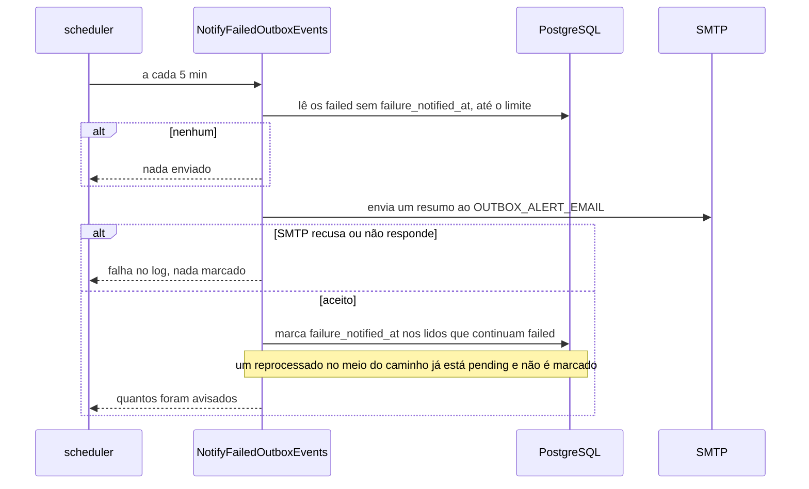

# Limpeza e aviso de falhas de `users_outbox` na stack Laravel

> Plan from this document. Each slice below carries its own shape - copy it, do not re-derive it.
> Status: confirmed by diashelter, 2026-11-12

## Situation

- Project: in active construction. Laravel e NestJS implementam o outbox e passam pela mesma suíte de contrato; Go ainda está em design.
- Decision: committed by diashelter, nesta sessão, em 2026-11-12, como a rodada que fecha o outbox. Fica só na stack Laravel, por escolha dele.
- In flight: copia de .design/laravel-outbox.md o agendamento no container `scheduler` e o módulo único `users` da decisão 26. Nenhuma branch aberta toca nesta área, e NestJS e Go ficam de fora.
- At stake: barato de reverter, exceto pela coluna nova em `users_outbox`, que é do schema comum às três stacks e passa a ser contrato do SQL de reprocessamento.

## Problem

Construção, com duas ausências que o design do outbox deixou de propósito para depois. A primeira: um evento em `failed` só é percebido por quem consulta o banco à mão, então um e-mail de boas-vindas que nunca saiu fica invisível até alguém procurar. O substituto hoje é o SQL de docs/database.md, rodado por quem já desconfia do problema. A segunda: `users_outbox` cresce para sempre com eventos `processed`, e cada um guarda nome e e-mail no `payload`, o que docs/database.md já aponta como pendência de retenção.

Nada foi medido em volume, porque não há produto: a prova é de comportamento, caso a caso.

## Success

- Worked if: um evento que chega a `failed` aparece num resumo no Mailpit em até 5 min depois de o SMTP responder, uma vez só; um evento reprocessado que falha de novo gera um aviso novo; eventos `processed` com mais de 7 dias somem, e nenhuma outra linha some. Os casos novos de `tests/infra/laravel-outbox.sh` passam e o CI da `main` fica verde.
- Going wrong: o resumo repete os mesmos eventos a cada rodada, um evento `failed` nunca aparece porque o aviso falhou na hora errada, ou a limpeza apaga algo que não seja `processed`.
- Review: no início da rodada de Go, por diashelter: Go e NestJS devem ganhar o mesmo comportamento, e com isso os casos passam para a suíte de contrato?

## Boundary

In: o comando de limpeza e seu agendamento diário; o resumo de falhas ao operador e seu agendamento a cada 5 min; a coluna que registra o aviso; a mudança no SQL de reprocessamento; os documentos e a decisão nova.

Out:
- NestJS e Go: escolha desta rodada. Com a NestJS ativa, eventos `failed` ficam sem aviso e saem no primeiro resumo depois que a Laravel voltar, porque o banco é o mesmo. A suíte de contrato não muda.
- Limpeza de eventos `failed`: ficam até a ação manual, que é o que o aviso pede.
- Reprocessamento automático de `failed`: continua sendo a ação manual de docs/database.md.
- Avisar a pessoa cadastrada: o canal seria o mesmo e-mail que acabou de falhar, e ela não tem o que fazer com a informação.
- Outros canais de aviso, como Slack ou webhook: o Mailpit é a única caixa da POC.
- Exclusão de usuários: só eventos saem do banco.

Unchanged: `users`; os valores de status e o ciclo de status; o relay, o job e o `Message-ID`; `POST /users` e `GET /health`; as variáveis já existentes de `.env.example`.

## Shape

Dois comandos agendados no `scheduler`: um apaga os eventos `processed` mais velhos que o prazo de retenção, e o outro manda ao operador um e-mail com os eventos `failed` ainda não avisados e só então os marca como avisados. A porta é a coluna `failure_notified_at` em `users_outbox`, do schema comum: as três stacks a recebem, e o SQL manual de reprocessamento passa a limpá-la. Sem índice novo, a limpeza percorre a tabela inteira, o que serve à POC e não sobrevive a milhões de linhas; aí entra um índice parcial em `processed_at`.

A alternativa mais pesada, o aviso como um evento novo em `users_outbox` gravado junto com a transição para `failed`, só vence se o aviso precisar de outro consumidor além de um e-mail, e ainda exigiria uma regra para a falha do aviso não gerar outro aviso.

## Key decisions

1. **A limpeza só apaga eventos `processed` cujo `processed_at` passou do prazo, e nunca toca em `pending`, `published`, `failed` nem em `users`.** O prazo é contado da conclusão, não da criação, e vem de `OUTBOX_RETENTION_DAYS`, padrão 7. Uma mensagem repetida que chegue depois da limpeza encontra o evento inexistente e já é ignorada pelo job.
2. **Todo evento `failed` aparece em pelo menos um resumo aceito pelo SMTP; um resumo repetido é tolerado, um aviso perdido não.** O evento só é marcado depois de o envio ser aceito, e uma falha de envio não marca nada e fica para a rodada seguinte. É a mesma entrega *at-least-once* do resto do outbox.
3. **O aviso não passa por `users_outbox` nem pela fila: o comando envia direto pelo SMTP, e a coluna é a retentativa.** A causa mais comum de `failed` é o SMTP fora do ar, que derrubaria igual um aviso feito como evento, e um resumo por rodada evita dezenas de e-mails numa queda longa.
4. **`failure_notified_at` é a única marca do aviso, e um evento que saiu de `failed` nunca é marcado.** O reprocessamento manual de docs/database.md passa a zerá-la junto com `attempts`, para uma nova falha gerar um novo aviso; isso vale para as três stacks, porque o SQL é comum. Um reprocessamento que caia entre o envio do resumo e a marca não deixa o evento marcado.
5. **O operador é um endereço só, `OUTBOX_ALERT_EMAIL`, padrão `ops@cadastro-feliz.local`.** Não existe usuário administrador no sistema, e o aviso é para quem pode rodar o reprocessamento.

## Work

| Slice | Delivers | Status |
|---|---|---|
| [`outbox:purge`](#outboxpurge) | Eventos `processed` com mais de 7 dias apagados todo dia, e sob demanda | open — 1 default taken |
| [`outbox:notify-failed`](#outboxnotify-failed) | Resumo das falhas ao operador a cada 5 min, com a coluna do aviso | open — 2 defaults taken |

Order: `outbox:purge` → `outbox:notify-failed`. São independentes; a limpeza vem antes por não mexer no schema.

Already handled by existing code: mensagem repetida de um evento já apagado → o job registra no log e ignora; evento `failed` fora do relay → a busca do relay já não o seleciona.

Derivable from the repository, left to the plan: casos de uso em `src/UseCases` com o comando só chamando e registrando falha no log e no stderr do PID 1, como `RelayOutboxCommand` e `outbox:relay`; variáveis novas em `config/outbox.php`, `.env.example` e docs/infrastructure.md como as demais; testes Pest sem banco e casos em `tests/infra/laravel-outbox.sh` contra PostgreSQL e Mailpit reais, com prazos curtos pelo ambiente; README, docs/database.md, docs/architecture.md e docs/stacks.md deixam de dizer que não há limpeza nem aviso, e docs/decisions.md ganha a decisão 27 com estas escolhas.

### `outbox:purge`

**Delivers** `PurgeProcessedOutboxEvents` e o comando `outbox:purge`, agendado uma vez por dia. **Status: open.** É a Key decision 1.

| State | What should happen | Command prints |
|---|---|---|
| `processed` com `processed_at` há mais de 7 dias | Apagado | Quantos eventos saíram |
| `processed` há menos de 7 dias | Fica | |
| `pending`, `published` ou `failed`, de qualquer idade | Fica | |
| Nada a apagar | Nada muda | `0`, com sucesso |
| Banco fora do ar | Nada muda; falha no log, e a próxima execução tenta | Código de saída de falha |
| Stack fora do ar na hora agendada | Nada roda; a execução seguinte apaga o acumulado | |
| Rodado à mão com `php artisan outbox:purge` | Mesmo efeito do agendado | Quantos eventos saíram |

Open, default taken:
1. Em que horário? Default: uma vez por dia, às 03:00. Num ambiente de desenvolvimento que raramente fica no ar de madrugada, a limpeza quase nunca rodaria sozinha; se isso incomodar, a troca é rodar a cada hora, sem mudar o prazo.

### `outbox:notify-failed`

**Delivers** `NotifyFailedOutboxEvents`, o comando `outbox:notify-failed` agendado a cada 5 min, e o e-mail `FailedEventsDigestMail`. **Status: open.** Guarda as Key decisions 2, 3, 4 e 5.

| State | What should happen | Operador vê |
|---|---|---|
| Nenhum `failed` sem aviso | Nada é enviado | Nada |
| `failed` sem aviso | Um e-mail com cada evento e só depois a marca neles | Um resumo com id do evento, e-mail da pessoa, `attempts` e `last_error`, e o caminho do reprocessamento |
| Já avisado | Não entra em resumo nenhum | Nada |
| SMTP ainda fora do ar | Nada é marcado; falha no log | Nada; o resumo sai na primeira rodada com o SMTP de volta |
| Mais eventos que o limite de um resumo | O restante sai nas rodadas seguintes | Um resumo por rodada |
| Reprocessado e falha de novo | A marca foi zerada no reprocessamento, então entra num novo resumo | Um novo resumo com o evento |
| Reprocessado entre o envio do resumo e a marca | Não é marcado | O evento já estava no resumo enviado |
| `failed` gravado pela NestJS | Entra no primeiro resumo depois que a Laravel subir | Resumo atrasado |
| Primeira execução com eventos `failed` antigos | Todos entram nos primeiros resumos | Um aviso para o acumulado |

Table `users_outbox` ganha uma coluna, pela migration `0002`; nenhuma outra tabela muda.

| Column | Type | Null | References | Note |
|---|---|---|---|---|
| `failure_notified_at` | timestamptz | yes | | Escrita só por este comando e zerada pelo SQL de reprocessamento; `NULL` em todo evento que nunca entrou num resumo aceito |

A NestJS não mapeia a coluna, e a decisão 24 não muda: a entidade só lê e grava as colunas que declara.

Alternatives considered: uma tabela própria de avisos em vez da coluna - deixa `users_outbox` intocada e vence se NestJS e Go nunca puderem ver a marca, mas é uma tabela a mais para um campo; um e-mail por evento na transição para `failed` - avisa na hora, mas se perde quando o SMTP é a causa da falha.

Open, default taken:
1. Qual é o limite de um resumo? Default: `OUTBOX_BATCH_SIZE`, os mesmos 100 do relay.
2. O que o resumo diz de ação? Default: o id de cada evento e o SQL de reprocessamento de docs/database.md citado pelo nome da seção, sem link para tela, porque não há tela.

## Sources

- docs/database.md: schema, ciclo de status, SQL de reprocessamento e a pendência de retenção dos eventos `processed`.
- docs/architecture.md: retentativas, garantias *at-least-once* e cenários de falha.
- docs/decisions.md: decisões 2, 9, 23, 24 e 26.
- .design/laravel-outbox.md: o relay no `scheduler` e o que aquela rodada deixou de fora.
