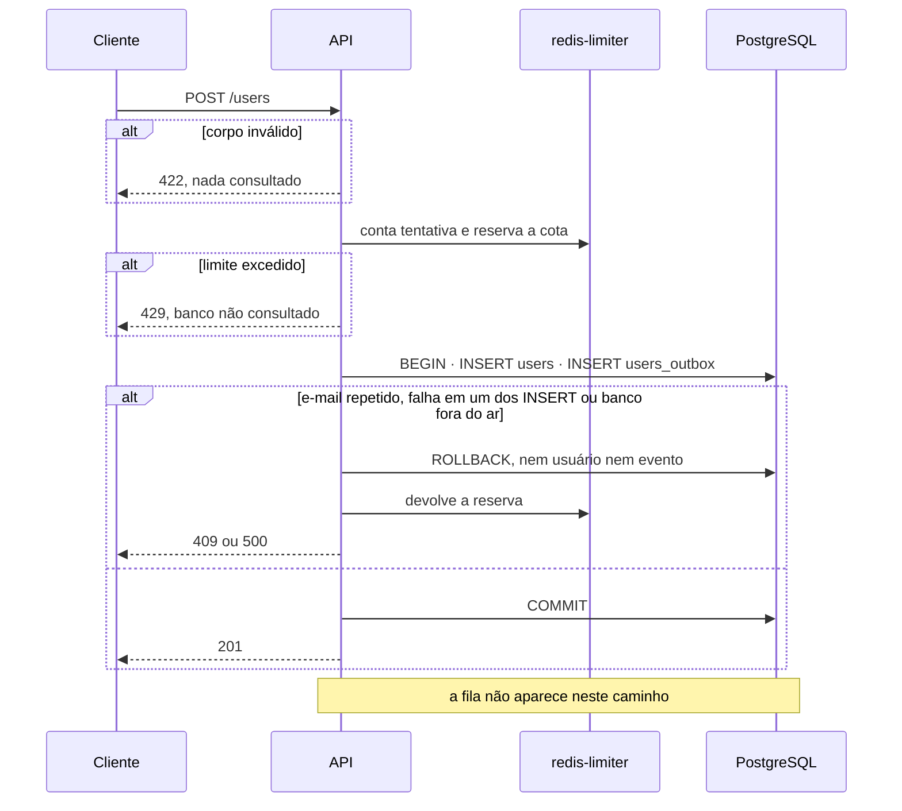
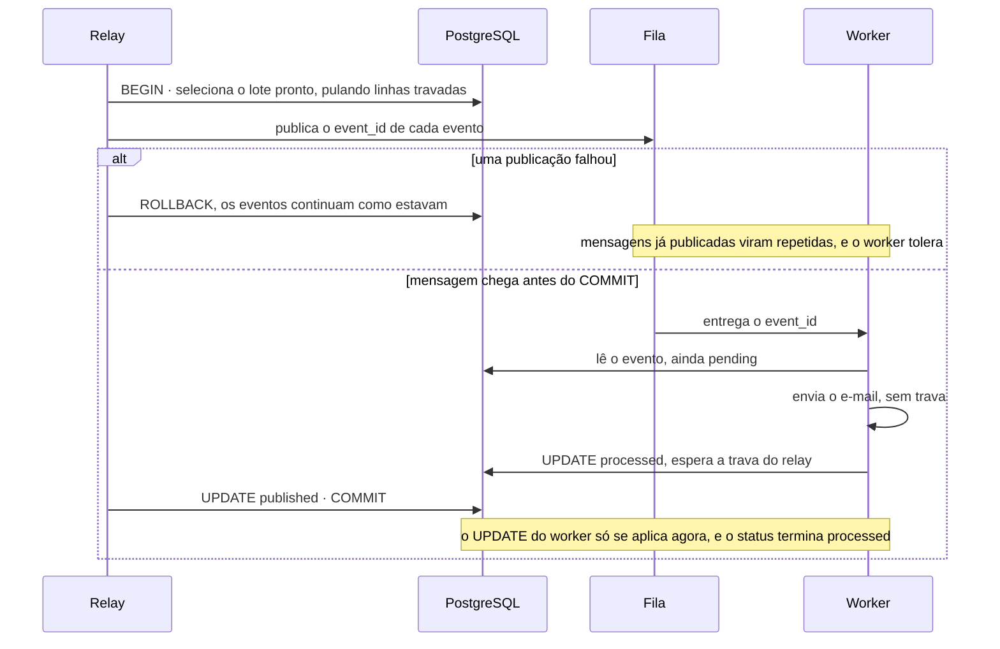
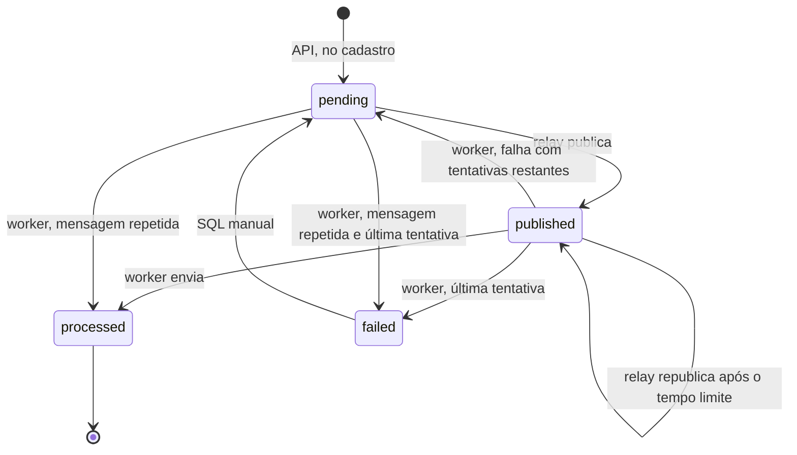

# Transactional Outbox de `users` na stack Laravel

> Plan from this document. Each slice below carries its own shape - copy it, do not re-derive it.
> Status: confirmed by diashelter, 2026-11-05

## Situation

- Project: in active construction. A stack Laravel conclui o cadastro e envia o e-mail sem outbox; NestJS e Go ainda não existem.
- Decision: committed by diashelter, nas decisões 1 e 21 de docs/decisions.md, e reafirmada nesta sessão, em 2026-11-05.
- In flight: copia de .design/laravel-registration-email.md os módulos, o código por cópia e os testes em `tests/infra`. NestJS e Go têm rodadas próprias, e nada aberto toca nesta área.
- At stake: reverte-se em poucos dias, porque nenhuma outra peça depende desta. O que pesa é o que NestJS e Go vão herdar como contrato: o `payload`, o ciclo de status e o `Message-ID`.

## Problem

Construção. O projeto existe para estudar o outbox, e nenhuma stack o implementa. O `201` promete um evento gravado, mas a stack Laravel provou que hoje o e-mail se perde em três casos reproduzidos e num quarto só registrado. Os cenários 4, 5, 6 e 8 de docs/architecture.md nunca rodaram.

NestJS e Go partiriam de um contrato nunca exercitado, e os testes de limitação continuam afirmando uma perda que já cumpriu seu papel. Vem agora porque a decisão 21 pôs esta rodada logo depois da observação, e essa observação terminou. Nada foi medido em volume, porque não há produto: a prova é de comportamento, caso a caso.

## Success

- Worked if: os três casos de `tests/infra` invertem como em [Antes e depois](#antes-e-depois); os cenários 4, 5, 6 e 8 passam na stack Laravel; os cenários 1, 2, 3, 7, 10, 11 e 12 continuam passando; o 13 passa contando 20 linhas em `users_outbox`; e o CI da `main` fica verde.
- Going wrong: a troca exige mexer em validação, limites ou corpo da resposta; o tempo de `POST /users` passa a variar com a fila; ou um cenário só se reproduz alterando o código da aplicação.
- Review: no início da rodada de NestJS ou Go, por diashelter: o contrato do relay e do worker é implementável sem exceções feitas para o Laravel?

## Boundary

In: o evento na transação de `POST /users`; o `scheduler` e o relay; o job sobre o evento, com retentativas no banco e `Message-ID` estável; a inversão dos testes de limitação; a seção de antes e depois; o encerramento da decisão 21 e a volta da decisão 9.

Out:
- NestJS e Go: rodadas próprias. O cenário 9 e a troca real de stack do cenário 6 esperam por elas; aqui o cenário 6 é provado derrubando e subindo a stack Laravel.
- Backfill: quem se cadastrou na fase sem outbox não ganha evento, porque isso reenviaria o e-mail, e o banco é só de desenvolvimento.
- Reprocessamento automático, ou por tela, de eventos em `failed`: continua sendo a ação manual de docs/database.md.
- Retenção e limpeza de eventos `processed`: docs/database.md já as deixa para uma evolução a produção.
- Fila e backlog no `GET /health`: a decisão 19 mantém o `/health` só com as dependências da API.

Unchanged: `users`, `users_outbox` e `database/migrations`, porque o schema já tem as colunas e os índices; o contrato de `POST /users` e de `GET /health`; os limites e seus scripts; o frontend; as variáveis de `.env.example`; o `redis` da stack, sem persistência.

## Shape

O registro é a linha de `users_outbox`, gravada na mesma transação de `users`, e `POST /users` deixa de falar com a fila. Um comando agendado a cada segundo publica os eventos prontos, e o Horizon envia cada e-mail e registra o resultado no próprio evento. A porta é o par `payload` e ciclo de status, que as três stacks vão ler no mesmo banco: mudá-lo depois obriga a tratar eventos antigos em todas elas.

A alternativa mais pesada, ler o log do PostgreSQL em vez da tabela, só vence se a busca a cada segundo pesar no banco, e aqui há um evento por cadastro numa POC.

## Key decisions

1. **`users` e `users_outbox` são gravados juntos ou nenhum dos dois, e o caminho de `POST /users` não toca na fila.** A fila fora do ar não muda nem o status nem o tempo da resposta. Não copiar `WelcomeEmailPublisher`, que engole o erro e responde `201`: agora a falha ao gravar o evento desfaz o usuário, devolve a reserva da cota e responde `500`. Essa classe deixa de existir.
2. **O relay só confirma `published` depois de publicar o lote, e qualquer falha de publicação desfaz o lote inteiro.** Um evento nunca fica `published` sem ter ido à fila. O preço é aceitar mensagens repetidas, que o worker ignora quando o evento já é terminal. Aqui o erro precisa aparecer, ao contrário da publicação de hoje, que o captura.
3. **Duas execuções do relay nunca publicam a mesma linha ao mesmo tempo, e quem garante isso é o banco.** O cache da stack é `array`, então o `withoutOverlapping` só protege dentro de um processo, e `schedule:run` troca de processo a cada minuto. O lock do agendador evita trabalho repetido, mas nenhuma garantia pode depender dele.
4. **O job roda uma vez por mensagem, e só a falha de envio conta como tentativa.** A decisão 9 volta a valer: a falha grava `attempts`, `last_error` e o novo estado no evento, e a mensagem é confirmada. Queda do worker, banco fora do ar ou mensagem perdida deixam o evento `published` até a republicação, sem gastar tentativa. Um SMTP travado precisa contar como falha, então a ordem dos limites é obrigatória: 5 s do SMTP, 60 s do job, 90 s do `retry_after` da fila e 300 s de `OUTBOX_REPUBLISH_AFTER_SECONDS`.
5. **`failed` é terminal e só sai por ação manual.** Com os valores padrão, um SMTP fora por mais de 7,5 min deixa o e-mail sem sair até alguém reprocessar o evento. A correção de hoje para esse caso é ter o registro da falha e um caminho de volta, não a entrega automática.
6. **A fila leva só o `event_id`, e o worker lê nome e e-mail do `payload`, não de `users`.** Mantém a decisão 10 e permite a uma stack processar eventos de outra. O formato do `payload` é o de docs/database.md, e o worker não segura lock nem transação durante o envio.
7. **O `Message-ID` é `<event_id>@cadastro-feliz.local`, com o domínio fixo nas três stacks.** Um reenvio, mesmo por outra stack, sai com o mesmo identificador. Isso torna a duplicata visível, mas não a impede, porque a entrega continua *at-least-once*.
8. **A comparação com o fluxo sem outbox é parte do entregável.** Os testes de limitação invertem em vez de sumir, e docs/architecture.md troca as limitações por um antes e depois. É o resultado do estudo, e a decisão 21 prometeu essa prova.

## Work

| Slice | Delivers | Status |
|---|---|---|
| [`POST /users`](#post-users) | Usuário e evento na mesma transação, sem a fila no caminho | open — 1 default taken |
| [`outbox:relay`](#outboxrelay) | Container `scheduler` publicando eventos prontos a cada segundo | clear |
| [`SendWelcomeEmailJob`](#sendwelcomeemailjob) | Envio a partir do evento, com retentativas no banco e `Message-ID` estável | open — 1 default taken |
| [Antes e depois](#antes-e-depois) | Testes invertidos, comparação registrada e documentos atualizados | clear |

Order: `POST /users` → `outbox:relay` → `SendWelcomeEmailJob` → Antes e depois. As quatro entram no mesmo pull request, porque o e-mail só volta a sair com as três primeiras juntas.

Already handled by existing code: corpo inválido, limites, `redis-limiter` fora do ar e e-mail repetido → a ordem de processamento de `POST /users` não muda, só o que acontece dentro da gravação; texto do e-mail → `WelcomeMail`; fila que cai e volta com o worker no ar → o Horizon já espera o Redis; cota por IP → o `201` já consome a reserva, e `409` e `500` já a devolvem.

Derivable from the repository, left to the plan: `OUTBOX_BATCH_SIZE` e `OUTBOX_REPUBLISH_AFTER_SECONDS` entregues aos containers como as demais; `scheduler` com a mesma imagem do `php-fpm`, sem build próprio, com healthcheck e Compose Watch como os outros serviços; tempos curtos da fila e `dns_opt` como no `php-fpm`, enquanto o `horizon` segue esperando o Redis; testes contra PostgreSQL, Redis e Mailpit reais em `tests/infra`, com `make test-laravel` sem dependências; testes e documentos que hoje fixam 4 containers, `users_outbox` vazia ou "sem outbox" passam a refletir o novo estado.

### `POST /users`

**Delivers** a gravação atômica. **Status: open.** É a Key decision 1; o contrato do endpoint não muda.

| State | What should happen | Caller sees |
|---|---|---|
| Corpo válido, tudo no ar | Uma linha em `users` e uma em `users_outbox`, `pending`, tipo `user.registered` | `201` |
| Fila parada, ou `scheduler` e `horizon` parados | Mesmo resultado, com o evento à espera | `201`, sem diferença de tempo |
| E-mail repetido | Nenhuma linha nova nas duas tabelas, reserva devolvida | `409` com `already_taken` |
| Falha ao gravar o evento | Usuário desfeito, reserva devolvida | `500` |
| Banco fora do ar | Nada gravado, reserva devolvida | `500`, dentro do limite de 3 s |
| API cai antes do `COMMIT` | Nada gravado | Erro; pode tentar de novo |
| API cai depois do `COMMIT` | Usuário e evento existem, e o e-mail sai | Sem resposta; repetir dá `409` |
| 50 cadastros paralelos do mesmo IP com a cota vazia | Exatamente 20 linhas em cada tabela | 20 `201` e 30 `429` |

O `php-fpm` continua alcançando o `redis` só pelo painel `/horizon`; a promessa de não tocar na fila vale para `POST /users`.

Open, default taken:
1. Onde ficam as classes? Default: o módulo `outbox`, já previsto em docs/stacks.md, guarda `UserOutboxEvent`, o relay, o job e `WelcomeMail`, e `users` só depende dele para gravar o evento. Deixar o job e o e-mail em `users`, como aquele documento desenha hoje, criaria uma dependência circular entre os módulos.

Alternatives considered: tudo no módulo `users` - vence se nunca houver um segundo evento, e dispensa o novo módulo, mas foge da divisão prevista em docs/stacks.md.

### `outbox:relay`

**Delivers** o comando `outbox:relay`, de `RelayOutboxCommand`, e o container `scheduler`. **Status: clear.** Guarda as Key decisions 2 e 3.

| State | What should happen |
|---|---|
| `make up-laravel` | `nginx`, `php-fpm`, `scheduler`, `horizon` e `redis` saudáveis |
| `pending` com `available_at` vencido | Publicado e marcado `published` no ciclo seguinte |
| `pending` com `available_at` no futuro | Ignorado até vencer |
| `published` há mais que `OUTBOX_REPUBLISH_AFTER_SECONDS` | Republicado, com `published_at` renovado e `attempts` igual |
| `processed` ou `failed` | Nunca selecionado |
| Mais eventos prontos que `OUTBOX_BATCH_SIZE` | O restante sai nas execuções seguintes |
| Fila parada ou travada | Desiste em 1 s, desfaz o lote, registra no log e tenta na execução seguinte, com o container saudável |
| Fila volta | Os eventos saem sem reinício manual |
| `scheduler` parado | Eventos ficam em `pending` e saem quando ele volta |
| Stack derrubada com eventos abertos | As linhas continuam no banco; `pending` sai logo na volta, e `published` depois do tempo limite |
| Edição do relay com `make watch-laravel` | A execução seguinte já usa o código novo |

Alternatives considered: um processo contínuo no lugar do agendador - evita iniciar o PHP a cada segundo e vence se esse custo for medido como problema; publicar depois de confirmar a transação - segura a trava por menos tempo, mas abre uma janela de evento `published` sem mensagem, que só a republicação recupera.

### `SendWelcomeEmailJob`

**Delivers** o worker sobre o evento. **Status: open.** Guarda as Key decisions 4, 5, 6 e 7.

Mensagem na fila: `{ "event_id": "<uuid>" }`, na conexão `redis`, fila `registration-emails`.

| State | What should happen |
|---|---|
| Mensagem de evento `pending` ou `published` | Envia pelo `payload` e marca `processed`, com `processed_at` e sem `last_error` |
| Evento `processed` ou `failed` | Ignora a mensagem, sem enviar |
| Evento inexistente | Ignora a mensagem e registra no log, sem falhar o job |
| Envio falha antes do limite | `attempts` + 1, `last_error`, volta a `pending`, com espera de 30, 60, 120 ou 240 s |
| Envio falha na última tentativa | `failed`, com `attempts` e `last_error`; nada mais o seleciona |
| SMTP travado | Vale como falha de envio |
| Banco fora do ar ao ler o evento | Job falha no Horizon, evento continua `published` e `attempts` não muda |
| Banco fora do ar depois do envio | Mesmo resultado; a republicação pode gerar duplicata, com o mesmo `Message-ID` |
| Evento `failed` reprocessado por SQL | Volta a `pending`, com `attempts` zerado, e o e-mail sai |
| Edição do job com `make watch-laravel` | O worker reinicia e usa o código novo |

Uma mensagem repetida para um evento em espera pode adiantar o reenvio, porque o worker aceita `pending`. É o comportamento já descrito em docs/architecture.md, e o caso de uso não precisa de mais.

Open, default taken:
1. Qual é o nome do job? Default: mantém `SendWelcomeEmailJob`, como o código e `WelcomeMail`, e docs/stacks.md deixa de citar `SendRegistrationEmailJob`.

### Antes e depois

**Delivers** a prova e o registro da correção. **Status: clear.** É a Key decision 8.

| Caso | Sem outbox | Com outbox | Prova |
|---|---|---|---|
| Fila parada no cadastro | `201`, e o e-mail nunca sai | `201`, evento `pending`, e o e-mail sai quando a fila volta; repetir dá `409`, sem segundo e-mail | LM1 invertido, cenário 8 |
| `horizon` parado e stack derrubada | Job descartado, e o e-mail nunca sai | Evento `published` sobrevive, e o e-mail sai depois da republicação, com o tempo limite reduzido no teste | LM2 invertido, cenário 6 |
| SMTP fora até esgotar as tentativas | Falha só no Horizon, e nada no banco | `failed`, com `attempts` e `last_error`; nada sai sozinho, e o reprocessamento manual entrega o e-mail | LM3 invertido |
| SMTP volta antes de esgotar | E-mail sai pelas retentativas do Horizon | `attempts` sobe no banco, e o e-mail sai | Cenário 5 |
| API cai entre as duas escritas | Usuário gravado e e-mail perdido, sem nem o log | A janela não existe: as escritas são uma só | Cenário 4 |

O cenário 4 força a falha no `INSERT` do outbox pelo próprio banco, dentro do teste, sem alterar o código da aplicação: a resposta é `500`, `users` continua sem a linha e a reserva volta.

Nos documentos, a seção `Limitações do fluxo sem outbox` de docs/architecture.md vira essa comparação. A decisão 21 fica registrada como encerrada, e a nota de suspensão sai da decisão 9. README, docs/stacks.md, docs/database.md, docs/api-contract.md e docs/infrastructure.md deixam de dizer que a stack está sem outbox, e o aviso de que `201` não garante o e-mail dá lugar aos limites que continuam valendo: duplicata possível e `failed` manual.

## Sources

- docs/decisions.md: decisões 1, 2, 9, 10, 19 e 21.
- docs/architecture.md: relay, worker, retentativas, cenários de falha e de validação.
- docs/database.md: schema, `payload`, ciclo de status e consultas.
- docs/stacks.md: containers da stack Laravel e divisão planejada em módulos.
- .design/laravel-registration-email.md: o fluxo sem outbox e a condição que encerra esta fase.
- [Laravel 13, Task Scheduling](https://github.com/laravel/docs/blob/13.x/scheduling.md): `schedule:run` dura até o fim do minuto com tarefas por segundo, e `withoutOverlapping` usa o cache da aplicação.
- [Laravel 13, Mail](https://github.com/laravel/docs/blob/13.x/mail.md): `Message-Id` próprio em um Mailable.
