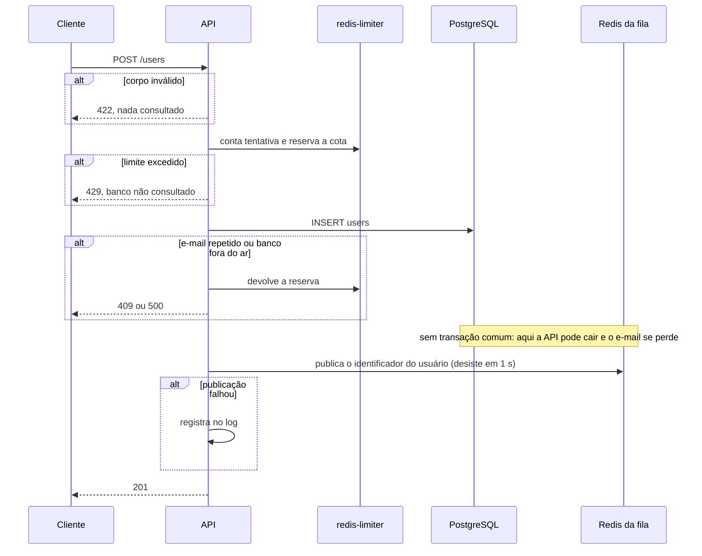

# Cadastro e e-mail de boas-vindas na stack Laravel, sem outbox

> Plan from this document. Each slice below carries its own shape - copy it, do not re-derive it.
> Status: confirmed by diashelter, 2026-11-05

## Situation

- Project: in active construction. Os serviços comuns, o schema, o formulário e a base Laravel existem; nenhuma stack conclui um cadastro, e o CI da `main` está vermelho.
- Decision: committed by diashelter, 2026-11-05, nesta sessão: entregar primeiro o fluxo direto, sem Transactional Outbox, identificar a limitação e só depois corrigi-la com o outbox.
- In flight: copia de .design/laravel-api-base.md o código por cópia, as dependências por `make laravel-composer` e os testes em container descartável; copia de .design/registration-ip-limit.md os scripts da cota. O outbox, o relay e NestJS e Go têm rodadas próprias.
- At stake: reverte-se em poucos dias, porque nenhuma outra peça depende desta. O que pesa é o contrato de `POST /users`, que o formulário já consome, e a mudança de estrutura para módulos, que toda rodada seguinte da stack vai herdar.

## Problem

Construção. O projeto existe para estudar o outbox, mas o problema que ele resolve só está descrito em texto: nunca foi observado. O formulário está pronto e não tem endpoint para chamar, e a rodada do outbox não teria um "antes" para comparar. Sem o fluxo direto, ela provaria que os e-mails saem, não que algo melhorou.

Vem antes do outbox por escolha de sequência do responsável do projeto, para que a perda de e-mail seja vista antes de ser corrigida. Nada foi medido, porque ainda não existe produto.

## Success

- Worked if: enviar o formulário em `localhost:3000` responde `201` e o e-mail de boas-vindas aparece no Mailpit em poucos segundos; os cenários 1, 2, 3, 7, 10, 11, 12 e 13 de docs/architecture.md se confirmam, com o 13 contando linhas em `users`; os cenários de [Limitações](#limitações) provam a perda; e o CI da `main` fica verde.
- Going wrong: trocar a publicação direta pelo outbox exigiria mexer em validação, limites ou resposta; ou reproduzir uma limitação exigiria alterar o código da aplicação.
- Review: no início da rodada do outbox na stack Laravel, pelo responsável do projeto.

## Boundary

In: o CI verde; Pest; `internachi/modular`, com `health` migrado; `POST /users` com validação, limites, forma única de erro e CORS; os containers `horizon` e `redis`; o job e o e-mail de boas-vindas; os testes e o registro das limitações; uma decisão nova em docs/decisions.md e a atualização de status e estrutura nos documentos.

Out:
- Transactional Outbox, relay e `scheduler`: são a próxima rodada, e existem para corrigir o que esta expõe.
- NestJS e Go: rodadas próprias. O cenário 9 de docs/architecture.md, entre stacks, espera por elas.
- Cenários 4, 5, 6 e 8 de docs/architecture.md: descrevem o outbox; seguem como critério da rodada dele.
- `Message-ID` estável: é derivado do `event_id`, que não existe sem o outbox.
- Forma do corpo de 404 e 405: continua nas limitações conhecidas do contrato.

Unchanged: o schema e `database/migrations`, inclusive `users_outbox`, que continua existindo e sem linhas; a forma única de erro, os status, as chaves e os scripts dos limites; o `redis-limiter`; o frontend; a porta 8080; o contrato de `GET /health`; os nomes das variáveis em `.env.example`.

## Shape

O registro é `users`, e `POST /users` o grava e depois publica um job no Redis do Horizon, como duas escritas independentes. O worker do Horizon lê o usuário e envia o e-mail pelo Mailpit. A porta é a publicação direta: ela é a limitação em estudo, deve ficar concentrada em um único ponto, e a rodada do outbox a substitui sem tocar no resto do endpoint.

A alternativa mais pesada é aplicar o outbox agora, que só vence se a comparação com o fluxo direto deixar de importar, e ela é o objetivo declarado desta sequência.

## Key decisions

1. **Gravar o usuário e publicar o job são duas escritas sem transação comum, nessa ordem, e uma publicação que falha não muda a resposta: o usuário fica gravado, a API responde `201` e o erro vai para o log.** A perda é silenciosa para o cliente de propósito, e é ela que o outbox vai corrigir. `users_outbox` não recebe nenhuma linha. O contrato continua descrevendo o alvo, e a decisão nova em docs/decisions.md registra este estado da stack Laravel e a condição que o encerra: a rodada do outbox.
2. **A publicação nunca segura a resposta: desiste em 1 s, sem retentar, enquanto o worker espera o Redis voltar.** As duas pontas têm necessidades opostas, e a mesma configuração para ambas faria o `201` travar ou o worker morrer. Vale a mesma regra de falha rápida do `redis-limiter`.
3. **A fila transporta só o identificador do usuário; nome e e-mail são lidos do PostgreSQL pelo worker.** Mantém a decisão 10: dados pessoais não passam pelo Redis e o banco segue como fonte da verdade.
4. **O envio tem 5 tentativas nativas do Horizon, com esperas de 30, 60, 120 e 240 s, calculadas de `OUTBOX_MAX_ATTEMPTS` e `OUTBOX_BACKOFF_BASE_SECONDS`.** A decisão 9 fica suspensa até o outbox: muda onde a retentativa mora, não a regra, e a comparação entre as rodadas fica justa. Esgotadas as tentativas, a falha só existe no Horizon, sem nenhum registro no PostgreSQL.
5. **O `201` consome a reserva da cota por IP mesmo quando a publicação falhou.** O cadastro foi concluído do ponto de vista do contrato; só `409` e `500` devolvem a reserva. Do mesmo modo, a fila não é uma dependência que gera `500`: a indisponibilidade que gera `500` é a do banco ou do `redis-limiter`.
6. **A fila usa um `redis` próprio da stack, com `noeviction` e sem persistência, separado do `redis-limiter`.** Mantém a decisão 5. Derrubar a stack descarta a fila, e os jobs pendentes e os registros de falha do Horizon vão junto; isso é uma das limitações em estudo, e não deve ser mascarado com persistência.
7. **Os testes de limitação afirmam o comportamento de hoje, inclusive a perda, e passam enquanto ela existir.** A rodada do outbox os inverte, e essa inversão é a prova da correção. Um teste que falha porque o e-mail se perdeu não serve: deixaria o CI vermelho por um comportamento escolhido.
8. **Cada módulo é um pacote `modules/<nome>` em `app-modules`, com o namespace padrão `Modules\`, e nenhum módulo tem migrations.** O schema continua só em `database/migrations` e `artisan migrate` continua sem rodar (decisões 2 e 15), embora a biblioteca ofereça isso. O namespace de organização que ela recomenda serve para extrair módulos para pacotes, o que esta POC não fará.

## Work

| Slice | Delivers | Status |
|---|---|---|
| [`GET /health`](#get-health) | CI da `main` verde, com `/health` cumprindo o limite de tempo com o banco parado | spike |
| [Pest](#pest) | Testes da stack em Pest, sobre PHPUnit 13, ainda sem dependências | open — 1 default taken |
| [`app-modules`](#app-modules) | Módulo `health` migrado, com build, edição e testes funcionando em módulos | clear |
| [`POST /users`](#post-users) | O endpoint do contrato com limites, CORS e publicação direta | clear |
| [`horizon`](#horizon) | Containers `horizon` e `redis`, com o painel e as retentativas | clear |
| [`WelcomeMail`](#welcomemail) | O e-mail de boas-vindas em HTML e texto | open — 1 default taken |
| [Limitações](#limitações) | Cenários automatizados e registro da perda observada | clear |

Order: `GET /health` → Pest → `app-modules` → `POST /users` → `horizon` → `WelcomeMail` → Limitações.

Already handled by existing code: nenhuma stack no ar → o formulário mostra a falha de rede; respostas `409`, `422`, `429` e `500` → o formulário já as traduz; jobs falhos não tocam o banco → o driver de falhas já é `null`.

Derivable from the repository, left to the plan: versões exatas das imagens e pacotes; intervalos de healthcheck; comentários em português; testes com `check "<id> <nome>"` em `tests/infra`; organização interna de cada módulo, como docs/stacks.md descreve; os testes da base que fixam 2 containers, a lista de rotas e os caminhos antigos passam a refletir a nova estrutura.

### `GET /health`

**Delivers** o CI da `main` verde antes de qualquer mudança. **Status: spike.**

| State | What should happen | Caller sees |
|---|---|---|
| `postgres` parado | `/health` responde dentro do limite do contrato | `503` com `database` em `fail`, em menos de 3 s |
| `postgres` e `redis-limiter` parados | Idem | `503` com os dois em `fail`, em menos de 3 s |
| Variáveis em docs/infrastructure.md e `.env.example` | A contagem do teste bate com as 26 linhas que ele lê | C9 passa |

- Spike: por que `/health` passa de 10 s com o `postgres` parado no CI, se o caso pausado e o do `redis-limiter` parado passam? A hipótese é a resolução do nome de um container parado, não coberta pelo limite de 1 s da conexão. Se confirmada, o limite precisa cobrir a resolução, e `POST /users` herda a correção; se for próprio do runner, o teste é que muda. Para ao reproduzir o caso com o tempo medido por dependência.

### Pest

**Delivers** Pest como formato dos testes da stack. **Status: open.**

| State | What should happen | Caller sees |
|---|---|---|
| `make test-laravel` com testes passando | Pest roda, inclusive os testes de módulos, sem banco nem Redis | Saída `0` |
| Teste falhando | O alvo acusa | Saída diferente de `0` |
| `HealthTest` | Convertido, sem cobertura a menos | Mesmos 4 casos |

Open, default taken:
1. Onde ficam os testes que precisam de banco real? Default: `make test-laravel` continua sem dependências, com filas, e-mail e limites simulados; o comportamento contra PostgreSQL e Redis reais, como o `409` pela constraint, fica em `tests/infra`, porque `artisan migrate` não roda.

Alternatives considered: banco real em `make test-laravel` - vence se os cenários de `tests/infra` ficarem lentos demais para o dia a dia.

### `app-modules`

**Delivers** a nova estrutura, provada com `health` antes de existir código novo. **Status: clear.** Guarda a Key decision 8.

| State | What should happen | Caller sees |
|---|---|---|
| Clone limpo, `make up-laravel` | A imagem resolve os módulos e a stack sobe sem nada de PHP na máquina | `/health` `200`, como antes |
| Edição em um módulo com `make watch-laravel` | Vale na próxima requisição, sem reiniciar o `php-fpm` | Código novo responde |
| `make laravel-composer` em uma stack com módulos | Só `composer.json` e `composer.lock` voltam, e `vendor` não aparece na máquina | Como antes |
| Rotas de um módulo | Registradas sem prefixo e sem os middlewares de sessão | `/health` na raiz |

Fatos que o plano precisa cobrir: `modular` 3.0.2 aceita Laravel 13, resolve os módulos como repositório Composer local, com symlink no `vendor`, e por isso a etapa de instalação da imagem precisa enxergar `app-modules`; o Compose Watch precisa observar esse diretório; o comando `make:module` é interativo, e o fluxo sem PHP na máquina não oferece hoje um comando artisan.

Alternatives considered: módulo único `app` com tudo - vence se o projeto parar em uma só área, o que os módulos `health`, `users` e o futuro `outbox` já contradizem.

### `POST /users`

**Delivers** o endpoint do contrato no módulo `users`. **Status: clear.** A porta do design: Key decisions 1, 2 e 5.

`POST /users` `{ name, email }` → `201` `{ data: { id, name, email, created_at }, message }`

| State | What should happen | Caller sees |
|---|---|---|
| Corpo válido, tudo no ar | Usuário gravado, job publicado | `201` |
| Corpo válido, Redis da fila fora do ar | Usuário gravado, erro no log, nenhum job | `201`, em menos de 3 s |
| Corpo inválido ou JSON malformado | Nada gravado, tentativa não conta | `422` com os códigos do contrato |
| E-mail já cadastrado | Nada gravado, reserva devolvida | `409` com `already_taken` |
| Mais de 5 tentativas do par IP + e-mail | Banco não consultado | `429` com `Retry-After` |
| Cota do IP esgotada | Banco não consultado | `429` com `Retry-After`, mesmo corpo |
| `redis-limiter` fora do ar | Nada gravado | `500` |
| Banco fora do ar | Reserva devolvida | `500`, dentro do limite de 3 s |
| Navegador em `CORS_ALLOWED_ORIGIN` | `POST` e `OPTIONS` aceitos, `Retry-After` exposto | O formulário lê o resultado real |
| 50 cadastros paralelos do mesmo IP com cota vazia | Exatamente 20 linhas em `users` | 20 `201` e 30 `429` |

Alternatives considered: publicar dentro da transação - vence para estudar o caso inverso, e-mail para um cadastro que não existe, mas é bem mais difícil de reproduzir e fica para quando a comparação pedir.

### `horizon`

**Delivers** o worker e a fila da stack. **Status: clear.** Guarda as Key decisions 2, 4 e 6.

| State | What should happen | Caller sees |
|---|---|---|
| `make up-laravel` | `nginx`, `php-fpm`, `horizon` e `redis` saudáveis; a imagem tem `pcntl` e o Horizon consome `registration-emails` | Saída `0` |
| Redis da fila cai e volta com o worker no ar | O worker volta a consumir sem reinício manual | Próximo cadastro recebe e-mail |
| SMTP cai e volta antes de esgotar as tentativas | O e-mail sai numa retentativa | E-mail no Mailpit |
| Edição no código do job com `make watch-laravel` | O worker reinicia e usa o código novo | Próximo envio já com o texto novo |
| `make down-laravel` | Containers da stack removidos, fila descartada, serviços comuns no ar | Como docs/infrastructure.md descreve |
| `localhost:8080/horizon` em ambiente local | O painel abre e funciona pelo `nginx`, que hoje encaminha tudo ao Laravel | Painel com jobs e falhas |

### `WelcomeMail`

**Delivers** o e-mail de boas-vindas. **Status: open.** O texto substitui o de docs/architecture.md e vale para as três stacks.

| State | What should happen | Caller sees |
|---|---|---|
| Worker recebe o job | Lê o usuário e envia em HTML e texto simples, do `MAIL_FROM` | E-mail no Mailpit |
| Cliente sem HTML | Mostra a versão em texto, com o mesmo conteúdo | Texto legível |
| Nome com caracteres especiais de HTML | Exibido como digitado, sem interpretar | Nome íntegro |

- **Assunto:** `Boas-vindas ao Cadastro Feliz!`
- **Corpo:** `Olá, {name}!` / `Que bom ter você por aqui. Seu cadastro no Cadastro Feliz foi concluído com sucesso.` / `Não é preciso fazer mais nada.` / `Um abraço,` / `Equipe Cadastro Feliz`

Open, default taken:
1. Visual do HTML: uma coluna estreita, tipografia do sistema, sem imagens nem recursos externos. Ajuste vendo o resultado no Mailpit, porque só ver responde.

### Limitações

**Delivers** a limitação provada e registrada: cenários em `tests/infra` e uma seção em docs/architecture.md com o observado. **Status: clear.** Guarda a Key decision 7.

| Cenário | O que acontece | O que o teste afirma |
|---|---|---|
| Redis da fila parado no cadastro, depois religado | Cliente recebe `201`, e o job nunca existiu | `users` com a linha, erro no log, nenhum e-mail depois de esperar, e repetir o cadastro dá `409` |
| Horizon parado, cadastro, `make down-laravel` e `make up-laravel` | O job existia só no Redis, descartado com a stack | `users` com a linha e nenhum e-mail depois de o worker voltar |
| SMTP fora até esgotar as tentativas, com as variáveis reduzidas no teste | O job vira falha só no Horizon | `users` com a linha, nenhum e-mail depois de o SMTP voltar, e nenhum registro da falha no PostgreSQL |

Registrado só no documento: a API cair entre gravar e publicar, com a mesma consequência do primeiro cenário e sem nem o log, porque reproduzi-la exigiria alterar o código (Going wrong em Success).

Cada linha do registro em docs/architecture.md aponta o cenário de outbox que passa a cobri-la, para a próxima rodada saber o que inverter. O README e os demais documentos passam a dizer que a stack Laravel está, por ora, sem outbox, e deixam de prometer que todo `201` tem evento gravado.

## Sources

- docs/architecture.md: janela de inconsistência, cenários de validação e texto do e-mail que este design substitui.
- docs/api-contract.md: `POST /users`, limites, forma de erro, comportamento do frontend e `GET /health`.
- docs/decisions.md: decisões 1, 2, 5, 9, 10, 14, 15, 17, 19 e 20.
- docs/stacks.md e docs/infrastructure.md: containers da stack Laravel, duas conexões Redis e variáveis.
- .design/laravel-api-base.md e .design/registration-ip-limit.md: base da stack e scripts da cota.
- [InterNACHI/modular](https://github.com/InterNACHI/modular): repositório Composer local, carregamento de rotas e views, e compatibilidade da versão 3.0.2.
- [Laravel Horizon](https://github.com/laravel/horizon): retenção de falhas e exigência de `pcntl` e `posix`.
- [Packagist](https://packagist.org): `pestphp/pest` 5.3 exige PHPUnit 13 e PHP 8.4; `pestphp/pest-plugin-laravel` 5.0 exige Laravel 13.23.
