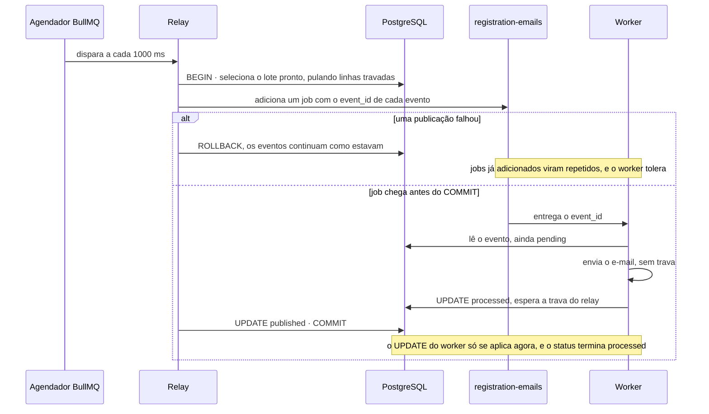

# Stack NestJS com Transactional Outbox

> Plan from this document. Each slice below carries its own shape - copy it, do not re-derive it.
> Status: decisão já tomada no README e em docs/stacks.md (responsável do projeto); forma confirmada por diashelter, 2026-11-08, com a rodada inteira, o TypeORM, a suíte de contrato por stack e o Vitest

## Situation

- Project: in active construction. Os serviços comuns, o schema, o formulário, o CI e a stack Laravel com outbox existem e são testados; `make up-nest` recusa com `stack nest ainda não implementada`, e nada está aberto em outra branch.
- Decision: committed. A stack NestJS, com os containers `api`, `worker` e `redis` no projeto `cadastro-feliz-nest` e o BullMQ como fila, está no README, em docs/stacks.md e em docs/infrastructure.md; a decisão 21 diz que ela já nasce com o outbox. Esta sessão decidiu só a forma.
- In flight: copia de .design/laravel-outbox.md o contrato entre stacks (`payload`, ciclo de status, mensagem com só o `event_id`, `Message-ID`, ordem dos limites de tempo) e de .design/laravel-api-base.md o código por cópia com Compose Watch, as dependências mudando só por um alvo do `Makefile` e os testes unitários num container descartável. A stack Go tem rodada própria.
- At stake: o código da stack reverte-se em poucos dias, porque nada depende dela. O que pesa é a suíte de contrato, que passa a ser a prova de toda stack e que a Go vai herdar, e a reorganização de testes da Laravel que hoje passam.

## Problem

Construção. O projeto promete o mesmo caso de uso em três stacks, intercambiáveis sobre o mesmo banco, e só uma existe. Sem uma segunda stack, os cenários 6 (troca de stack com evento aberto) e 9 (limite entre stacks) de docs/architecture.md nunca rodaram de verdade, e o contrato do relay e do worker, escrito para ser neutro, só foi exercitado por quem o escreveu. Vem antes da Go porque o BullMQ sobre Redis é o caso mais próximo da Laravel: o que falhar aqui é o contrato, não a distância entre as tecnologias. Não há volume a medir; a prova é de comportamento, caso a caso.

## Success

- Worked if: a mesma suíte de contrato passa contra `laravel` e contra `nest` no CI da `main`, com os ids de caso de hoje; os cenários 1 a 13 de docs/architecture.md passam na stack NestJS, com o 6 e o 9 trocando de verdade entre Laravel e NestJS nos dois sentidos.
- Going wrong: um caso de contrato precisa de um desvio por stack; a stack NestJS precisa de uma exceção no contrato (um `400` escapando, um corpo de erro diferente, um `Message-ID` próprio); ou a `api` abre conexão com o `redis` da stack.
- Review: no início da rodada Go, por diashelter: o adaptador da suíte cobre a Go sem tocar nos casos de contrato?

## Boundary

In: os containers `api`, `worker` e `redis` da stack NestJS; `GET /health`; `POST /users` com o evento na mesma transação; o relay no `worker`; o envio do e-mail de boas-vindas; `make nest-npm` e `make test-nest`; o job da NestJS no CI; a extração da suíte de contrato de `tests/infra`; os documentos.

Out:
- Stack Go - rodada própria; a suíte de contrato só precisa admitir uma terceira stack, não implementá-la.
- Painel de fila, como um Bull Board - o README não lista painel para a NestJS, e o estado da fila se vê no banco.
- Build de produção - a stack roda em modo de desenvolvimento, como o frontend (decisão 16).
- Reprocessamento automático de eventos em `failed` - continua sendo a ação manual de docs/database.md.
- Mudança de contrato - se a NestJS não couber nele, a rodada para e o contrato é revisto em docs/api-contract.md, não contornado na stack.

Unchanged: `users`, `users_outbox` e `database/migrations`; docs/api-contract.md, inclusive os scripts da cota; o frontend; o código da stack Laravel, cujos testes só mudam de arquivo; as variáveis de `.env.example`, que já preveem `REDIS_HOST` e `REDIS_PORT` para a NestJS e os `OUTBOX_*` comuns.

## Prior art

- O BullMQ entrega *at-least-once*: um job cujo lock expira, por queda do processo ou laço de eventos travado, é considerado *stalled* e roda de novo, até `maxStalledCount` vezes (padrão 1). É uma retentativa nativa que a decisão 9 proíbe; a Key decision 4 existe para ela.
- A receita oficial do Nest para Vitest compila os testes com SWC, porque o Vitest sozinho não emite os metadados de decorators de que a injeção de dependência precisa. Adotamos a receita, sem variação.

## Shape

O registro continua sendo a linha de `users_outbox`, e a stack NestJS é uma imagem com dois processos: a `api` grava usuário e evento numa transação do TypeORM, e o `worker` roda o relay, disparado pelo agendador do BullMQ a cada segundo, e o envio do e-mail. A porta é o contrato entre stacks, agora provado por uma única suíte que recebe a stack como parâmetro: mudar o `payload`, o ciclo de status, a mensagem ou um caso de contrato depois custa Laravel, NestJS e Go. A suíte por stack é a forma mais pesada e foi escolhida porque a condição que a justifica já vale hoje: a Go está comprometida no README e copiaria os casos uma terceira vez.

Separar `api` e `worker` em aplicações e imagens próprias, num monorepo do Nest, só venceria se os dois processos fossem implantados ou versionados separadamente, e aqui eles sobem e descem juntos com `make up-nest`.

## Key decisions

1. **`users` e `users_outbox` são gravados juntos ou nenhum dos dois, e a `api` nem abre conexão com o `redis` da stack.** O BullMQ existe só no grafo de módulos do `worker`; o módulo que grava o evento é compartilhado pelos dois processos e não importa nada de fila. Um `BullModule` no módulo raiz da `api`, como sugerem os exemplos do Nest, quebraria a promessa e faria a queda da fila atrasar o cadastro.
2. **O TypeORM nunca altera o schema.** Sem sincronização automática e sem migrations; as entidades `User` e `UserOutboxEvent` espelham `database/migrations`, que continua sendo a única fonte (decisão 2). O banco é o mesmo que a Laravel lê, e um `synchronize` ligado num ambiente de desenvolvimento reescreveria as tabelas das outras stacks.
3. **O relay só confirma `published` depois de publicar o lote, qualquer falha desfaz o lote inteiro, e duas execuções nunca publicam a mesma linha ao mesmo tempo, garantido pelo banco.** O agendador do BullMQ dispara um relay por vez, mas nenhuma garantia pode depender dele: um segundo `worker`, ou a Laravel subindo durante a troca, roda outro relay contra as mesmas linhas.
4. **Cada mensagem de `registration-emails` roda o job uma vez, e só a falha de envio conta como tentativa.** Nem as retentativas do BullMQ nem a recuperação de jobs *stalled* rodam o job de novo: uma queda do `worker` durante o envio deixa o evento `published` até a republicação, sem gastar tentativa, como na Laravel. A ordem dos limites é obrigatória: 5 s do SMTP, menor que o lock do job no BullMQ, menor que os 300 s de `OUTBOX_REPUBLISH_AFTER_SECONDS`.
5. **A stack NestJS lê e escreve eventos que a Laravel lê e escreve.** A mensagem leva só o `event_id`, o worker lê nome e e-mail do `payload`, o `Message-ID` é `<event_id>@cadastro-feliz.local` e o texto do e-mail é o de docs/architecture.md, sem variação. É o que torna verdadeiros os cenários 6 e 9.
6. **Uma única suíte de contrato, parametrizada por stack, é o critério de aceite de toda stack.** Ela só observa a porta 8080, o PostgreSQL, o `redis-limiter` e o Mailpit, e só age sobre a stack por um adaptador de ações nomeadas (parar e congelar a fila, parar o worker, parar o relay, trocar variáveis de ambiente). Os ids de caso de hoje não mudam; o que é interno de uma stack (Horizon, `scheduler`, agendador do BullMQ) fica num arquivo dela.

## Work

| Slice | Delivers | Status |
|---|---|---|
| [Suíte de contrato](#suíte-de-contrato) | Casos de contrato de `tests/infra` parametrizados por stack, provados primeiro só na Laravel | open — 2 defaults taken |
| [`cadastro-feliz-nest`](#cadastro-feliz-nest) | `api`, `worker` e `redis` no ar, `GET /health`, fluxo de edição e testes unitários | open — 1 default taken |
| [`POST /users`](#post-users) | Usuário e evento na mesma transação, sem a fila no caminho | clear |
| [`outbox-relay`](#outbox-relay) | Relay no `worker`, disparado a cada segundo pelo agendador do BullMQ | clear |
| [`registration-emails`](#registration-emails) | Envio a partir do evento, com retentativas no banco e `Message-ID` estável | clear |

Order: Suíte de contrato → `cadastro-feliz-nest` → `POST /users` → `outbox-relay` → `registration-emails`. A suíte entra primeiro, num pull request próprio, para a reorganização ser provada pela Laravel com os mesmos resultados antes de existir uma segunda stack; as outras quatro podem entrar juntas, e a stack só passa a rodar a suíte de contrato quando as quatro estiverem prontas.

Already handled by existing code: troca de stack que derruba a outra, `make logs-nest` e `make down-nest` → os alvos genéricos do `Makefile`; aplicação do schema antes da stack subir → `make migrate` dentro de `make up-<stack>`; contador e cota compartilhados entre stacks → o `redis-limiter` comum; formulário e mensagens ao usuário → o frontend, que não sabe qual stack responde.

Derivable from the repository, left to the plan: imagem sobre `node` na mesma versão exata do frontend e dependências em versões exatas; `node_modules` nunca na máquina e `make nest-npm` como `make frontend-npm`; `make test-nest` num container descartável e sem dependências, como `make test-laravel`; healthchecks, `dns_opt` e tempos curtos da conexão com o `redis-limiter` como no `php-fpm`; `OUTBOX_*` entregues ao `worker` como ao `scheduler` e ao `horizon`; logs na saída do container; cópias dos scripts Lua da cota conferidas contra o contrato; CORS e IP do cliente como docs/api-contract.md; docs/decisions.md ganha as decisões do TypeORM sem schema próprio, da suíte de contrato por stack e do Vitest; README, docs/stacks.md, docs/infrastructure.md, docs/architecture.md e docs/database.md deixam de dizer que a NestJS está em design.

### Suíte de contrato

**Delivers** os casos de `tests/infra` que valem para qualquer stack, rodando contra a stack escolhida. **Status: open.** É a Key decision 6.

| State | What should happen |
|---|---|
| Suíte rodada contra `laravel`, antes da NestJS existir | Os mesmos ids passam com o mesmo resultado de hoje |
| Suíte rodada contra `nest` | Os mesmos ids passam, sem desvio por stack dentro de um caso |
| Caso que precisa parar, congelar ou reconfigurar algo da stack | Pede ao adaptador da stack uma ação nomeada; o caso não conhece container nem chave de fila |
| Caso interno de uma stack (painel e falhas do Horizon, lista do `scheduler`, agendador do BullMQ, `api` sem conexão com o `redis`) | Fica num arquivo só daquela stack |
| Stack sem adaptador, como a `go` hoje | A suíte recusa com uma mensagem clara, antes de tocar no Docker |
| CI | A matriz roda cada arquivo de contrato para cada stack implementada, além dos arquivos internos |
| Cenário 6 | Para o `worker` da Laravel, cadastra, sobe a NestJS e o e-mail chega; e o inverso |
| Cenário 9 | Atinge o `429` numa stack, troca para a outra e continua recebendo `429` com o mesmo e-mail e IP |
| `make up-nest` sem o compose da NestJS | Continua recusando até a fatia `cadastro-feliz-nest`; daí em diante só `go` recusa |

Open, default taken:
1. Como a suíte escolhe a stack? Default: uma variável de ambiente lida por `tests/infra/run.sh`, com `laravel` como padrão para quem roda localmente sem informar nada.
2. Qual caso é de contrato? Default: todo caso de `registration.sh` e `outbox.sh` que só observa a porta 8080, o PostgreSQL, o `redis-limiter` e o Mailpit, ou que age sobre a stack por uma ação do adaptador; os demais vão para o arquivo da stack. LM0 a LM3 e LM2B entram no contrato: nasceram como o antes e depois da Laravel, mas hoje só afirmam o comportamento com outbox (diashelter, 2026-11-08).

Alternatives considered: arquivos só da NestJS, copiando os casos com os nomes dela - vence se nenhuma terceira stack fosse chegar, e a Go está comprometida.

### `cadastro-feliz-nest`

**Delivers** o projeto Compose `cadastro-feliz-nest`, com `api`, `worker` e `redis`, e `GET /health`. **Status: open.** Guarda a Key decision 1 na divisão dos processos.

| State | What should happen | Caller sees |
|---|---|---|
| `make up-nest` | Outra stack derrubada, `api`, `worker` e `redis` saudáveis, `api` na porta 8080 | |
| `GET /health` com tudo no ar | Nada gravado | `200`, corpo de docs/api-contract.md |
| PostgreSQL ou `redis-limiter` fora do ar | `fail` no check correspondente, dentro do limite de tempo do contrato | `503`, mesmo corpo |
| `redis` da stack fora do ar | A `api` não percebe; o `worker` espera ele voltar, sem reinício manual | `200` |
| Edição do código da `api` com `make watch-nest` | A requisição seguinte usa o código novo | |
| Edição do código do `worker` com `make watch-nest` | O `worker` reinicia, e o job seguinte usa o código novo | |
| `make nest-npm ARGS="<comando>"` | Só `package.json` e `package-lock.json` mudam na máquina | |
| `make test-nest` | Vitest num container descartável, sem PostgreSQL nem Redis | código de saída dos testes |

`GET /health` → `200` `{"status":"ok","checks":{"database":"ok","limiter":"ok"}}`

Open, default taken:
1. Como o processo pega a edição copiada? Default: `api` e `worker` rodam o modo watch do Nest CLI, que recompila e reinicia o processo; o Compose Watch só copia, como no frontend.

Alternatives considered: compilar na imagem e reiniciar o container a cada edição - vence se o modo watch for lento demais no container, e não há medida disso.

### `POST /users`

**Delivers** o cadastro com o evento na mesma transação. **Status: clear.** É a Key decision 1; a ordem de processamento, as respostas e o fluxo são os de docs/api-contract.md e de .design/laravel-outbox.md › `POST /users`, sem variação.

| State | What should happen | Caller sees |
|---|---|---|
| Corpo válido, tudo no ar | Uma linha em `users` e uma em `users_outbox`, `pending`, tipo `user.registered` | `201` |
| Fila parada ou `worker` parado | Mesmo resultado, com o evento à espera | `201`, sem diferença de tempo |
| JSON malformado | Nada consultado, nenhuma tentativa contada | `422` na forma do contrato, nunca o `400` do Nest |
| Campo ausente, vazio, longo demais ou e-mail inválido | Nada consultado, nenhuma tentativa contada | `422`, com `field` e `code` de cada erro |
| Campos a mais no corpo | Ignorados | Como se não existissem |
| `X-Forwarded-For` na requisição | Ignorado: a `api` é publicada direto, sem proxy de confiança | Limite contado pelo IP da conexão |
| E-mail repetido, inclusive em requisições paralelas | Nenhuma linha nova, reserva devolvida | `409` com `already_taken` |
| Falha ao gravar o evento | Usuário desfeito, reserva devolvida | `500` |
| Banco ou `redis-limiter` fora do ar | Nada gravado, reserva devolvida quando houve | `500`, dentro de 3 s |
| Limite excedido | Banco não consultado | `429` com `Retry-After` |
| 50 cadastros paralelos do mesmo IP com a cota vazia | Exatamente 20 linhas em cada tabela | 20 `201` e 30 `429` |

`POST /users` `{"name": string, "email": string}` → `201` `{"data": {...}, "message": string}`, como docs/api-contract.md.

Schema: nenhuma tabela muda. As entidades `User` e `UserOutboxEvent` são mapeamentos de `users` e `users_outbox` como estão (Key decision 2).

### `outbox-relay`

**Delivers** o relay no `worker`, disparado a cada 1000 ms por um agendador do BullMQ na fila `outbox-relay`. **Status: clear.** Guarda a Key decision 3.

| State | What should happen |
|---|---|
| `pending` com `available_at` vencido | Publicado em `registration-emails` e marcado `published` no ciclo seguinte |
| `pending` com `available_at` no futuro | Ignorado até vencer |
| `published` há mais que `OUTBOX_REPUBLISH_AFTER_SECONDS` | Republicado, com `published_at` renovado e `attempts` igual |
| `processed` ou `failed` | Nunca selecionado |
| Mais eventos prontos que `OUTBOX_BATCH_SIZE` | O restante sai nas execuções seguintes |
| Linha travada por outro relay, de qualquer stack | Pulada nesta execução |
| Falha ao publicar no meio do lote | Lote desfeito, erro no log, nova tentativa na execução seguinte |
| `redis` da stack fora do ar | O agendador não dispara; os eventos ficam em `pending` e saem quando ele volta, sem reinício manual |
| `worker` parado | Eventos ficam em `pending` e saem quando ele volta |
| Evento deixado pela Laravel | Tratado como qualquer outro: `pending` sai logo, `published` depois do tempo limite |
| Stack derrubada com a fila cheia | As linhas continuam no banco; `pending` sai logo na volta, e `published` depois do tempo limite |

Alternatives considered: um laço com temporizador dentro do `worker`, sem a fila `outbox-relay` - dispensa a segunda fila e vence se o agendador do BullMQ atrasar disparos, mas foge de docs/stacks.md e da comparação entre stacks, em que a Go é quem usa o laço.

### `registration-emails`

**Delivers** o job que envia o e-mail de boas-vindas a partir do evento. **Status: clear.** Guarda as Key decisions 4 e 5; o ciclo de status é o de .design/laravel-outbox.md › `SendWelcomeEmailJob`.

Mensagem: `{ "event_id": "<uuid>" }`, fila `registration-emails` no `redis` da stack.

| State | What should happen |
|---|---|
| Evento `pending` ou `published` | Envia pelo `payload`, com o `Message-ID` do evento, e marca `processed`, com `processed_at` e sem `last_error` |
| Evento `processed` ou `failed` | Ignora a mensagem, sem enviar |
| Evento inexistente | Ignora a mensagem e registra no log, sem falhar o job |
| Envio falha antes do limite | `attempts` + 1, `last_error`, volta a `pending` com espera de 30, 60, 120 ou 240 s; o job termina sem falhar na fila |
| Envio falha na última tentativa | `failed`, com `attempts` e `last_error` |
| SMTP travado | Vale como falha de envio, em 5 s |
| `worker` cai durante o envio | O job não roda de novo pela fila; o evento fica `published` até a republicação, e pode haver duplicata com o mesmo `Message-ID` |
| Banco fora do ar ao ler ou depois de enviar | Evento continua `published`, `attempts` não muda |
| Evento `failed` reprocessado por SQL | Volta a `pending`, com `attempts` zerado, e o e-mail sai |
| Nome com HTML | Escapado no corpo HTML, como na Laravel |

## Sources

- README e docs/stacks.md: a stack NestJS, seus containers, o BullMQ e a estrutura planejada.
- docs/decisions.md: decisões 1, 2, 9, 10, 14, 16, 19, 20, 21 e 22.
- docs/architecture.md: relay, worker, retentativas, cenários de falha e os 13 cenários de validação.
- docs/api-contract.md: `POST /users`, `GET /health`, forma do erro, limites e IP do cliente.
- docs/database.md: schema, `payload`, ciclo de status e consultas.
- docs/infrastructure.md: projetos Compose, alvos do `Makefile`, variáveis e CI.
- .design/laravel-outbox.md e .design/laravel-api-base.md: o contrato entre stacks e o fluxo de edição que esta stack copia.
- [BullMQ, Important Notes](https://github.com/taskforcesh/bullmq/blob/master/docs/gitbook/bull/important-notes.md) e [WorkerOptions](https://github.com/taskforcesh/bullmq/blob/master/src/interfaces/worker-options.ts): jobs *stalled* rodam de novo, até `maxStalledCount` (padrão 1), com `lockDuration` padrão de 30 s.
- [NestJS, receita SWC](https://github.com/nestjs/docs.nestjs.com/blob/master/content/recipes/swc.md): Vitest com `unplugin-swc` para os metadados dos decorators.
