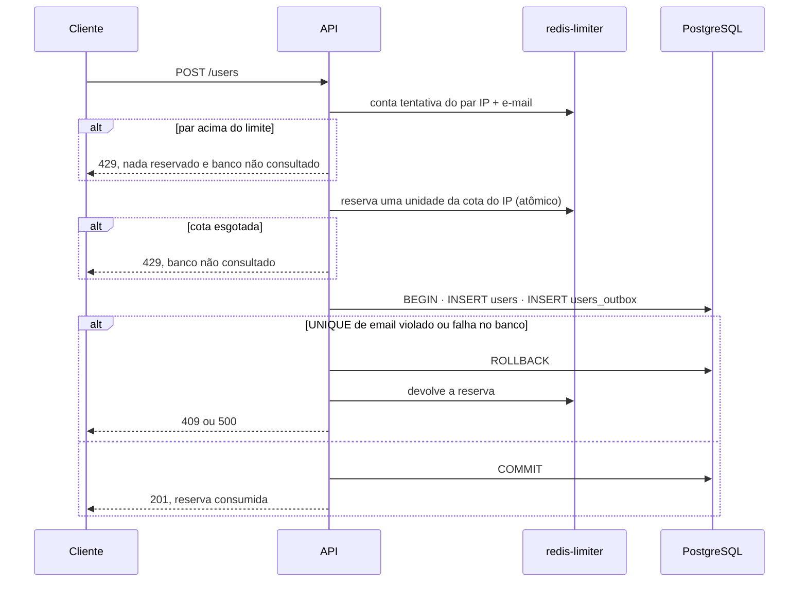

# Limite de cadastros por IP

> Plan from this document. Each slice below carries its own shape - copy it, do not re-derive it.
> Status: confirmed by responsável do projeto, 2026-11-04

## Situation

- Project: in active construction. O repositório tem só documentação; nenhuma stack existe ainda.
- Decision: open, decidida nesta sessão.
- In flight: copia o contador por IP + e-mail de docs/api-contract.md (mesmo `redis-limiter`, mesma forma canônica do IP, mesmo formato de chave com hash, mesmo 429 com `Retry-After`); ficam fora a infraestrutura de .design/shared-infrastructure.md e o código das stacks.
- At stake: barato agora, porque nenhuma stack implementou o contador. Depois que as três implementarem, mudar chave ou script vira mudança coordenada em três códigos.

## Problem

Construção, com um dano definido. Cada cadastro concluído grava um evento em `users_outbox`, e esse evento vira um e-mail para o endereço informado. Hoje o limite conta o par IP + e-mail, então um único IP pode cadastrar milhares de endereços alheios e fazer o sistema enviar um e-mail para cada um. O dano que isso causaria em produção: o envio usado contra terceiros e a reputação do remetente comprometida. Nada está medido, porque nada foi lançado; a POC registrava isso como limitação aceita (docs/api-contract.md › Limitações conhecidas, "Sem limite só por IP").

## Success

- Worked if: a partir de um mesmo IP, no máximo 20 cadastros por hora chegam a 201 e geram e-mail, inclusive quando 50 requisições com e-mails diferentes chegam em paralelo (20 respostas 201 e 30 respostas 429, com 20 linhas em `users_outbox`).
- Going wrong: uma rajada paralela passa de 20 respostas 201, ou respostas 409 consomem a cota do IP.
- Review: quando a primeira stack for implementada, rodando os cenários 12 e 13 de docs/architecture.md, por quem a implementar.

## Boundary

In: novo contador por IP no `redis-limiter`, nova posição na ordem de processamento de `POST /users`, nova mensagem do 429 no frontend, novas variáveis de ambiente, novos cenários de validação e registro como decisão 15 em docs/decisions.md (o número 14 está reservado ao golang-migrate em .design/shared-infrastructure.md).

Out: carga no banco por muitas requisições com e-mails já cadastrados (409), que não geram e-mail e não eram o dano escolhido. CAPTCHA, que precisa de serviço externo e não funciona offline na POC. Limite por faixa de IP (/24, /64), porque cada stack teria de calcular a faixa da mesma forma, e o ganho só aparece contra quem troca de IP dentro da mesma rede.

Unchanged: o contador por IP + e-mail, a chave, o script e as regras dele; o corpo e o header do 429; a regra de 500 quando o `redis-limiter` está indisponível (decisão 8 de docs/decisions.md); `make reset-limits`, que já esvazia o `redis-limiter` inteiro.

## Shape

Cada IP tem uma cota de cadastros concluídos por janela fixa de uma hora no `redis-limiter`. A API reserva uma unidade da cota antes da transação e a devolve quando o resultado não é 201, então a cota só é consumida por cadastros que geram e-mail. A porta é o formato da chave e dos dois scripts, que viram contrato entre as três stacks como o contador por IP + e-mail já é. A forma mais leve, consultar a cota antes e incrementar só depois do commit, deixa uma rajada paralela passar de 20; ela só serviria se o abuso viesse em série, e o envio em massa por script chega em paralelo.

## Key decisions

1. **A cota do IP conta cadastros concluídos: no máximo `REGISTRATION_MAX_PER_IP` (20) respostas 201 por IP a cada `REGISTRATION_IP_WINDOW_SECONDS` (3600), em janela fixa que começa no primeiro cadastro.** Respostas 409, 422 e 500 não consomem cota. É o que liga o limite ao dano: só o 201 gera e-mail.
2. **O limite vale mesmo com requisições simultâneas: a verificação e a reserva da cota são uma única operação atômica no `redis-limiter`, feita antes de abrir a transação.** Consultar antes e incrementar depois do commit deixa N requisições paralelas passarem juntas. Não copie esse formato, embora ele pareça o mais simples.
3. **Uma reserva que não termina em 201 é devolvida, e a devolução nunca cria chave sem expiração nem deixa o contador negativo.** Se a janela expirou entre a reserva e a devolução, a devolução não faz nada. Uma devolução que falha, ou uma API que cai entre reserva e resposta, deixa a cota com uma unidade a mais até a janela expirar. Esse erro é aceito porque bloqueia um pouco antes, nunca depois.
4. **A cota do IP é verificada depois do contador por IP + e-mail e antes do banco.** Um 429 por IP + e-mail não reserva cota. Um 429 por IP já contou a tentativa no contador por IP + e-mail, que conta toda tentativa válida. Nenhum dos dois 429 consulta o banco.
5. **A chave é `registration:ip:{sha256(ip)}`, com o IP na forma canônica de docs/api-contract.md › IP do cliente e o mesmo hash hexadecimal minúsculo do contador por IP + e-mail.** As três stacks precisam gerar os mesmos bytes para a cota valer na troca de stack. Os dois scripts (reserva e devolução) entram em docs/api-contract.md › Operação no Redis, como o script atual.
6. **Os dois limites respondem o mesmo 429: corpo `Too many registration attempts. Try again later.` e `Retry-After` com os segundos restantes da janela que recusou.** A resposta não revela qual limite foi atingido. O frontend mostra "Muitas tentativas de cadastro. Tente novamente em {minutos} minutos." para qualquer 429.

## Work

### Limite por IP em `POST /users`

**Delivers** a cota de cadastros por IP no contrato de `POST /users`, com o texto do frontend e os cenários de validação. **Status: clear.** É a porta (decisões 2, 3 e 5).

| State | What should happen | Caller sees |
|---|---|---|
| IP com cota livre, e-mail novo | Reserva uma unidade, grava `users` e `users_outbox`, a reserva fica | `201` |
| IP com cota livre, e-mail já cadastrado | Reserva, a transação viola o `UNIQUE`, devolve a reserva | `409` |
| IP com cota esgotada, e-mail novo | Nada é gravado e o banco não é consultado; a tentativa conta no contador por IP + e-mail | `429`, `Retry-After` da janela do IP |
| Par IP + e-mail já em 429 | A cota do IP não é tocada | `429`, `Retry-After` da janela do par |
| 50 requisições paralelas, e-mails novos, cota vazia | Exatamente 20 reservas são aceitas | 20 `201`, 30 `429` |
| Banco indisponível depois da reserva | Devolve a reserva | `500` |
| `redis-limiter` indisponível na reserva | Nada é gravado | `500` (decisão 8 de docs/decisions.md) |
| `redis-limiter` indisponível na devolução | A resposta original é mantida; a cota fica com uma unidade a mais até a janela expirar (decisão 3) | `409` ou `500`, o que já seria |
| Janela do IP expira | A cota volta a 20 | `201` no próximo cadastro |
| Teste local com muitos e-mails | Todos os testes saem pelo IP do gateway Docker e dividem a cota; `make reset-limits` a esvazia | `429` depois do 20º cadastro na hora |
| Pessoas legítimas atrás do mesmo IP | Dividem a cota de 20 por hora (limitação conhecida) | `429` para a 21ª |

Novas variáveis: `REGISTRATION_MAX_PER_IP` = `20` e `REGISTRATION_IP_WINDOW_SECONDS` = `3600`, na tabela "Regras de negócio" de docs/infrastructure.md.

Novos cenários em docs/architecture.md:
- 12: cadastrar 20 e-mails diferentes a partir do mesmo IP, receber 429 no 21º sem gravar nada, e o mesmo IP com e-mails já cadastrados recebe 409 sem consumir cota.
- 13: 50 cadastros paralelos com e-mails novos produzem exatamente 20 respostas 201.

Alternatives considered: contar cadastros por IP no PostgreSQL, com uma coluna de IP em `users`, ganha se o limite precisar sobreviver a uma perda do `redis-limiter`. Mas grava IP junto de dados pessoais e carrega o banco, que é o que a decisão 5 de docs/decisions.md quer evitar.

## Sources

- docs/api-contract.md: contador por IP + e-mail, forma canônica do IP, script atual, ordem de processamento, mensagens do frontend.
- docs/decisions.md: decisões 4, 5 e 8.
- docs/architecture.md: cenários de validação.
- docs/infrastructure.md: variáveis de regra de negócio e o `redis-limiter` (`volatile-ttl`, sem persistência).
- .design/shared-infrastructure.md: `make reset-limits` e reserva do número 14 em docs/decisions.md.
