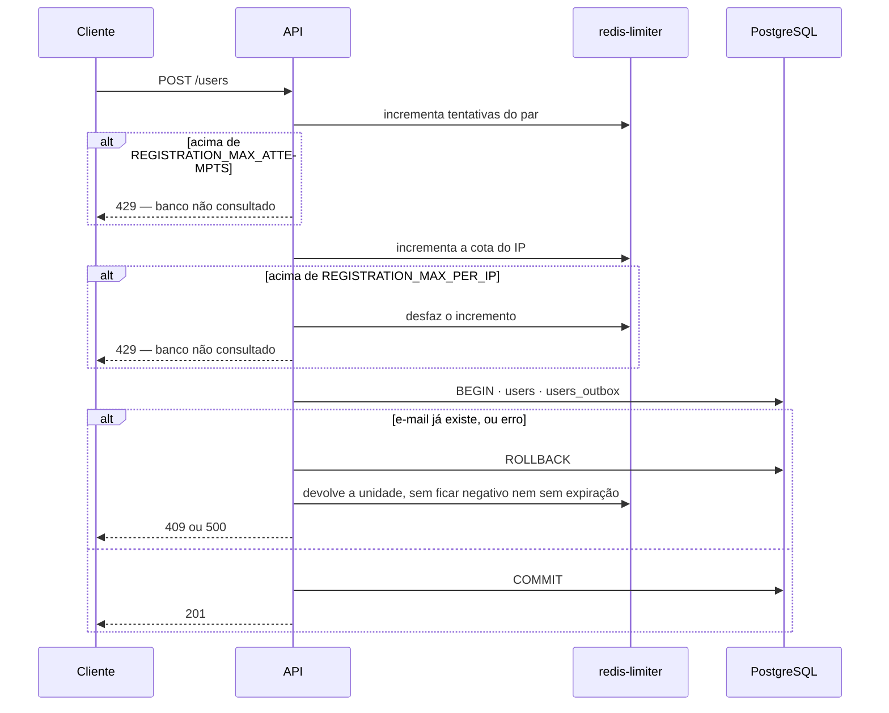

# Testes por stack, sem `tests/infra` e sem Lua

> Plan from this document. Each slice below carries its own shape - copy it, do not re-derive it.
> Status: confirmed by diashelter, 2026-11-12

## Situation

- Project: in active construction. Laravel e NestJS implementam `POST /users`, o outbox e o limitador; Go ainda não tem compose.
- Decision: committed by diashelter, nesta sessão, em 2026-11-12. Os testes passam a ser de cada API, o CI passa a ser um por stack, e o Lua sai das APIs, com o limitador nativo do framework no Laravel e comandos do ioredis no NestJS.
- In flight: copia do `Makefile` o padrão em que o CI chama o mesmo alvo `make test-<stack>` usado por quem desenvolve, e copia dos workflows atuais a instalação fixada do Compose. Nenhuma branch aberta toca em `tests/infra`, nos limitadores ou no CI.
- At stake: reversível pelo git, com dois custos que não voltam sozinhos. A cobertura de contrato entre stacks deixa de existir (a decisão 23 é revogada), e o contador deixa de ser comum às stacks (a decisão 5 muda).

## Problem

A dor é de quem mantém o projeto, que paga duas camadas de teste para o mesmo comportamento. `tests/infra` tem 17 arquivos de bash, com cerca de 5.600 linhas e 35 commits desde agosto, e cada stack nova precisa de um adaptador com o vocabulário inteiro da decisão 23. No CI da `main` de 2026-11-12, as 15 entradas de infraestrutura somaram 3.447 s de runner, contra 120 s das suítes das três stacks; a entrada mais longa levou 649 s. Três das últimas cinco execuções falharam, a última delas em `laravel-outbox`, `nest` e `shared`. Fonte: `gh run view 43221077479`.

As suítes das APIs, por outro lado, rodam sem banco nem Redis, então nada do que tem regra é provado dentro de cada projeto: o 409 pelo índice único, a atomicidade entre usuário e evento, o limitador, o relay. Se nada mudar, a stack Go nasce precisando de um adaptador em bash, e cada mudança de comportamento continua sendo escrita duas vezes, em linguagens diferentes.

Os scripts Lua existem em cópias idênticas por stack, e a igualdade entre eles é garantida por um teste que compara o texto com `docs/api-contract.md`. O responsável escolheu o mecanismo nativo de cada framework no lugar deles.

## Success

- Worked if: o repositório não tem nenhum `.lua` nem `tests/infra`; `make test-laravel` e `make test-nest` provam, contra PostgreSQL e Redis reais, as tabelas de estado das slices deste documento; um PR que só toca uma stack roda só o workflow dela; o tempo de runner de um PR que toca tudo cai de cerca de 60 min para a soma dos workflows por stack.
- Going wrong: o teste de uma stack passa a depender da outra stack ou do Mailpit; os testes falham de forma intermitente por estado que sobra no Redis ou no banco; um caso que `registration.sh` ou `outbox.sh` provava, como a cota sob requisições paralelas, não tem par em nenhuma suíte.
- Review: no início da rodada da stack Go, por diashelter. A pergunta: as cópias dos casos de contrato em Laravel e NestJS já divergiram?

## Boundary

In: o limitador das duas stacks sem Lua; os testes de integração dentro de cada API, contra serviços reais; um workflow de CI por stack; a remoção de `tests/infra` e do que só existia para ele; os documentos e as decisões novas.

Out:
- Stack Go: não tem compose. Ganha o próprio workflow e o próprio `make test-go` quando for criada, no mesmo formato.
- Uma suíte de contrato caixa-preta, comum às stacks: foi rejeitada nesta sessão; cada API prova o próprio comportamento.
- Os casos sem dono numa API (`stack-switch`, `docs`, `stack`, `shared`, `migrate`): removidos. O schema fica provado de forma indireta, porque os testes de cada API rodam depois do migrate.
- Os cenários de `docs/architecture.md` que precisam de uma pessoa olhando, como o e-mail no Mailpit, a troca de stack e a stack derrubada: continuam como roteiro de aceite manual, sem automação.
- Mailpit nos testes: o e-mail sai por um transporte em memória (Key decision 5).

Unchanged: `POST /users`, `GET /health` e o corpo das respostas; os limites, as janelas, o 429 com `Retry-After` e o que consome ou devolve a cota (decisões 4 e 17); a regra de hash das chaves, para que nenhum IP ou e-mail vá em claro para o Redis; o `redis-limiter` como armazenamento; `users` e `users_outbox`; as variáveis de `.env.example`; `make reset-limits`; `make test-frontend` e o job do frontend; os `.design` e `.specs` anteriores, que são histórico.

## Shape

Cada API passa a ter testes de integração na própria suíte, rodando contra PostgreSQL, `redis-limiter` e o Redis da fila da stack. `make test-<stack>` sobe esses serviços, aplica o migrate num banco só de teste e roda a suíte; o CI é um workflow por stack que chama esse alvo. O limitador de cada stack troca o script Lua por operações nativas com as mesmas garantias, e a porta é o contador deixar de ser comum às stacks: voltar a compartilhá-lo exigiria de novo um formato de chave e uma operação definidos no contrato.

A alternativa mais pesada, uma suíte de contrato caixa-preta escrita uma vez e rodada contra cada stack, só vence se as cópias dos casos começarem a divergir entre stacks, e é isso que a revisão da rodada Go verifica.

## Key decisions

1. **`tests/infra` sai inteiro, e cada stack passa a ter a própria cópia dos casos de contrato.** Substitui a decisão 23: a divergência entre stacks é aceita, e quem a percebe é a revisão, não um teste. Saem junto o que só existia para os adaptadores e o alvo `make test-infra`.
2. **O contador de tentativas e a cota por IP deixam de ser comuns às stacks.** O `redis-limiter` continua sendo o armazenamento, mas cada stack é dona do formato das próprias chaves; um par bloqueado numa stack não fica bloqueado na outra. `docs/api-contract.md` passa a descrever só o comportamento, sem "Operação no Redis" nem "Scripts da cota", e a decisão 5 é atualizada.
3. **Sem Lua, o limitador mantém três invariantes.** A cota nunca passa de `REGISTRATION_MAX_PER_IP` sob requisições paralelas; nenhum contador fica sem expiração, nem quando a devolução chega depois de a janela expirar; as janelas são fixas, e só o primeiro incremento define a expiração. O padrão "verificar e depois incrementar" que a documentação do Laravel também mostra (`tooManyAttempts` seguido de `hit`, ou `attempt`) deixa requisições paralelas passarem juntas: não o copie. Vale o padrão "incrementar, comparar e desfazer o excedente".
4. **Testes nunca gravam nos dados de quem desenvolve.** Gravam só no banco `cadastro_feliz_test`, no mesmo PostgreSQL, e num banco lógico do Redis separado do usado no ambiente local. O schema desse banco vem do mesmo migrate de `database/migrations`, nunca das migrations de um framework.
5. **Nos testes, PostgreSQL, `redis-limiter` e o Redis da fila são reais; o e-mail sai por um transporte em memória.** O que tem regra (índice único, transação, limitador, relay e fila) é provado de verdade, e o Mailpit fica fora das suítes.
6. **Um workflow de CI por stack, e cada um roda só `make test-<stack>`.** Cada workflow dispara pelos caminhos da própria stack e pelos caminhos comuns que ela usa: `database/migrations`, `docker-compose.yml`, `Makefile`, `.env.example` e o próprio arquivo do workflow. O frontend já tem o próprio job e segue no mesmo formato.

## Work

| Slice | Delivers | Status |
|---|---|---|
| [`RegistrationLimiter`](#registrationlimiter) | Limitador das duas stacks sem Lua, com as mesmas respostas de hoje | clear |
| [`make test-<stack>`](#make-test-stack) | Alvo que sobe os serviços, migra `cadastro_feliz_test` e roda a suíte da stack | open — 1 default taken |
| [Suíte Laravel](#suíte-laravel) | Casos de integração no Pest, contra serviços reais | clear |
| [Suíte NestJS](#suíte-nestjs) | Casos de integração no Vitest, contra serviços reais | clear |
| [Workflows por stack](#workflows-por-stack) | `frontend`, `laravel` e `nest` como workflows separados, filtrados por caminho | clear |
| [Remoção de `tests/infra`](#remoção-de-testsinfra) | Repositório sem `tests/infra`, sem `.lua` e com os documentos atualizados | clear |

Order: `RegistrationLimiter` → `make test-<stack>` → Suíte Laravel e Suíte NestJS, em paralelo → Workflows por stack → Remoção de `tests/infra`. A remoção vem por último para que nenhum comportamento fique sem prova entre um PR e outro.

Derivable from the repository, left to the plan: a forma do corpo de erro e o `Retry-After`, como em `docs/api-contract.md`; os nomes dos testes, como os arquivos atuais de `app-modules/users/tests` e os `*.spec.ts`; a instalação fixada do Compose nos workflows, como em `.github/workflows/ci.yml`.

### `RegistrationLimiter`

**Delivers** o contador de tentativas e a cota por IP sem script Lua, nas classes `RegistrationLimiter` (Laravel) e `RegistrationAttemptLimiter` (NestJS). **Status: clear.** É a porta da Key decision 2.

Nas duas stacks, são comandos Redis numa transação no `redis-limiter`: no Laravel pela conexão `limiter`, no NestJS pelo ioredis, sem dependência nova. O `RateLimiter` do Laravel foi descartado no build: o `increment` dele roda em passos separados e deixou passar 21 reservas numa cota de 20. Os invariantes estão na Key decision 3.

| State | What should happen | Caller sees |
|---|---|---|
| 1ª a 5ª tentativa do par IP e e-mail na janela de 15 min | Conta a tentativa e segue | 201 ou 409 |
| 6ª tentativa em diante, na mesma janela | Não consulta o banco nem reserva cota | 429, `Retry-After` com os segundos restantes, no mínimo 1 |
| Cota do IP com unidade livre | Reserva uma unidade antes da transação | segue |
| Cota esgotada | Desfaz o próprio incremento; não consulta o banco | 429, `Retry-After` |
| N requisições paralelas disputando as últimas unidades | Passam exatamente as unidades livres; as outras desfazem o incremento | 201 para as que couberam, 429 para as outras |
| 409 ou 500 depois da reserva | Devolve a unidade | 409 ou 500 |
| Devolução depois de a janela expirar | Não cria contador negativo nem sem expiração | 409 ou 500 |
| `redis-limiter` indisponível | Não cadastra | 500 (decisão 8) |
| 422 de validação | Não conta tentativa nem reserva | 422 |

Alternatives considered: `@nestjs/throttler` na stack NestJS - vence se 409 e 500 puderem consumir cota, porque a interface de storage dele não devolve unidades.

### `make test-<stack>`

**Delivers** um alvo por stack que deixa o ambiente de teste pronto e roda a suíte, idêntico na máquina e no CI. **Status: open.**

| State | What should happen |
|---|---|
| Nada no ar | Sobe PostgreSQL, `redis-limiter` e o Redis da fila da stack; cria `cadastro_feliz_test` se faltar; aplica o migrate nele; roda a suíte |
| Ambiente local no ar, com cadastros feitos à mão | Mesmo resultado, sem apagar nem alterar nada em `cadastro_feliz` nem nos contadores locais (Key decision 4) |
| Migration nova em `database/migrations` | É aplicada no banco de teste antes da suíte |
| Suíte falha | O alvo sai com o código da suíte |
| Stack sem compose | Recusa antes de alterar qualquer coisa, como os outros alvos por stack |

1. O que fica no ar depois do alvo - default: os serviços comuns continuam no ar, como depois de `make migrate`, e os containers da suíte são descartados.

### Suíte Laravel

**Delivers** os casos de integração da stack Laravel no Pest, ao lado dos testes atuais de `app-modules`, contra os serviços da Key decision 5. **Status: clear.**

| State | What should happen |
|---|---|
| Cadastro válido | 201; `users` e `users_outbox` gravados na mesma transação |
| Falha ao gravar o evento | Nem o usuário nem o evento existem |
| E-mail repetido | 409, sem evento novo |
| Corpo inválido | 422, nada gravado, nenhuma tentativa contada |
| Estados do limitador | Todas as linhas da tabela de `RegistrationLimiter`, incluindo a disputa paralela pela cota |
| Evento `pending` | O relay publica na fila e o marca `published` |
| Evento `published` além de `OUTBOX_REPUBLISH_AFTER_SECONDS` | É republicado |
| Job da fila | O e-mail sai pelo transporte em memória e o evento fica `processed`; uma mensagem repetida não envia de novo |
| Falha de SMTP | `attempts` sobe com backoff, e `failed` ao atingir `OUTBOX_MAX_ATTEMPTS` |
| `outbox:purge` e `outbox:notify-failed` | Os casos de `.design/laravel-outbox-maintenance.md` contra o banco real |
| `GET /health` | 200 com o corpo da decisão 19 |

### Suíte NestJS

**Delivers** os mesmos casos na stack NestJS, no Vitest, contra os serviços da Key decision 5, com a fila do BullMQ real. **Status: clear.**

| State | What should happen |
|---|---|
| Cadastro, 409, 422 e atomicidade | Como na Suíte Laravel |
| Estados do limitador | Todas as linhas da tabela de `RegistrationLimiter` |
| Relay, republicação, job, mensagem repetida e falha de SMTP | Como na Suíte Laravel, com as opções do job (tentativas e backoff) vindas do BullMQ real |
| `GET /health` | 200 com o corpo da decisão 19 |

### Workflows por stack

**Delivers** `.github/workflows` com um workflow para `frontend`, um para `laravel` e um para `nest`, sem a matriz de infraestrutura. **Status: clear.** A regra de disparo está na Key decision 6.

| State | What should happen |
|---|---|
| PR que só altera `apis/laravel` | Só o workflow `laravel` roda |
| PR que altera `database/migrations` ou `docker-compose.yml` | Rodam os workflows `laravel` e `nest` |
| PR que só altera `frontend` | Só o workflow `frontend` roda |
| Push na `main` | Rodam os workflows cujos caminhos mudaram |
| Push novo no mesmo branch | Cancela a execução anterior do mesmo workflow |
| `workflow_dispatch` | Roda o workflow escolhido, sem filtro de caminho |

### Remoção de `tests/infra`

**Delivers** o repositório sem a suíte de infraestrutura e sem Lua, e os documentos coerentes com isso. **Status: clear.**

| State | What should happen |
|---|---|
| `tests/infra` e o alvo `make test-infra` | Não existem |
| `.lua` nas duas stacks | Não existem |
| Código que só servia aos adaptadores, como o controle de filas do worker NestJS e o comentário de `frontend/src/app/page.test.tsx` | Removido |
| `docs/decisions.md` | Uma decisão nova revoga a 23 (Key decision 1) e outra registra o limitador por stack, atualizando as decisões 5 e 17 (Key decisions 2 e 3) |
| `docs/api-contract.md` | Mantém o comportamento do limite e a regra de hash das chaves, sem script e sem "Operação no Redis"; somem as frases que dizem que o limite continua valendo na troca de stack |
| `docs/infrastructure.md`, `docs/stacks.md` e `README.md` | Descrevem `make test-<stack>` com serviços reais e os workflows por stack, sem `tests/infra` e sem a árvore `lua/` |

## Sources

- `docs/decisions.md` - as decisões 4, 5, 8, 17, 19 e 23, que este documento mantém, muda ou revoga.
- `docs/api-contract.md` › Limite por IP, Operação no Redis - o comportamento que continua e o contrato de script que sai.
- `docs/infrastructure.md` › Integração contínua - o formato atual do CI.
- `.design/laravel-outbox-maintenance.md` - os casos de manutenção do outbox que passam para a Suíte Laravel.
- Laravel 13, Rate Limiting (laravel.com/docs/13.x/rate-limiting) - `increment` atômico nos stores Redis e o padrão de comparar o valor retornado.
- `@nestjs/throttler`, ThrottlerStorageService - o storage padrão em memória e a interface só com `increment`.
