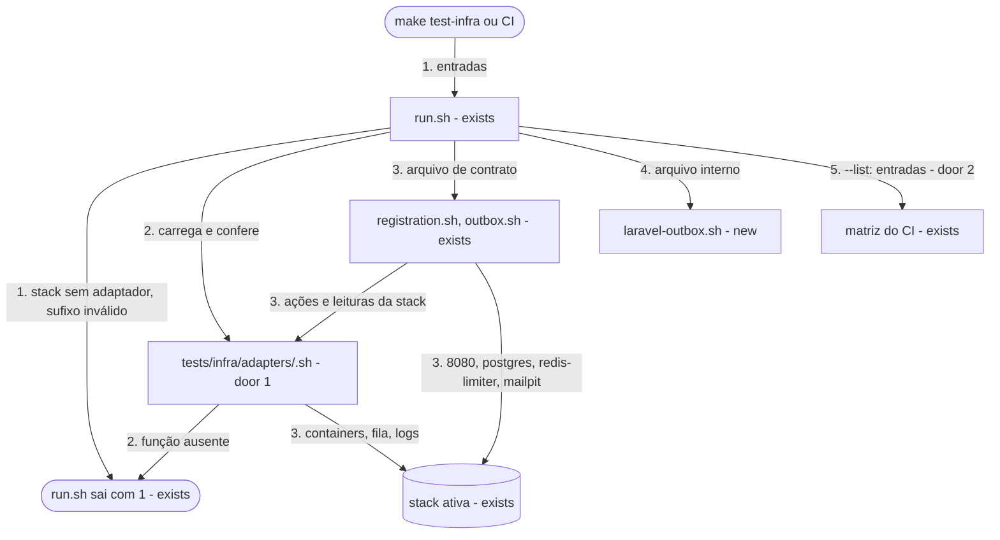

# Suíte de contrato por stack

**Approved**: 2026-11-08 - user: "Aprovar e seguir"

## Problem

Os testes de ponta a ponta de `POST /users`, do relay e do worker existem só para a stack Laravel. `tests/infra/registration.sh` e `tests/infra/outbox.sh` misturam casos que valem para qualquer stack (status e corpo de `POST /users`, linhas de `users_outbox`, e-mails no Mailpit) com nomes de container, chaves de fila e comandos `artisan` da Laravel. A stack NestJS, que vem a seguir, e depois a Go só seriam provadas copiando esses casos, e cada cópia pode divergir do contrato sem que nenhum teste perceba. A fonte (`.design/nestjs-stack.md`) não traz medição: o custo é a duplicação de 72 casos por stack nova e a deriva entre as cópias.

Quando isto sair, uma stack nova é provada pelos mesmos casos, com os mesmos ids, escrevendo só um adaptador. Para a Laravel, nada muda no que é afirmado: os 72 casos continuam passando.

## Shape

Reusa os casos de hoje, os ajudantes de `tests/infra/run.sh` e `tests/infra/registration-helpers.sh`, e a matriz do CI montada por `run.sh --list`, sem mudar o workflow. As regras que mudam o resultado ficam em `tests/infra/run.sh`, que escolhe a stack e recusa antes de tocar no Docker, e nos casos de contrato, que só falam com a stack pelo adaptador; os casos mudam de mecanismo, nunca de valor afirmado.

1. `bash tests/infra/run.sh [<arquivo>[:<stack>] ...]` -> `run.sh` (exists) - resolve cada entrada: um arquivo de contrato sem sufixo usa `STACK`, com `laravel` como padrão; recusa stack sem adaptador e sufixo em arquivo que não é de contrato, antes do Docker
2. `run.sh` (exists) -> `tests/infra/adapters/<stack>.sh` (door 1) - carrega o adaptador e confere que ele define todo o vocabulário; uma função ausente recusa antes do Docker
3. `registration.sh` e `outbox.sh` (exists) - os casos de contrato, que agem e observam a stack só pelo adaptador, além da porta 8080, do PostgreSQL, do `redis-limiter` e do Mailpit
4. `laravel-outbox.sh` (new) - os casos internos da Laravel: `redis` da fila, painel e falhas do Horizon, `scheduler`, comando `outbox:relay`, configuração e estrutura dos módulos
5. out: `== <arquivo>:<stack>` antes dos casos de cada entrada de contrato, e `PASS <id> <nome>` ou `FAIL <id> <nome>` com os ids de hoje (door 3); `run.sh --list` imprime as entradas (door 2), e o CI cria um job por entrada

**Comandos** - `bash tests/infra/run.sh` sem argumentos roda todas as entradas de `--list`, na ordem. Com argumentos, cada um é um arquivo (`registration`) ou um arquivo de contrato com a stack (`registration:laravel`). `STACK` só escolhe a stack de um arquivo de contrato nomeado sem sufixo. `--list` imprime uma entrada por linha e não toca no Docker. Uma recusa imprime o motivo na saída de erro e sai com `1`, sem criar container, rede ou volume; `make test-infra` mantém nome e códigos de saída.

**Changes underneath**

| Front | What changes |
| --- | --- |
| domain | "caso de contrato" passa a ser um termo: um caso que vale para toda stack com adaptador. `RG7` deixa de ler o painel do Horizon e lê os jobs criados pelo adaptador; `RG12` deixa de chamar o `php` do `php-fpm` e posta de outro IP pelo adaptador; `RG16` lê o diretório dos scripts Lua pelo adaptador |
| stored data | nothing to migrate - nenhum teste muda o schema, e o ambiente é recriado a cada arquivo |
| readers | `.github/workflows/ci.yml`: a matriz lê `--list` e passa a ter `registration:laravel`, `outbox:laravel` e `laravel-outbox`, sem mudança no arquivo. `tests/infra/laravel.sh`: LV que confere `laravel` em `--list` continua valendo. `tests/infra/docs.sh`: a verificação da seção antes e depois continua citando `tests/infra/outbox.sh`. docs/infrastructure.md: a linha de `make test-infra` e a tabela do CI |
| docs | docs/infrastructure.md, docs/stacks.md › Testes previstos em cada stack e docs/decisions.md, com a decisão 23 |

Data: none - os testes leem e escrevem `users` e `users_outbox` como hoje, e nenhuma estrutura persistida muda.

## Surface

None - nothing consumed outside. A interface de linha de comando está em `Comandos`.

## Landing

| One-way door | Literal shape | Alternative rejected |
| --- | --- | --- |
| 1. Vocabulário do adaptador, que NestJS e Go vão implementar | `tests/infra/adapters/<stack>.sh` define: `stack_reset_queue`; `stack_worker_stop`, `stack_worker_start` (o consumidor de `registration-emails` para e volta, e o relay segue publicando); `stack_relay_stop`, `stack_relay_start`; `stack_queue_stop`, `stack_queue_start`, `stack_queue_freeze`, `stack_queue_unfreeze`; `stack_queue_up_alone` (depois de `make down-<stack>`, sobe só a fila); `stack_queue_length`, `stack_queued_messages`, `stack_queue_connections`, `stack_jobs_created`, `stack_failed_jobs`; `stack_dispatch <event_id>` (publica sem o relay); `stack_api_errors_since <ts>`, `stack_worker_logs_since <ts>`; `stack_relay_container`; `stack_lua_dir`; `stack_post_from_other_ip <corpo>` (imprime o status); `stack_wait_ready`. As funções descrevem papéis, não containers: uma stack com relay e worker no mesmo processo para só o consumo em `stack_worker_stop` | Desvios `if [ "$STACK" = ... ]` dentro dos casos - toda stack nova editaria cada caso, e o caso deixaria de ser o mesmo para todas |
| 2. Formato das entradas de `run.sh` e de `--list` | `<arquivo>` para arquivo comum, `<arquivo>:<stack>` para arquivo de contrato, uma por adaptador em `tests/infra/adapters`, em ordem alfabética de stack | Matriz de duas dimensões no CI, arquivo × stack - mudaria o workflow a cada stack nova e quebraria a promessa de docs/infrastructure.md de que um arquivo novo entra no CI sem mudar o workflow |
| 3. Ids iguais em todas as stacks | `PASS RG1 post users created body`, sem a stack no id; a stack aparece em `== <arquivo>:<stack>` antes do primeiro caso | Ids com a stack, como `RG1-nest` - quebraria o histórico e as provas de `.specs/features/*/checks.md`, que citam os ids de hoje |

- Nothing else in this change is hard to reverse

## Criteria

### S1: os casos de contrato rodam contra a stack escolhida (P1)

Os 57 casos de contrato passam contra a Laravel pelo adaptador, e os 15 internos passam no arquivo dela.

**Acceptance Criteria**

1. WHEN `bash tests/infra/run.sh registration:laravel` runs THEN it SHALL print `PASS` for RG0 to RG21, RG23, RG25, RG26 and RG29 to RG33, with the same names as today
2. WHEN `bash tests/infra/run.sh outbox:laravel` runs THEN it SHALL print `PASS` for LM0, LM1, LM2, LM2B, LM3, OB1, OB2, OB4, OB5, OB6, OB15 to OB18, OB22 to OB25, OB27 to OB29, OB31 to OB33 and OB36 to OB38, with the same names as today except OB25, renamed `events wait for the relay` because AC 4 forbids `scheduler`
3. WHEN `bash tests/infra/run.sh laravel-outbox` runs THEN it SHALL print `PASS` for RG22, RG24, RG27, RG28, OB9, OB11, OB13, OB14, OB19, OB20, OB21, OB26, OB39, OB40 and OB41, with the same names as today, and none of these ids SHALL appear in `registration.sh` or `outbox.sh`
4. The contract files `registration.sh`, `outbox.sh` and `registration-helpers.sh` SHALL contain none of `laravel`, `horizon`, `scheduler`, `php`, `artisan`, `nginx` or `queues:`, in any case
   - `RG_FPM` → reprovado; um comentário que cita `Horizon` → reprovado; `stack_worker_stop` → aceito
5. WHEN a contract entry runs THEN `run.sh` SHALL print `== <arquivo>:<stack>` before its first case
6. WHEN a contract file is named without a stack and `STACK` is unset THEN `run.sh` SHALL run it as `<arquivo>:laravel`
   - `registration` → `== registration:laravel`; `STACK=laravel` e `outbox` → `== outbox:laravel`
7. IF an entry or `STACK` names a stack with no file in `tests/infra/adapters` THEN `run.sh` SHALL exit 1 printing `stack <nome> sem adaptador em tests/infra/adapters`, before checking Docker, and SHALL create no container, network or volume
   - `registration:go` → recusa; `STACK=nest` e `outbox` → recusa; `registration:rails` → recusa; `STACK=nest` e `docs` → roda `docs`, porque `STACK` só vale para arquivo de contrato
8. IF a stack suffix is given to a file that is not a contract file THEN `run.sh` SHALL exit 1 printing `<arquivo> não é um arquivo de contrato`, before checking Docker
   - `docs:laravel` → recusa; `laravel-outbox:laravel` → recusa
9. IF the adapter of the chosen stack does not define a function of the vocabulary (door 1) THEN `run.sh` SHALL exit 1 printing `adaptador <stack> sem <função>`, before checking Docker
   - adaptador sem `stack_dispatch` → recusa citando `stack_dispatch`; adaptador com todas → segue
10. WHEN `bash tests/infra/run.sh --list` runs THEN it SHALL print, one per line, `docs`, `shared`, `limiter`, `migrate`, `stack`, `frontend`, `test-frontend`, `laravel`, `registration:laravel`, `outbox:laravel`, `laravel-outbox`, without touching Docker
11. WHEN a second adapter file exists in `tests/infra/adapters` THEN `--list` SHALL print each contract file once per adapter, in alphabetical order of stack, with no change to `run.sh`
    - com `adapters/nest.sh` numa cópia de trabalho: `registration:laravel`, `registration:nest`, `outbox:laravel`, `outbox:nest`
12. WHEN `bash tests/infra/run.sh` runs with no arguments THEN it SHALL run every entry `--list` prints, in that order
13. The `rg_set_env` reconfiguration used by the contract cases SHALL change the root `.env` of the working copy and recreate the chosen stack with `make up-<stack>`, and `rg_default_env` SHALL restore the four `OUTBOX_*` defaults the same way

### S2: CI e documentos descrevem a suíte (P1)

O CI roda uma entrada por job, e os documentos dizem como acrescentar uma stack.

**Acceptance Criteria**

14. WHEN the CI runs on a pull request THEN it SHALL create one `Infraestrutura (<entrada>)` job per line of `--list`, including `Infraestrutura (registration:laravel)` and `Infraestrutura (outbox:laravel)`, with `.github/workflows/ci.yml` unchanged
15. WHEN docs/infrastructure.md is read THEN the `make test-infra` row SHALL show `bash tests/infra/run.sh registration:laravel` as an example of an entry, and the CI section SHALL say that a contract file runs once per adapter in `tests/infra/adapters`
16. WHEN docs/decisions.md is read THEN the index SHALL have the row `| [23](#23-suíte-de-contrato-por-stack) | Suíte de contrato por stack | Definida |`, and section 23 SHALL name the adapter, the unchanged ids and the rejected matrix of two dimensions
17. WHEN docs/stacks.md › Testes previstos em cada stack is read THEN it SHALL say that every stack is accepted by the contract cases of `tests/infra` through its own adapter, and that cases internal to a stack live in a file of that stack

## Out of scope

| Excluded | Why |
| --- | --- |
| Adaptador da NestJS e qualquer código da stack NestJS | fatia `cadastro-feliz-nest` de `.design/nestjs-stack.md`, que vem depois |
| Cenários 6 e 9 com troca real de stack | precisam de uma segunda stack; entram com a NestJS |
| Reescrever OB19, OB20, OB21, OB40 e OB41 como contrato | rodam o comando `outbox:relay` uma vez ou dependem do `scheduler`; a NestJS ganha os equivalentes no arquivo dela |
| Stack Go | rodada própria; aqui ela só precisa ser recusada por falta de adaptador |
| Mudar os valores afirmados por qualquer caso | a refatoração troca o mecanismo, não o contrato |

## Assumptions

| Assumption | Chosen default | Rationale | Confirmed? |
| --- | --- | --- | --- |
| Como a suíte escolhe a stack | `STACK`, com `laravel` como padrão, para arquivo de contrato sem sufixo; `<arquivo>:<stack>` vence | default de `.design/nestjs-stack.md`, confirmado por diashelter em 2026-11-08; o sufixo deixa o CI sem mudança | y |
| Quais casos são de contrato | os que só observam 8080, PostgreSQL, `redis-limiter` e Mailpit, ou agem pelo adaptador; LM0 a LM3 e LM2B entram | default do design; a mudança de LM confirmada por diashelter em 2026-11-08 | y |
| Onde ficam os casos internos da Laravel | um arquivo novo, `laravel-outbox.sh`, depois de `outbox` em `FILES` | `laravel.sh` é a base da stack e já tem 686 linhas; o nome diz que é a fila, o relay e o worker da Laravel | n |
| `run.sh` sem argumentos | roda todas as entradas, ou seja, os arquivos de contrato para cada adaptador | `make test-infra` continua cobrindo tudo o que existe | n |
| RG7 sem o painel do Horizon | lê `stack_jobs_created` antes e depois do `409` | é a mesma medida, `recentJobs` do Horizon, atrás do adaptador | n |

**Open questions:** none - all resolved or logged above.

## Differences from the source

None - the product matches the source

## Sources

- `.design/nestjs-stack.md` › Suíte de contrato, Key decision 6 - binding - o que é caso de contrato, o adaptador e os ids iguais
- docs/infrastructure.md › Integração contínua - binding - a matriz vinda de `--list`, sem mudar o workflow
- docs/architecture.md › Cenários para validar a implementação - binding - os cenários que os casos de contrato provam
