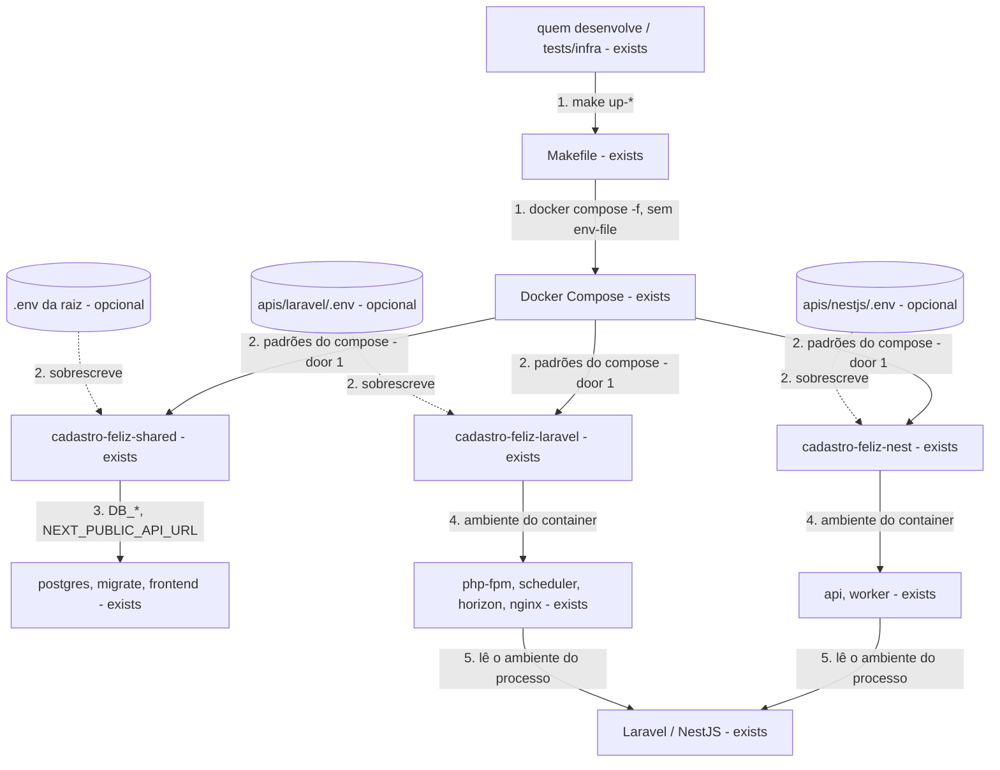

# Variáveis de ambiente por projeto

**Approved**: 2026-11-16 - user: "Aprovar e seguir"

## Problem

O `.env` da raiz guarda as variáveis de todos os projetos Compose: 36 linhas em `.env.example`, das quais `APP_KEY`, `APP_ENV`, `APP_DEBUG`, `REDIS_*` e `RABBITMQ_URL` só servem a uma ou duas stacks. Uma variável nova de uma stack mexe num arquivo comum a todas, na tabela de docs/infrastructure.md e nos testes. O `.env` é copiado de `.env.example` uma única vez e nunca mais recebe o que entra depois: o `.env` desta máquina não tem `OUTBOX_RETENTION_DAYS` nem `OUTBOX_ALERT_EMAIL`, e o compose da Laravel precisou de um valor padrão só para um `.env` antigo não zerar a retenção. Nenhuma stack recebe um valor próprio para um experimento sem que todas o recebam. A fonte (`.design/env-per-project.md`) não traz outra medição: não há produto.

Quando isto sair, um clone limpo sobe qualquer projeto sem criar arquivo nenhum, uma variável nova chega pelo `git pull` com o seu valor, e quem quer trocar um valor de uma stack escreve no `.env` ao lado do compose dela, sem afetar as outras.

## Shape

Reusa o mecanismo do próprio Compose, que lê o `.env` do diretório do compose (testado no Compose 5.6.1 com `-f` a partir da raiz) e já interpola valores padrão, como o compose da Laravel faz hoje com `OUTBOX_RETENTION_DAYS`; não há script nem arquivo de padrões novo. As regras que mudam o resultado - qual valor cada container recebe - ficam nos três composes, e `make test-infra` as alcança por `docker compose config`, por `docker exec ... printenv` e pelo comportamento da API.

1. quem desenvolve ou `tests/infra` (exists) -> `make up-shared`, `make migrate`, `make up-<stack>` e os demais alvos do `Makefile` (exists) - chamam o Compose sem apontar arquivo de ambiente e sem criar nenhum (door 1)
2. Docker Compose (exists) - lê o `.env` opcional ao lado do compose do projeto, se existir, e interpola cada variável com o valor dele ou com o padrão escrito no compose (door 1)
3. `cadastro-feliz-shared` (exists) - `postgres`, `migrate` e `frontend` recebem `DB_*` e `NEXT_PUBLIC_API_URL`
4. `cadastro-feliz-laravel` e `cadastro-feliz-nest` (exists) - os containers recebem as variáveis de que a stack precisa; a imagem da Laravel é construída sem o `.env` da stack
5. out: Laravel e NestJS (exists) leem o ambiente do processo, como hoje, e nenhum deles lê `.env` dentro do container

**Inventário** - as variáveis que cada compose interpola hoje, e que passam a ter padrão nele:
- `cadastro-feliz-shared` (6): `DB_HOST`, `DB_PORT`, `DB_DATABASE`, `DB_USERNAME`, `DB_PASSWORD`, `NEXT_PUBLIC_API_URL`.
- `cadastro-feliz-laravel` (27): `API_PORT`, `APP_KEY`, `APP_ENV`, `APP_DEBUG`, `CORS_ALLOWED_ORIGIN`, os cinco `DB_*`, `LIMITER_REDIS_HOST`, `LIMITER_REDIS_PORT`, `REDIS_HOST`, `REDIS_PORT`, `SMTP_HOST`, `SMTP_PORT`, `MAIL_FROM`, os quatro `REGISTRATION_*` e os seis `OUTBOX_*`.
- `cadastro-feliz-nest` (22): as da Laravel, menos `APP_KEY`, `APP_ENV`, `APP_DEBUG`, `OUTBOX_RETENTION_DAYS` e `OUTBOX_ALERT_EMAIL`.

**Changes underneath**

| Front | What changes |
| --- | --- |
| domain | `.env` significava o arquivo da raiz, única fonte de todas as variáveis, criado por `make` a partir de `.env.example`. Passa a significar a sobrescrita opcional de um único projeto, ao lado do compose dele, que nenhum `make` cria. Quem depende do significado antigo: o alvo `env` do `Makefile` e todos os alvos que o chamam, o `--env-file .env` do `Makefile` e dos adaptadores de `tests/infra`, e o guarda de `apis/laravel/bootstrap/app.php`, que continua certo porque o arquivo nunca entra na imagem (door 2) |
| stored data | nada a migrar. Um `.env` antigo e completo na raiz de quem já clonou continua funcionando: `cadastro-feliz-shared` só lê dele as próprias variáveis, com os mesmos valores dos padrões, e as stacks não o enxergam. Nenhum alvo o apaga |
| readers | `tests/infra`: C1, C2 e C9 de `shared.sh`; FE1, FE4 e FE13 de `frontend.sh`; RF18 de `test-frontend.sh`; LV1, LV11 e LV23 de `laravel.sh`; RG18, RG20 e RG21 de `registration.sh`; NS7 de `nest.sh`; OM15 e OM23 de `laravel-outbox.sh`; IP13 de `docs.sh`; `rg_set_env` de `registration-helpers.sh`, usado por `outbox.sh`, `laravel-outbox.sh` e `nest.sh`; `sw_env` de `stack-switch.sh`; `stack_queue_up_alone` dos dois adaptadores; o `rm -f "$WORK/.env"` de `run.sh`. LV10 e FE12 continuam valendo como estão |
| docs | docs/infrastructure.md (Status, a tabela do `Makefile`, a sequência de subida, as notas de `NEXT_PUBLIC_API_URL` e das variáveis da Laravel, e Variáveis de ambiente por projeto), docs/stacks.md (Laravel e a árvore), README (a árvore), docs/decisions.md (decisão 29) e uma nota nos três designs cujas decisões a 29 substitui |

Data: none - nenhum dado guardado muda; só configuração local.

## Surface

None - nothing consumed outside: `POST /users`, `GET /health`, as portas e os nomes dos alvos do `Makefile` não mudam. O alvo `make env` sai; ele não aparece em `make help` e só os próprios alvos o chamavam.

## Landing

| One-way door | Literal shape | Alternative rejected |
| --- | --- | --- |
| 1. cada projeto Compose é dono das próprias variáveis | toda interpolação nos três composes tem a forma `${NOME:-<padrão de docs/infrastructure.md>}`, inclusive em `ports` e `command`; o `Makefile` chama `docker compose` sem `--env-file`, e o alvo `env` e `.env.example` deixam de existir; a sobrescrita de um projeto é o `.env` do diretório do compose dele (raiz, `apis/laravel`, `apis/nestjs`), já ignorado pela linha `.env` do `.gitignore`; registrado como decisão 29 em docs/decisions.md, que substitui o default 2 de .design/shared-infrastructure.md, a Key decision 7 de .design/laravel-api-base.md e, em .design/frontend-container.md, a frase que faz do `.env` da raiz a única fonte | um `.env.example` por projeto, copiado no primeiro uso - a divergência de hoje continua, em quatro arquivos; um arquivo de padrões versionado por projeto lido como `env_file` - dois mecanismos, porque `ports` e `command` ainda precisam de interpolação, e só pagaria se as variáveis fossem lidas fora do Compose, o que a POC não faz (motivos das decisões 16 e 20) |
| 2. a sobrescrita nunca entra numa imagem | `apis/laravel/.dockerignore` ganha a linha `.env*`, como `apis/nestjs/.dockerignore` e `frontend/.dockerignore` já têm | ler o `.env` da stack dentro do container - o Laravel o carregaria por conta própria, e uma variável só do arquivo chegaria à aplicação sem passar pelo compose |

- Nothing else in this change is hard to reverse

## Criteria

### S1: `cadastro-feliz-shared` sem arquivo de ambiente (P1)

Os serviços comuns sobem de um clone limpo com os padrões do compose da raiz, e o `.env` da raiz só sobrescreve este projeto.

**Acceptance Criteria**

1. WHEN `make up-shared` roda numa cópia sem nenhum `.env` THEN o sistema SHALL sair com `0`, deixar `postgres`, `redis-limiter`, `mailpit` e `frontend` saudáveis, mostrar `localhost:8080` na página do frontend e não criar arquivo `.env` em lugar nenhum da cópia
2. WHEN `make migrate` roda numa cópia sem nenhum `.env` THEN o sistema SHALL sair com `0` com a versão das migrations igual à do último arquivo de `database/migrations`, e não criar arquivo `.env`
3. WHEN o `.env` da raiz troca `NEXT_PUBLIC_API_URL` para o endereço HTTP de `localhost:9090` e `make up-shared` roda THEN o frontend SHALL mostrar `localhost:9090`, não mostrar `localhost:8080` e manter a mesma imagem
4. WHEN o `.env` da raiz existe com `DB_PASSWORD=outra` e `make up-shared` roda THEN o sistema SHALL deixar o arquivo byte a byte como estava
5. IF o `.env` da raiz traz `REGISTRATION_MAX_ATTEMPTS=2` e `OUTBOX_BATCH_SIZE=7` THEN `docker compose config` dos composes da Laravel e do NestJS SHALL resolver essas variáveis como `5` e `100`
   - o `.env` completo de antes desta mudança, copiado do `.env.example` antigo, na raiz → as duas stacks resolvem os padrões dos próprios composes
6. The repositório SHALL não ter `.env.example` em nenhum diretório, e `git check-ignore` SHALL ignorar `.env` na raiz, em `apis/laravel` e em `apis/nestjs`

### S2: `cadastro-feliz-laravel` com padrões próprios (P1)

A stack Laravel sobe com os padrões do próprio compose, e o `.env` dela muda só ela, sem entrar na imagem.

**Acceptance Criteria**

7. WHEN `make up-laravel` roda numa cópia sem nenhum `.env` THEN o sistema SHALL sair com `0`, `GET localhost:8080/health` SHALL responder `200`, e nenhum arquivo `.env` SHALL ser criado
8. The `php-fpm`, o `scheduler` e o `horizon` SHALL receber, sem nenhum `.env`, `APP_ENV=local`, `APP_DEBUG=true`, `APP_KEY` com `base64:` seguido de 32 bytes, `OUTBOX_RETENTION_DAYS=7`, `OUTBOX_ALERT_EMAIL=ops@cadastro-feliz.local` e `CORS_ALLOWED_ORIGIN` com a origem HTTP de `localhost:3000`
9. WHEN `apis/laravel/.env` traz `REGISTRATION_MAX_ATTEMPTS=2` e `make up-laravel` roda THEN a terceira tentativa de `POST /users` com o mesmo e-mail e IP dentro da janela SHALL responder `429`, e `docker compose config` do compose do NestJS SHALL resolver `REGISTRATION_MAX_ATTEMPTS` como `5`
   - primeira e segunda tentativas, com e-mails já cadastrados → `409`; terceira → `429`
10. IF `apis/laravel/.env` existe quando a imagem é construída THEN a imagem do `php-fpm` SHALL não conter `/var/www/html/.env`, e o `php-fpm` SHALL não ter no ambiente uma variável que só esse arquivo declara
    - `apis/laravel/.env` com `PROBE_ONLY_IN_FILE=1` → `printenv` do `php-fpm` sem `PROBE_ONLY_IN_FILE`; `GET /health` → `200`

### S3: `cadastro-feliz-nest` com padrões próprios (P1)

A stack NestJS sobe com os padrões do próprio compose, e o `.env` dela muda só ela.

**Acceptance Criteria**

11. WHEN `make up-nest` roda numa cópia sem nenhum `.env` THEN o sistema SHALL sair com `0`, `GET localhost:8080/health` SHALL responder `200`, e nenhum arquivo `.env` SHALL ser criado
12. WHEN `apis/nestjs/.env` traz `OUTBOX_BATCH_SIZE=2` e `make up-nest` roda THEN o `worker` SHALL ter `OUTBOX_BATCH_SIZE=2` no ambiente, e `docker compose config` do compose da Laravel SHALL resolver `OUTBOX_BATCH_SIZE` como `100`
13. WHEN `apis/laravel/.env` traz `REGISTRATION_MAX_ATTEMPTS=2` e `make up-nest` roda THEN a `api` SHALL ter `REGISTRATION_MAX_ATTEMPTS=5` no ambiente

### S4: Regras que valem para todo projeto (P1)

`make test-infra` impede que um compose volte a depender de um arquivo de ambiente ou que uma stack mude o padrão do contrato.

**Acceptance Criteria**

14. The `docker compose config` de cada um dos três composes, numa cópia sem nenhum `.env`, SHALL resolver toda variável interpolada com valor não vazio, em `environment`, `ports` e `command`
15. IF um compose interpola uma variável sem padrão THEN `make test-infra` SHALL falhar com uma linha que nomeia o compose e a variável
    - `${OUTBOX_BATCH_SIZE}` sem padrão no compose do NestJS → a falha nomeia `apis/nestjs/docker-compose.yml` e `OUTBOX_BATCH_SIZE`; sem `.env` e com `OUTBOX_BATCH_SIZE` exportado no shell de quem roda → a falha acontece igual
16. The padrão de cada `REGISTRATION_*` e de cada `OUTBOX_*` que um compose de stack declara SHALL ser igual ao valor de docs/infrastructure.md › Regras de negócio, e os dois composes de stack SHALL declarar os quatro `REGISTRATION_*` e `OUTBOX_BATCH_SIZE`, `OUTBOX_REPUBLISH_AFTER_SECONDS`, `OUTBOX_MAX_ATTEMPTS` e `OUTBOX_BACKOFF_BASE_SECONDS`
    - `REGISTRATION_MAX_ATTEMPTS:-6` no compose da Laravel → `make test-infra` falha nomeando `cadastro-feliz-laravel` e `REGISTRATION_MAX_ATTEMPTS`; `OUTBOX_RETENTION_DAYS` ausente do compose do NestJS → passa
17. The docs/infrastructure.md › Variáveis de ambiente SHALL listar cada variável que algum compose interpola, com o mesmo padrão dos composes e os projetos que a declaram, e cada variável listada SHALL ser declarada por algum compose, exceto `RABBITMQ_URL`, marcada como da stack Go
    - os três composes declaram `DB_PASSWORD` com `cadastro_feliz` → uma linha, com os três projetos; docs com `DB_PASSWORD` `outra` → falha
18. The docs/decisions.md SHALL ter a decisão 29 com a regra de door 1; os três designs que ela substitui SHALL ter uma nota que aponta para ela; e docs/infrastructure.md, docs/stacks.md e o README SHALL não citar `.env.example` nem dizer que o `.env` da raiz é a única fonte das variáveis

## Out of scope

| Excluded | Why |
| --- | --- |
| a stack Go | não existe; nasce já com a regra de door 1, e `RABBITMQ_URL` fica na documentação marcada como dela |
| segredos de produção e cofre de segredos | a POC não tem produção nem segredo real; `APP_KEY` continua um valor local fixo e versionado, como já era em `.env.example` |
| o frontend em projeto Compose próprio | mexeria em `make up-shared`, `make watch-frontend` e nos testes do frontend sem resolver nenhuma das dores; o `.env` da raiz continua sobrescrevendo `NEXT_PUBLIC_API_URL` |
| trocar qualquer valor padrão | nomes e valores de docs/infrastructure.md continuam os mesmos |
| apagar o `.env` antigo da raiz de quem já clonou | continua funcionando (Changes underneath); quem quiser o apaga |

## Assumptions

| Assumption | Chosen default | Rationale | Confirmed? |
| --- | --- | --- | --- |
| Valores repetidos entre projetos (`DB_*`, `CORS_ALLOWED_ORIGIN`, `API_PORT`) | declarados em cada projeto que os usa | Key decision 6 do design aprovado: nenhum projeto depende de outro para subir | y |
| Regras de negócio por stack | sobrescrita local livre; padrão igual ao contrato, conferido por teste | resposta do usuário na descoberta: "Padrão igual ao contrato" | y |
| Onde fica a sobrescrita dos serviços comuns | o `.env` da raiz, só para `cadastro-feliz-shared` | resposta do usuário na descoberta: "Mesma regra" | y |
| Um teste que cria o `.env` de um projeto | apaga o arquivo ao terminar, para o próximo começar dos padrões | default do design, como os testes já apagam o `.env` da raiz hoje | n |
| De onde os testes tiram a origem do CORS | do padrão do compose da stack, não de um arquivo | o arquivo deixa de existir num clone limpo; o valor continua `http://localhost:3000` | n |
| Forma da tabela de docs/infrastructure.md | as três tabelas atuais, com uma coluna a mais com os projetos que declaram cada variável | mantém o formato que C9 e docs.sh já leem | n |

**Open questions:** none - all resolved or logged above.

## Differences from the source

None - the product matches the source

## Sources

- .design/env-per-project.md - binding - o formato, as seis Key decisions e as quatro slices; confirmado pelo responsável do projeto em 2026-11-16
- .design/shared-infrastructure.md, .design/frontend-container.md, .design/laravel-api-base.md - binding - as decisões que a 29 substitui
- docs/infrastructure.md › Variáveis de ambiente - binding - os nomes e os padrões, que não mudam
