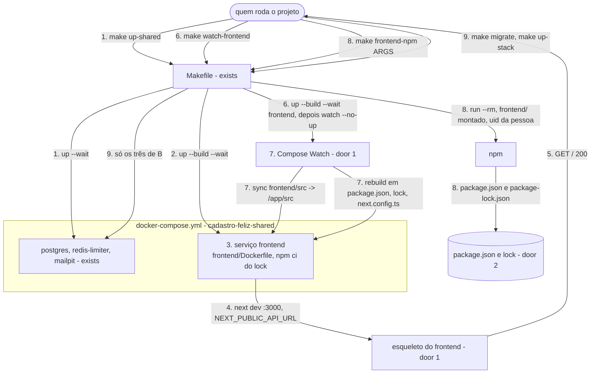

# Container do frontend

**Approved**: pending

## Problem

O projeto `cadastro-feliz-shared` não tem o serviço `frontend`, e `frontend/` não existe. A
documentação promete o formulário sempre em `localhost:3000`, e o README promete que a máquina só
precisa de Docker e `make`. Quem for escrever o formulário hoje teria de instalar Node na própria
máquina, quebrando essa promessa, e de desenhar o ambiente de execução junto com o formulário. O
responsável roda Docker Desktop no macOS, onde, segundo o guia de desenvolvimento local do Next.js,
os eventos de arquivo de um bind mount podem atrasar ou se perder. A fonte
(`.design/frontend-container.md`) não traz medição, porque ainda não há produto.

Quando isto sair, `make up-shared` deixa um esqueleto Next.js respondendo em `localhost:3000`. Com
`make watch-frontend` em um terminal, uma edição em `frontend/src` aparece no navegador sem
reiniciar o container, e `make frontend-npm` acrescenta dependências sem Node na máquina. Uma falha
do frontend não impede o `migrate` nem uma stack de subir.

## Shape

Reusa o projeto `cadastro-feliz-shared`, a rede externa, o `.env` da raiz e o `Makefile` existentes,
e a imagem oficial do Node, sem nenhum orquestrador novo. As regras que mudam o resultado (ordem e
isolamento das falhas em `up-shared`, recusa de `frontend-npm` sem argumentos, o que `migrate` e
`up-<stack>` deixam de construir) ficam no `Makefile` e no `docker-compose.yml`, e os testes em
`tests/infra/` os executam contra o Docker de verdade.

1. `make up-shared` -> `Makefile` (exists) - cria `.env` e a rede se faltarem, sobe `postgres`,
   `redis-limiter` e `mailpit` e espera que fiquem saudáveis
2. `Makefile` (exists) - só depois, reconstrói a imagem do `frontend` e sobe o serviço esperando que
   fique saudável; uma falha aqui faz o comando sair com erro, sem derrubar o passo 1
3. `docker-compose.yml` (exists) - o serviço `frontend` (door 1) constrói `frontend/Dockerfile`
   (door 1) com `npm ci` a partir de `frontend/package-lock.json` (door 2), publica 3000 e passa
   `NEXT_PUBLIC_API_URL` do `.env` como variável de ambiente do container
4. `frontend` (new) - o container roda `next dev` em 3000, como usuário `node`, e o esqueleto em
   `frontend/src/app` renderiza o nome do projeto e o valor de `NEXT_PUBLIC_API_URL`
5. out: `GET localhost:3000/` responde `200` com o esqueleto
6. `make watch-frontend` -> `Makefile` (exists) - cria `.env` e a rede, reconstrói e sobe só o
   `frontend` saudável e então vigia sem subir nada (Compose Watch, door 1)
7. Compose Watch - copia cada mudança de `frontend/src` para `/app/src` no container, onde o
   Turbopack recompila; uma mudança em `package.json`, `package-lock.json` ou `next.config.ts`
   reconstrói a imagem e recria o container; Ctrl+C encerra só a vigilância
8. `make frontend-npm ARGS="..."` -> `Makefile` (exists) - recusa sem `ARGS`; com `ARGS`, roda o npm
   num container descartável da imagem do `frontend`, com `frontend/` montado, `node_modules` num
   volume anônimo e o usuário de quem rodou o `make`; grava `package.json` e `package-lock.json`
   (door 2)
9. `make migrate` e `make up-<stack>` -> `Makefile` (exists) - sobem e esperam só `postgres`,
   `redis-limiter` e `mailpit`; não constroem nem sobem o `frontend`

**Comandos** - chamados por quem roda o projeto na própria máquina, com Docker e Compose. Código de
saída `0` no sucesso; diferente de zero nos casos indicados.

| Comando | Faz | Sai com erro quando |
| --- | --- | --- |
| `make up-shared` | passos 1 a 5 | uma porta (3000, 5432, 8025) está ocupada, o build do `frontend` falha ou um serviço não fica saudável |
| `make watch-frontend` | passos 6 e 7, em primeiro plano | o build do `frontend` falha ou a porta 3000 está ocupada |
| `make frontend-npm ARGS="<comando npm>"` | passo 8 | `ARGS` vazio, ou o npm falha |
| `make migrate`, `make up-<stack>` | como hoje, sem o `frontend` (passo 9) | como hoje |

**Changes underneath**

| Front | What changes |
| --- | --- |
| domain | nada - nenhum termo muda de significado |
| stored data | nada a migrar - o frontend não guarda dados; o cache `.next` vive no container e some quando ele é recriado |
| readers | `make up-shared` passa a ter quatro serviços: os testes C1, C3, C5, C7 e C8 de `.specs/features/shared-infrastructure/checks.md` afirmam três serviços, as portas {5432, 8025} e quatro imagens, e mudam junto com essas afirmações (critérios 1, 2, 5, 6 e 7). `make migrate` deixa de chamar `make up-shared`: o C13 continua valendo, porque só afirma os três serviços |
| docs | `README.md`, `docs/infrastructure.md` e `docs/stacks.md` dizem que o frontend está em design ou não existe; passam a descrever o container, `make watch-frontend` e `make frontend-npm`. `docs/decisions.md` ganha a decisão 16 |

Data: none - nenhuma tabela, volume ou chave é lida ou escrita pelo frontend nesta rodada.

## Surface

None - nenhuma rota de API; a única página é o esqueleto em `GET localhost:3000/`, sem
controles, que a rodada do formulário substitui. Os comandos estão em Shape › Comandos e nos
critérios de S1 a S4.

## Landing

| One-way door | Literal shape | Alternative rejected |
| --- | --- | --- |
| execução do frontend | serviço `frontend` em `docker-compose.yml`, `build: ./frontend`, imagem `cadastro-feliz-shared-frontend`, porta `3000:3000`, `environment: NEXT_PUBLIC_API_URL`; `frontend/Dockerfile` `FROM node:26.13.0-alpine`, `WORKDIR /app` com dono `node`, `USER node`, `npm ci` antes de copiar o código, comando `next dev` em `0.0.0.0:3000`; `develop.watch`: `sync` de `./frontend/src` para `/app/src`, `rebuild` em `./frontend/package.json`, `./frontend/package-lock.json` e `./frontend/next.config.ts` | bind mount de `frontend/` - no Docker Desktop do macOS os eventos de arquivo podem atrasar ou se perder, e `WATCHPACK_POLLING` não tem efeito no Turbopack, o padrão do Next.js 16; build de produção com saída standalone - cada edição exigiria rebuild, e a POC não tem produção |
| fluxo de dependências | `make frontend-npm ARGS="<comando npm>"` é o único caminho; `frontend/.npmrc` com `save-exact=true`; `frontend/package-lock.json` versionado é a fonte do `npm ci`; `frontend/node_modules` e `frontend/.next` no `.gitignore` e no `frontend/.dockerignore` | Node na máquina - quebra a promessa do README de só precisar de Docker e `make` |
| dependências novas | `next` `16.4.5`, `react` `19.3.1`, `react-dom` `19.3.1`, TypeScript e tipos nas versões exatas que `create-next-app@16.4.5` escolher, todas sem `^` nem `~` | faixas `^` - o `npm install` de cada pessoa resolveria versões diferentes |

- Nothing else in this change is hard to reverse

## Criteria

### S1: Frontend no ar com `make up-shared` (P1)

`make up-shared` constrói e sobe o `frontend` depois dos três serviços comuns, sempre com o código
atual de `frontend/`.

**Acceptance Criteria**

1. WHEN `make up-shared` roda em um clone limpo (sem `.env`, sem a rede, sem volume) THEN o sistema SHALL deixar `postgres`, `redis-limiter`, `mailpit` e `frontend` do projeto `cadastro-feliz-shared` com saúde `healthy`, sair com código `0`, e `GET localhost:3000/` SHALL responder `200` com um HTML que contém `Cadastro Feliz` e `localhost:8080`
2. WHEN `make up-shared` roda de novo sem nenhuma mudança THEN o sistema SHALL manter os mesmos quatro IDs de container e o mesmo ID da imagem `cadastro-feliz-shared-frontend`, e sair com código `0`
3. WHEN `frontend/src/app/page.tsx` muda sem o watch ativo e `make up-shared` roda THEN `GET localhost:3000/` SHALL servir o código novo
   - `Cadastro Feliz` trocado por `Cadastro Probe` → o HTML contém `Cadastro Probe` e não contém `Cadastro Feliz`
4. WHEN `NEXT_PUBLIC_API_URL` muda no `.env` e `make up-shared` roda THEN `GET localhost:3000/` SHALL mostrar o valor novo (os exemplos omitem o esquema do valor), e o ID da imagem `cadastro-feliz-shared-frontend` SHALL ser o mesmo de antes
   - `localhost:9090` → o HTML contém `localhost:9090` e não contém `localhost:8080`
5. The projeto `cadastro-feliz-shared` SHALL publicar na máquina exatamente as portas `3000`, `5432` e `8025`
6. The serviços comuns SHALL usar exatamente as imagens `postgres:18.6-alpine`, `redis:8.10.3-alpine`, `axllent/mailpit:v1.33.0`, `migrate/migrate:v4.20.1` e `cadastro-feliz-shared-frontend`, e `frontend/Dockerfile` SHALL partir de `node:26.13.0-alpine`
7. IF a porta `3000` da máquina já está ocupada THEN `make up-shared` SHALL sair com código diferente de zero
8. IF `frontend/package-lock.json` está inválido (o `npm ci` do build falha) THEN `make up-shared` SHALL sair com código diferente de zero e deixar `postgres`, `redis-limiter` e `mailpit` com saúde `healthy`
9. IF a página tem um erro de compilação THEN o `frontend` SHALL continuar `healthy` 20 s depois do erro, e `GET localhost:3000/` SHALL responder `500`
10. The container do `frontend` SHALL rodar como o usuário `node` (uid `1000`) e executar `next dev`
11. The arquivo `frontend/package.json` SHALL fixar `next` `16.4.5`, `react` `19.3.1` e `react-dom` `19.3.1`, e nenhuma versão em `dependencies` nem em `devDependencies` SHALL começar com `^` ou `~`
12. The repositório SHALL ignorar `frontend/node_modules` e `frontend/.next` no `.gitignore`, e `frontend/` SHALL não ter arquivo `.env`

### S2: Edição pelo `make watch-frontend` (P1)

Com o watch ativo, o que muda em `frontend/src` chega ao container sem reiniciá-lo, e o que muda nas
dependências reconstrói a imagem.

**Acceptance Criteria**

13. WHEN `make watch-frontend` roda com o `frontend` fora do ar e `frontend/src/app/page.tsx` editado antes THEN o sistema SHALL criar `.env` e a rede se faltarem, deixar o `frontend` `healthy` servindo a edição e continuar em primeiro plano
14. WHILE `make watch-frontend` roda, WHEN `frontend/src/app/page.tsx` muda THEN `GET localhost:3000/` SHALL servir o texto novo em até 10 s, com o mesmo ID de container
15. WHILE `make watch-frontend` roda, WHEN `frontend/src/app/probe/page.tsx` é criado THEN `GET localhost:3000/probe` SHALL responder `200` em até 10 s, e WHEN ele é apagado THEN SHALL responder `404` em até 10 s
16. WHILE `make watch-frontend` roda, WHEN `frontend/package.json` muda THEN o `frontend` SHALL estar, em até 120 s, num container de ID diferente, `healthy`, com `GET localhost:3000/` respondendo `200`
    - campo `"description": "probe"` acrescentado → container novo
17. WHEN `make watch-frontend` recebe SIGINT THEN o container do `frontend` SHALL continuar no estado `running`, com o mesmo ID, e `GET localhost:3000/` SHALL responder `200`

### S3: Dependências por `make frontend-npm` (P1)

Dependências mudam sem Node na máquina, e só `package.json` e o lock mudam em `frontend/`.

**Acceptance Criteria**

18. WHEN `make frontend-npm ARGS="install is-number@7.0.0"` roda THEN `frontend/package.json` SHALL ter `"is-number": "7.0.0"` em `dependencies`, `frontend/package-lock.json` SHALL ter a entrada `node_modules/is-number` na versão `7.0.0`, `frontend/node_modules` SHALL não existir na máquina, e `frontend/package.json` SHALL pertencer ao uid de quem rodou o `make`
    - `install is-number` sem versão → a versão gravada não começa com `^` nem `~`
19. IF `make frontend-npm` roda sem `ARGS` THEN o sistema SHALL imprimir `uso: make frontend-npm ARGS="<comando npm>"`, sair com código diferente de zero e não criar nenhum container
20. WHEN `make frontend-npm` roda com o `frontend` no ar THEN o container do `frontend` SHALL continuar com o mesmo ID, respondendo em 3000
21. WHEN `make up-shared` roda depois de `make frontend-npm ARGS="install is-number@7.0.0"` THEN o container do `frontend` SHALL ter `/app/node_modules/is-number`

### S4: Frontend fora do caminho do migrate e das stacks (P1)

Uma falha do frontend nunca impede o `migrate` nem uma stack de subir.

**Acceptance Criteria**

22. IF `frontend/package-lock.json` está inválido THEN `make migrate` SHALL sair com código `0` com a versão `1` aplicada, e `make up-<stack>` SHALL sair com código `0` com a stack `healthy`
23. WHEN `make migrate` ou `make up-<stack>` roda em um clone limpo THEN nenhum container do serviço `frontend` SHALL existir depois

### S5: Documentação alinhada (P2)

A documentação descreve o container que existe e registra a forma escolhida.

**Acceptance Criteria**

24. The arquivo `docs/decisions.md` SHALL ter a decisão `16` "Frontend em `next dev` com o código copiado pelo Compose Watch", com origem `Definida`, no índice e numa seção que cita `next dev`, `Compose Watch`, `bind mount` e `Turbopack`
25. The arquivo `docs/infrastructure.md` SHALL deixar de dizer que o serviço `frontend` não existe; › Makefile SHALL listar `make watch-frontend` e `make frontend-npm`, e a linha de `make migrate` SHALL dizer que ela sobe `postgres`, `redis-limiter` e `mailpit`; › Versões fixadas SHALL listar o `frontend` com `node:26.13.0-alpine`
26. The `README.md` SHALL deixar de dizer que o frontend está em design, e › Como vai funcionar SHALL mostrar `make up-shared` antes de `make up-<stack>` e mostrar `make watch-frontend` e `make frontend-npm`
27. The arquivo `docs/stacks.md` › Frontend SHALL dizer que o container roda `next dev` e citar `make watch-frontend` e `make frontend-npm`
28. WHEN `make help` roda THEN a saída SHALL listar `make watch-frontend` e `make frontend-npm`

## Out of scope

| Excluded | Why |
| --- | --- |
| Formulário, schema de validação, serviço de cadastro e textos de `docs/api-contract.md` | rodada do formulário |
| Build de produção do frontend | Key decision 1 do design: a POC não tem produção |
| Lint e test runner do frontend | entram com o formulário, o primeiro código com regra |
| CORS | pertence a cada stack |
| Teste automatizado de npm sem rede | default 3 do slice Makefile do design; o critério 8 cobre a falha de build com um lock inválido |
| Medida de 2 s no Mac do responsável | é o `Worked if` do design e se confere na revisão do início da rodada do formulário; os testes rodam no Docker local com limite de 10 s |
| Aplicar o limite por IP (`.design/registration-ip-limit.md`) aos docs | tarefa separada; esta rodada só ocupa o número 16 em `docs/decisions.md` |

## Assumptions

| Assumption | Chosen default | Rationale | Confirmed? |
| --- | --- | --- | --- |
| Versão do Node | `node:26.13.0-alpine` | Node 26 é a LTS (Lithium) mais recente desde 2026-10-28, e 26.13.0 é o patch atual; Alpine como os outros serviços | n |
| Versões do Next.js e do React | `next` `16.4.5`, `react` e `react-dom` `19.3.1` | as mais recentes no registro do npm em 2026-11-04; o Next.js 16.4.5 aceita React `^19.0.0` e Node `>=20.9.0` | n |
| TypeScript e tipos | as versões exatas que `create-next-app@16.4.5` escolher, sem ESLint | o esqueleto segue o gerador da mesma versão do Next.js; o lint fica para o formulário (design, Out) | n |
| O que é saudável | o servidor responde HTTP em 3000, com qualquer status | default 1 do slice frontend do design: um erro de compilação aparece no navegador e não derruba `make up-shared` | n |
| Gerenciador de pacotes | npm | default 2 do slice frontend do design | n |
| Cache `.next` | dentro do container, sem volume | default 3 do slice frontend do design | n |
| `make up-<stack>` e o frontend | não sobe o frontend; o README manda rodar `make up-shared` antes | default 1 do slice Makefile do design | n |
| Nomes dos alvos | `watch-frontend` e `frontend-npm` | default 2 do slice Makefile do design | n |
| Rede nos testes | os testes que sobem o `frontend` precisam do registro do npm | default 3 do slice Makefile do design | n |
| Alcance do watch | `sync` só de `frontend/src`; `rebuild` em `package.json`, `package-lock.json` e `next.config.ts`; outros arquivos de `frontend/` entram no container com `make up-shared` | é onde a rodada do formulário escreve (`src/app`, `src/modules`); o resto muda raramente | n |
| Conteúdo do esqueleto | título `Cadastro Feliz` e a linha `API: <NEXT_PUBLIC_API_URL>`, com `lang="pt-BR"` | o design pede o nome do projeto e o endereço da API, para provar que a variável chegou à página | n |
| Usuário do `frontend-npm` | o uid e gid de quem roda o `make`, com o cache do npm em `/tmp` | no Linux, o usuário `node` (uid 1000) não teria escrita em `frontend/` de outro dono, e root deixaria os arquivos com dono root | n |
| Versões exatas em instalações novas | `frontend/.npmrc` com `save-exact=true` | Key decision 7 do design pede versões exatas, e `frontend-npm` é o único caminho para instalar | n |
| Limite de tempo nos testes do watch | 10 s para uma edição e 120 s para um rebuild | o Docker local dos testes não é o Mac do responsável; o limite prova que a sincronização acontece sem reiniciar, não o tempo do Mac | n |
| Número e origem da decisão | `16`, origem `Definida` | 15 é a última em `docs/decisions.md`; o responsável escolheu o modo e o Compose Watch na sessão de design | n |

**Open questions:** none - all resolved or logged above.

## Differences from the source

None - the product matches the source

## Sources

- `.design/frontend-container.md` - binding - forma, Key decisions 1 a 7, slices e defaults desta rodada
- `docs/infrastructure.md` - binding - projeto comum, porta 3000, `.env`, sequência de `make up-<stack>` e versões fixadas
- `.specs/features/shared-infrastructure/plan.md` e `checks.md` - binding - comportamento atual de `make up-shared`, `make migrate` e `make up-<stack>` que esta rodada estende
- Next.js, guia Local Development e upgrade para a versão 16 - Docker no macOS, Turbopack como padrão
- Docker, Compose file watch e `docker compose watch` - `sync`, `rebuild`, `--no-up` e os pré-requisitos (`stat`, `mkdir`, `rmdir`, escrita do `USER` no destino)
- registro do npm (`next`, `react`) e `nodejs.org/dist/index.json`, consultados em 2026-11-04 - versões fixadas
