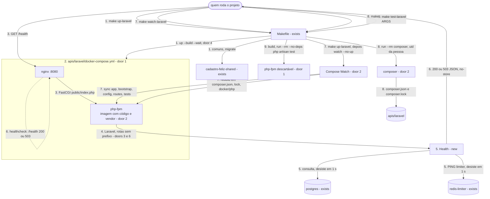

# Base da API Laravel

**Approved**: 2026-11-04 - user: "aprovado, pode seguir com as suposições"

## Problem

`apis/laravel` não existe, e `make up-laravel` recusa com `stack laravel ainda não implementada`.
O README promete a mesma API nas três stacks, na porta 8080, e a Laravel é a primeira a ser
construída. Quem começar `POST /users` nela hoje teria de resolver ao mesmo tempo a imagem PHP, o
compose, a configuração do framework, as conexões com o PostgreSQL e com o `redis-limiter` e a
regra de negócio, e um erro de rede apareceria misturado com um erro de validação. Um projeto novo
do Laravel 13 ainda guarda sessão, cache e fila em tabelas que este schema não tem, então a primeira
requisição falharia sem que ninguém tivesse escrito uma linha. A fonte
(`.design/laravel-api-base.md`) não traz medição, porque ainda não há produto.

Quando isto sair, `make up-laravel` deixa `nginx` e `php-fpm` saudáveis e `GET localhost:8080/health`
diz em JSON se o PostgreSQL e o `redis-limiter` respondem. Com `make watch-laravel` em um terminal,
uma edição em `apis/laravel` vale na próxima requisição, `make laravel-composer` muda as
dependências e `make test-laravel` roda os testes, tudo sem PHP na máquina. A rodada de
`POST /users` começa sem editar o Dockerfile, o compose da stack nem o `Makefile`.

## Shape

Reusa o `Makefile` com a regra genérica de stack, a rede externa, o `.env` da raiz, a sequência de
`make up-<stack>` com o migrate antes, o padrão de Compose Watch, do alvo de dependências e do
container descartável de teste do frontend, e as imagens oficiais em versão exata. As regras que
mudam o resultado ficam em dois lugares: o que `/health` responde e quando desiste, no módulo
`Health` do Laravel, que o PHPUnit alcança com os checks simulados; e o que cada alvo constrói,
sobe e grava, no `Makefile` e nos composes, que os testes de `tests/infra` executam contra o Docker
de verdade, com dependências reais paradas e pausadas.

1. `make up-laravel` -> `Makefile` (exists) - como hoje: cria `.env` e a rede, derruba as outras
   stacks, sobe os comuns e aplica o migrate; o passo final passa a ser `up --build --wait` (door 4)
2. `apis/laravel/docker-compose.yml` (door 1) - projeto `cadastro-feliz-laravel`: constrói a imagem
   do `php-fpm` com o código e o `vendor/` (doors 1 e 2) e sobe o `nginx` publicando `API_PORT`;
   o `php-fpm` só fica saudável respondendo ao ping do FPM, e o `nginx` só sobe depois dele
3. `GET localhost:8080/health` -> `nginx` (door 1) - encaminha toda requisição por FastCGI para
   `php-fpm:9000`, sempre para `public/index.php`
4. Laravel (door 6) - rotas de `routes/api.php` sem prefixo e sem a rota nativa `/up` (door 3),
   sessão e cache em memória, nenhuma tabela própria; todo erro sai em JSON
5. `Health` (new) - roda o check `database` (uma consulta ao PostgreSQL pela conexão padrão) e o
   check `limiter` (`PING` pela conexão `limiter`, sem prefixo), cada um desistindo em 1 s, e
   escreve o motivo de cada falha no log do `php-fpm`
6. out: `200` ou `503` com o corpo de door 3 e `Cache-Control: no-store`; o healthcheck do `nginx`
   chama esse mesmo `/health` e aceita `200` ou `503`
7. `make watch-laravel` -> `Makefile` (exists) - roda `make up-laravel` e fica vigiando sem subir
   nada (door 2): copia cada mudança de `app`, `bootstrap`, `config`, `routes` e `tests` para o
   `php-fpm`, e reconstrói a imagem quando `composer.json`, `composer.lock` ou `docker/php` mudam
8. `make laravel-composer ARGS="..."` -> `Makefile` (exists) - recusa sem `ARGS`; com `ARGS`, roda
   o composer no serviço descartável `composer` (doors 2 e 7), da imagem `base`, com o usuário de
   quem chamou, sobre uma cópia de `apis/laravel` dentro do container; devolve só `composer.json`
   e `composer.lock`, e só quando o composer termina sem erro
9. `make test-laravel` -> `Makefile` (exists) - reconstrói a imagem do `php-fpm` e roda
   `php artisan test` num container descartável, sem dependências, sem tocar no `php-fpm` em
   execução; o job `laravel` do CI chama o mesmo alvo

**Comandos** - chamados por quem roda o projeto na própria máquina, com Docker e Compose. Código de
saída `0` no sucesso; diferente de zero nos casos indicados.

| Comando | Faz | Sai com erro quando |
| --- | --- | --- |
| `make up-laravel` | passos 1 a 6 | a porta 8080 está ocupada, o build falha, o migrate falha ou o `nginx` não fica saudável |
| `make watch-laravel` | passo 7, em primeiro plano | como `make up-laravel` |
| `make watch-<stack>` sem compose | recusa, como `make up-<stack>` | sempre: `stack <nome> ainda não implementada` |
| `make laravel-composer ARGS="<comando composer>"` | passo 8 | `ARGS` vazio, ou o composer falha |
| `make test-laravel` | passo 9 | o build falha ou um teste falha |

**Changes underneath**

| Front | What changes |
| --- | --- |
| domain | `make up-<stack>` passava a stack ao `up --wait` como ela estava; agora reconstrói as imagens dela. Vale para NestJS e Go quando chegarem; as stacks falsas de `tests/infra` não têm `build` e não mudam |
| stored data | nada a migrar - `/health` não grava nada, e o schema não muda |
| readers | `tests/infra/stack.sh` `C16` afirma a recusa de `up-`, `down-` e `logs-laravel`; o critério 12 a substitui pela recusa só de `nest` e `go`, e `laravel` sai do laço. `.specs/features/shared-infrastructure/plan.md` critério 16 continua valendo para `nest` e `go`. Os testes FE22 e FE23 usam `make up-go` com stack falsa e não são afetados por `--build` |
| docs | `README.md`, `docs/stacks.md`, `docs/infrastructure.md` e `docs/api-contract.md` dizem que nenhuma stack está implementada; passam a descrever a base Laravel e `GET /health`. `docs/decisions.md` ganha as decisões 19 e 20 |

Data: none - `/health` só executa uma consulta sem tabela e um `PING`; nenhuma tabela, chave ou
volume é lido ou escrito, e o schema não muda.

## Surface

| Route | In | Out | Status | Who |
| --- | --- | --- | --- | --- |
| `GET /health` | nada | `status`, `checks.database`, `checks.limiter`; header `Cache-Control: no-store` | `200`, `503` | anyone - sem autenticação, como `POST /users` |

## Landing

| One-way door | Literal shape | Alternative rejected |
| --- | --- | --- |
| 1. execução da stack | `apis/laravel/docker-compose.yml` com `name: cadastro-feliz-laravel` e a rede `cadastro-feliz-net` externa; serviço `php-fpm`: `build` com contexto `.` e `dockerfile: docker/php/Dockerfile`, `provenance: false`, imagem `cadastro-feliz-laravel-php-fpm`, sem porta publicada, `environment` com `APP_KEY`, `APP_ENV`, `APP_DEBUG`, `DB_HOST`, `DB_PORT`, `DB_DATABASE`, `DB_USERNAME`, `DB_PASSWORD`, `LIMITER_REDIS_HOST` e `LIMITER_REDIS_PORT` vindos do `.env` da raiz, healthcheck pelo ping do FPM; serviço `nginx`: `nginx:1.30.6-alpine`, `ports: "${API_PORT}:80"`, `docker/nginx/default.conf` montado só leitura, `depends_on` o `php-fpm` saudável, healthcheck que aceita `200` ou `503` de `GET /health`; `docker/php/Dockerfile` `FROM php:8.5.12-fpm-alpine` com `pdo_pgsql` e `redis` 6.3.0 (phpredis) | bind mount de `apis/laravel` - escolha do responsável no design (decisão 20); healthcheck só pelo ping do FPM - não prova que o `nginx` alcança o Laravel (Key decision 2 do design); `/up` nativo no healthcheck - responde `500` sem dizer qual dependência caiu |
| 2. fluxo de código e dependências | a imagem copia `composer.json` e `composer.lock`, roda `composer install` sem scripts, copia o código e só então gera o autoload; `composer` vem de `composer:2.11.1`; `develop.watch` no `php-fpm`: `sync` de `./app`, `./bootstrap` (sem `cache/`), `./config`, `./routes` e `./tests` para `/var/www/html`, `rebuild` em `./composer.json`, `./composer.lock` e `./docker/php`; OPcache revalida a cada requisição; serviço `composer` no perfil `tools`, da mesma imagem, com `apis/laravel` montado em `/var/www/html` e `tmpfs` com modo `1777` em `vendor` e `bootstrap/cache`; `apis/laravel/vendor` no `.gitignore` e no `.dockerignore`; `make laravel-composer ARGS="<comando composer>"` é o único caminho para mudar dependências | PHP e Composer na máquina - quebra a promessa do README de só precisar de Docker e `make`; volume anônimo sobre `vendor` - criado com dono root, o composer com o uid da pessoa não escreve nele |
| 3. contrato `GET /health` | rota `GET /health` na raiz, sem prefixo; `200` `{"status":"ok","checks":{"database":"ok","limiter":"ok"}}`; `503` com a mesma forma, `status` `fail` e cada check `ok` ou `fail`; nenhuma outra chave; `Content-Type: application/json` e `Cache-Control: no-store` nos dois; resposta em menos de 3 s, cada check desistindo em 1 s; `/up` não existe | a forma de erro da decisão 14 - é para erros de entrada de `POST /users`, e um `503` aqui é relatório de estado; `/up` nativo - HTML, `500` e sem detalhe por dependência |
| 4. `make up-<stack>` reconstrói | o último passo de `up-%` vira `up --detach --build --wait`, para as três stacks | rebuild manual - uma edição feita sem o watch ficaria invisível até alguém lembrar de reconstruir, como o frontend já resolveu em `make up-shared` |
| 5. dependências novas | `laravel/laravel` `v13.11.0` como esqueleto, com `laravel/framework` `v13.40.0` e `phpunit/phpunit` da série 12 travados em `composer.lock`, que é a fonte do `composer install` da imagem; `nginx:1.30.6-alpine`, `php:8.5.12-fpm-alpine`, `composer:2.11.1`, phpredis `6.3.0` | `predis/predis` - cliente em PHP, dispensaria compilar a extensão, mas o phpredis é o cliente padrão do Laravel (design, Alternatives considered) |
| 6. Laravel sem tabelas e sem `.env` próprio | padrões no código: conexão de banco `pgsql`, sessão `array`, cache `array`, fila `sync`, log em `stderr`; `apis/laravel/database/migrations` não existe; `apis/laravel` não tem `.env` nem `.env.example`; `APP_KEY` (`base64:` com 32 bytes), `APP_ENV=local` e `APP_DEBUG=true` em `.env.example` › Específicas de stack, com valores locais fixos | os padrões de um projeto novo do Laravel 13 - sessão, cache e fila no driver `database`, em tabelas que o schema não tem e que `artisan migrate` nunca cria (Key decision 6 do design) |
| 7. composer sobre uma cópia (achado no build, ajusta door 2) | o `Dockerfile` tem dois estágios: `base` (PHP, extensões, `composer`, sem código) e `app` (vendor e código, o que o `php-fpm` roda); o serviço `composer` usa `target: base`, imagem `cadastro-feliz-laravel-php-base`, `apis/laravel` montado em `/src`; o alvo copia `/src` para `/tmp/app`, roda o composer lá e copia de volta só `composer.json` e `composer.lock` | `tmpfs` sobre `vendor` dentro do bind mount - o Docker cria o ponto de montagem `apis/laravel/vendor` na máquina, vazio e com dono root, o que contradiz o critério 27; a imagem do `php-fpm` no serviço `composer` - ela roda `composer install` do lock, então um lock quebrado impediria o próprio `make laravel-composer` de consertá-lo |

- Nothing else in this change is hard to reverse

## Criteria

### S1: Stack Laravel no ar com `make up-laravel` (P1)

`make up-laravel` constrói e sobe `nginx` e `php-fpm`, sempre com o código atual de `apis/laravel`.

**Acceptance Criteria**

1. WHEN `make up-laravel` roda em um clone limpo (sem `.env`, sem a rede, sem volume) THEN o sistema SHALL sair com código `0`, deixar `nginx` e `php-fpm` do projeto `cadastro-feliz-laravel` com saúde `healthy`, e `GET localhost:8080/health` SHALL responder `200`
2. WHEN `make up-laravel` roda de novo sem nenhuma mudança THEN o sistema SHALL manter os mesmos IDs dos dois containers e o mesmo ID da imagem `cadastro-feliz-laravel-php-fpm`, e sair com código `0`
3. WHEN `apis/laravel/routes/api.php` ganha uma rota `GET /probe` sem o watch ativo e `make up-laravel` roda THEN `GET localhost:8080/probe` SHALL responder `200` com o corpo da rota nova
   - antes do `make up-laravel` → `404`; depois → `200`
4. The projeto `cadastro-feliz-laravel` SHALL publicar na máquina só a porta `8080`, pelo `nginx`, e o `php-fpm` SHALL não publicar porta nenhuma
5. The serviços da stack SHALL usar `nginx:1.30.6-alpine` e `cadastro-feliz-laravel-php-fpm`; `apis/laravel/docker/php/Dockerfile` SHALL partir de `php:8.5.12-fpm-alpine`; e o `php-fpm` SHALL ter as extensões `pdo_pgsql` e `redis` `6.3.0` carregadas
6. The arquivo `apis/laravel/composer.lock` SHALL travar `laravel/framework` em `v13.40.0`
7. IF o Laravel não inicializa THEN `make up-laravel` SHALL sair com código diferente de zero
   - `apis/laravel/bootstrap/app.php` com erro de sintaxe → código diferente de zero, `nginx` não `healthy`
8. IF a porta `8080` da máquina já está ocupada THEN `make up-laravel` SHALL sair com código diferente de zero
9. WHEN `make up-go` roda com a stack Laravel ativa THEN nenhum container do projeto `cadastro-feliz-laravel` SHALL existir depois, e WHEN `make down-laravel` roda THEN nenhum container dele SHALL existir e `postgres`, `redis-limiter` e `mailpit` SHALL continuar `healthy`
10. The repositório SHALL ignorar `apis/laravel/vendor` no `.gitignore`, e `apis/laravel` SHALL não ter `.env`, `.env.example` nem o diretório `database/migrations`
11. The arquivo `.env.example` SHALL ter, em › Específicas de stack, `APP_KEY` começando com `base64:` seguido de 32 bytes em base64, `APP_ENV=local` e `APP_DEBUG=true`
12. IF `make up-`, `make down-`, `make logs-` ou `make watch-` nomeia `nest` ou `go` sem compose THEN o sistema SHALL imprimir `stack <nome> ainda não implementada`, sair com código diferente de zero e não criar rede nem container

### S2: `GET /health` (P1)

O endpoint comum diz se o PostgreSQL e o `redis-limiter` respondem, rápido e sem gravar nada.

**Acceptance Criteria**

13. WHEN `GET /health` é chamado com o PostgreSQL e o `redis-limiter` no ar THEN a API SHALL responder `200` com `Content-Type: application/json`, `Cache-Control` contendo `no-store`, sem `Set-Cookie`, e o corpo exatamente `{"status":"ok","checks":{"database":"ok","limiter":"ok"}}`
14. IF o `redis-limiter` está parado THEN `GET /health` SHALL responder `503` com o corpo exatamente `{"status":"fail","checks":{"database":"ok","limiter":"fail"}}`, e `nginx` e `php-fpm` SHALL continuar `healthy` 30 s depois
15. IF o `postgres` está parado THEN `GET /health` SHALL responder `503` com o corpo exatamente `{"status":"fail","checks":{"database":"fail","limiter":"ok"}}`
16. IF o `postgres` e o `redis-limiter` estão parados THEN `GET /health` SHALL responder `503` com o corpo exatamente `{"status":"fail","checks":{"database":"fail","limiter":"fail"}}`
17. IF uma dependência aceita a conexão e não responde THEN `GET /health` SHALL responder `503`, com aquele check em `fail`, em menos de 3 s
    - `redis-limiter` pausado → `limiter` `fail` em menos de 3 s; `postgres` pausado → `database` `fail` em menos de 3 s
18. IF um check falha THEN o log do container `php-fpm` SHALL ter uma linha que nomeia o check (`database` ou `limiter`), e o corpo SHALL não ter nenhuma chave além de `status` e `checks`
19. WHEN `GET /health` é chamado 5 vezes THEN a quantidade de chaves do `redis-limiter` e de linhas de `users` e `users_outbox` SHALL ser a mesma de antes
20. WHEN `GET /up` ou `GET /api/health` é chamado THEN a API SHALL responder `404`
21. IF uma rota não existe e a requisição não tem o header `Accept` THEN a API SHALL responder `404` com `Content-Type: application/json`
    - `GET /nada` sem `Accept` → `404` JSON; `GET /` sem `Accept` → `404` JSON
22. The testes do Laravel SHALL cobrir, com os checks simulados, o `200` com os dois checks `ok` e o `503` com cada um dos três casos de falha de S2, cada caso com o corpo exato

### S3: Edição e dependências sem PHP na máquina (P1)

Com o watch ativo, o que muda no código chega ao `php-fpm` sem reiniciá-lo; as dependências mudam
só por `make laravel-composer`.

**Acceptance Criteria**

23. WHEN `make watch-laravel` roda com a stack fora do ar e `apis/laravel/routes/api.php` com uma rota `GET /probe` acrescentada antes THEN o sistema SHALL criar `.env` e a rede se faltarem, deixar `nginx` e `php-fpm` `healthy`, `GET localhost:8080/probe` SHALL responder `200`, e o comando SHALL continuar em primeiro plano
24. WHILE `make watch-laravel` roda, WHEN `apis/laravel/routes/api.php` ganha uma rota `GET /probe` que devolve o valor de uma classe nova em `apis/laravel/app` THEN `GET localhost:8080/probe` SHALL responder `200` com esse valor em até 10 s, com o mesmo ID de container do `php-fpm`
    - o valor da classe muda de `um` para `dois` → `/probe` devolve `dois` em até 10 s, mesmo ID
25. WHILE `make watch-laravel` roda, WHEN `apis/laravel/composer.json` muda THEN o `php-fpm` SHALL estar, em até 180 s, num container de ID diferente, `healthy`, com `GET localhost:8080/health` respondendo `200`
    - campo `"description"` alterado → container novo
26. WHEN `make watch-laravel` recebe SIGINT THEN `nginx` e `php-fpm` SHALL continuar `running`, com os mesmos IDs, e `GET localhost:8080/health` SHALL responder `200`
27. WHEN `make laravel-composer ARGS="require webmozart/assert:1.11.0"` roda por um usuário que não é root THEN `apis/laravel/composer.json` SHALL ter `webmozart/assert` em `require`, `apis/laravel/composer.lock` SHALL ter o pacote `webmozart/assert` na versão `1.11.0`, `apis/laravel/vendor` SHALL não existir, `apis/laravel/bootstrap/cache` SHALL ter só `.gitignore`, e `apis/laravel/composer.json` SHALL pertencer ao uid de quem rodou o `make`
28. IF `make laravel-composer` roda sem `ARGS` THEN o sistema SHALL imprimir `uso: make laravel-composer ARGS="<comando composer>"`, sair com código diferente de zero e não criar nenhum container
29. WHEN `make laravel-composer` roda com a stack no ar THEN o `php-fpm` SHALL continuar com o mesmo ID, e `GET localhost:8080/health` SHALL responder `200`
30. WHEN `make up-laravel` roda depois de `make laravel-composer ARGS="require webmozart/assert:1.11.0"` THEN o container do `php-fpm` SHALL ter `/var/www/html/vendor/webmozart/assert`

### S4: Testes do Laravel com `make test-laravel` e no CI (P1)

Os testes rodam num container descartável da imagem atual, sem PHP na máquina e sem banco nem Redis.

**Acceptance Criteria**

31. WHEN `make test-laravel` roda com nenhum container `cadastro-feliz-*` no ar e os testes passando THEN o sistema SHALL sair com código `0`, e nenhum container nem rede SHALL ficar depois
32. IF um teste falha THEN `make test-laravel` SHALL sair com código diferente de zero
    - um teste com `assertTrue(false)` acrescentado em `apis/laravel/tests` → código diferente de zero
33. WHEN `make test-laravel` roda com a stack no ar THEN o `php-fpm` SHALL continuar com o mesmo ID, respondendo em `8080`
34. WHEN `make test-laravel` roda depois de uma mudança em `apis/laravel/tests` sem o watch THEN SHALL rodar a mudança
    - o teste do exemplo do critério 32 acrescentado → código diferente de zero sem nenhum outro comando antes
35. The workflow `.github/workflows/ci.yml` SHALL ter um job `laravel` que roda `make test-laravel` depois de instalar o Compose fixado, e `bash tests/infra/run.sh --list` SHALL listar `laravel`

### S5: Documentação alinhada (P2)

A documentação descreve a base que existe, o contrato de `/health` e as duas decisões.

**Acceptance Criteria**

36. The arquivo `docs/decisions.md` SHALL ter a decisão `19` "`GET /health` comum às três stacks", com origem `Definida`, no índice e numa seção que cita `200`, `503`, `database`, `limiter` e `3 s`
37. The arquivo `docs/decisions.md` SHALL ter a decisão `20` "Código da stack Laravel copiado pelo Compose Watch", com origem `Definida`, no índice e numa seção que cita `bind mount`, `vendor/`, `make watch-laravel` e `make laravel-composer`
38. The arquivo `docs/api-contract.md` SHALL ter a seção `` ## `GET /health` `` com os dois corpos de door 3, `503`, `Cache-Control: no-store` e o limite de `3 s`, e o status no topo SHALL dizer que a stack Laravel implementa `GET /health`
39. The arquivo `docs/infrastructure.md` › Makefile SHALL listar `make watch-laravel`, `make laravel-composer` e `make test-laravel`, e a linha de `make up-laravel` ou a sequência de `make up-<stack>` SHALL dizer que a imagem é reconstruída; › Versões fixadas SHALL listar `nginx:1.30.6-alpine`, `php:8.5.12-fpm-alpine` e `composer:2.11.1`; › Arquivos Compose SHALL listar `nginx` e `php-fpm` na linha de `apis/laravel/docker-compose.yml`; › Integração contínua SHALL listar o job do Laravel; › Específicas de stack SHALL listar `APP_KEY`, `APP_ENV` e `APP_DEBUG`
40. The `README.md` SHALL deixar de dizer que as três stacks estão em design, › Como vai funcionar SHALL mostrar `make watch-laravel`, `make laravel-composer` e `make test-laravel`, e › Endereços SHALL mostrar `http://localhost:8080/health`
41. The arquivo `docs/stacks.md` › Laravel SHALL dizer que `nginx` e `php-fpm` existem, que `scheduler`, `horizon` e `redis` chegam com o outbox, e citar `GET /health`, `make watch-laravel` e `make laravel-composer`
42. WHEN `make help` roda THEN a saída SHALL listar `make watch-<stack>`, `make laravel-composer` e `make test-laravel`

## Out of scope

| Excluded | Why |
| --- | --- |
| `POST /users`, contador de tentativas, cota por IP, proxy confiável e CORS | rodada do cadastro na stack Laravel (design, Boundary) |
| `scheduler`, `horizon`, `redis` e a conexão `default` da fila | entram com o outbox; sem o relay e o job não há o que verificar |
| `GET /health` em NestJS e Go | cada stack o implementa na própria rodada, seguindo a decisão 19 |
| Build de produção do PHP (OPcache sem revalidação, sem dependências de dev) | a POC estuda a API e o outbox, como no frontend |
| Forma do corpo de 404 e 405 | continua em › Limitações conhecidas do contrato; o critério 21 só fixa que é JSON |
| Medida de 2 s do design para uma edição | se confere na revisão do início da rodada de `POST /users`; os testes rodam no Docker local com limite de 10 s, como no frontend |
| Lint e formatação do PHP (Pint) | entram com a primeira regra de negócio |

## Assumptions

| Assumption | Chosen default | Rationale | Confirmed? |
| --- | --- | --- | --- |
| Versões | `laravel/laravel` `v13.11.0`, `laravel/framework` `v13.40.0`, `php:8.5.12-fpm-alpine`, `nginx:1.30.6-alpine` (série estável), `composer:2.11.1`, phpredis `6.3.0` | as mais recentes no Packagist, no Docker Hub e nas tags do phpredis em 2026-11-04; o Laravel 13 suporta PHP 8.3 a 8.5 | y |
| Test runner | PHPUnit, o do esqueleto | default 1 do slice `make test-laravel` do design | y |
| Nome e lugar do módulo | `app/Modules/Health`, com rota em `routes/api.php` | organização modular de docs/stacks.md e da decisão 13 | y |
| Healthcheck do `php-fpm` | ping do FPM por FastCGI, com o `nginx` dependendo dele saudável | o `nginx` prova o caminho inteiro (Key decision 2 do design); o ping só ordena a subida | y |
| Porta interna do `nginx` | `80`, publicada como `${API_PORT}:80` | padrão da imagem oficial | y |
| Alcance do watch | `sync` de `app`, `bootstrap` (sem `cache/`), `config`, `routes` e `tests`; `rebuild` em `composer.json`, `composer.lock` e `docker/php`; o resto entra com `make up-laravel` | é onde as próximas rodadas escrevem; `vendor` e `bootstrap/cache` são gerados na imagem | y |
| `watch-<stack>` genérico | regra `watch-%` com a mesma recusa de `up-%`, rodando `make up-<stack>` antes de vigiar | uma stack nova entra só com o compose, como as outras regras; `watch-frontend` continua explícito | y |
| Composer sem `vendor/` na máquina | serviço `composer` no perfil `tools`, com `tmpfs` em `vendor` e `bootstrap/cache` | os scripts do composer rodam `package:discover`, que precisa de `vendor/` e grava em `bootstrap/cache`; em memória, nada fica na máquina | y |
| Pacote de exemplo dos critérios 27 e 30 | `webmozart/assert:1.11.0` | pacote pequeno em PHP puro; se já estiver em `composer.lock`, o build troca por outro ausente e ajusta os critérios no mesmo commit | y |
| `APP_DEBUG` | `true` | ambiente local; o corpo de `/health` não depende dele | y |
| Limites de tempo nos testes | 10 s para uma edição e 180 s para um rebuild com o watch | 10 s como no frontend; 180 s porque a imagem compila o phpredis quando a camada não está em cache | y |
| Números e origem das decisões | `19` e `20`, origem `Definida` | 18 é a última em `docs/decisions.md`; o responsável escolheu o `/health` comum e a cópia do código na sessão de design | y |

**Open questions:** none - all resolved or logged above.

## Differences from the source

None - the product matches the source

## Sources

- `.design/laravel-api-base.md` - binding - forma, Key decisions 1 a 7, slices e defaults desta rodada
- `docs/stacks.md` › Laravel, `docs/infrastructure.md` e `docs/database.md` - binding - containers, pontos de atenção, sequência de `make up-<stack>`, variáveis e a regra de não usar migrations do framework
- `.specs/features/frontend-container/plan.md` - binding - padrão de Compose Watch, alvo de dependências, container descartável de teste e `provenance: false`
- `.specs/features/shared-infrastructure/plan.md` - binding - critério 16, que esta rodada restringe a `nest` e `go`
- Laravel 13: Deployment › The Health Route, Cache, Session, Queues e Errors - `/up`, driver `database` como padrão e `shouldRenderJsonWhen`
- Packagist (`laravel/laravel`, `laravel/framework`), Docker Hub (`php`, `nginx`, `composer`) e tags de `phpredis/phpredis`, consultados em 2026-11-04 - versões fixadas
