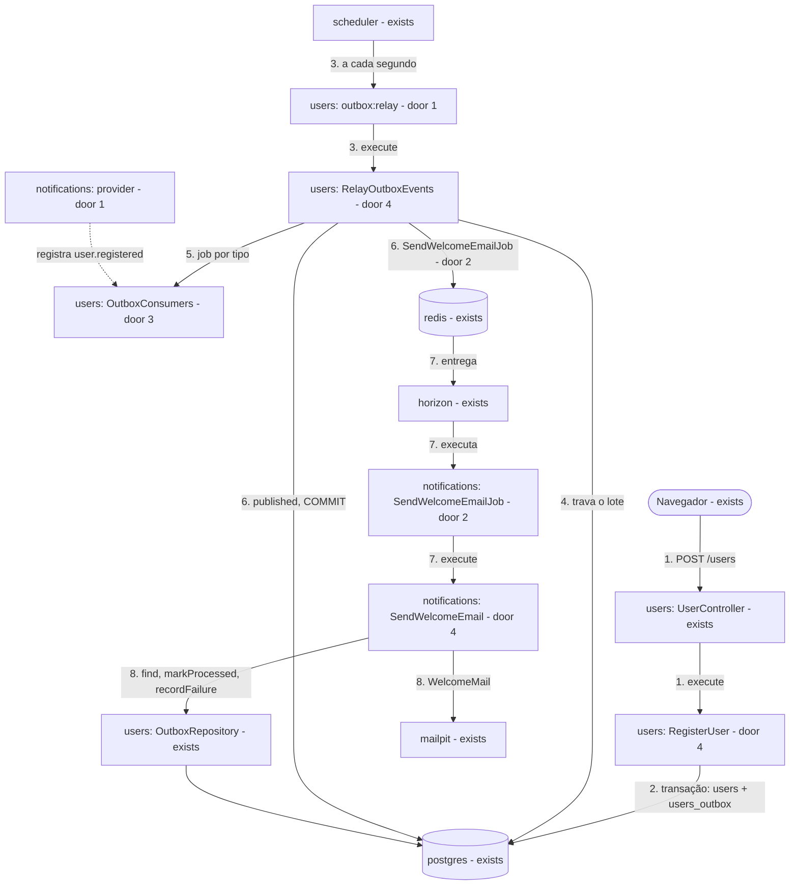
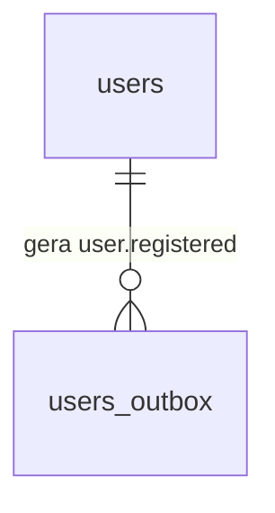

# Módulos da stack Laravel por contexto: `users` e `notifications`

**Approved**: 2026-11-10 - user: "Aprovar e seguir"

## Problem

O código da stack Laravel não segue os contextos do domínio. O módulo `outbox` mistura o mecanismo de publicação do cadastro (a tabela `users_outbox`, o relay) com o envio do e-mail de boas-vindas. Por isso, a transação do cadastro, que hoje fica dentro de `UserRepository`, chama o repositório de outro módulo. Os status (`pending`, `published`, `processed`, `failed`) e o nome `user.registered` aparecem como texto solto em 9 linhas de `OutboxRepository` e `UserOutboxEvent`, e a transação é aberta nos repositórios (`UserRepository::create` e `OutboxRepository::publishReady`), não na camada que decide a operação. Quem paga é quem mexe na stack: renomear um status exige caçar texto, e um teste do cadastro não consegue provar a transação sem PostgreSQL. A fonte é o /tlc-discover de 2026-11-10; não há medição, porque não há produto.

Quando isto sair, quem lê a stack encontra dois contextos: `users`, que cadastra e publica `user.registered`, e `notifications`, que envia o e-mail. Cada operação é um caso de uso que abre a própria transação, e status e eventos têm um único lugar. Para quem se cadastra, nada muda: mesma API, mesmo e-mail, mesmos prazos.

## Shape

Reusa o schema, o `scheduler`, o `horizon`, `config/outbox.php`, as consultas de docs/database.md e toda a suíte de `tests/infra`, que já prova o comportamento de ponta a ponta e não muda de expectativa. As regras que mudam o resultado ficam nos casos de uso e nos enums, que o Pest alcança sem banco nem Redis, porque cada caso de uso recebe a conexão por injeção (door 4); o que depende de transação, trava, fila ou SMTP reais continua provado em `tests/infra`.

1. `POST /users` -> `users` (exists) - `UserController` chama o caso de uso `RegisterUser` (door 4), que aplica os limites como hoje
2. `RegisterUser` (door 4) -> `postgres` (exists) - abre a transação e, dentro dela, grava `users` e o evento `user.registered` (door 5) em `users_outbox`; out: `201` com o corpo de hoje
3. `scheduler` (exists) -> `outbox:relay`, agora em `users` (door 1) - chama o caso de uso `RelayOutboxEvents` (door 4)
4. `RelayOutboxEvents` (door 4) -> `postgres` (exists) - abre a transação e trava o lote pronto, como hoje
5. `RelayOutboxEvents` (door 4) -> `OutboxConsumers` (door 3) - resolve o job de cada evento pelo tipo; um tipo sem consumidor desfaz o lote antes de qualquer publicação
6. `RelayOutboxEvents` (door 4) -> `redis` (exists) - publica `SendWelcomeEmailJob` de `notifications` (door 2) e marca o lote `published`, na mesma transação
7. `horizon` (exists) -> `SendWelcomeEmailJob` (door 2) -> `notifications` (door 1) - o job chama o caso de uso `SendWelcomeEmail` (door 4), sem transação
8. `SendWelcomeEmail` (door 4) -> `users` (exists) - lê o evento e informa sucesso ou falha pelo `OutboxRepository` de `users`, único que escreve em `users_outbox`; out: `WelcomeMail` no `mailpit`

**Changes underneath**

| Front | What changes |
| --- | --- |
| domain | `outbox` deixa de ser um módulo e passa a ser parte do contexto `users`; o e-mail de boas-vindas passa a ser do contexto `notifications`. A dependência entre módulos fica só `notifications` -> `users`. Quem se apoia na direção antiga: `tests/infra/laravel-outbox.sh` OB11 (`outbox` não referencia `users`), que se inverte |
| stored data | nada a migrar: schema, `payload`, status e `event_type` continuam iguais, e só mudam de lugar no código |
| readers | `tests/infra/adapters/laravel.sh` `stack_dispatch` (classe do job); `tests/infra/laravel-outbox.sh` (caminho da view em OB/watch, OB11); `tests/infra/docs.sh` LV40 (árvore de docs/stacks.md); `tests/infra/laravel.sh` LV49, LV50 e LV51 (lista dos módulos locais); os testes Pest de `outbox` e `users`; `apis/laravel/composer.json` e `composer.lock`; docs/stacks.md; docs/decisions.md. A NestJS e os demais arquivos de `tests/infra` não leem nenhum nome que muda |

New: nothing - o schema não muda. One-way constraints: os valores dos enums (door 5) são os do `CHECK` de `users_outbox_status_valid` e o `event_type` que as outras stacks leem.

O ciclo de status não muda: é o de docs/database.md › Ciclo de status.

## Surface

None - nothing consumed outside: `POST /users`, `GET /health` e `outbox:relay` mantêm rota, corpo, saída e códigos.

## Landing

| One-way door | Literal shape | Alternative rejected |
| --- | --- | --- |
| 1. módulos | `app-modules/users` (`modules/users`, `Modules\Users\`) guarda `Models\User`, `Models\UserOutboxEvent`, `Enums\OutboxStatus`, `Enums\OutboxEventType`, `Repositories\UserRepository`, `Repositories\OutboxRepository`, `Services\RetryPolicy`, `Services\OutboxConsumers`, `Console\Commands\RelayOutboxCommand` e `UseCases\RegisterUser` e `UseCases\RelayOutboxEvents`; `app-modules/notifications` (`modules/notifications`, `Modules\Notifications\`) guarda `Jobs\SendWelcomeEmailJob`, `Mail\WelcomeMail`, `UseCases\SendWelcomeEmail` e as views `notifications::welcome` e `notifications::welcome-text`; `app-modules/outbox` e `modules/outbox` deixam de existir; `users` nunca referencia `Modules\Notifications`; só código de `users` escreve em `users_outbox` | juntar tudo em `users` - mais simples, mas mistura o e-mail ao cadastro e foi recusado no discover; manter `users` + `outbox` - a transação do cadastro atravessa dois módulos, e o outbox não é um contexto |
| 2. job na fila | classe `Modules\Notifications\Jobs\SendWelcomeEmailJob`, conexão `redis`, fila `registration-emails`, só o `eventId`, `tries` `1`, sem backoff, `after_commit` `false` - muda só o namespace | manter `Modules\Outbox\Jobs\SendWelcomeEmailJob` - o módulo deixa de existir |
| 3. registro de consumidores | `Modules\Users\Services\OutboxConsumers`, singleton, com `register(OutboxEventType $type, Closure $job)` e um método que devolve o job de um `event_id` pelo tipo; `NotificationsServiceProvider` registra `OutboxEventType::UserRegistered` -> `new SendWelcomeEmailJob($eventId)`; um tipo sem consumidor lança `Modules\Users\Exceptions\UnknownOutboxConsumer` com o tipo na mensagem | evento do Laravel com listener na fila - sem listener, o `dispatch` passa em silêncio e o evento seria marcado `published` sem consumidor; o relay importando o job - `users` passaria a depender de `notifications` |
| 4. casos de uso | `app-modules/<módulo>/src/UseCases/<Verbo><Coisa>.php`, sem sufixo, com um método público `execute(...)`; quem precisa de transação recebe `Illuminate\Database\ConnectionInterface` no construtor e chama `transaction()`; repositórios só executam consultas e nunca abrem transação; controllers, comandos e jobs só traduzem a entrada e chamam `execute`; `src/Actions` deixa de existir | `Actions` com `__invoke` - pedido explícito do responsável para casos de uso; transação pela facade `DB` - `make test-laravel` roda sem PostgreSQL e não consegue executar o callback |
| 5. enums | `enum OutboxStatus: string` com `Pending = 'pending'`, `Published = 'published'`, `Processed = 'processed'`, `Failed = 'failed'` e `isTerminal()`; `enum OutboxEventType: string` com `UserRegistered = 'user.registered'`; `UserOutboxEvent` faz o cast de `status` e `event_type` para eles; no SQL escrito à mão, os valores entram como parâmetro (`->value`) | constantes de classe - sem tipo e sem `tryFrom`; valores interpolados no SQL - funcionaria, mas foi decidido parâmetro no discover |

- Nothing else in this change is hard to reverse

## Criteria

### S1: Status e eventos com nome (P1)

Status e tipo de evento têm um único lugar, os enums de `users`.

**Acceptance Criteria**

1. The enum `Modules\Users\Enums\OutboxStatus` SHALL ter exatamente os valores `pending`, `published`, `processed` e `failed`, e `isTerminal()` SHALL ser verdadeiro só para `processed` e `failed`
   - `pending` → falso; `published` → falso; `processed` → verdadeiro; `failed` → verdadeiro
2. The enum `Modules\Users\Enums\OutboxEventType` SHALL ter exatamente um caso, `UserRegistered`, com o valor `user.registered`
3. The arquivos PHP de `apis/laravel/app-modules/*/src` SHALL não conter `'pending'`, `'published'`, `'processed'`, `'failed'` nem `'user.registered'` entre aspas simples ou duplas, exceto os dois arquivos dos enums
   - `status = 'pending'` dentro de um SQL conta como ocorrência; `OutboxStatus::Pending->value` não conta
4. The constante `TERMINAL_STATUSES` SHALL não existir em `apis/laravel`, e `UserOutboxEvent` SHALL devolver `status` como `OutboxStatus` e `event_type` como `OutboxEventType`

### S2: Cadastro como caso de uso (P1)

`RegisterUser` abre a transação que grava usuário e evento.

**Acceptance Criteria**

5. WHEN `RegisterUser::execute` grava um cadastro THEN o `INSERT` em `users` e o `INSERT` em `users_outbox` SHALL acontecer dentro do callback de uma única chamada a `transaction()` da conexão injetada, provado em Pest sem PostgreSQL
   - conexão falsa que não executa o callback → nenhuma escrita; conexão que executa → as duas escritas, na ordem `users` e depois `users_outbox`
6. IF a gravação do evento lança uma exceção THEN `RegisterUser` SHALL deixar a exceção sair do callback de `transaction()` e devolver a reserva da cota uma vez
7. The classes de `apis/laravel/app-modules/*/src/Repositories` SHALL não conter `transaction(` nem `beginTransaction`
8. The diretório `src/Actions` e a classe `RegisterUserAction` SHALL não existir em `apis/laravel/app-modules`, e `UserController` SHALL chamar `RegisterUser`

### S3: Relay como caso de uso (P1)

`RelayOutboxEvents` publica o lote numa transação e só publica eventos que têm consumidor.

**Acceptance Criteria**

9. WHEN `RelayOutboxEvents::execute` publica um lote THEN a trava do lote, cada publicação e a marcação `published` SHALL acontecer dentro do callback de uma única chamada a `transaction()` da conexão injetada, nessa ordem, provado em Pest sem PostgreSQL
   - lote com 2 eventos → 2 publicações e uma marcação com os 2 ids; lote vazio → nenhuma publicação e nenhuma marcação
10. IF um evento do lote tem um tipo sem consumidor registrado THEN `RelayOutboxEvents` SHALL lançar `UnknownOutboxConsumer` com o tipo na mensagem antes de publicar qualquer job do lote, sem marcar `published`
    - lote [`user.registered`] com o registro vazio → 0 publicações, exceção com `user.registered`; lote de 3 eventos com o 3º sem consumidor → 0 publicações
11. IF `RelayOutboxEvents` lança qualquer exceção THEN `php artisan outbox:relay` SHALL sair com `1` e registrar `outbox relay failed` no log; sem exceção, SHALL imprimir `<N> event(s) published.` e sair com `0`
12. WHEN a aplicação sobe com os módulos instalados THEN `OutboxConsumers` SHALL devolver, para `user.registered` e um `event_id`, um `Modules\Notifications\Jobs\SendWelcomeEmailJob` com esse `eventId`
13. The código de `apis/laravel/app-modules/users` SHALL não referenciar `Modules\Notifications`

### S4: E-mail no módulo `notifications` (P1)

`notifications` envia o e-mail e só informa o resultado a `users`.

**Acceptance Criteria**

14. The módulo `apis/laravel/app-modules/notifications` SHALL existir com o pacote `modules/notifications` e o namespace `Modules\Notifications\`; `apis/laravel/app-modules/outbox` SHALL não existir; `apis/laravel/composer.lock` SHALL ter `modules/notifications` vindo de `app-modules/notifications` e SHALL não ter `modules/outbox`
15. The código de `apis/laravel/app-modules/notifications/src` SHALL não conter `users_outbox`, `DB::`, `ConnectionInterface` nem `transaction(`
16. WHEN `SendWelcomeEmail::execute` recebe um `event_id` THEN SHALL agir conforme o evento, provado em Pest sem banco nem SMTP
    - `processed` ou `failed` → nenhum e-mail e nenhuma escrita; `pending` ou `published` com envio ok → um `WelcomeMail` para o e-mail do `payload` e `markProcessed`; envio lançando `boom` → `recordFailure` com `boom` e nenhum `markProcessed`; id inexistente → nenhum e-mail e um aviso `outbox event not found` no log
17. The job `SendWelcomeEmailJob` SHALL ter `tries` `1`, sem `backoff`, e `WelcomeMail` SHALL ter o `Message-ID` `<event_id>@cadastro-feliz.local` e as views `notifications::welcome` e `notifications::welcome-text`
18. The `RetryPolicy` de `users` SHALL dar 30, 60, 120 e 240 s para `attempts` anterior de `0` a `3` com base 30, e 2 s para `0` com base 2

### S5: Comportamento igual, provado (P1)

A suíte que já prova a stack continua verde, sem afrouxar nenhum caso.

**Acceptance Criteria**

19. WHEN `make test-laravel` roda THEN SHALL sair com `0`, sem PostgreSQL nem Redis
20. WHEN `bash tests/infra/run.sh docs laravel registration:laravel outbox:laravel laravel-outbox stack-switch` roda THEN SHALL sair com `0`, com os mesmos ids de antes, e só OB11, LV40, LV49, LV50, LV51 e os ajudantes que citam caminho ou classe SHALL ter mudado

### S6: Documentação alinhada (P2)

Os documentos descrevem os módulos que existem.

**Acceptance Criteria**

21. The arquivo `docs/stacks.md` › Laravel SHALL mostrar na árvore `notifications/` e, em `users/`, `src/UseCases/`, `src/Enums/` e `src/Console/Commands/RelayOutboxCommand.php`, SHALL não ter `outbox/` como módulo, `src/Actions` nem `RegisterUserAction`, e o item de módulos SHALL dizer que `users` é dono de `users_outbox` e do relay, que `notifications` envia o e-mail, e que `users` nunca depende de `notifications`
22. The arquivo `docs/decisions.md` SHALL ter a decisão 26, sobre os módulos da stack Laravel por contexto, no índice e numa seção com motivos, alternativas descartadas (juntar em `users`, manter `outbox`) e custos

## Out of scope

| Excluded | Why |
| --- | --- |
| Mais de um consumidor por tipo, e tipos além de `user.registered` | só existe um evento; o registro aceita um consumidor por tipo |
| Mudanças na NestJS | decidido no discover; a NestJS já abre a transação no serviço do cadastro |
| Mensagens com a classe antiga do job já na fila no momento da troca | o `redis` da stack não tem persistência; uma que sobrar falha no Horizon, e o evento `published` é republicado após `OUTBOX_REPUBLISH_AFTER_SECONDS`, como LM2 já prova |
| `.design/` e `.specs/` de rodadas anteriores | registram a história e ficam como estão |
| Medir o plano do PostgreSQL com os status como parâmetro | o volume desta POC não muda o plano de forma observável |

## Assumptions

| Assumption | Chosen default | Rationale | Confirmed? |
| --- | --- | --- | --- |
| Assinatura do caso de uso | um método `execute(...)`, classe sem sufixo `UseCase` | é o nome mais comum para caso de uso e se distingue do `__invoke` das actions | n |
| Evento com tipo sem consumidor | o relay falha a rodada inteira (sai com `1`, loga, nada é publicado), e os eventos esperam | "um evento sem consumidor registrado dá erro, nunca é marcado published em silêncio", decidido no discover; com um só tipo, isso só acontece por erro de configuração da stack | n |
| Como `notifications` lê e informa o resultado | chama `OutboxRepository` de `users` (`find`, `markProcessed`, `recordFailure`), sem fachada nova | o SQL de `users_outbox` continua todo em `users`, que é a regra; uma fachada só repassaria as três chamadas | n |
| Decisão no registro do projeto | a divisão vira a decisão 26 em docs/decisions.md | o projeto registra decisões ali, e não em `.specs/STATE.md` | n |

**Open questions:** none - all resolved or logged above.

## Differences from the source

None - the product matches the source

## Sources

- /tlc-discover de 2026-11-10, nesta conversa - binding - divisão `users` + `notifications`, enums, casos de uso e transação no caso de uso
- docs/database.md - binding - status, `CHECK` e consultas, que não mudam
- .specs/features/laravel-outbox/plan.md - binding - doors 2 e 3 daquela rodada (ciclo e job), que esta preserva salvo o namespace
