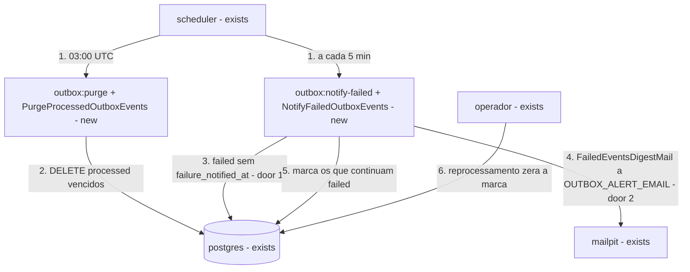
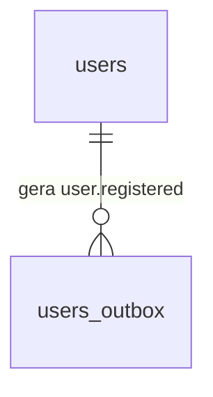
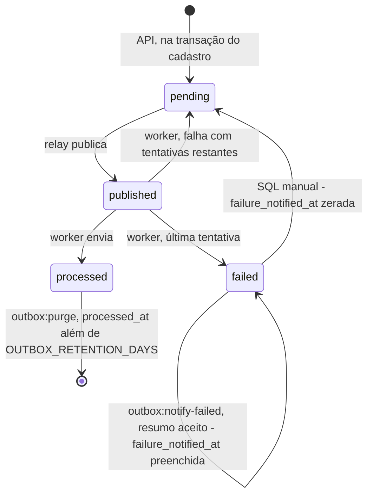

# Limpeza e aviso de falhas de `users_outbox` na stack Laravel

**Approved**: 2026-11-12 - user: "Aprovar e seguir"

## Problem

Um evento que chega a `failed` na stack Laravel só é notado por quem consulta `users_outbox` à mão: o e-mail de boas-vindas não sai, e ninguém fica sabendo até alguém desconfiar e rodar o SQL de docs/database.md. Ao mesmo tempo, `users_outbox` só cresce: todo evento `processed` fica no banco para sempre, com nome e e-mail no `payload`, pendência que docs/database.md já registra. A fonte (`.design/laravel-outbox-maintenance.md`) não traz medição de volume, porque ainda não há produto.

Quando isto sair, o operador recebe no Mailpit, em até 5 min depois de o SMTP responder, um resumo com cada evento que esgotou as tentativas, uma vez por evento; e os eventos `processed` com mais de 7 dias deixam o banco todo dia, sem que nenhuma outra linha saia.

## Shape

Reusa o `scheduler` e o agendamento de `outbox:relay`, o módulo único `users` com casos de uso que abrem a própria transação (decisão 26), `OutboxRepository`, `OutboxStatus`, o `MAIL_FROM` e o SMTP já configurados, e os ajudantes de `tests/infra`. As regras que mudam o resultado - quais linhas a limpeza apaga, quais eventos entram no resumo e quais são marcados - ficam nos casos de uso e nas consultas de `OutboxRepository`; o Pest alcança a montagem do resumo e a saída dos comandos sem banco, e tudo que depende de PostgreSQL, trava ou SMTP reais fica em `tests/infra/laravel-outbox.sh`.

1. `scheduler` (exists) - dispara `outbox:purge` todo dia às 03:00 UTC e `outbox:notify-failed` a cada 5 min, os dois com `withoutOverlapping()` e a saída no stderr do PID 1, como `outbox:relay`
2. `outbox:purge` (new) -> `PurgeProcessedOutboxEvents` (new) -> `postgres` (exists) - apaga de `users_outbox` os `processed` com `processed_at` anterior a `now()` menos `OUTBOX_RETENTION_DAYS` dias, num só `DELETE`, e imprime quantos saíram
3. `outbox:notify-failed` (new) -> `NotifyFailedOutboxEvents` (new) -> `postgres` (exists) - lê os `failed` com `failure_notified_at` nulo (door 1), os `OUTBOX_BATCH_SIZE` mais antigos por `created_at`, sem travar linhas
4. `NotifyFailedOutboxEvents` (new) -> `mailpit` (exists) - envia um `FailedEventsDigestMail` (new) a `OUTBOX_ALERT_EMAIL` (door 2); se o SMTP recusa ou não responde, nada é marcado, a falha vai ao log e o comando sai com `1`
5. `NotifyFailedOutboxEvents` (new) -> `postgres` (exists) - marca `failure_notified_at = now()` só nos lidos que continuam `failed` e sem marca
6. operador -> `postgres` (exists) - o reprocessamento manual de docs/database.md volta o evento a `pending` e zera `failure_notified_at` (door 1), então uma nova falha entra num novo resumo

**Comandos** - nenhum dos dois tem opções.
- `php artisan outbox:purge` imprime `<N> event(s) purged.` e sai com `0`, inclusive com `N` igual a `0`. Numa falha, registra `outbox purge failed` no log e sai com `1`, sem apagar nada.
- `php artisan outbox:notify-failed` imprime `<N> failed event(s) notified.` e sai com `0`; com `N` igual a `0`, nenhum e-mail sai. Numa falha de leitura, envio ou marca, registra `outbox failed-events notification failed` no log e sai com `1`; uma falha antes do envio aceito não marca nada.

**Changes underneath**

| Front | What changes |
| --- | --- |
| domain | `failed` continua terminal, mas passa a ter "avisado" ou "não avisado" por `failure_notified_at`. O reprocessamento manual de docs/database.md passa a zerar a marca. Quem roda esse SQL hoje: o LM3 de `tests/infra/outbox.sh`, caso de contrato que também roda na NestJS, e o operador |
| stored data | coluna nova, nula e sem padrão, pela migration `0002` (door 1); sem backfill: todo `failed` existente fica sem marca e entra nos primeiros resumos. A primeira limpeza apaga os `processed` acumulados com mais de 7 dias. `users` não muda |
| readers | `tests/infra/migrate.sh`: C11, C12 e C13 passam a esperar a versão `2 f`, C14 grava a sonda como `0003_probe` e espera `3 t`, e C15 desfaz as duas migrations; `tests/infra/stack.sh` grava a sua sonda como `0003_probe`; `tests/infra/frontend.sh` passa a esperar `2|f`. O OB13 de `tests/infra/laravel-outbox.sh` compara `schedule:list` com os espaços normalizados, porque a entrada `*/5` alarga a coluna do minuto e muda o alinhamento da linha do relay (achado no build). A NestJS não mapeia a coluna e não muda (decisão 24); seus casos de contrato continuam passando com a coluna no banco. O job `SendWelcomeEmailJob` encontra inexistente um evento apagado pela limpeza e o ignora, como o OB32 já prova |
| docs | docs/database.md (erDiagram, a coluna da `0002`, a retenção, o resumo, o reprocessamento e o status), docs/architecture.md (retentativas e garantias), docs/stacks.md (comandos da stack Laravel), docs/infrastructure.md (as duas variáveis), README (Limites conhecidos) e docs/decisions.md (decisão 27) |

New: a coluna `users_outbox.failure_notified_at`; nenhuma tabela nem relação nova. One-way constraints: a coluna é nula, e só `outbox:notify-failed` a preenche e só o reprocessamento manual a zera (door 1).

As transições de mensagem repetida e de republicação continuam as de docs/database.md e não mudam.

## Surface

None - nothing consumed outside: `POST /users` e `GET /health` não mudam, e os dois comandos são internos à stack, rodados pelo `scheduler` ou por quem tem acesso ao container.

## Landing

| One-way door | Literal shape | Alternative rejected |
| --- | --- | --- |
| 1. marca do aviso no schema comum | `database/migrations/0002_add_failure_notified_at_to_users_outbox.up.sql`: `BEGIN;` / `ALTER TABLE users_outbox ADD COLUMN failure_notified_at timestamptz;` / `COMMIT;`, e o `.down.sql` remove só a coluna; o reprocessamento de docs/database.md passa a ser `UPDATE users_outbox SET status = 'pending', attempts = 0, available_at = now(), failure_notified_at = NULL WHERE id = $1 AND status = 'failed';`; o bloco SQL de `## Schema` continua igual à `0001`, e a `0002` ganha um bloco próprio logo abaixo; registrado como decisão 27 em docs/decisions.md | editar a `0001` - um banco que já tem a versão 1 nunca recebe a coluna, e o comando falha nos volumes existentes; uma tabela própria de avisos - uma tabela a mais para um campo, e o reprocessamento teria de apagar linhas dela |
| 2. aviso ao operador | variáveis `OUTBOX_ALERT_EMAIL=ops@cadastro-feliz.local` e `OUTBOX_RETENTION_DAYS=7` em `.env.example`, entregues ao `php-fpm`, ao `scheduler` e ao `horizon` como as demais `OUTBOX_*`, lidas em `config/outbox.php` como `alert_email` e `retention_days`; e-mail em texto simples, de `MAIL_FROM`, assunto `Cadastro Feliz: <N> evento(s) sem envio`, uma linha por evento no formato `- <event_id> · <email do payload> · <attempts> tentativa(s) · <last_error>`, em ordem de `created_at`, e o fecho `Para reenviar, use o reprocessamento manual de docs/database.md, seção "Reprocessar um evento em failed".` | um e-mail por evento na transição para `failed` - se perde quando o SMTP é a causa da falha, e uma queda longa gera dezenas de e-mails; o aviso como evento em `users_outbox` - falharia pelo mesmo SMTP e exigiria uma regra para a falha do aviso não gerar outro aviso |

- Nothing else in this change is hard to reverse

## Criteria

### S1: `outbox:purge` (P1)

Os eventos `processed` mais velhos que o prazo deixam o banco, e nada mais sai.

**Acceptance Criteria**

1. WHEN `php artisan outbox:purge` roda THEN o sistema SHALL apagar toda linha de `users_outbox` com `status` `processed` e `processed_at` anterior a `now()` menos `OUTBOX_RETENTION_DAYS` dias, imprimir `<N> event(s) purged.` com o número apagado e sair com `0`
   - `processed_at` há 8 dias → apagado; há 6 dias → fica; há 7 dias e 1 min → apagado; há 6 dias, 23 h e 59 min → fica
2. The `outbox:purge` SHALL não apagar linha com `status` `pending`, `published` ou `failed`, de qualquer idade, nem linha de `users`
   - `failed` e `pending` criados há 30 dias → ficam; o usuário cujo único evento foi apagado → continua em `users`
3. WHEN `outbox:purge` roda sem nada vencido THEN o sistema SHALL imprimir `0 event(s) purged.`, sair com `0` e deixar `users_outbox` como estava
4. IF o `postgres` está parado THEN `outbox:purge` SHALL sair com `1` e registrar `outbox purge failed` no log, e depois de o banco voltar `users_outbox` SHALL ter as mesmas linhas de antes
5. WHERE `OUTBOX_RETENTION_DAYS` é `1` THEN `outbox:purge` SHALL apagar um `processed` de 2 dias atrás e manter um de 12 h atrás
6. The `php artisan schedule:list` do `scheduler` SHALL listar `outbox:purge` com a expressão `0 3 * * *`, e a aplicação SHALL rodar em `UTC`

### S2: `outbox:notify-failed` (P1)

O operador recebe, uma vez por evento, a lista do que esgotou as tentativas.

**Acceptance Criteria**

7. WHEN `php artisan outbox:notify-failed` roda com eventos `failed` sem `failure_notified_at` THEN o sistema SHALL enviar exatamente um e-mail a `OUTBOX_ALERT_EMAIL`, de `MAIL_FROM`, com o assunto e as linhas de door 2 em ordem de `created_at`, preencher `failure_notified_at` em cada evento listado, imprimir `<N> failed event(s) notified.` e sair com `0`
   - dois `failed`, de `ana@example.com` com `attempts` `5` e `last_error` `Connection refused`, e de `bia@example.com` criado depois → um e-mail com o assunto `Cadastro Feliz: 2 evento(s) sem envio`, a linha de Ana antes da de Bia, e `2 failed event(s) notified.`
8. WHEN `outbox:notify-failed` roda e todo `failed` já tem `failure_notified_at` THEN o sistema SHALL não enviar e-mail, imprimir `0 failed event(s) notified.` e sair com `0`
9. The `outbox:notify-failed` SHALL não listar nem marcar eventos `pending`, `published` ou `processed`, nem `failed` com `failure_notified_at` preenchida
   - um `failed` avisado ontem e um `processed` → nenhum e-mail
10. IF o SMTP está fora do ar THEN `outbox:notify-failed` SHALL sair com `1`, registrar `outbox failed-events notification failed` no log e deixar `failure_notified_at` nula em todos; WHEN o SMTP volta e o comando roda de novo THEN o sistema SHALL enviar um e-mail com os mesmos eventos
11. WHEN há mais eventos `failed` sem marca que `OUTBOX_BATCH_SIZE` THEN o e-mail SHALL listar só os `OUTBOX_BATCH_SIZE` mais antigos por `created_at` e marcar só esses, e a execução seguinte SHALL listar o restante
    - `OUTBOX_BATCH_SIZE` `2` com três `failed` → primeiro e-mail com os dois mais antigos, segundo com o terceiro, terceira execução sem e-mail
12. IF um evento listado sai de `failed` por um reprocessamento confirmado depois da leitura e antes da marca THEN o sistema SHALL não preencher `failure_notified_at` nele, que fica `pending` e sem marca
13. WHEN o SQL da seção `Reprocessar um evento em failed` de docs/database.md roda sobre um evento `failed` avisado THEN o evento SHALL ficar `pending`, com `attempts` `0` e `failure_notified_at` nula, e WHEN ele volta a `failed` THEN a execução seguinte SHALL listá-lo de novo
14. The `php artisan schedule:list` do `scheduler` SHALL listar `outbox:notify-failed` com a expressão `*/5 * * * *`
15. The `php-fpm`, o `scheduler` e o `horizon` SHALL receber `OUTBOX_ALERT_EMAIL` e `OUTBOX_RETENTION_DAYS` do `.env`, e `.env.example` SHALL trazê-las com `ops@cadastro-feliz.local` e `7`

### S3: Coluna `failure_notified_at` e registro (P1)

O schema comum ganha a marca sem mexer no que as stacks já leem, e os documentos param de dizer que não há limpeza nem aviso.

**Acceptance Criteria**

16. WHEN `make migrate` roda num banco vazio THEN `users_outbox` SHALL ter `failure_notified_at` do tipo `timestamp with time zone`, nula e sem padrão, e `schema_migrations` SHALL ter `2 f`
17. WHEN `make migrate` roda num banco na versão 1 com linhas em `users_outbox` THEN as linhas SHALL continuar, com `failure_notified_at` nula, e rodar de novo SHALL não mudar o schema
18. WHEN a `0002` é desfeita THEN `failure_notified_at` SHALL deixar de existir e `users_outbox` SHALL manter as linhas e as demais colunas
19. The arquivo `0002_add_failure_notified_at_to_users_outbox.up.sql` SHALL começar com `BEGIN;` e terminar com `COMMIT;`, e o bloco SQL de `## Schema` de docs/database.md SHALL continuar igual ao corpo da `0001` (C10)
20. The docs/decisions.md SHALL ter a decisão 27 no índice e numa seção, com a coluna, o resumo ao operador, a limpeza diária e a alternativa do aviso como evento descartada
21. The docs/database.md SHALL mostrar `failure_notified_at` no erDiagram, trazer o SQL de reprocessamento de door 1, descrever a retenção de `OUTBOX_RETENTION_DAYS` dias sobre `processed` e não conter mais `Esta POC não faz limpeza`
22. The README › Limites conhecidos SHALL dizer que um evento `failed` chega ao operador num resumo por e-mail e continua dependendo do reprocessamento manual, e docs/infrastructure.md SHALL listar `OUTBOX_ALERT_EMAIL` e `OUTBOX_RETENTION_DAYS` com os padrões de door 2

## Out of scope

| Excluded | Why |
| --- | --- |
| Limpeza e aviso nas stacks NestJS e Go | escolha do responsável nesta rodada; com a NestJS ativa, os `failed` saem no primeiro resumo depois que a Laravel voltar |
| Casos novos na suíte de contrato | o comportamento é só da Laravel (decisão 23): os casos ficam em `tests/infra/laravel-outbox.sh` |
| Limpeza de eventos `failed` | ficam até o reprocessamento manual, que é o que o aviso pede |
| Reprocessamento automático ou por comando | continua o SQL manual de docs/database.md |
| Avisar a pessoa cadastrada | o canal seria o e-mail que acabou de falhar |
| Slack, webhook ou outro canal | o Mailpit é a única caixa da POC |
| Índice em `processed_at` | a limpeza percorre a tabela, o que basta à POC; o índice parcial entra quando o volume pesar |
| Limpeza em lotes | um `DELETE` só basta ao volume de uma POC |
| Exclusão de usuários | só eventos saem do banco |

## Assumptions

| Assumption | Chosen default | Rationale | Confirmed? |
| --- | --- | --- | --- |
| Horário da limpeza | todo dia às 03:00 UTC | default do design; o prazo de 7 dias não depende do horário | n |
| Prazo contado de quando | de `processed_at`, em dias inteiros por `OUTBOX_RETENTION_DAYS` | "finalizados com sucesso há mais de 7 dias" fala da conclusão, não da criação | n |
| Texto do resumo | assunto, linhas e fecho de door 2, só texto simples | o leitor é o operador, e o fecho diz o que fazer em seguida | n |
| Limite de um resumo | `OUTBOX_BATCH_SIZE`, os mesmos 100 do relay | evita uma variável a mais | n |
| Onde ficam as variáveis | `OUTBOX_ALERT_EMAIL` e `OUTBOX_RETENTION_DAYS` junto das outras `OUTBOX_*` em `.env.example` | as regras do outbox já ficam juntas, e só a Laravel as lê por enquanto | n |
| Quem é avisado | um endereço de operador, `ops@cadastro-feliz.local` | resposta na rodada de design | y |
| Formato do aviso | um resumo a cada 5 min com os eventos ainda não avisados | resposta na rodada de design | y |
| Agendamento da limpeza | diária, e também rodável à mão | resposta na rodada de design | y |
| Stacks | só Laravel | resposta na rodada de design | y |

**Open questions:** none - all resolved or logged above.

## Differences from the source

None - the product matches the source

## Sources

- `.design/laravel-outbox-maintenance.md` - binding - o desenho confirmado por diashelter em 2026-11-12: Key decisions 1 a 5 e os dois slices
- docs/database.md - binding - schema, ciclo de status e SQL de reprocessamento
- docs/decisions.md - binding - decisões 2, 15, 23, 24 e 26
