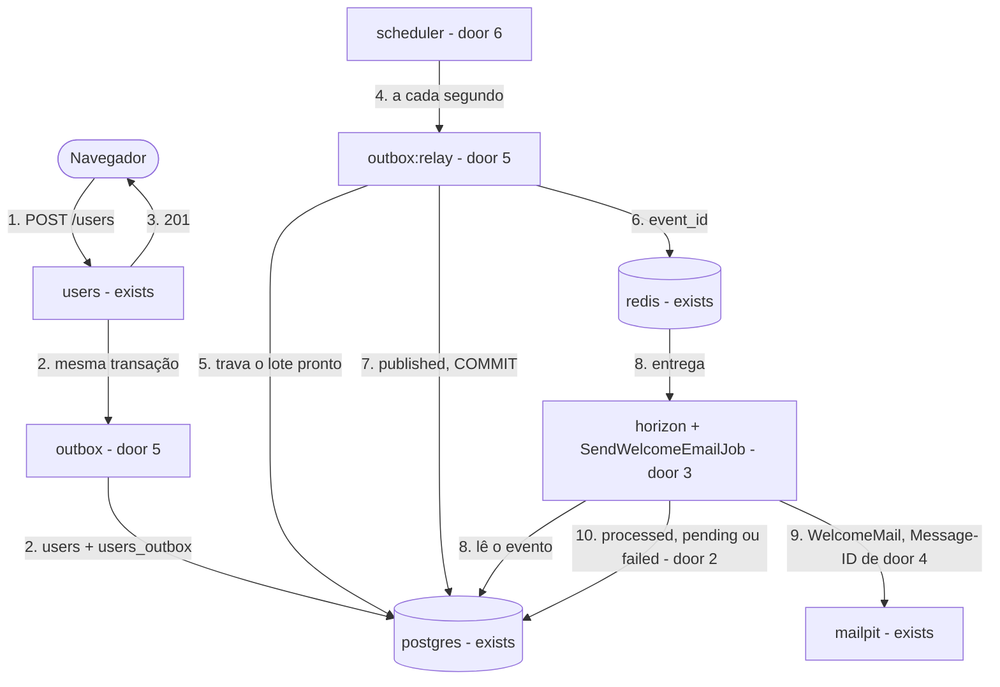
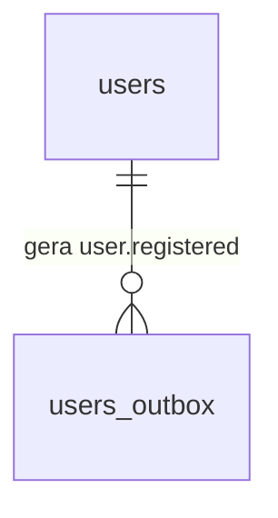
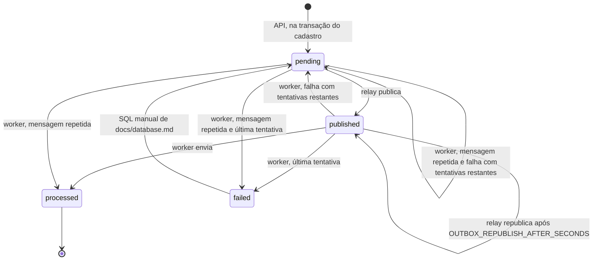

# Transactional Outbox de `users` na stack Laravel

**Approved**: 2026-11-05 - user: "Aprovar e seguir"

## Problem

Um `201` da stack Laravel não garante o e-mail de boas-vindas. O usuário é gravado e o job é publicado como duas escritas sem transação comum, então o e-mail se perde se a fila estiver fora do ar, se a stack cair com o job na fila ou se o SMTP ficar fora até esgotar as tentativas. Nesse último caso, a falha só fica no Horizon e some com a stack. Quem se cadastra paga sem saber: repetir o cadastro responde `409`, e nenhum e-mail sai. Os testes de `tests/infra/limitations.sh` provam a perda, e os cenários 4, 5, 6 e 8 de docs/architecture.md nunca rodaram. A fonte (`.design/laravel-outbox.md`) não traz medição de volume, porque ainda não há produto.

Quando isto sair, todo `201` terá um evento gravado na mesma transação. O e-mail sai quando a fila ou o SMTP voltam, inclusive depois de derrubar a stack. Se as tentativas se esgotarem, a falha fica no PostgreSQL e o evento pode ser reprocessado.

## Shape

Reusa o schema atual, o `redis` e o `horizon` da stack, `WelcomeMail`, os limites, o `Makefile` com a regra genérica de stack e os ajudantes de `tests/infra`. As regras que mudam o resultado ficam em dois lugares: cálculo de espera, `Message-ID` e forma do job no módulo `outbox`, que o Pest alcança sem dependências; e tudo que depende de transação, trava, fila ou SMTP reais em `tests/infra`, que para, pausa e religa os serviços de verdade.

1. `POST /users` -> `users` (exists) - valida e aplica os limites como hoje, sem mudança
2. `users` (exists) -> `outbox` (door 5) -> `postgres` (exists) - grava `users` e `users_outbox` (door 1) na mesma transação; `UNIQUE` violada responde `409`, qualquer outra falha responde `500`, e os dois desfazem tudo e devolvem a reserva
3. out: `201` com o corpo de hoje, sem nenhuma conexão com a fila
4. `scheduler` (door 6) - dispara `outbox:relay` a cada segundo
5. `outbox:relay` (door 5) -> `postgres` (exists) - abre a transação e trava o lote pronto, pulando linhas já travadas
6. `outbox:relay` (door 5) -> `redis` (exists) - publica `SendWelcomeEmailJob` (door 3) para cada evento; qualquer falha desfaz o lote, registra no log e sai com erro
7. `outbox:relay` (door 5) -> `postgres` (exists) - marca o lote `published` e confirma
8. `horizon` (exists) -> `SendWelcomeEmailJob` (door 3) -> `postgres` (exists) - lê o evento pelo `event_id`, sem transação aberta; evento terminal ou inexistente encerra aqui
9. `SendWelcomeEmailJob` (door 3) -> `mailpit` (exists) - envia `WelcomeMail` a partir do `payload`, com o `Message-ID` de door 4
10. `SendWelcomeEmailJob` (door 3) -> `postgres` (exists) - grava `processed`; numa falha de envio, grava a tentativa, a espera ou `failed` (door 2), e a mensagem é confirmada do mesmo jeito

**Comandos** - `php artisan outbox:relay` não tem opções. Imprime `<N> event(s) published.` e sai com `0`, inclusive com `N` igual a `0`. Numa falha, desfaz o lote, registra `outbox relay failed` no log e sai com `1`. Os alvos do `Makefile` mantêm nomes, mensagens e códigos de saída; não há alvo novo.

**Changes underneath**

| Front | What changes |
| --- | --- |
| domain | `201` passa a significar usuário e evento gravados, com o e-mail a caminho (decisão 21 encerrada). O job passa a carregar `event_id`, não o id do usuário, e deixa de usar as retentativas do Horizon (decisão 9 volta a valer). Quem lê o job: só `horizon` |
| stored data | nada a migrar - o schema não muda e não há backfill. Usuários da fase sem outbox não ganham evento. `users_outbox` passa a receber linhas, e jobs antigos no `redis` somem com a stack |
| readers | `tests/infra/laravel.sh`: LV1, LV2 e LV4 (5 containers), LV5 (imagem do `scheduler`), `lv_healthy`, LV49, LV50 e LV51 (módulo `outbox`). `tests/infra/registration.sh`: RG0 a RG2 e RG7 (eventos), RG15 (20 linhas em `users_outbox`), RG19 (fila parada sem erro no log), RG23 (só `event_id`), RG24 (`maxTries` `1`, sem backoff), RG26 (`attempts` no banco), RG27 (caminho da view). `tests/infra/limitations.sh` vira `tests/infra/outbox.sh` (door 8). `tests/infra/docs.sh`: LV40, LM4, RD1, RD3, RD4 e RD5. O painel do Horizon continua, mas uma falha de envio deixa de aparecer nele. O frontend não muda |
| docs | README, docs/architecture.md, docs/stacks.md, docs/database.md, docs/api-contract.md, docs/infrastructure.md e docs/decisions.md, como em S5 |

New: nothing - o schema já tem a tabela, as colunas e os índices; esta rodada passa a escrever em `users_outbox`. One-way constraints: o formato do `payload` (door 1) e o ciclo de status (door 2), porque as três stacks leem o mesmo banco.

## Surface

None - nothing consumed outside: `POST /users` e `GET /health` mantêm rota, corpo e status, e `outbox:relay` é interno à stack.

## Landing

| One-way door | Literal shape | Alternative rejected |
| --- | --- | --- |
| 1. evento e `payload` | uma linha em `users_outbox` por `201`: `user_id` = `users.id`, `event_type` `user.registered`, `status` `pending`, `attempts` `0`; `payload` `{"user_id":"<uuid>","name":"Ana Souza","email":"ana@example.com","occurred_at":"2026-11-04T12:00:00Z"}`, com nome e e-mail já normalizados e `occurred_at` igual a `users.created_at` em UTC | só `user_id` no `payload` - obrigaria o worker a ler `users` e impediria uma stack de processar o evento de outra sem depender da forma atual dessa tabela |
| 2. ciclo e retentativas | os status e consultas de docs/database.md, sem mudança; numa falha, `attempts` + 1, `last_error` com a mensagem da exceção, `pending` e `available_at = now() + OUTBOX_BACKOFF_BASE_SECONDS * 2^(attempts anterior)`, ou `failed` ao chegar em `OUTBOX_MAX_ATTEMPTS`; republicar não conta tentativa | retentativas nativas do Horizon - variam entre filas, e a falha some com a stack (decisão 9) |
| 3. job na fila | conexão `redis`, fila `registration-emails`, classe `Modules\Outbox\Jobs\SendWelcomeEmailJob`; carrega só o id do evento; `tries` `1`, sem backoff; `after_commit` continua `false` | `SendRegistrationEmailJob`, como docs/stacks.md cita - renomear não traz ganho; job com nome e e-mail - contraria a decisão 10 |
| 4. `Message-ID` | `<event_id>@cadastro-feliz.local`, com o domínio fixo nas três stacks; registrado como decisão 22 em docs/decisions.md | derivar o domínio de `MAIL_FROM` - uma stack com outro remetente quebraria a identificação de duplicatas |
| 5. módulo `outbox` | `app-modules/outbox`, `name` `modules/outbox`, `require` `"modules/outbox": "*"`, namespace `Modules\Outbox\`; guarda `Models\UserOutboxEvent`, `Console\Commands\RelayOutboxCommand`, `Jobs\SendWelcomeEmailJob`, `Mail\WelcomeMail` e as views `outbox::welcome` e `outbox::welcome-text`; `users` depende de `outbox`, nunca o contrário; `WelcomeEmailPublisher` deixa de existir; `config/outbox.php` lê `OUTBOX_BATCH_SIZE`, `OUTBOX_REPUBLISH_AFTER_SECONDS`, `OUTBOX_MAX_ATTEMPTS` e `OUTBOX_BACKOFF_BASE_SECONDS`, e as chaves `mail_*` saem de `config/registration.php` | job e e-mail em `users`, como docs/stacks.md desenha - dependência circular entre os módulos; `src/Console/RelayOutboxCommand.php`, como docs/stacks.md desenha - `internachi/modular` só descobre comandos em `src/Console/Commands` |
| 6. container `scheduler` | serviço em `apis/laravel/docker-compose.yml`, com a imagem `cadastro-feliz-laravel-php-fpm` e sem `build`, comando `php artisan schedule:work`, `restart: unless-stopped`, `depends_on` `redis` saudável, sem porta publicada, healthcheck por `php artisan schedule:list` contendo `outbox:relay`; `routes/console.php` agenda `outbox:relay` com `everySecond()` e `withoutOverlapping()`, com a saída enviada ao log do container; tempos da fila (`REDIS_TIMEOUT` e `REDIS_READ_TIMEOUT` `1`, `REDIS_MAX_RETRIES` `0`) e `dns_opt` como no `php-fpm`; `sync` sem restart no watch, porque cada execução é um processo novo | processo contínuo em vez do agendador - evita iniciar o PHP a cada segundo, mas foge do que README e docs/stacks.md fixam, sem custo medido; `build` próprio - a tag alterna entre dois IDs e recria os containers |
| 7. ordem dos limites de tempo | 5 s do SMTP, menor que 60 s do `timeout` do Horizon, menor que 90 s do `retry_after`, menor que `OUTBOX_REPUBLISH_AFTER_SECONDS` (300 s); os três primeiros ficam como hoje, e `OUTBOX_REPUBLISH_AFTER_SECONDS` passa a chegar aos containers | só o `timeout` do job - um SMTP travado derrubaria o job sem contar tentativa, e o evento seria republicado para sempre |
| 8. prova e registro | `tests/infra/limitations.sh` vira `tests/infra/outbox.sh`, na lista `FILES` de `tests/infra/run.sh`, mantendo os ids LM1 a LM3 com o resultado invertido; docs/architecture.md troca `## Limitações do fluxo sem outbox` por `## Antes e depois do outbox`; a decisão 21 continua no índice, com **Encerrada** na seção | apagar a seção e os testes - tira do projeto o resultado do estudo, contra a escolha do responsável |
| 9. início do `scheduler` (achado no build) | comando `sh -c "php artisan schedule:run & exec php artisan schedule:work"`, com `init: true` | só `schedule:work`, como door 6 - ele dispara apenas na virada do minuto, e um container novo fica até 60 s sem publicar, contra os prazos dos critérios 25, 44 e 45; sem `init` - o PHP como PID 1 ignora o sinal de parada, e cada `docker stop` espera 10 s |
| 10. rebuild do watch (achado no build) | `horizon` e `scheduler` com `depends_on` `php-fpm` saudável | deixar como a rodada anterior - o rebuild recria todo serviço com a imagem, mas só inicia o `php-fpm` e o que depende dele, e os dois ficam parados em `Created`, como o `LV25` já acusava na `main`; um `build` ou uma tag por serviço - contraria as doors 3 e 6 |

- Nothing else in this change is hard to reverse

## Criteria

### S1: Cadastro e evento na mesma transação (P1)

`POST /users` grava usuário e evento juntos e deixa de falar com a fila.

**Acceptance Criteria**

1. WHEN `POST /users` responde `201` com o `scheduler` parado THEN `users_outbox` SHALL ter uma linha com `user_id` igual a `data.id`, `event_type` `user.registered`, `status` `pending`, `attempts` `0` e `published_at` nulo
2. WHEN um cadastro é gravado THEN o `payload` SHALL ter exatamente as chaves `user_id`, `name`, `email` e `occurred_at`, com nome e e-mail normalizados e `occurred_at` igual a `data.created_at`
   - `{"name":"  Ana  ","email":"  ANA@Example.COM "}` → `Ana` e `ana@example.com`
3. IF o e-mail já está cadastrado, inclusive com outra caixa, THEN a API SHALL responder `409` com o corpo de hoje, sem linha nova em `users` nem em `users_outbox`, e `registration:ip:<hash>` SHALL ter o valor de antes
4. IF o `INSERT` em `users_outbox` falha, por uma falha forçada no banco dentro do teste, THEN a API SHALL responder `500` com `{"message":"Internal server error.","errors":[]}`, `users` SHALL continuar sem a linha, e `registration:ip:<hash>` SHALL ter o valor de antes
5. IF o `redis` da stack está parado ou pausado THEN a API SHALL responder `201` em menos de 3 s, com a linha em `users`, o evento `pending`, nenhuma linha de erro no log do `php-fpm` e `registration:ip:<hash>` uma unidade acima do de antes
6. WHILE o `scheduler` e o `horizon` estão parados, WHEN `POST /users` responde `201` THEN `total_connections_received` do `redis` da stack SHALL ser o de antes
7. WHEN 50 `POST /users` paralelos com e-mails novos saem do mesmo IP com a cota vazia THEN SHALL haver exatamente 20 respostas `201`, 30 `429`, 20 linhas em `users` e 20 em `users_outbox`
8. IF o `postgres` está parado e a cota está livre THEN a API SHALL responder `500` com o corpo de hoje, em menos de 3 s, sem mudar `registration:ip:<hash>`
9. The classe `WelcomeEmailPublisher` SHALL não existir, e o teste em Pest do `201` SHALL afirmar que nenhum job foi publicado por `POST /users`
10. The arquivo `apis/laravel/composer.lock` SHALL ter `modules/outbox` vindo de `app-modules/outbox`, e `vendor/modules/outbox` SHALL existir no `php-fpm`
11. The código de `app-modules/outbox` SHALL não referenciar `Modules\Users`

### S2: Relay e `scheduler` (P1)

Um container publica os eventos prontos a cada segundo, sem publicar a mesma linha duas vezes ao mesmo tempo.

**Acceptance Criteria**

12. WHEN `make up-laravel` roda em um clone limpo THEN `nginx`, `php-fpm`, `scheduler`, `horizon` e `redis` SHALL ser os únicos containers do projeto, todos `healthy`; rodar de novo sem mudança SHALL manter os 5 IDs
13. The `scheduler` SHALL usar a imagem `cadastro-feliz-laravel-php-fpm`, sem porta publicada, e `php artisan schedule:list` SHALL mostrar `outbox:relay` a cada segundo
14. WHEN `php artisan config:show outbox` roda no `scheduler` com o `.env` padrão THEN os valores SHALL ser 100 para o lote, 300 para a republicação, 5 para as tentativas e 30 para a base
15. WHILE o `horizon` está parado, WHEN um cadastro responde `201` THEN, em até 10 s, o evento SHALL estar `published`, com `published_at` preenchido, e `queues:registration-emails` SHALL ter uma mensagem
16. IF um evento está `pending` com `available_at` 1 hora no futuro THEN, depois de 5 s, ele SHALL continuar `pending`, sem mensagem na fila
17. WHEN um evento está `published` há mais que `OUTBOX_REPUBLISH_AFTER_SECONDS` THEN o relay SHALL publicá-lo de novo, com `published_at` renovado e `attempts` igual
    - republicação de 5 s: `published` há 10 s → republica; republicação de 300 s: `published` há 10 s → não republica
18. IF um evento está `processed` ou `failed` THEN o relay SHALL nunca selecioná-lo, nem com `published_at` antigo
19. WHEN `php artisan outbox:relay` roda com `OUTBOX_BATCH_SIZE=2` e 3 eventos prontos THEN SHALL imprimir `2 event(s) published.`, sair com `0` e publicar os 2 de `created_at` mais antigo; sem eventos prontos, SHALL imprimir `0 event(s) published.` e sair com `0`
20. IF outra transação trava um evento pronto THEN o relay SHALL não esperar nem publicar esse evento, e SHALL publicar os demais
21. IF o `redis` da stack está parado THEN `php artisan outbox:relay` SHALL sair com `1`, os eventos SHALL continuar `pending`, com `published_at` nulo, e `docker logs` do `scheduler` SHALL ter uma linha com `outbox relay failed`, com o container `healthy`
22. WHEN o `redis` da stack volta THEN o evento SHALL sair e o e-mail SHALL chegar em até 60 s, sem reinício manual
23. IF o `UPDATE` do relay falha depois da publicação THEN os eventos SHALL continuar `pending`; WHEN a falha acaba THEN cada evento SHALL gerar exatamente uma mensagem no Mailpit, mesmo com mensagens repetidas na fila
24. WHEN a mensagem chega ao worker antes do `COMMIT` do relay, com o `COMMIT` atrasado 3 s por uma trava no teste, THEN o evento SHALL terminar `processed`, com uma mensagem no Mailpit
25. WHILE o `scheduler` está parado, WHEN um cadastro responde `201` THEN o evento SHALL ficar `pending`; WHEN o `scheduler` volta THEN o e-mail SHALL chegar em até 60 s
26. WHILE `make watch-laravel` roda, WHEN `RelayOutboxCommand` muda THEN `php artisan outbox:relay` no `scheduler` SHALL imprimir o texto novo em até 15 s, com o mesmo ID de container
56. WHILE `make watch-laravel` roda, WHEN `composer.json`, `composer.lock` ou `docker/php` muda THEN `php-fpm`, `scheduler` e `horizon` SHALL estar recriados, na mesma imagem nova e `healthy`, em até 180 s

### S3: Worker sobre o evento (P1)

O job envia a partir do evento e registra o resultado nele, com as retentativas no banco.

**Acceptance Criteria**

27. WHEN a mensagem de um evento `pending` ou `published` é processada com sucesso THEN o evento SHALL estar `processed`, com `processed_at` preenchido e `last_error` nulo, e o Mailpit SHALL ter uma mensagem para o e-mail do `payload`, em até 30 s depois do `201`
28. WHEN o nome em `users` muda depois do cadastro e antes do envio THEN o e-mail SHALL usar o nome do `payload`
29. The `MessageID` no Mailpit SHALL ser `<event_id>@cadastro-feliz.local`
30. WHILE o `horizon` está parado, WHEN o evento é publicado THEN a mensagem na fila SHALL conter o `id` do evento, SHALL não conter o nome, o e-mail nem o `user_id`, e SHALL ter `maxTries` `1` e `backoff` nulo
31. IF chega uma mensagem de um evento `processed` ou `failed` THEN o worker SHALL não enviar e-mail, e `status`, `attempts` e `processed_at` SHALL continuar iguais
32. IF chega uma mensagem de um `event_id` inexistente THEN o worker SHALL não enviar e-mail, SHALL registrar no log, e o job SHALL não aparecer em `GET /horizon/api/jobs/failed`
33. IF o envio falha antes do limite THEN o evento SHALL voltar a `pending`, com `attempts` + 1, `last_error` preenchido e `available_at` adiantado pela espera, e o job SHALL não aparecer em `GET /horizon/api/jobs/failed`
    - base 30: `attempts` anterior `0` → cerca de 30 s; `attempts` anterior `3` → cerca de 240 s
34. IF o envio falha na tentativa `OUTBOX_MAX_ATTEMPTS` THEN o evento SHALL estar `failed`, com `attempts` igual ao limite e `last_error` preenchido
35. WHEN o `UPDATE` de reprocessamento de docs/database.md roda sobre um evento `failed` com o SMTP de volta THEN o e-mail SHALL chegar, e o evento SHALL terminar `processed`
36. IF o Mailpit está pausado THEN o envio SHALL contar como falha: `attempts` SHALL subir em até 30 s, com `last_error` preenchido, e depois de despausar o e-mail SHALL chegar
37. WHILE o envio espera um Mailpit pausado, `pg_stat_activity` SHALL não ter transação aberta do `horizon`, e um `UPDATE` no evento com `lock_timeout` de 1 s SHALL concluir
38. IF o `postgres` está parado quando a mensagem chega THEN, com o banco de volta, o evento SHALL continuar `published`, com `attempts` igual, e o e-mail SHALL chegar depois da republicação
39. The valores no `horizon` SHALL manter a ordem de door 7: `timeout` de `mail.mailers.smtp` 5, `timeout` do supervisor 60, `retry_after` da fila 90 e `OUTBOX_REPUBLISH_AFTER_SECONDS` 300
40. The testes em Pest do módulo `outbox` SHALL cobrir, sem banco nem Redis, a espera para `attempts` anterior de `0` a `3`, o `tries` `1` do job e o `Message-ID` de `WelcomeMail`
41. WHEN `POST /users` responde `201` com tudo no ar THEN o assunto, o remetente, os textos em HTML e em texto e o escape do nome SHALL continuar como em RG29 a RG32, e um `409` SHALL não enviar e-mail
42. WHILE `make watch-laravel` roda, WHEN o texto de `outbox::welcome-text` muda THEN o próximo cadastro SHALL enviar o texto novo em até 60 s, com o `php-fpm` no mesmo ID

### S4: Antes e depois, provado (P1)

Os testes que afirmavam a perda agora afirmam a correção.

**Acceptance Criteria**

43. WHEN o `redis` da stack está parado, um cadastro é feito e o `redis` é religado THEN o e-mail SHALL chegar em até 60 s, o evento SHALL terminar `processed`, e repetir o cadastro SHALL responder `409`, com exatamente uma mensagem no Mailpit
44. WHEN o `horizon` está parado, um cadastro é publicado, e `make down-laravel` e `make up-laravel` rodam com `OUTBOX_REPUBLISH_AFTER_SECONDS=5` THEN a fila SHALL voltar vazia, o evento SHALL continuar `published` até a republicação, e o e-mail SHALL chegar em até 60 s, com exatamente uma mensagem
45. WHEN o `scheduler` e o `horizon` estão parados, um cadastro é feito, e `make down-laravel` e `make up-laravel` rodam com os valores padrão THEN o e-mail SHALL chegar em até 60 s
46. WHEN o Mailpit está parado com `OUTBOX_MAX_ATTEMPTS=2` e `OUTBOX_BACKOFF_BASE_SECONDS=1`, as tentativas se esgotam e o Mailpit é religado THEN, 30 s depois, o evento SHALL estar `failed`, com `attempts` `2` e `last_error` preenchido, e o Mailpit SHALL não ter mensagem; WHEN o evento é reprocessado THEN o e-mail SHALL chegar
47. WHEN o Mailpit está parado com `OUTBOX_MAX_ATTEMPTS=5` e `OUTBOX_BACKOFF_BASE_SECONDS=2`, `attempts` sobe e o Mailpit é religado antes de esgotar THEN o e-mail SHALL chegar, com o evento `processed`
48. WHEN `make test-frontend`, `make test-laravel` e `bash tests/infra/run.sh` rodam com todas as fatias prontas THEN cada um SHALL sair com código `0`

### S5: Documentação alinhada (P2)

Os documentos dizem o que existe, e a comparação com o fluxo anterior fica registrada.

**Acceptance Criteria**

49. The arquivo `docs/architecture.md` SHALL ter `## Antes e depois do outbox` e não SHALL ter `## Limitações do fluxo sem outbox`, com uma linha para cada caso de `.design/laravel-outbox.md` › Antes e depois, cada uma com o que acontecia, o que acontece agora e a prova
50. The arquivo `docs/architecture.md` SHALL dizer no status que a stack Laravel implementa o outbox, e › Worker SHALL trazer `<event_id>@cadastro-feliz.local`
51. The arquivo `docs/decisions.md` SHALL marcar a decisão 21 como **Encerrada**, SHALL não ter `Suspensa na stack Laravel` na decisão 9, e SHALL ter a decisão 22, sobre o `Message-ID`, no índice e numa seção
52. The arquivo `docs/stacks.md` › Laravel SHALL dizer que `scheduler` existe, SHALL citar `SendWelcomeEmailJob` e não SHALL citar `SendRegistrationEmailJob`, e a árvore SHALL mostrar `app-modules/outbox`, com `src/Console/Commands/RelayOutboxCommand.php`, sem `WelcomeEmailPublisher`
53. The status no topo de `docs/api-contract.md` e de `docs/database.md` SHALL deixar de dizer que a stack Laravel está sem outbox
54. The arquivo `docs/infrastructure.md` › Arquivos Compose SHALL listar `scheduler` entre os serviços da stack Laravel
55. The `README.md` SHALL deixar de ter `por enquanto sem o outbox` e o limite `E-mail perdido na stack Laravel`, SHALL dizer que a stack Laravel implementa o outbox, e › Limites conhecidos SHALL citar o reprocessamento manual de `failed`

## Out of scope

| Excluded | Why |
| --- | --- |
| NestJS, Go, o cenário 9 e a troca real de stack do cenário 6 | rodadas próprias; aqui o cenário 6 é provado derrubando e subindo a stack Laravel |
| Backfill de quem se cadastrou sem outbox | escolha do responsável; reenviaria o e-mail |
| Reprocessamento automático ou por tela de `failed` | continua sendo o SQL manual de docs/database.md |
| Retenção e limpeza de eventos `processed` | docs/database.md as deixa para uma evolução a produção |
| Fila e backlog no `GET /health` | a decisão 19 mantém só as dependências da API |
| Falhas de envio no painel do Horizon | passam a ficar em `users_outbox`; o painel continua para jobs que quebram |
| Reproduzir a queda da API entre as duas escritas | a janela deixa de existir; a atomicidade é provada pelo critério 4 |
| Reduzir o log de `schedule:work` | cada execução imprime uma linha, e `make logs-laravel` fica mais ruidoso, sem efeito no comportamento |

## Assumptions

| Assumption | Chosen default | Rationale | Confirmed? |
| --- | --- | --- | --- |
| Limite da rodada | só a stack Laravel, sem backfill | escolha do responsável na entrevista do design | y |
| Seção de limitações | vira um antes e depois em docs/architecture.md | escolha do responsável na entrevista do design | y |
| Onde ficam as classes | módulo `outbox`, com o relay, o job e `WelcomeMail`, e `users` dependendo dele | evita a dependência circular; default do design, sem objeção | n |
| Nome do job | `SendWelcomeEmailJob` | é o nome do código; default do design, sem objeção | n |
| Evento inexistente | ignora e registra no log, sem falhar o job | a mensagem não tem como ser atendida; uma falha só encheria o painel | n |
| Texto de saída do comando | `<N> event(s) published.` e `outbox relay failed` | a API e os logs da stack estão em inglês | n |
| Nome do arquivo de testes | `tests/infra/outbox.sh`, com os ids LM1 a LM3 mantidos | um arquivo chamado `limitations` provaria o contrário do nome, e os ids mostram a inversão no histórico | n |
| Origem da decisão 22 | `Proposta` | o desenho a propôs, e o responsável não a escolheu entre alternativas | n |
| Saída das tarefas agendadas | o agendamento envia a saída ao log do container | pelo que conheço do framework, a saída padrão é descartada, e o `stderr` do comando sumiria; o critério 21 prova, e o caminho exato sai no build | n |
| Provas com tempos reduzidos | `OUTBOX_REPUBLISH_AFTER_SECONDS`, `OUTBOX_MAX_ATTEMPTS`, `OUTBOX_BACKOFF_BASE_SECONDS` e `OUTBOX_BATCH_SIZE` menores no `.env` da cópia de trabalho | esperar 300 s ou 450 s por caso tornaria a suíte inviável; os padrões são provados pelo critério 14 | n |
| Falhas forçadas nos testes | gatilhos e travas criados por `psql` dentro do teste, e `docker pause` para o SMTP travado | provam atomicidade e corrida sem alterar o código da aplicação | n |
| Mensagem repetida para um evento em espera | pode adiantar o reenvio | comportamento já descrito em docs/architecture.md | n |
| Testes existentes | os listados em `readers` mudam no mesmo commit do que afirmam | regra 3: o teste muda com o que ele prova; nenhum muda só para passar | n |

**Open questions:** none - all resolved or logged above.

## Differences from the source

None - the product matches the source

## Sources

- `.design/laravel-outbox.md` - binding - forma, Key decisions 1 a 8, slices e defaults desta rodada
- `docs/architecture.md` - binding - relay, worker, retentativas, cenários 4, 5, 6, 8 e 13
- `docs/database.md` - binding - schema, `payload`, ciclo de status e consultas
- `docs/decisions.md` - binding - decisões 1, 2, 9, 10, 19 e 21
- `docs/stacks.md` e `docs/infrastructure.md` - binding - containers, pontos de atenção e variáveis, menos o que doors 3 e 5 corrigem
- `.specs/features/laravel-registration-email/plan.md` - binding - doors da rodada anterior que esta estende ou encerra
- Laravel 13, Task Scheduling e Mail, documentação consultada em 2026-11-05 - tarefas por segundo, `withoutOverlapping`, saída das tarefas e `Message-Id`
- InterNACHI/modular, documentação consultada em 2026-11-05 - comandos descobertos em `src/Console/Commands` e views com o namespace do módulo
