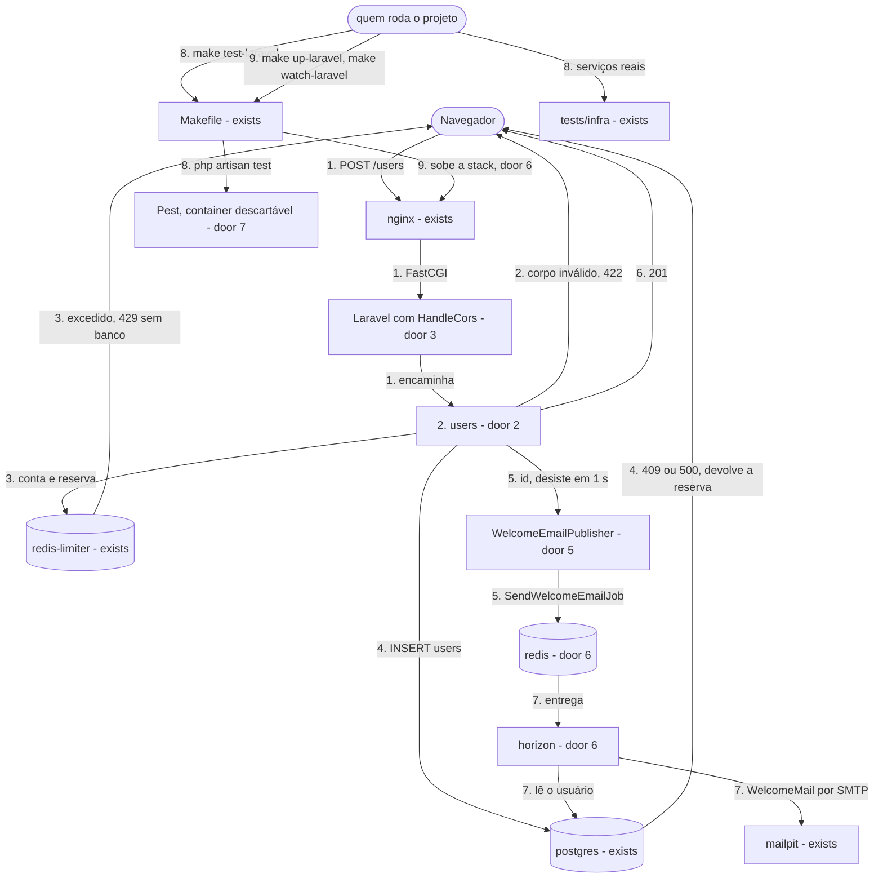
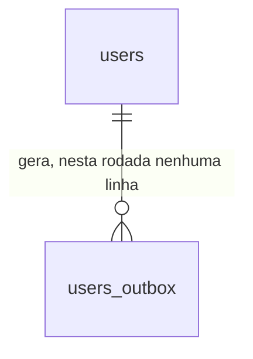

# Cadastro e e-mail de boas-vindas na stack Laravel, sem outbox

**Approved**: 2026-11-05 - user: "Aprovar e seguir"

## Problem

O formulário em `localhost:3000` está pronto, mas nenhuma stack tem `POST /users`: quem envia os dados
não conclui um cadastro e não recebe e-mail. O problema que o projeto existe para estudar, a perda do
e-mail quando banco e fila não compartilham uma transação, só está descrito em texto e nunca foi
observado. A rodada do outbox não teria um "antes" para comparar. Além disso, a `main` está com o CI
vermelho em `C9`, `LV15`, `LV16` e `LV18`, e os testes da stack e a organização dos módulos ainda não
seguem o que o responsável do projeto quer manter daqui em diante. A fonte
(`.design/laravel-registration-email.md`) não traz medição, porque ainda não há produto.

Quando isto sair, enviar o formulário responde `201` e o e-mail de boas-vindas chega ao Mailpit em
poucos segundos; a perda do e-mail é reproduzível por testes que afirmam o que acontece hoje; a stack
usa Pest e `internachi/modular`; e os testes que o CI roda passam.

## Shape

Reusa o `Makefile` com a regra genérica de stack, a rede externa, o `.env` da raiz, o código por cópia
com Compose Watch, `make laravel-composer`, o container descartável de teste, o schema atual e os
scripts Lua de docs/api-contract.md. As regras que mudam o resultado ficam em dois lugares: validação,
chaves, ordem de processamento e forma das respostas no módulo `users`, que o Pest alcança com
dependências simuladas; e tudo que depende de PostgreSQL, Redis, Horizon ou Mailpit reais em
`tests/infra`, que para e religa os serviços de verdade, porque `artisan migrate` não roda.

1. `POST /users` -> `nginx` (exists) -> Laravel (exists) - `HandleCors` responde o preflight (door 3) e encaminha ao módulo `users` (door 2)
2. `users` (door 2) - valida e normaliza; um corpo inválido responde `422` sem tocar em Redis nem banco
3. `users` (door 2) -> `redis-limiter` (exists) - roda os scripts do contrato: conta o par IP + e-mail e reserva a cota do IP; limite excedido responde `429` sem tocar no banco
4. `users` (door 2) -> `postgres` (exists) - grava `users` sem `SELECT` prévio; `UNIQUE` violada responde `409`, banco fora do ar responde `500`, e os dois devolvem a reserva
5. `users` (door 2) -> `WelcomeEmailPublisher` (door 5) -> `redis` (door 6) - publica `SendWelcomeEmailJob` só com o id, desistindo em 1 s; uma falha só vai para o log
6. out: `201` com o corpo de door 3, com ou sem o job publicado
7. `horizon` (door 6) - consome `registration-emails` e roda o job, que lê o usuário em `users` e envia `WelcomeMail` pelo `mailpit` (exists); uma falha espera o backoff, até 5 tentativas (door 4)
8. `make test-laravel` -> `Makefile` (exists) - roda Pest (door 7) num container descartável; o comportamento contra serviços reais fica em `tests/infra` (exists)
9. `make up-laravel` e `make watch-laravel` -> `Makefile` (exists) - sobem `nginx`, `php-fpm`, `horizon` e `redis` (door 6); o watch copia `app-modules` e reinicia o `horizon` para o código novo valer no worker

**Comandos** - os alvos do `Makefile` mantêm nomes, mensagens e códigos de saída; não há alvo novo.

**Changes underneath**

| Front | What changes |
| --- | --- |
| domain | `POST /users` na stack Laravel deixa de ser só contrato: `201` significa usuário gravado, sem garantia de que o e-mail será enviado, até a rodada do outbox (decisão 21). `make test-laravel` passa a rodar Pest |
| stored data | nada a migrar - `users` passa a receber linhas, `users_outbox` continua sem nenhuma, e o schema não muda. O job fica no `redis` da stack, que é descartável |
| readers | `tests/infra/laravel.sh` muda onde afirma o que muda: LV2 e LV4 (4 containers), LV5 (imagens e `pcntl`), LV7 (caminho do `LimiterCheck`), LV15 a LV18 (limite de tempo), LV24 (sync de `app-modules`), LV44 (lista de rotas) e LV45 (fila `redis`). `tests/infra/shared.sh` C9 passa a esperar 26 variáveis. `tests/infra/docs.sh` LV40 passa a exigir `horizon` e `redis` como existentes. O frontend não muda: já lê `201`, `409`, `422`, `429` e `500` |
| docs | `README.md` deixa de prometer que todo `201` tem evento gravado. `docs/architecture.md` ganha o registro da limitação e o texto novo do e-mail. `docs/api-contract.md`, `docs/stacks.md`, `docs/infrastructure.md` e `docs/database.md` descrevem o que passa a existir. `docs/decisions.md` ganha a decisão 21 e marca a 9 como suspensa nesta stack |

New: nothing - o schema não muda; esta rodada só escreve em `users`.

## Surface

| Route | In | Out | Status | Who |
| --- | --- | --- | --- | --- |
| `POST /users` | `name`, `email` | `data.id`, `data.name`, `data.email`, `data.created_at`, `message`; em erro, `message` e `errors`; header `Retry-After` no `429` | `201`, `409`, `422`, `429`, `500` | anyone - cadastro público; o navegador só lê a resposta a partir de `CORS_ALLOWED_ORIGIN` |
| `OPTIONS /users` | headers de preflight | headers de CORS de door 3 | `204` | anyone |
| `GET /horizon` | nada | painel HTML e sua API em `/horizon/api` | `200`, `403` | só com `APP_ENV=local`; os demais ambientes recebem `403` |

## Landing

| One-way door | Literal shape | Alternative rejected |
| --- | --- | --- |
| 1. dependências novas | `internachi/modular` `3.0.2` e `laravel/horizon` `v5.50.1` em `require`; `pestphp/pest` `v5.3.5`, `pestphp/pest-plugin-laravel` `v5.0.1` e `phpunit/phpunit` da série 13 em `require-dev`; `php` `^8.4` em `composer.json`; extensão `pcntl` na imagem `base`; `redis:8.10.3-alpine` para a fila, a mesma imagem do `redis-limiter` | Pest 4 sobre PHPUnit 12 - evitaria atualizar o PHPUnit agora, mas nasceria uma major atrás, contra o que o projeto faz com as versões; `predis/predis` - dispensaria nada, o phpredis já está na imagem |
| 2. módulos | um pacote por módulo: `app-modules/health` e `app-modules/users`, com `name` `modules/health` e `modules/users`, `require` `"modules/<nome>": "*"` e repositório `{"type": "path", "url": "app-modules/*", "options": {"symlink": true}}` no `composer.json` da stack; namespaces `Modules\Health\` e `Modules\Users\`, em `src/`; rotas em `routes/<nome>-routes.php`; views com o namespace do módulo (`users::`); nenhum módulo tem `database/migrations`; `app/Modules` e `routes/api.php` deixam de existir; a imagem `app` copia `app-modules` antes do `composer install`, e o `sync` do watch inclui `./app-modules` | `app/Modules` sem a biblioteca - contraria o pedido; namespace de organização, recomendado pela biblioteca - só ajuda a extrair módulos para pacotes (Key decision 8 do design) |
| 3. contrato de `POST /users` | o de `docs/api-contract.md`, sem mudança; `201` `{"data":{"id":"<uuid>","name":"Ana Souza","email":"ana@example.com","created_at":"2026-11-04T12:00:00Z"},"message":"User registered successfully."}`; CORS só em `users`, origem de `CORS_ALLOWED_ORIGIN`, métodos `POST` e `OPTIONS`, header `Content-Type`, expõe `Retry-After` | o formato de erro nativo do Laravel - proibido pela decisão 14 |
| 4. job na fila | conexão `redis`, fila `registration-emails`, classe `Modules\Users\Jobs\SendWelcomeEmailJob`; carrega só o id do usuário; `tries` = `OUTBOX_MAX_ATTEMPTS`; backoff = `OUTBOX_BACKOFF_BASE_SECONDS * 2^(n-1)`, ou seja 30, 60, 120 e 240 s; `php-fpm` e `horizon` recebem as duas variáveis, porque os valores entram no job quando ele é publicado | nome e e-mail no job - contraria a decisão 10; variáveis novas `MAIL_*` para a retentativa - a regra é a mesma do outbox, que vai reutilizá-las |
| 5. ponto único de publicação | `Modules\Users\Services\WelcomeEmailPublisher` é a única classe que publica o job e a única que captura a falha de publicação, registra no log e segue; `RegisterUserAction` só a chama depois do `INSERT` | evento do Laravel com listener em fila - esconde a segunda escrita no dispatcher, e a rodada do outbox teria de achá-la; `dispatch` direto na action - espalha a captura e dificulta a troca |
| 6. containers da fila | `apis/laravel/docker-compose.yml` ganha `redis` (`redis:8.10.3-alpine`, `--maxmemory-policy noeviction`, `--save ""`, `--appendonly no`, `tmpfs` em `/data`, sem porta publicada, healthcheck por `PING`) e `horizon` (imagem `cadastro-feliz-laravel-php-fpm`, comando `php artisan horizon`, healthcheck por `php artisan horizon:status`, sem porta publicada, `sync+restart` do código no watch); `php-fpm` publica com tempo limite de 1 s por variável que o `horizon` não recebe; `scheduler` não existe nesta rodada; padrões no código: fila `redis`, e-mail `smtp` lendo `SMTP_HOST`, `SMTP_PORT` e `MAIL_FROM`; `.env.example` não muda | persistência no `redis` - mascararia a perda em estudo (Key decision 6 do design); o `redis-limiter` como fila - contraria a decisão 5 |
| 7. Pest | `tests/Pest.php` liga os testes a `Tests\TestCase`; `phpunit.xml` ganha a suíte `Modules`, em `app-modules/*/tests`; `make test-laravel` continua `php artisan test`, sem banco nem Redis; os testes do módulo `health` passam para Pest, em `app-modules/health/tests` | banco real em `make test-laravel` - exigiria o migrate no alvo e quebra LV31, que fixa que ele roda sem dependências |
| 8. decisão 21 e texto do e-mail | `docs/decisions.md`, origem `Definida`: "Stack Laravel sem outbox até a rodada do outbox"; assunto `Boas-vindas ao Cadastro Feliz!` e o corpo do slice `WelcomeMail` do design em `docs/architecture.md`, valendo para as três stacks | editar o contrato como se o outbox nunca tivesse existido - apagaria o alvo da próxima rodada |

| 9. falha rápida na resolução de nomes (achado no build) | `php-fpm` com `dns_opt: [timeout:1, attempts:1]`; o conector `pgsql` é `App\\Database\\FailFastPostgresConnector`, que não reconecta ao abrir a conexão | só o `dns_opt` - o Laravel trata `could not translate host name` como conexão perdida e tenta de novo, somando 2 s no banco e estourando os 3 s com as duas dependências paradas; `curl --max-time` maior no teste - esconderia o defeito do contrato |
| 10. `nginx` e imagem da stack (achado no build) | `apis/laravel/docker/nginx/default.conf` com `resolver 127.0.0.11 valid=5s`, `set $php_fpm php-fpm:9000` e `fastcgi_pass $php_fpm`; o `Dockerfile` tem o estágio `module-manifests`, que guarda só os `composer.json` dos módulos e entra antes do `composer install` | `fastcgi_pass php-fpm:9000` - o `nginx` guarda o IP do início e responde `502` quando o `php-fpm` é recriado; copiar `app-modules` inteiro antes do `composer install` - toda edição de código refaria as dependências |
| 11. quem constrói a imagem da stack (achado no build) | só o `php-fpm` tem `build`; o `horizon` declara `image: cadastro-feliz-laravel-php-fpm`, sem `build` nem gatilho `rebuild`, e passa a usar uma imagem nova no próximo `make up-laravel` | `build` nos dois serviços - o Compose grava `com.docker.compose.service` na imagem, a tag alterna entre dois IDs e toda subida recria os containers, contra LV2 e AC 50; uma tag para o `horizon` - contraria a door 6 |

- Nothing else in this change is hard to reverse

## Criteria

### S1: CI verde e `/health` dentro do limite (P1)

A `main` volta a passar nos testes antes de qualquer mudança, e `/health` cumpre o limite com uma dependência parada.

**Acceptance Criteria**

1. WHEN `bash tests/infra/run.sh shared` roda THEN `C9` SHALL passar conferindo as 26 linhas de docs/infrastructure.md › Variáveis de ambiente contra `.env.example`
2. IF o `postgres` está parado THEN `GET /health` SHALL responder `503` com o corpo exatamente `{"status":"fail","checks":{"database":"fail","limiter":"ok"}}` em menos de 3 s
3. IF o `redis-limiter` está parado THEN `GET /health` SHALL responder `503` com o corpo exatamente `{"status":"fail","checks":{"database":"ok","limiter":"fail"}}` em menos de 3 s
4. IF o `postgres` e o `redis-limiter` estão parados THEN `GET /health` SHALL responder `503` com os dois checks em `fail` em menos de 3 s
5. IF o `postgres` está parado THEN o log do `php-fpm` SHALL ter uma linha com `health check database`, e o corpo de `/health` SHALL ter só as chaves `status` e `checks`
6. WHEN `make test-frontend`, `make test-laravel` e `bash tests/infra/run.sh` rodam com todas as fatias prontas THEN cada um SHALL sair com código `0`

69. IF o DNS externo não responde e o `postgres` e o `redis-limiter` estão parados THEN `GET /health` SHALL responder `503` com os dois checks em `fail` em menos de 3 s
    - é o caso do runner do CI: o nome de um container parado vai para o DNS externo, que o limite de 1 s da conexão não cobre

### S2: Testes em Pest (P1)

`make test-laravel` roda Pest, ainda sem banco nem Redis.

**Acceptance Criteria**

7. The arquivo `apis/laravel/composer.lock` SHALL travar `pestphp/pest` em `v5.3.5`, `pestphp/pest-plugin-laravel` em `v5.0.1` e `phpunit/phpunit` na série 13
8. IF um teste escrito com `it()` em `apis/laravel/tests/Feature` falha THEN `make test-laravel` SHALL sair com código diferente de zero e imprimir o nome desse teste
9. IF um teste escrito com `it()` em `apis/laravel/app-modules/health/tests` falha THEN `make test-laravel` SHALL sair com código diferente de zero e imprimir o nome desse teste
10. WHEN `make test-laravel` roda com nenhum container `cadastro-feliz-*` no ar THEN o sistema SHALL sair com código `0`, sem deixar container nem rede
11. The testes de `GET /health` SHALL ser escritos em Pest, em `apis/laravel/app-modules/health/tests`, e cobrir o `200` e os três casos de `503`, cada um com o corpo exato, `Content-Type: application/json` e `Cache-Control` com `no-store`

### S3: Módulos com `internachi/modular` (P1)

`health` vira o primeiro módulo, e build, edição e dependências continuam funcionando sem PHP na máquina.

**Acceptance Criteria**

12. The arquivo `apis/laravel/composer.lock` SHALL travar `internachi/modular` em `3.0.2`, e SHALL ter `modules/health` e `modules/users` vindos de `app-modules`
13. The diretório `apis/laravel/app/Modules` e o arquivo `apis/laravel/routes/api.php` SHALL não existir, e `apis/laravel/app-modules/health` e `apis/laravel/app-modules/users` SHALL ter `composer.json` e `src`
14. WHEN `make up-laravel` roda em um clone limpo THEN `GET localhost:8080/health` SHALL responder `200` com o corpo de hoje, sem `Set-Cookie`, e `/var/www/html/vendor/modules/health` SHALL existir no `php-fpm`
15. WHILE `make watch-laravel` roda, WHEN uma rota e uma classe novas são acrescentadas em `apis/laravel/app-modules/users` THEN a rota SHALL responder com o valor da classe em até 10 s, com o mesmo ID de container do `php-fpm`
16. WHEN `make laravel-composer ARGS="require webmozart/assert:1.11.0"` roda por um usuário que não é root THEN só `composer.json` e `composer.lock` SHALL mudar na máquina, e `apis/laravel/vendor` SHALL não existir
17. The módulos SHALL não ter `database/migrations`, e `apis/laravel` SHALL continuar sem `database/migrations`
18. WHEN `php artisan route:list` roda no `php-fpm` THEN as rotas fora de `horizon` SHALL ser exatamente `health` e `users`

### S4: `POST /users` (P1)

O endpoint cumpre o contrato: valida, aplica os limites, grava e publica, sem transação entre as duas escritas.

**Acceptance Criteria**

19. WHEN `POST /users` recebe `{"name":"Ana Souza","email":"ana@example.com"}` com tudo no ar THEN a API SHALL responder `201` com `data.id` UUID, `data.name` `Ana Souza`, `data.email` `ana@example.com`, `data.created_at` no formato `YYYY-MM-DDTHH:MM:SSZ` e `message` `User registered successfully.`
20. WHEN um cadastro é gravado THEN `users` SHALL ter o nome sem espaços nas pontas e o e-mail sem espaços e em minúsculas, e `users_outbox` SHALL continuar sem nenhuma linha
    - `{"name":"  Ana  ","email":"  ANA@Example.COM "}` → `Ana` e `ana@example.com`
21. IF um campo viola uma regra THEN a API SHALL responder `422` com `message` `The given data was invalid.` e o item de `errors` com o `field`, o `code` e a `message` canônicos do contrato
    - `name` ausente, `""`, `"   "` ou `123` → `required`; `name` com 256 caracteres → `too_long`; `name` com 255 → `201`
    - `email` ausente, `""` ou `123` → `required`; `não-é-email` ou `ana@` → `invalid_format`; com 255 caracteres → item `too_long`; com 254 caracteres válidos → `201`
22. IF o corpo é JSON malformado THEN a API SHALL responder `422` com um item `required` para `name` e outro para `email`
23. IF a resposta é `422` THEN `users` e as chaves do `redis-limiter` SHALL ficar como antes
24. IF o corpo traz campos extras THEN a API SHALL ignorá-los e responder `201`
25. IF o e-mail já está cadastrado, inclusive com outra caixa THEN a API SHALL responder `409` com `already_taken` em `email` e `message` `The email has already been taken.`, sem linha nova em `users` e sem job novo
26. WHEN dois `POST /users` paralelos usam o mesmo e-mail novo THEN um SHALL responder `201`, o outro `409`, e `users` SHALL ter uma linha
27. WHEN o mesmo IP repete o mesmo e-mail 6 vezes na janela THEN as respostas SHALL ser `201`, quatro `409` e `429`, com `Retry-After` entre 1 e 900, `message` `Too many registration attempts. Try again later.` e `errors` `[]`
28. IF o par IP + e-mail já excedeu o limite e o `postgres` está parado THEN a API SHALL responder `429`, não `500`
29. The chaves do `redis-limiter` SHALL ser as do contrato, e o IP SHALL estar na forma canônica antes do hash
    - IP `203.0.113.10` e `ana@example.com` → `registration:attempts:da657b591c8d33639918ea46be3b50e2bb1173313d08cf019556c130426a63a8`; IP `203.0.113.10` → `registration:ip:631f08140b24b7274d12df3c37a1a80ce5876dafd7007d772e0114fddf88b682`; `::ffff:203.0.113.10` → as mesmas chaves; `2001:DB8:0:0::1` → hash de `2001:db8::1`
30. IF a requisição traz `X-Forwarded-For` THEN a API SHALL ignorá-lo
    - 6 tentativas do mesmo e-mail, cada uma com um valor diferente no header → a 6ª responde `429`
31. WHEN um e-mail está bloqueado a partir de um IP e é enviado de outro IP THEN a API SHALL não responder `429`
32. WHEN o mesmo IP cadastra 21 e-mails novos THEN os 20 primeiros SHALL responder `201`, o 21º `429`, e `users` SHALL ter 20 linhas novas
33. WHEN um e-mail já cadastrado é enviado com cota livre THEN a API SHALL responder `409` e o valor de `registration:ip:<hash>` SHALL ser o de antes
34. WHEN 50 `POST /users` paralelos com e-mails novos saem do mesmo IP com a cota vazia THEN SHALL haver exatamente 20 respostas `201`, 30 `429` e 20 linhas em `users`
35. The três scripts Lua da API SHALL ser iguais, byte a byte, aos blocos de docs/api-contract.md
36. IF o `redis-limiter` está parado THEN a API SHALL responder `500` com o corpo exatamente `{"message":"Internal server error.","errors":[]}`, sem linha em `users`, em menos de 3 s
37. IF o `postgres` está parado e a cota está livre THEN a API SHALL responder `500` com o mesmo corpo, em menos de 3 s, com `APP_DEBUG=true`, e o valor de `registration:ip:<hash>` SHALL ser o de antes
38. IF o `redis` da fila está parado THEN a API SHALL responder `201` em menos de 3 s, com a linha em `users`, uma linha no log do `php-fpm` nomeando `SendWelcomeEmailJob` e o valor de `registration:ip:<hash>` uma unidade acima do de antes
39. WHEN `OPTIONS /users` chega com o header `Origin` igual a `CORS_ALLOWED_ORIGIN` e pedindo `POST` THEN a API SHALL responder `204` com `Access-Control-Allow-Origin` igual a essa origem, e `POST` SHALL estar em `Access-Control-Allow-Methods`
40. WHEN `POST /users` chega com o header `Origin` igual a `CORS_ALLOWED_ORIGIN` THEN a resposta SHALL trazer `Access-Control-Allow-Origin` igual a essa origem e `Retry-After` em `Access-Control-Expose-Headers`, e com outra origem SHALL não trazer `Access-Control-Allow-Origin`
41. The testes em Pest do módulo `users` SHALL cobrir, com banco, limites e fila simulados, cada caso de `422`, o `409`, o `429` com `Retry-After`, o `500` e o `201` com o job publicado, cada um com o corpo exato

### S5: Horizon e a fila própria (P1)

A stack sobe o worker e um Redis só para a fila, e o worker sobrevive a uma queda dele.

**Acceptance Criteria**

42. WHEN `make up-laravel` roda em um clone limpo THEN o sistema SHALL sair com código `0`, e `nginx`, `php-fpm`, `horizon` e `redis` SHALL ser os únicos containers do projeto, todos `healthy`
43. WHEN `make up-laravel` roda de novo sem mudança THEN os 4 containers SHALL manter os mesmos IDs
44. The projeto `cadastro-feliz-laravel` SHALL publicar na máquina só a porta `8080`, e a imagem do `php-fpm` e do `horizon` SHALL ter `pcntl`
45. The `redis` da stack SHALL usar `redis:8.10.3-alpine`, com `maxmemory-policy` `noeviction`, `save` vazio e `appendonly` `no`
46. WHEN o job está na fila com o `horizon` parado THEN o conteúdo de `queues:registration-emails` SHALL conter o id do usuário e SHALL não conter o nome nem o e-mail
47. The job publicado SHALL ter `maxTries` `5` e backoff `30,60,120,240` com os valores padrão de `.env.example`
48. WHEN o `redis` da stack é parado e religado com o `horizon` no ar THEN um cadastro feito depois SHALL ter o e-mail no Mailpit em até 60 s, sem comando manual
49. WHEN o Mailpit é parado, um cadastro é feito com `OUTBOX_MAX_ATTEMPTS=5` e `OUTBOX_BACKOFF_BASE_SECONDS=2`, e o Mailpit é religado antes de esgotar THEN o e-mail SHALL chegar
50. WHILE `make watch-laravel` roda, WHEN o texto de `WelcomeMail` muda THEN o próximo cadastro SHALL enviar o texto novo em até 60 s, com o `php-fpm` no mesmo ID
51. WHEN `make down-laravel` roda THEN nenhum container nem volume do projeto `cadastro-feliz-laravel` SHALL existir, e `postgres`, `redis-limiter` e `mailpit` SHALL continuar `healthy`
52. WHEN `GET localhost:8080/horizon` é chamado com `APP_ENV=local` THEN a API SHALL responder `200` em HTML, sem recurso que dependa de arquivo estático do `nginx`, e `GET /horizon/api/stats` SHALL trazer `status` `running`

### S6: E-mail de boas-vindas (P1)

Quem se cadastra recebe um e-mail amigável e minimalista, em HTML e em texto.

**Acceptance Criteria**

53. WHEN `POST /users` responde `201` com tudo no ar THEN o Mailpit SHALL ter, em até 30 s, uma mensagem para o e-mail informado, do remetente `no-reply@cadastro-feliz.local`, com o assunto `Boas-vindas ao Cadastro Feliz!`
54. The parte em texto SHALL ter `Olá, {name}!`, `Que bom ter você por aqui. Seu cadastro no Cadastro Feliz foi concluído com sucesso.`, `Não é preciso fazer mais nada.`, `Um abraço,` e `Equipe Cadastro Feliz`, e a parte HTML SHALL ter os mesmos textos
55. The parte HTML SHALL não ter `Souza</b>` → `Ana &lt;b&gt;Souza&lt;/b&gt;`
57. IF a resposta é `409` THEN nenhum e-mail novo SHALL sair
58. WHEN uma pessoa preenche nome e e-mail em `localhost:3000` e usa `Cadastrar` THEN a página SHALL mostrar `Recebemos seus dados! Em instantes você receberá um e-mail de confirmação.`, e o e-mail SHALL aparecer em `localhost:8025`

### S7: Limitações provadas e registradas (P1)

Os testes afirmam a perda de hoje, e a rodada do outbox vai invertê-los.

**Acceptance Criteria**

59. WHEN o `redis` da stack está parado, um cadastro é feito e o `redis` é religado com o `horizon` no ar THEN, 30 s depois, o usuário SHALL estar em `users`, o Mailpit SHALL não ter mensagem para ele, e repetir o cadastro SHALL responder `409` sem mensagem nova
60. WHEN o `horizon` está parado, um cadastro é feito e `make down-laravel` e `make up-laravel` rodam THEN, 30 s depois, o usuário SHALL estar em `users` e o Mailpit SHALL não ter mensagem para ele
61. WHEN o Mailpit está parado, um cadastro é feito com `OUTBOX_MAX_ATTEMPTS=2` e `OUTBOX_BACKOFF_BASE_SECONDS=1`, as tentativas se esgotam e o Mailpit é religado THEN, 30 s depois, o usuário SHALL estar em `users`, o Mailpit SHALL não ter mensagem para ele, `GET /horizon/api/jobs/failed` SHALL listar o job, `users_outbox` SHALL continuar sem linhas, e o schema SHALL não ter tabela além de `schema_migrations`, `users` e `users_outbox`
62. The arquivo `docs/architecture.md` SHALL ter uma seção `## Limitações do fluxo sem outbox` com uma linha para cada um dos três cenários e para a API cair entre gravar e publicar, cada linha com o que acontece e o cenário de validação que passa a cobri-la, e SHALL citar `tests/infra`

### S8: Documentação alinhada (P2)

Os documentos dizem o que existe hoje, sem apagar o alvo da próxima rodada.

**Acceptance Criteria**

63. The arquivo `docs/decisions.md` SHALL ter a decisão `21` "Stack Laravel sem outbox até a rodada do outbox", com origem `Definida`, no índice e numa seção que cita `201`, `users_outbox` e a rodada do outbox, e a decisão 9 SHALL dizer que está suspensa nessa stack
64. The arquivo `docs/architecture.md` › E-mail enviado SHALL ter o assunto `Boas-vindas ao Cadastro Feliz!` e o corpo novo, e não SHALL ter `Seu cadastro foi concluído`
65. The status no topo de `docs/api-contract.md` SHALL dizer que a stack Laravel implementa `POST /users` e citar a decisão 21
66. The arquivo `docs/stacks.md` › Laravel SHALL dizer que `nginx`, `php-fpm`, `horizon` e `redis` existem e que `scheduler` chega com o outbox, e SHALL mostrar `app-modules` e Pest
67. The arquivo `docs/infrastructure.md` SHALL listar `redis:8.10.3-alpine` em › Versões fixadas e `horizon` e `redis` em › Arquivos Compose
68. The `README.md` SHALL dizer que a stack Laravel responde `POST /users` sem outbox, citar a decisão 21 e deixar de dizer que se a API responde `201` o evento está gravado

## Out of scope

| Excluded | Why |
| --- | --- |
| Transactional Outbox, relay e `scheduler` | próxima rodada, por decisão do responsável; existem para corrigir o que esta expõe |
| NestJS, Go e o cenário 9 de docs/architecture.md | rodadas próprias; o cenário entre stacks espera por elas |
| Cenários 4, 5, 6 e 8 de docs/architecture.md | descrevem o outbox e seguem como critério da rodada dele |
| `Message-ID` estável | é derivado do `event_id`, que não existe sem o outbox |
| Reproduzir a API caindo entre gravar e publicar | exigiria alterar o código; fica só no registro do critério 62 |
| Forma do corpo de 404 e 405 | continua em › Limitações conhecidas do contrato |
| Publicar dentro da transação | caso inverso, difícil de reproduzir; alternativa registrada no design |
| Pint e análise estática | a rodada já traz mudanças de ferramenta demais; entram quando pedidos |

## Assumptions

| Assumption | Chosen default | Rationale | Confirmed? |
| --- | --- | --- | --- |
| Fila fora do ar no cadastro | usuário salvo, `201`, erro no log | escolha do responsável na entrevista do design | y |
| Limites 429 | entram nesta rodada | escolha do responsável na entrevista do design | y |
| Retentativa | 5 tentativas nativas, 30, 60, 120 e 240 s | escolha do responsável na entrevista do design | y |
| CI vermelho | primeira fatia | escolha do responsável na entrevista do design | y |
| Registro da limitação | testes e documento | escolha do responsável na entrevista do design | y |
| Texto do e-mail | o do slice `WelcomeMail` do design | escolha do responsável na entrevista do design | y |
| Testes com banco real | ficam em `tests/infra`; `make test-laravel` segue sem dependências | default do design aprovado | y |
| Namespace dos módulos | `Modules\`, o padrão da biblioteca | default do design aprovado | y |
| Visual do HTML | uma coluna estreita, tipografia do sistema, sem imagens nem recursos externos, ajustável vendo no Mailpit | default do design aprovado | y |
| Causa da falha do `/health` | confirmada no build: com um DNS externo mudo, `getaddrinfo` leva 5 s, fora do limite de 1 s da conexão, e o Laravel reconecta o PostgreSQL ao ver `could not translate host name`, chegando a 10 s; sem DNS externo, como no Docker Desktop, o nome falha na hora e o teste passa | reproduzido com `--dns` apontando para um endereço mudo; explica por que `LV14` passa e `LV15` não | y |
| Versões | as de door 1 | as mais recentes no Packagist em 2026-11-05 que aceitam Laravel 13 e PHP 8.5 | n |
| E-mail com espaços nas pontas | `trim` antes de validar, não só antes de gravar | o formulário envia o que foi digitado (decisão 18), e o contrato normaliza com `trim`; recusar `" ana@x.com "` frustraria o caso que o formulário gera | n |
| Formato do e-mail | validação sintática do Laravel, sem DNS; os exemplos do critério 21 são o que precisa valer | o contrato pede só validação sintática e deixa os casos de borda em aberto entre as stacks | n |
| Nome do remetente | `Cadastro Feliz`, com o endereço de `MAIL_FROM` | `.env.example` só tem o endereço, e o corpo assina assim | n |
| Janela de "nenhum e-mail" nos cenários de perda | 30 s depois de o serviço voltar | passa com folga do tempo de consumo de uma fila vazia, sem alongar demais a suíte; a linha em `users` e o Mailpit vazio são a afirmação | n |
| Provas com backoff reduzido | `OUTBOX_MAX_ATTEMPTS` e `OUTBOX_BACKOFF_BASE_SECONDS` menores no `.env` da cópia de trabalho | esperar 450 s por caso tornaria a suíte inviável; o padrão é provado pelo critério 47 | n |
| Reinício do worker no watch | `sync+restart` do `horizon` para o código da stack | um worker de longa duração não recarrega código; é o caminho do Compose Watch, sem alvo novo | n |
| `make down-laravel` e os testes existentes | LV2, LV4, LV5, LV7, LV15 a LV18, LV24, LV40, LV44, LV45 e C9 mudam no mesmo commit do que afirmam | regra 3: o teste muda com o que ele prova; nenhum muda só para passar | n |

**Open questions:** none - all resolved or logged above.

## Differences from the source

None - the product matches the source

## Sources

- `.design/laravel-registration-email.md` - binding - forma, Key decisions 1 a 8, slices e defaults desta rodada
- `docs/api-contract.md` - binding - `POST /users`, limites, chaves, scripts, forma de erro, `GET /health` e comportamento do frontend
- `docs/architecture.md` - binding - cenários de validação e janela de inconsistência
- `docs/stacks.md` e `docs/infrastructure.md` - binding - containers, pontos de atenção da stack, variáveis e CORS
- `.specs/features/laravel-api-base/plan.md` - binding - doors da base que esta rodada estende
- Packagist (`internachi/modular`, `pestphp/pest`, `pestphp/pest-plugin-laravel`, `laravel/horizon`), consultado em 2026-11-05 - versões e exigências
- InterNACHI/modular e Laravel Horizon, documentação consultada em 2026-11-05 - repositório local, rotas e views de módulo, `pcntl`, retenção e API de falhas
