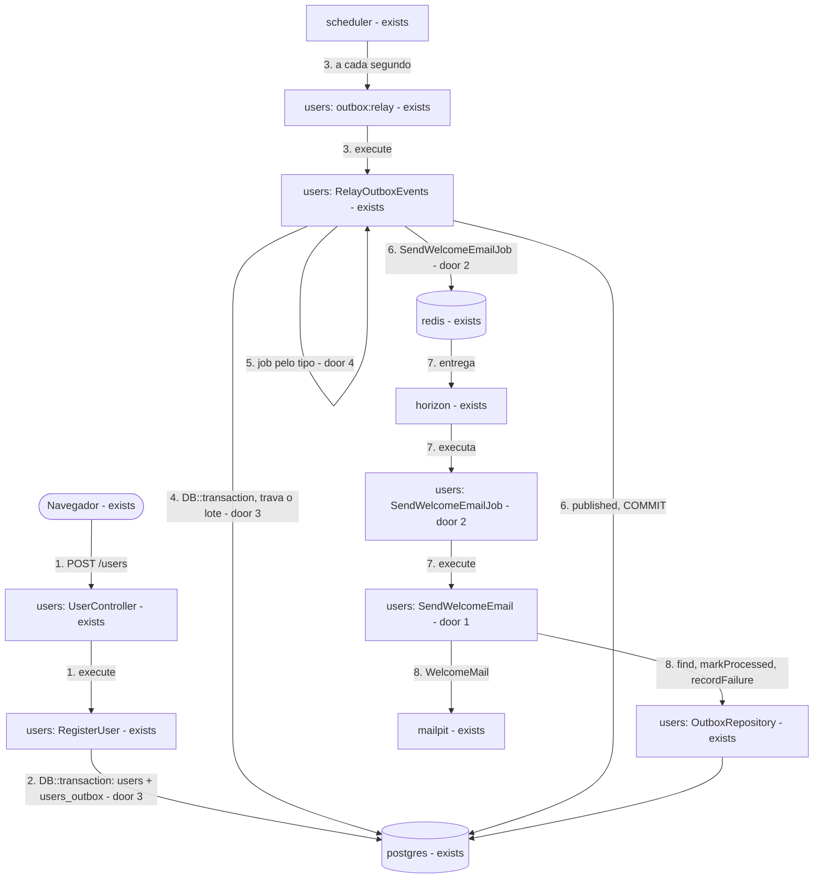
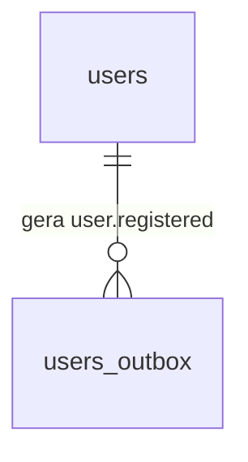

# Módulo único `users` e `DB::transaction` na stack Laravel

**Approved**: 2026-11-11 - user: "Approve"

## Problem

O e-mail de boas-vindas da stack Laravel fica num módulo `notifications` separado de `users`, e a separação é só nominal: `notifications` lê e escreve `users_outbox` pelo `OutboxRepository` de `users`, e para `users` não importar o job existem três peças só de indireção - o registro `OutboxConsumers`, o `NotificationsServiceProvider` que se registra nele e a exceção `UnknownOutboxConsumer`. Os casos de uso `RegisterUser` e `RelayOutboxEvents` recebem `ConnectionInterface` por injeção só para abrir uma transação, num projeto em que o resto do código fala com o banco pela facade `DB`. Quem paga é quem mexe na stack: dois módulos, um registro e um provider para seguir um evento que tem um consumidor. A fonte é o /tlc-discover de 2026-11-11, que reverte a decisão 26 de 2026-11-10; não há medição, porque não há produto.

Quando isto sair, quem lê a stack encontra um módulo `users` que cadastra, publica `user.registered` e envia o e-mail, com o relay escolhendo o job pelo tipo do evento e cada caso de uso abrindo a transação com `DB::transaction`. Para quem se cadastra, nada muda: mesma API, mesmo e-mail, mesmos prazos.

## Shape

Reusa o schema, o `scheduler`, o `horizon`, `config/outbox.php`, as consultas de docs/database.md, os repositórios, os enums e toda a suíte de `tests/infra`, que já prova o comportamento de ponta a ponta e não muda de expectativa. As regras que mudam o resultado ficam nos casos de uso, que o Pest alcança sem banco nem Redis porque a facade `DB` é simulável (door 3); o que depende de transação, trava, fila ou SMTP reais continua provado em `tests/infra`.

1. `POST /users` -> `users` (exists) - `UserController` chama `RegisterUser`, que aplica os limites como hoje
2. `RegisterUser` (exists) -> `postgres` (exists) - abre a transação com `DB::transaction` (door 3) e grava `users` e o evento `user.registered` em `users_outbox`; out: `201` com o corpo de hoje
3. `scheduler` (exists) -> `outbox:relay` (exists) - chama `RelayOutboxEvents`
4. `RelayOutboxEvents` (exists) -> `postgres` (exists) - abre a transação com `DB::transaction` (door 3) e trava o lote pronto, como hoje
5. `RelayOutboxEvents` (exists) - monta o job de cada evento do lote pelo tipo (door 4) antes da primeira publicação; um tipo fora de `OutboxEventType` desfaz o lote sem publicar nada
6. `RelayOutboxEvents` (exists) -> `redis` (exists) - publica `SendWelcomeEmailJob` de `users` (door 2) e marca o lote `published`, na mesma transação
7. `horizon` (exists) -> `SendWelcomeEmailJob` (door 2) - chama `SendWelcomeEmail`, agora em `users` (door 1), sem transação
8. `SendWelcomeEmail` (door 1) -> `OutboxRepository` (exists) - lê o evento e grava sucesso ou falha; out: `WelcomeMail` no `mailpit`

**Changes underneath**

| Front | What changes |
| --- | --- |
| domain | `notifications` deixa de ser um módulo: o e-mail de boas-vindas passa a ser parte de `users`. A decisão 26 de docs/decisions.md é reescrita no lugar. Quem se apoia na divisão: `tests/infra/laravel-outbox.sh` OB11 (`users` não referencia `notifications`), `ModulesStructureTest` ("has no outbox module", "keeps notifications away…"), `tests/infra/docs.sh` LV40 e LV53 |
| stored data | nada a migrar: schema, `payload`, status e `event_type` continuam iguais |
| readers | `tests/infra/adapters/laravel.sh` `stack_dispatch` (classe do job); `tests/infra/laravel-outbox.sh` RG27 (caminho da view) e OB11; `tests/infra/laravel.sh` LV49, LV50 e LV51 (lista dos módulos locais); `tests/infra/docs.sh` LV40 e LV53; os testes Pest de `users` e `notifications`; `apis/laravel/composer.json` e `composer.lock`; docs/stacks.md; docs/decisions.md. A NestJS e os demais arquivos de `tests/infra` não leem nenhum nome que muda |

New: nothing - o schema não muda. One-way constraints: o `event_type` gravado continua `user.registered`, o valor de `OutboxEventType::UserRegistered` que as outras stacks leem.

O ciclo de status não muda: é o de docs/database.md › Ciclo de status.

## Surface

None - nothing consumed outside: `POST /users`, `GET /health` e `outbox:relay` mantêm rota, corpo, saída e códigos.

## Landing

| One-way door | Literal shape | Alternative rejected |
| --- | --- | --- |
| 1. módulos | `app-modules/users` (`modules/users`, `Modules\Users\`) passa a guardar também `Jobs\SendWelcomeEmailJob`, `Mail\WelcomeMail`, `UseCases\SendWelcomeEmail` e as views `users::welcome` e `users::welcome-text`; `app-modules/notifications` e `modules/notifications` deixam de existir; os módulos locais são `health` e `users` | manter `users` + `notifications` - a divisão é nominal (o e-mail escreve pelo repositório de `users`) e custa um registro, um provider e uma exceção; recusado pelo responsável no discover de 2026-11-11 |
| 2. job na fila | classe `Modules\Users\Jobs\SendWelcomeEmailJob`, conexão `redis`, fila `registration-emails`, só o `eventId`, `tries` `1`, sem backoff, `after_commit` `false` - muda só o namespace | manter `Modules\Notifications\Jobs\SendWelcomeEmailJob` - o módulo deixa de existir |
| 3. transação nos casos de uso | o caso de uso chama `DB::transaction(fn () => ...)` da facade `Illuminate\Support\Facades\DB`; nenhum caso de uso recebe `ConnectionInterface`; repositórios só executam consultas e nunca abrem transação; os testes Pest sem banco simulam a facade | `ConnectionInterface` injetada - decisão de 2026-11-10, recusada no discover de 2026-11-11: o motivo dela (testar sem PostgreSQL) também se cumpre simulando a facade |
| 4. job pelo tipo do evento | `RelayOutboxEvents` converte o `event_type` com `OutboxEventType::from` e escolhe o job com `match`, `UserRegistered` -> `new SendWelcomeEmailJob($eventId)`; um tipo novo no enum sem braço no `match` é erro; `OutboxConsumers`, `NotificationsServiceProvider` e `UnknownOutboxConsumer` deixam de existir | manter o registro `OutboxConsumers` - só existia para `users` não depender de `notifications`, que deixa de existir; escolhido pelo responsável no discover de 2026-11-11 |

- Nothing else in this change is hard to reverse

## Criteria

### S1: Um módulo `users` (P1)

O e-mail de boas-vindas mora em `users`, e `notifications` deixa de existir.

**Acceptance Criteria**

1. The diretório `apis/laravel/app-modules/notifications` SHALL não existir, `apis/laravel/composer.json` SHALL não exigir `modules/notifications`, e `apis/laravel/composer.lock` SHALL não ter `modules/notifications` nem `modules/outbox`, e SHALL ter `modules/users` e `modules/health` vindos de `app-modules/users` e `app-modules/health`
2. The código PHP de `apis/laravel/app-modules` e de `apis/laravel/tests` SHALL não conter `Modules\Notifications` nem `notifications::`
3. The classes `Modules\Users\Jobs\SendWelcomeEmailJob`, `Modules\Users\Mail\WelcomeMail` e `Modules\Users\UseCases\SendWelcomeEmail` SHALL existir, e as classes `OutboxConsumers`, `NotificationsServiceProvider` e `UnknownOutboxConsumer` SHALL não existir em `apis/laravel`
4. The job `SendWelcomeEmailJob` SHALL ter `tries` `1`, sem `backoff`, e `WelcomeMail` SHALL ter o `Message-ID` `<event_id>@cadastro-feliz.local` e as views `users::welcome` e `users::welcome-text`, e o HTML renderizado para `Ana` SHALL conter `Olá, Ana!`
5. WHEN `SendWelcomeEmail::execute` recebe um `event_id` THEN SHALL agir conforme o evento, provado em Pest sem banco nem SMTP
   - `processed` ou `failed` → nenhum e-mail e nenhuma escrita; `pending` ou `published` com envio ok → um `WelcomeMail` para o e-mail do `payload` e `markProcessed`; envio lançando `boom` → `recordFailure` com `boom` e nenhum `markProcessed`; id inexistente → nenhum e-mail e um aviso `outbox event not found` no log

### S2: Transação pela facade `DB` (P1)

`RegisterUser` e `RelayOutboxEvents` abrem a transação com `DB::transaction`, sem conexão injetada.

**Acceptance Criteria**

6. The código PHP de `apis/laravel/app` e `apis/laravel/app-modules/*/src` SHALL não conter `ConnectionInterface`, e os construtores de `RegisterUser` e `RelayOutboxEvents` SHALL não receber conexão de banco
7. WHEN `RegisterUser::execute` grava um cadastro THEN o `INSERT` em `users` e o `INSERT` em `users_outbox` SHALL acontecer dentro do callback de uma única chamada a `DB::transaction`, provado em Pest sem PostgreSQL
   - transação simulada que não executa o callback → nenhuma escrita; transação que executa → as duas escritas, na ordem `users` e depois `users_outbox`
8. IF a gravação do evento lança uma exceção THEN `RegisterUser` SHALL deixar a exceção sair do callback de `DB::transaction` e devolver a reserva da cota uma vez
9. The classes de `apis/laravel/app-modules/*/src/Repositories` SHALL não conter `transaction(` nem `beginTransaction`
10. WHEN `POST /users` recebe um cadastro válido em Pest sem PostgreSQL THEN SHALL responder `201` sem publicar job, como hoje

### S3: Relay escolhe o job pelo tipo (P1)

`RelayOutboxEvents` publica o lote numa transação e só publica eventos de tipo conhecido.

**Acceptance Criteria**

11. WHEN `RelayOutboxEvents::execute` publica um lote THEN a trava do lote, cada publicação e a marcação `published` SHALL acontecer dentro do callback de uma única chamada a `DB::transaction`, nessa ordem, provado em Pest sem PostgreSQL
    - lote com 2 eventos → 2 publicações e uma marcação com os 2 ids; lote vazio → nenhuma publicação e nenhuma marcação
12. WHEN o lote tem um evento `user.registered` com id `e1` THEN `RelayOutboxEvents` SHALL publicar um `Modules\Users\Jobs\SendWelcomeEmailJob` com `eventId` `e1`
13. IF um evento do lote tem um `event_type` fora de `OutboxEventType` THEN `RelayOutboxEvents` SHALL lançar uma exceção com o tipo na mensagem antes de publicar qualquer job do lote, sem marcar `published`
    - lote [`user.deleted`] → 0 publicações, exceção com `user.deleted`; lote de 3 eventos com o 3º `user.deleted` → 0 publicações
14. IF `RelayOutboxEvents` lança qualquer exceção THEN `php artisan outbox:relay` SHALL sair com `1` e registrar `outbox relay failed` no log; sem exceção, SHALL imprimir `<N> event(s) published.` e sair com `0`

### S4: Comportamento igual, provado (P1)

A suíte que já prova a stack continua verde, sem afrouxar nenhum caso.

**Acceptance Criteria**

15. WHEN `make test-laravel` roda THEN SHALL sair com `0`, sem PostgreSQL nem Redis
16. WHEN `bash tests/infra/run.sh docs laravel registration:laravel outbox:laravel laravel-outbox stack-switch` roda THEN SHALL sair com `0`, com os mesmos ids de antes, e só OB11, RG27, LV40, LV49, LV50, LV51, LV53 e `stack_dispatch` SHALL ter mudado
17. The check OB11 de `tests/infra/laravel-outbox.sh` SHALL falhar se `apis/laravel/app-modules/notifications` existir ou se algum arquivo de `apis/laravel/app-modules` referenciar `Modules\Notifications`

### S5: Documentação alinhada (P2)

Os documentos descrevem o módulo que existe.

**Acceptance Criteria**

18. The arquivo `docs/stacks.md` › Laravel SHALL mostrar na árvore, em `users/`, `src/Jobs/SendWelcomeEmailJob.php`, `src/Mail/WelcomeMail.php` e `src/UseCases/SendWelcomeEmail.php`, SHALL não ter `notifications/`, `OutboxConsumers` nem `NotificationsServiceProvider`, e SHALL dizer que `users` é dono de `users_outbox`, roda o relay e envia o e-mail de boas-vindas, e que cada caso de uso abre a transação com `DB::transaction`
19. The arquivo `docs/decisions.md` SHALL ter a decisão 26 reescrita no lugar, com o título `Módulo único da stack Laravel`, no índice e numa seção com uma linha **Substitui** citando o desenho `users` + `notifications` com `ConnectionInterface`, motivos, alternativas descartadas (manter `users` + `notifications`; `ConnectionInterface` injetada) e custos

## Out of scope

| Excluded | Why |
| --- | --- |
| Mudanças na NestJS e nas demais stacks | o discover tratou só da Laravel |
| Renomear o módulo `users` | rota, tabela e pacote já se chamam `users`; renomear não simplifica nada |
| Mensagens com a classe antiga do job já na fila no momento da troca | o `redis` da stack não tem persistência; uma que sobrar falha no Horizon, e o evento `published` é republicado após `OUTBOX_REPUBLISH_AFTER_SECONDS`, como LM2 já prova |
| `config/services.php` › `slack.notifications` | é a configuração padrão do framework para Slack, sem relação com o módulo |
| `.design/` e `.specs/` de rodadas anteriores | registram a história e ficam como estão |

## Assumptions

| Assumption | Chosen default | Rationale | Confirmed? |
| --- | --- | --- | --- |
| Exceção para um tipo desconhecido | a `ValueError` de `OutboxEventType::from`, cuja mensagem traz o tipo, sem exceção de domínio | o comportamento visível não muda (o comando sai com `1` e loga `outbox relay failed`), e uma exceção própria devolveria uma das três classes que o discover removeu | n |
| Nome do módulo | `users`, com o e-mail dentro | é o escopo do discover de 2026-11-11 e o nome que rota, tabela e pacote já usam | n |
| Onde registrar a reversão | decisão 26 de docs/decisions.md reescrita no lugar, com linha **Substitui**, como a decisão 5 | escolhido pelo responsável no discover de 2026-11-11; o projeto registra decisões ali, e não em `.specs/STATE.md` | y |
| Registro de consumidores | trocado por `match` sobre `OutboxEventType` | escolhido pelo responsável no discover de 2026-11-11 | y |

**Open questions:** none - all resolved or logged above.

## Differences from the source

None - the product matches the source

## Sources

- /tlc-discover de 2026-11-11, nesta conversa - binding - módulo único `users`, `match` no lugar de `OutboxConsumers`, `DB::transaction`, decisão 26 reescrita no lugar
- .specs/features/laravel-modules-refactor/plan.md - binding - doors 2 e 5 daquela rodada (job na fila e enums), que esta preserva salvo o namespace do job
- docs/database.md - binding - status, `CHECK` e consultas, que não mudam
