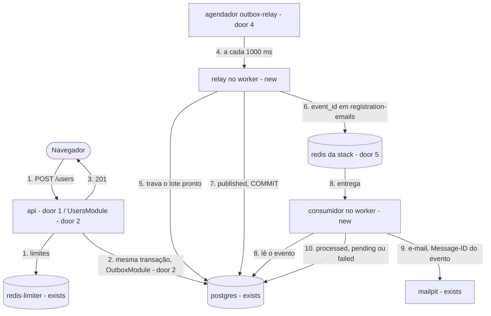
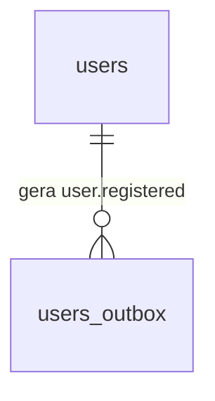
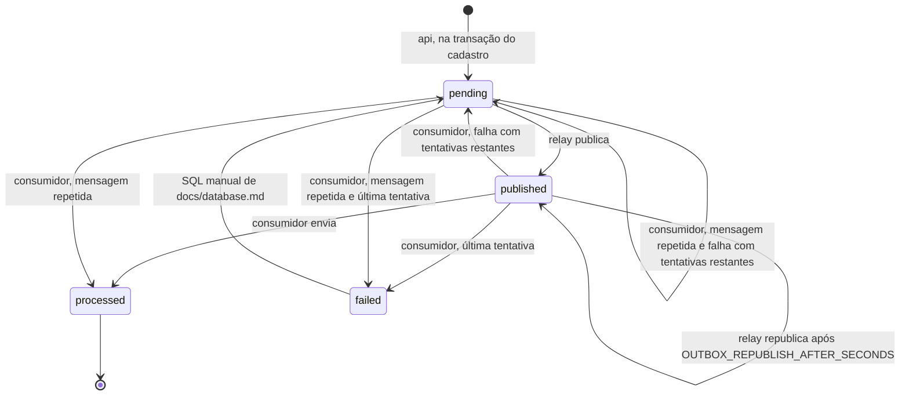

# Stack NestJS com Transactional Outbox

**Approved**: 2026-11-08 - user: "Aprovar e seguir"

## Problem

A stack NestJS não existe. `make up-nest` recusa com `stack nest ainda não implementada`, e a suíte de contrato só tem o adaptador `laravel`. O projeto promete o mesmo caso de uso em três stacks intercambiáveis sobre o mesmo banco, mas os cenários 6 (troca de stack com evento aberto) e 9 (limite entre stacks) de docs/architecture.md nunca rodaram trocando de stack de verdade. Além disso, o contrato do relay e do worker, escrito para ser neutro, só foi exercitado por quem o escreveu. Quem paga é o próprio estudo: a comparação entre stacks, que é o propósito da prova de conceito, não tem um segundo ponto. A fonte (`.design/nestjs-stack.md`) não traz medição, porque ainda não há produto; a prova é de comportamento, caso a caso.

Quando isto sair, `make up-nest` sobe a stack, o formulário conclui o cadastro e o e-mail chega sem que o frontend saiba qual stack responde. A mesma suíte de contrato passa contra `laravel` e contra `nest`. Trocar entre as duas com um evento aberto ou com um `429` ativo continua o mesmo fluxo, nos dois sentidos.

## Shape

Reusa o schema, os serviços comuns, o `Makefile` com a regra genérica de stack, a suíte de contrato com os ids de hoje, o padrão de imagem e de npm do frontend e o padrão de compose da Laravel. As regras que mudam o resultado ficam em dois lugares: a espera entre tentativas, o `Message-ID`, as opções do job, o corpo do e-mail e a forma do `422` ficam em funções que o Vitest alcança sem banco nem Redis; tudo o que depende de transação, trava, fila ou SMTP reais fica na suíte de contrato e em `tests/infra/nest.sh`.

1. `POST /users` -> `api` (door 1) -> `UsersModule` (door 2) - valida na forma do contrato e aplica os limites no `redis-limiter` (exists), com cópias dos scripts Lua de docs/api-contract.md
2. `UsersModule` (door 2) -> `OutboxModule` (door 2) -> `postgres` (exists) - grava `users` e `users_outbox` numa transação do TypeORM (door 3), com o `payload` de .design/laravel-outbox.md door 1; `UNIQUE` violada responde `409`, qualquer outra falha responde `500`, e as duas desfazem tudo e devolvem a reserva
3. out: `201` com o corpo do contrato, sem nenhuma conexão com o `redis` da stack
4. agendador `outbox-relay` (door 4) no `redis` da stack - dispara um job a cada 1000 ms
5. relay (new) no `worker` (door 1) -> `postgres` (exists) - abre a transação e trava o lote pronto, pulando linhas já travadas
6. relay (new) -> `redis` da stack (door 5) - adiciona um job em `registration-emails` (door 4) por evento; qualquer falha desfaz o lote e registra `outbox relay failed` no log
7. relay (new) -> `postgres` (exists) - marca o lote `published` e confirma
8. consumidor de `registration-emails` (new) no `worker` (door 1) -> `postgres` (exists) - lê o evento pelo `event_id`, sem transação aberta; um evento terminal ou inexistente encerra aqui
9. consumidor (new) -> `mailpit` (exists) - envia a partir do `payload`, com o `Message-ID` `<event_id>@cadastro-feliz.local`
10. consumidor (new) -> `postgres` (exists) - grava `processed`, ou a tentativa, a espera ou `failed` (.design/laravel-outbox.md door 2); o job termina sem falhar na fila

**Comandos** - `make nest-npm ARGS="<comando npm>"` roda o npm num container descartável, como `make frontend-npm`; sem `ARGS`, sai com erro e imprime `uso: make nest-npm ARGS="<comando npm>"`. `make test-nest` roda o Vitest num container descartável, como `make test-laravel`, e sai com o código dos testes. Os alvos `up-nest`, `watch-nest`, `logs-nest` e `down-nest` são os genéricos do `Makefile` e passam a funcionar quando `apis/nestjs/docker-compose.yml` existir.

**Changes underneath**

| Front | What changes |
| --- | --- |
| domain | Nenhum termo muda de significado. `nest` passa a ser uma stack implementada: os alvos `*-nest` deixam de recusar. Quem decide isso hoje: `require_stack` no `Makefile`, pela existência do compose |
| stored data | nada a migrar - o schema não muda, e a NestJS lê e escreve as mesmas linhas que a Laravel (Key decision 5 do design) |
| readers | `tests/infra/stack.sh`: CS1 (lista exata de entradas), CS2 (um adaptador fictício de outro nome, porque `nest` passa a existir) e C16 (só `go` recusa). `tests/infra/run.sh`: `FILES` ganha `nest.sh` e `stack-switch.sh`. `.github/workflows/ci.yml`: job `make test-nest`; a matriz de infraestrutura cresce sozinha, pela lista de `run.sh`. `tests/infra/docs.sh`: os casos que leem os textos alterados em S8. O frontend não muda |
| docs | README, docs/stacks.md, docs/infrastructure.md, docs/architecture.md, docs/database.md, docs/api-contract.md e docs/decisions.md, como em S8 |

New: nothing - a NestJS só mapeia `users` e `users_outbox` como estão. One-way constraints: nenhuma nova; o `payload` e o ciclo de status são as doors 1 e 2 de .design/laravel-outbox.md, sem variação.

## Surface

None - nothing consumed outside changes: a stack NestJS serve `POST /users`, o preflight `OPTIONS /users` e `GET /health` com a rota, o corpo e os status de docs/api-contract.md, na mesma porta 8080 da Laravel.

## Landing

| One-way door | Literal shape | Alternative rejected |
| --- | --- | --- |
| 1. projeto Compose e processos | `apis/nestjs/docker-compose.yml` com `name: cadastro-feliz-nest` e a rede externa `cadastro-feliz-net`. `api` constrói a imagem `cadastro-feliz-nest-api` a partir de `apis/nestjs/Dockerfile`, roda `src/main.ts` e publica `${API_PORT}:8080`. `worker` usa a mesma imagem, sem `build`, roda `src/worker.ts`, com `restart: unless-stopped` e `depends_on` `redis` e `api` saudáveis; o healthcheck dele não abre conexão nova com o `redis`. `redis` usa `redis:8.10.3-alpine`, com `noeviction`, sem persistência e em `tmpfs`, como o da Laravel | `api` e `worker` como aplicações e imagens próprias, num monorepo do Nest - só venceria se os dois processos fossem implantados ou versionados separadamente, e aqui eles sobem e descem juntos (design › Shape); um quarto container só para o relay - contradiz README, docs/stacks.md e o cenário 6 de docs/architecture.md |
| 2. fronteira de módulos | `src/main.ts` inicia `ApiModule`, e `src/worker.ts` inicia `WorkerModule`. Só `WorkerModule`, e os módulos que só ele importa, registram o `BullModule`. `OutboxModule` (`src/modules/outbox`), que guarda `UserOutboxEvent` e a gravação do evento, é importado pelos dois e não importa nada de fila. `UsersModule` (`src/modules/users`) é só da `api`; o relay e o consumidor (`src/modules/outbox` e `src/modules/mail`, como docs/stacks.md desenha) são só do `worker` | `BullModule.forRoot` no módulo raiz, como sugerem os exemplos do Nest - a `api` abriria conexão com o `redis` da stack, e a queda da fila atrasaria o cadastro (Key decision 1 do design) |
| 3. TypeORM sem schema próprio | entidades `User` → `users` e `UserOutboxEvent` → `users_outbox`, espelhando `database/migrations`; `synchronize` `false`, `migrationsRun` `false` e nenhuma migration do TypeORM no repositório; registrado como decisão 24 em docs/decisions.md | migrations do TypeORM - duas fontes do schema, contra a decisão 2; `synchronize` ligado em desenvolvimento - reescreveria as tabelas que a Laravel lê |
| 4. filas, jobs e limites | fila `outbox-relay` com o agendador de id `outbox-relay`, `every` 1000 ms, registrado pelo `worker` ao subir. Fila `registration-emails`, job `send-welcome-email` com `data` exatamente `{"event_id":"<uuid>"}`, `attempts` `1` e sem `backoff`; o id do job é gerado pelo BullMQ e nunca é o `event_id`. Consumidor com `maxStalledCount` `0` e `lockDuration` 30000 ms. Ordem obrigatória: 5 s do SMTP < 30 s do lock < 300 s de `OUTBOX_REPUBLISH_AFTER_SECONDS` | retentativas do BullMQ com backoff - a falha some com a stack (decisão 9); `jobId` igual ao `event_id` - o BullMQ descartaria a republicação enquanto o job anterior existisse; `maxStalledCount` padrão `1` - um job interrompido rodaria de novo pela fila, contra a Key decision 4 do design |
| 5. conexões com o `redis` da stack | a `api` não tem conexão nenhuma com ele. A conexão por onde o relay publica desiste em 1 s por comando, sem retentar e sem fila offline, para uma fila travada não segurar o lote aberto. As conexões do consumidor e do agendador esperam o Redis voltar (`maxRetriesPerRequest: null`, como docs/stacks.md pede) | uma conexão só para tudo - ou o relay segura as travas do lote enquanto o Redis está travado, ou o consumidor desiste quando o Redis pisca |
| 6. adaptador `nest` | `tests/infra/adapters/nest.sh` define as 22 funções de `ADAPTER_FUNCTIONS`. `stack_worker_stop` e `stack_worker_start` pausam e retomam a fila `registration-emails`; `stack_relay_stop` e `stack_relay_start` pausam e retomam a fila `outbox-relay`; `stack_relay_container` é o `worker`; `stack_queue_*` param, pausam e contam o `redis` da stack; `stack_jobs_created` lê o contador de ids de `registration-emails`, e `stack_failed_jobs` conta os jobs falhos dela. Parar o container `worker` inteiro é provado em `tests/infra/nest.sh` | um quarto container para o relay - contradiz README e design; recriar o `worker` com uma variável que desliga um papel - leva segundos por caso e recria o container que OB22 exige estável (escolha de diashelter, 2026-11-08) |
| 7. dependências e testes | `Dockerfile` sobre `node:26.13.0-alpine`, a mesma do frontend; `package.json` com versões exatas em `dependencies` e `devDependencies` e `package-lock.json` versionado. As dependências são `@nestjs/*`, `typeorm` e `pg`, `@nestjs/bullmq` e `bullmq`, `ioredis` para o `redis-limiter`, `nodemailer`, `class-validator` e `class-transformer`. Os testes usam Vitest com `unplugin-swc` e `@swc/core`, pela receita oficial do Nest; registrado como decisão 25 em docs/decisions.md | Jest, o padrão do Nest CLI - um segundo executor de testes no projeto, ao lado do Vitest do frontend (escolha do design) |
| 8. arquivos de prova | `tests/infra/nest.sh` guarda os casos internos da NestJS, com ids `NS<n>`; `tests/infra/stack-switch.sh` guarda a troca entre Laravel e NestJS, com ids `SW<n>`. Os dois entram em `FILES` de `run.sh`, depois de `laravel-outbox.sh`. Os arquivos de contrato não mudam | troca de stack dentro de um arquivo de contrato - ele roda uma vez por stack, e um caso que precisa das duas rodaria duas vezes e dependeria de outra stack existir |
| 9. agendador registrado de novo (achado no build) | o `worker` confere a cada segundo, com a conexão pronta, se o agendador `outbox-relay` existe no `redis`, e o registra de novo quando falta; o mesmo laço renova `/tmp/worker-alive`, que o healthcheck do `worker` lê | registrar o agendador só ao subir - o `redis` da stack não tem persistência e volta vazio depois de parar, e o relay nunca mais dispararia sem reiniciar o `worker` (OB22, RG25) |
| 10. entradas de teste no worker (achado no build) | `node dist/scripts/queue-control.js <pause\|resume\|reset\|dispatch\|scheduler>` faz as ações do adaptador `nest`, e `node dist/scripts/relay-once.js` roda uma execução do relay fora do agendador, imprimindo `<N> event(s) published.` ou `outbox relay failed`, como o `outbox:relay` da Laravel | pausar pela `redis-cli` - a pausa do BullMQ é um script Lua sobre várias chaves; disparar o relay só pelo agendador - um relay já aberto com a fila travada não teria como ser provado (critério 32) |
| 11. compilação no modo watch (achado no build) | `nest-cli.json` com `builder` `swc` e `typeCheck` `false`, e `@swc/cli` `0.8.2` em `devDependencies`; o `tsc --noEmit` de `make test-nest` continua sendo a checagem de tipos | o `tsc` do Nest CLI, o padrão - leva 9 s a cada início do `api` e do `worker`, e um `worker` recém-iniciado passava dos 10 s do critério 33 |

- Nothing else in this change is hard to reverse

## Criteria

### S1: Stack no ar e `GET /health` (P1)

`make up-nest` sobe três containers, e a `api` responde a saúde do contrato sem tocar na fila nem no schema.

**Acceptance Criteria**

1. WHEN `make up-nest` roda em um clone limpo THEN `api`, `worker` e `redis` SHALL ser os únicos containers de `cadastro-feliz-nest`, todos `healthy`, com a outra stack derrubada; rodar de novo sem mudança SHALL manter os 3 IDs
2. The `api` SHALL ser o único container da stack com porta publicada, na porta 8080 da máquina, e `api` e `worker` SHALL usar a mesma imagem
3. WHEN `GET /health` é chamado com tudo no ar THEN a `api` SHALL responder `200` com exatamente `{"status":"ok","checks":{"database":"ok","limiter":"ok"}}`, `Content-Type: application/json` e `Cache-Control: no-store`, sem mudar nenhuma linha de `users` nem de `users_outbox`
4. IF o `postgres`, o `redis-limiter` ou os dois estão parados THEN `GET /health` SHALL responder `503` em menos de 3 s, com `fail` em cada check que falhou e os mesmos headers, e o container `api` SHALL continuar `healthy`
   - só o `redis-limiter` parado → `{"status":"fail","checks":{"database":"ok","limiter":"fail"}}`; os dois parados → os dois `fail`
5. IF o `postgres` ou o `redis-limiter` está pausado THEN `GET /health` SHALL responder `503` em menos de 3 s
6. IF um check falha THEN o log da `api` SHALL ter o motivo da falha, e o corpo SHALL não ter outra chave nem outro valor além de `ok` e `fail`
7. The `api` SHALL responder só a `GET /health`, `POST /users` e ao preflight `OPTIONS /users`; `GET /api/health` SHALL responder `404`, e `GET /nada` e `GET /` SHALL responder `404` com `Content-Type: application/json`
8. WHEN `make up-nest` roda sobre um banco já migrado THEN `pg_dump --schema-only` SHALL ser idêntico ao de antes, arquivo inteiro, e `apis/nestjs` SHALL não ter migration do TypeORM
9. IF o `redis` da stack está parado THEN `GET /health` SHALL responder `200` e `POST /users` SHALL responder `201`; WHEN ele volta THEN o `worker` SHALL estar `healthy` em até 60 s, com o mesmo ID e `RestartCount` `0`
10. WHILE `GET /health` e `POST /users` são atendidos, o `CLIENT LIST` do `redis` da stack SHALL não ter nenhum cliente vindo do IP da `api`
11. IF a aplicação não inicia, por um erro forçado em `src/main.ts`, THEN `make up-nest` SHALL sair com código diferente de `0`; IF a porta 8080 está ocupada THEN `make up-nest` SHALL sair com código diferente de `0`
12. WHEN `make up-laravel` ou `make down` roda com a NestJS no ar THEN nenhum container nem volume de `cadastro-feliz-nest` SHALL restar
13. IF o corpo de `POST /users` é um JSON válido que não é objeto THEN a `api` SHALL responder `422` com o mesmo corpo do JSON malformado de RG4, sem consultar o banco nem contar tentativa
    - `[]` → `422`; `null` → `422`; `"x"` → `422`; `1` → `422`; nunca o `400` do Nest

### S2: Edição, dependências e testes unitários (P1)

O código entra por cópia, as dependências mudam só por um alvo do `Makefile`, e os testes unitários rodam sem serviços.

**Acceptance Criteria**

14. WHILE `make watch-nest` roda, WHEN um arquivo de `src` usado pela `api` muda THEN a requisição seguinte SHALL usar o código novo em até 30 s, com o mesmo ID do container `api`
15. WHILE `make watch-nest` roda, WHEN o texto do e-mail muda THEN o próximo cadastro SHALL enviar o texto novo em até 60 s, com o mesmo ID do container `worker`
16. WHILE `make watch-nest` roda, WHEN `package.json`, `package-lock.json` ou `Dockerfile` muda de um jeito que produz uma imagem nova THEN `api` e `worker` SHALL estar recriados, com IDs novos, na mesma imagem nova e `healthy`, em até 180 s
17. IF `make nest-npm` roda sem `ARGS` THEN SHALL sair com código diferente de `0`, imprimir `uso: make nest-npm ARGS="<comando npm>"` e não mudar nenhum container
18. WHEN um usuário que não é root roda `make nest-npm ARGS="install <pacote>"` THEN só `apis/nestjs/package.json` e `apis/nestjs/package-lock.json` SHALL mudar na máquina, com o dono de quem chamou, sem `node_modules` em `apis/nestjs`, e os containers da stack no ar SHALL manter os IDs
19. IF o comando do npm falha THEN `make nest-npm` SHALL sair com código diferente de `0`, com `package.json` e `package-lock.json` iguais aos de antes, arquivo inteiro
20. The seções `dependencies` e `devDependencies` de `apis/nestjs/package.json` SHALL ter só versões na forma exata `X.Y.Z`, e `apis/nestjs/Dockerfile` SHALL partir de `node:26.13.0-alpine`
21. WHEN `make test-nest` roda sem ambiente no ar THEN SHALL rodar o Vitest num container descartável, sem PostgreSQL nem Redis, e sair com `0`; com a stack no ar, os IDs dos containers SHALL continuar os mesmos
22. IF um teste do Vitest falha THEN `make test-nest` SHALL sair com código diferente de `0`
23. The testes do Vitest SHALL cobrir, sem banco nem Redis: a espera para `attempts` anterior de `0` a `3`, as opções do job de door 4, o `Message-ID` `<event_id>@cadastro-feliz.local`, o escape do nome no HTML e o corpo do `422` para JSON malformado
    - base 30: `attempts` anterior `0` → 30 s; `3` → 240 s; nome `<b>Ana</b>` → `&lt;b&gt;Ana&lt;/b&gt;` no HTML

### S3: A NestJS passa a suíte de contrato (P1)

Os mesmos casos que provam a Laravel provam a NestJS, sem desvio por stack.

**Acceptance Criteria**

24. WHEN `bash tests/infra/run.sh registration:nest` roda THEN os 30 ids de contrato de `registration.sh`, de `RG0` a `RG33`, SHALL imprimir `PASS`, os mesmos ids que `registration:laravel` imprime
25. WHEN `bash tests/infra/run.sh outbox:nest` roda THEN os 27 ids de contrato de `outbox.sh`, de `LM0` a `OB38`, SHALL imprimir `PASS`, os mesmos ids que `outbox:laravel` imprime
26. The arquivos `tests/infra/registration.sh`, `tests/infra/outbox.sh` e `tests/infra/registration-helpers.sh` SHALL ficar iguais aos de `5d4f5e7`
27. The adaptador `tests/infra/adapters/nest.sh` SHALL definir as 22 funções de `ADAPTER_FUNCTIONS`, e `stack_worker_stop` SHALL deixar o relay publicando: com ele chamado, um cadastro SHALL ter o evento `published` em até 10 s e uma mensagem esperando em `registration-emails`

### S4: Relay no `worker` (P1)

O `worker` publica os eventos prontos a cada segundo, sem publicar a mesma linha duas vezes ao mesmo tempo e sem segurar o lote quando a fila trava.

**Acceptance Criteria**

28. The `redis` da stack SHALL ter o agendador `outbox-relay` com intervalo de 1000 ms depois de `make up-nest`
29. WHEN há 3 eventos prontos com `OUTBOX_BATCH_SIZE=2` e o relay é retomado THEN a primeira execução SHALL publicar exatamente os 2 de `created_at` mais antigo, e o terceiro SHALL ficar `published` numa execução seguinte
30. IF outra transação trava um evento pronto THEN o relay SHALL não esperar nem publicar esse evento, e SHALL publicar os demais em até 10 s
31. IF a publicação falha no lote, com o contador de ids de `registration-emails` corrompido dentro do teste, THEN todos os eventos do lote SHALL continuar `pending`, com `published_at` nulo, e o log do `worker` SHALL ter uma linha com `outbox relay failed`, com o container `healthy`
32. IF o `redis` da stack é pausado THEN, em até 3 s e enquanto ele estiver pausado, `pg_stat_activity` SHALL não ter transação aberta do `worker`, e um `UPDATE` num evento pronto com `lock_timeout` de 1 s SHALL concluir, com pelo menos duas sondagens; WHEN ele é despausado THEN o e-mail SHALL chegar em até 60 s, sem reinício do `worker`
33. WHEN o container `worker` é iniciado THEN um evento pronto SHALL ficar `published` em até 10 s
34. WHILE o container `worker` está parado, WHEN um cadastro responde `201` THEN o evento SHALL continuar `pending` depois de 5 s; WHEN o `worker` volta THEN o e-mail SHALL chegar em até 60 s

### S5: Envio a partir do evento (P1)

O consumidor envia a partir do evento, roda cada mensagem uma vez e deixa as retentativas no banco.

**Acceptance Criteria**

35. WHILE o consumidor está pausado, WHEN um evento é publicado THEN o job em `registration-emails` SHALL ter `data` exatamente `{"event_id":"<id do evento>"}`, `attempts` `1`, nenhum `backoff`, e id diferente do `event_id`
36. WHEN um evento é republicado enquanto o job anterior dele ainda existe no `redis` THEN o BullMQ SHALL criar um job novo, e o contador de ids de `registration-emails` SHALL subir
37. IF o container `worker` é morto durante um envio, com o Mailpit pausado, THEN, com o `worker` de volta, o job SHALL não rodar de novo pela fila: o evento SHALL continuar `published`, com `attempts` igual; WHEN o Mailpit é despausado e o evento é republicado, com `OUTBOX_REPUBLISH_AFTER_SECONDS=5`, THEN o Mailpit SHALL ter exatamente uma mensagem, com o `Message-ID` do evento
38. WHILE um envio espera o Mailpit pausado, o `PTTL` da trava do job SHALL ficar entre 5000 e 30000 ms, e a falha SHALL ser gravada no evento entre 5 e 10 s depois do início do envio

### S6: Troca entre Laravel e NestJS (P1)

O evento aberto e o limite atingido numa stack seguem na outra, nos dois sentidos.

**Acceptance Criteria**

39. WHILE o container `worker` da NestJS está parado, WHEN um cadastro responde `201` e `make up-laravel` roda THEN o evento, deixado em `pending`, SHALL ser publicado pela Laravel, e o Mailpit SHALL ter exatamente uma mensagem em até 60 s
40. WHILE o `horizon` da Laravel está parado, WHEN um cadastro responde `201`, o evento fica `published` e `make up-nest` roda com `OUTBOX_REPUBLISH_AFTER_SECONDS=5` THEN a NestJS SHALL republicar o evento, e o Mailpit SHALL ter exatamente uma mensagem em até 60 s, com o `Message-ID` do evento
41. WHEN um par IP e e-mail recebe `429` na NestJS e `make up-laravel` roda THEN o mesmo par SHALL receber `429` com `Retry-After`; WHEN o par recebe `429` na Laravel e `make up-nest` roda THEN o mesmo par SHALL receber `429` com `Retry-After`

### S7: Suíte e CI (P1)

A NestJS entra na lista de testes, na matriz do CI e no job de testes unitários.

**Acceptance Criteria**

42. WHEN `bash tests/infra/run.sh --list` roda THEN SHALL imprimir, uma por linha e nesta ordem, `docs`, `shared`, `limiter`, `migrate`, `stack`, `frontend`, `test-frontend`, `laravel`, `registration:laravel`, `registration:nest`, `outbox:laravel`, `outbox:nest`, `laravel-outbox`, `nest` e `stack-switch`
43. WHEN `make up-nest`, `make watch-nest`, `make logs-nest` ou `make down-nest` roda THEN SHALL não imprimir `stack nest ainda não implementada`; os mesmos alvos de `go` SHALL continuar recusando com `stack go ainda não implementada`
44. The arquivo `.github/workflows/ci.yml` SHALL ter um job que roda `make test-nest` no mesmo formato do job da Laravel, com o Docker Compose fixado e conferido pelo checksum
45. WHEN `make test-frontend`, `make test-laravel`, `make test-nest` e `bash tests/infra/run.sh` rodam com todas as fatias prontas THEN cada um SHALL sair com código `0`

### S8: Documentação alinhada (P2)

Os documentos dizem que a NestJS existe e como ela funciona.

**Acceptance Criteria**

46. The `README.md` SHALL dizer no status que a stack NestJS implementa o outbox, com `api`, `worker` e `redis`, SHALL não dizer que a NestJS está em design, e a árvore SHALL mostrar `nestjs/` sem `# planejado`
47. The arquivo `docs/stacks.md` SHALL dizer no status que a stack NestJS existe, e a árvore de › NestJS SHALL listar os arquivos que existem em `apis/nestjs`
48. The arquivo `docs/infrastructure.md` SHALL listar `cadastro-feliz-nest` com `api`, `worker` e `redis` em › Arquivos Compose, `make nest-npm` e `make test-nest` entre os alvos, o job `make test-nest` no CI e as entradas `registration:nest`, `outbox:nest`, `nest` e `stack-switch` na suíte
49. The status no topo de `docs/architecture.md`, `docs/database.md` e `docs/api-contract.md` SHALL dizer que Laravel e NestJS implementam o outbox, e SHALL não dizer que a NestJS ainda não o implementa
50. The arquivo `docs/decisions.md` SHALL ter as decisões 24 (TypeORM sem schema próprio) e 25 (Vitest com SWC na NestJS) no índice e numa seção cada, e a decisão 23 SHALL dizer que o adaptador `nest` para o relay e o worker pausando as filas

## Out of scope

| Excluded | Why |
| --- | --- |
| Stack Go | rodada própria; a suíte só precisa admitir uma terceira stack |
| Painel de fila, como um Bull Board | o README não lista painel para a NestJS, e o estado da fila se vê no banco |
| Build de produção | a stack roda em modo de desenvolvimento, como o frontend (decisão 16) |
| Reprocessamento automático de eventos `failed` | continua sendo o SQL manual de docs/database.md |
| Mudança de contrato | se a NestJS não couber nele, a rodada para e o contrato é revisto em docs/api-contract.md; o critério 26 guarda isso |
| Fila e backlog no `GET /health` | a decisão 19 mantém só as dependências da API |
| Retenção e limpeza de jobs concluídos no `redis` da stack | a fila é descartada com a stack, e o volume de uma prova de conceito não pede limpeza |
| Reescrever `.design/nestjs-stack.md` | o design é o registro da decisão; o estado da rodada fica nestes arquivos, e o índice dele só marca a suíte de contrato como pronta |

## Assumptions

| Assumption | Chosen default | Rationale | Confirmed? |
| --- | --- | --- | --- |
| Rodada | as quatro fatias que faltam entram juntas, e a NestJS só passa a rodar a suíte de contrato com as quatro prontas | ordem do design confirmada por diashelter em 2026-11-08 | y |
| Parar o relay e o worker no adaptador | pausar e retomar as filas `outbox-relay` e `registration-emails` | escolha de diashelter em 2026-11-08: "Pausar a fila (Recomendado)" | y |
| Como o processo pega a edição | `api` e `worker` rodam o modo watch do Nest CLI; o Compose Watch só copia, como no frontend | default do design, sem objeção | n |
| Prazos do watch | 30 s para a `api`, 60 s para o `worker`, 180 s para o rebuild | os mesmos da Laravel, com folga para a recompilação do TypeScript | n |
| Nome do job | `send-welcome-email` | o nome na NestJS é interno; o contrato entre stacks é só o `data` | n |
| Linha de log da falha do relay | `outbox relay failed` | a mesma da Laravel; a API e os logs estão em inglês | n |
| Healthcheck do `worker` | saudável enquanto o processo está de pé e as conexões dele com o `redis` estão prontas, sem abrir conexão nova | uma sondagem por conexão nova mudaria `total_connections_received`, que OB6 lê | n |
| Falhas forçadas nos testes | o contador de ids de `registration-emails` corrompido no `redis` da stack para recusar só a publicação (diashelter, 2026-11-08: "Contador corrompido (Recomendado)"); travas por `psql`; `docker pause` e `docker kill` | provam atomicidade, corrida e queda sem alterar o código da aplicação | n |
| Provas com tempos reduzidos | `OUTBOX_*` menores no `.env` da cópia de trabalho, como na Laravel | esperar 300 s por caso tornaria a suíte inviável | n |
| Testes existentes | os listados em `readers` mudam no mesmo commit do que afirmam | regra 3: um teste muda com o que ele prova | n |

**Open questions:** none - all resolved or logged above.

## Differences from the source

None - the product matches the source

## Sources

- `.design/nestjs-stack.md` - binding - forma, Key decisions 1 a 6, fatias e defaults desta rodada
- `docs/api-contract.md` - binding - `POST /users`, `GET /health`, forma do erro, limites e IP do cliente
- `docs/architecture.md` - binding - relay, worker, retentativas e cenários 1 a 13
- `docs/database.md` - binding - schema, `payload`, ciclo de status e consultas
- `docs/decisions.md` - binding - decisões 2, 9, 10, 16, 19, 22 e 23
- `docs/stacks.md` e `docs/infrastructure.md` - binding - containers, entrypoints, pontos de atenção e variáveis da NestJS
- `.specs/features/laravel-outbox/plan.md` - binding - doors 1, 2 e 4 da Laravel, que esta stack copia sem variação
- `.specs/features/contract-suite/plan.md` - binding - o vocabulário do adaptador e os ids de contrato
- BullMQ, documentação consultada pelo design em 2026-11-08 - jobs *stalled*, `maxStalledCount`, `lockDuration` e agendadores
- NestJS, receita SWC, consultada pelo design em 2026-11-08 - Vitest com `unplugin-swc`
