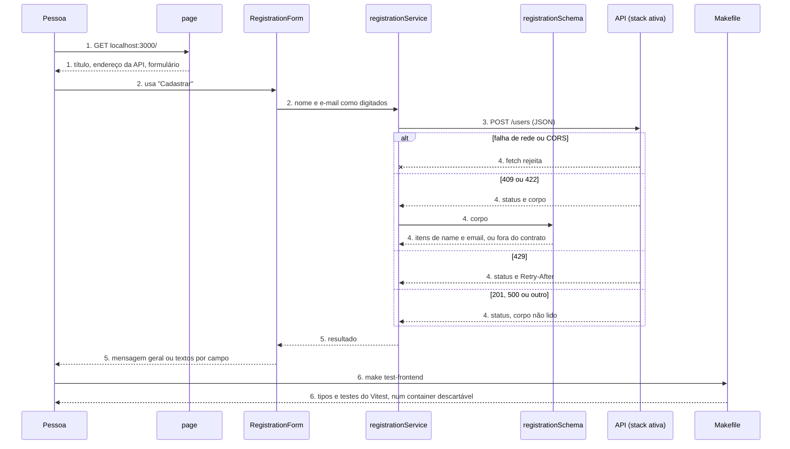
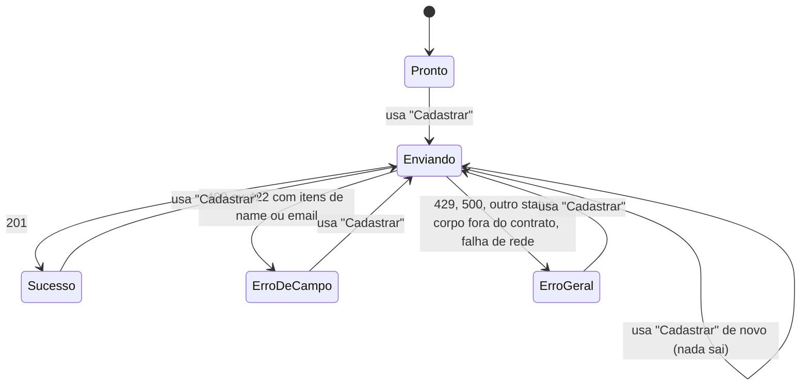

# Formulário de cadastro

**Approved**: pending

## Problem

`localhost:3000` mostra um esqueleto sem formulário. O README promete que uma pessoa preenche nome
e e-mail ali, e os cenários 1, 2, 3 e 7 de `docs/architecture.md`, que são o critério de aceite de
cada stack, começam no formulário. Hoje cada stack só poderia ser validada por `curl`, e a metade do
contrato que pertence ao frontend não tem consumidor: a tradução por `field` + `code`, o
`Retry-After` lido no navegador e a separação entre falha de rede e erro da API. Uma divergência
nesses pontos só apareceria depois que as três stacks estivessem prontas. A fonte
(`.design/registration-form.md`) não traz medição, porque ainda não há produto. O frontend também
não tem test runner: o design do container adiou essa escolha para esta rodada.

Quando isto sair, uma pessoa preenche nome e e-mail em `localhost:3000`, usa "Cadastrar" e lê em
português o resultado de cada resposta do contrato. Com nenhuma stack no ar, ela vê que o serviço
está indisponível. `make test-frontend` prova cada resposta do contrato contra o formulário, sem
nenhuma API rodando e sem Node na máquina.

## Shape

Reusa o serviço `frontend`, a página `/`, `NEXT_PUBLIC_API_URL`, `make frontend-npm` para as
dependências e os textos de `docs/api-contract.md`, sem nenhuma rota ou servidor intermediário. As
regras que mudam o resultado (qual texto cada resposta produz, quando o corpo está fora do
contrato, os minutos do 429) ficam em `registrationService` e `registrationSchema`, funções sem
React que o Vitest alcança direto; o comportamento dos controles fica em `RegistrationForm`, que o
Testing Library exercita com `fetch` simulado.

1. a pessoa abre `GET localhost:3000/` -> `page` (exists) - mantém o título `Cadastro Feliz` e o
   endereço da API, e renderiza `RegistrationForm` (new) no lugar do resto do esqueleto
2. a pessoa usa "Cadastrar" -> `RegistrationForm` (new) - apaga as mensagens anteriores, desabilita
   o botão e entrega nome e e-mail como digitados
3. `registrationService` (new) - `POST {NEXT_PUBLIC_API_URL}/users` direto do navegador (door 1),
   com JSON, sem validar a entrada (door 2)
4. `registrationService` (new) - lê o status; só em `409` e `422` passa o corpo a
   `registrationSchema` (new), que aceita ou recusa a forma única de erro (door 3); em `429` lê o
   `Retry-After`; uma falha do `fetch` vira falha de rede
5. out: `RegistrationForm` (new) mostra a mensagem geral ou os textos por campo, mantém os campos
   preenchidos e reabilita o botão
6. `make test-frontend` -> `Makefile` (exists) - checa os tipos e roda o Vitest dentro de um
   container da imagem do `frontend` com o código atual, sem tocar no container em execução
   (door 4)

**Changes underneath**

| Front | What changes |
| --- | --- |
| domain | nada - os termos de `docs/api-contract.md` não mudam de significado |
| stored data | nada a migrar - o frontend não guarda dados |
| readers | os testes FE1, FE3, FE4, FE9 e FE14 de `tests/infra/frontend.sh` leem a página: afirmam `Cadastro Feliz` e `localhost:8080` no HTML e trocam `Cadastro Feliz` em `frontend/src/app/page.tsx` esperando que o texto suma da página. Continuam valendo porque o título e o endereço da API ficam em `page`, e `Cadastro Feliz` não aparece em nenhum outro arquivo (critério 1) |
| docs | `docs/api-contract.md` › Comportamento do frontend ganha a regra dos minutos, o 429 sem `Retry-After`, o 201 com qualquer corpo e a recusa sem item de campo; `docs/stacks.md`, `README.md` e `docs/infrastructure.md` deixam de descrever o esqueleto e passam a citar `make test-frontend`; `docs/decisions.md` ganha a decisão 18 |

Data: none - o frontend não lê nem grava nada armazenado; a única saída é a requisição a `POST /users`.

## Surface

None - nothing consumed outside. O formulário consome `POST /users` sem mudar sua assinatura, e
`make test-frontend` é um comando local, coberto em S2.

## Landing

| One-way door | Literal shape | Alternative rejected |
| --- | --- | --- |
| chamada à API | `fetch` em componente de cliente para `{NEXT_PUBLIC_API_URL sem barra final}/users`, `method: POST`, headers `Content-Type: application/json` e `Accept: application/json`, corpo `{"name": <como digitado>, "email": <como digitado>}` | Server Action ou rota do Next.js - o navegador deixa de ver o status real e a falha de rede vira erro do servidor (decisão 12 de docs/decisions.md) |
| sem validação no navegador | nenhum `required`, `maxLength` ou `pattern` nos campos, `noValidate` no formulário, nenhum `trim` antes de enviar; decisão 18 "Formulário sem validação no navegador" em docs/decisions.md, origem `Definida` | espelhar as regras do contrato no cliente - o cenário 3 de docs/architecture.md (422) deixaria de ser reproduzível pelo formulário |
| leitura das respostas | `201` é sucesso sem ler o corpo; `409`/`422` só são interpretados se o corpo for objeto com `message` texto e `errors` lista, cada item com `field`, `code` e `message` texto, e houver ao menos um item com `field` `name` ou `email`; qualquer outro caso de `409`/`422` e qualquer status fora de `201`, `409`, `422`, `429` dá o texto do `500`; `Retry-After` legível é um inteiro decimal ≥ 0, minutos = `max(1, ceil(segundos ÷ 60))` | validar também o corpo do `201` - mostraria erro para um cadastro gravado, e a pessoa receberia `409` ao reenviar |
| test runner do frontend | `make test-frontend` roda `tsc --noEmit` e depois `vitest run` num container descartável da imagem `cadastro-feliz-shared-frontend`, construída com o código atual; dependências de desenvolvimento `vitest`, `@vitejs/plugin-react`, `jsdom`, `@testing-library/react`, `@testing-library/dom` e `@testing-library/user-event`, em versão exata, por `make frontend-npm` | Jest - pede transformação própria de TypeScript e JSX, e o guia de testes do Next.js aponta o Vitest para componentes de cliente; Playwright com API simulada em container - prova CORS e `Retry-After` exposto, que são de cada stack, ao custo de uma imagem de navegador |

- Nothing else in this change is hard to reverse

## Criteria

### S1: Formulário e respostas do contrato (P1)

A pessoa envia nome e e-mail e lê em português o resultado de cada resposta de `POST /users`.

**Acceptance Criteria**

1. WHEN a pessoa abre `localhost:3000/` THEN o sistema SHALL mostrar o título `Cadastro Feliz`, o endereço de `NEXT_PUBLIC_API_URL`, o campo `Nome`, o campo `E-mail` e o botão `Cadastrar`, sem nenhuma mensagem, e o texto `Cadastro Feliz` SHALL aparecer em `frontend/src` só em `frontend/src/app/page.tsx`
2. WHEN a pessoa preenche os campos e usa `Cadastrar` THEN o sistema SHALL enviar exatamente uma requisição `POST` para `{NEXT_PUBLIC_API_URL}/users` com `Content-Type: application/json`, `Accept: application/json` e corpo `{"name": <como digitado>, "email": <como digitado>}`
   - nome `  Ana Souza ` e e-mail ` ANA@Example.com` → corpo com `"  Ana Souza "` e `" ANA@Example.com"`; `NEXT_PUBLIC_API_URL` com barra final (`…:8080/`) → `…:8080/users`, sem `//users`
3. WHEN a pessoa usa `Cadastrar` com os dois campos vazios, ou com `não-é-email` no e-mail THEN o sistema SHALL enviar a requisição, com `""` ou o texto digitado, sem nenhuma mensagem do navegador
4. WHILE a requisição está em andamento the sistema SHALL mostrar o botão desabilitado com o texto `Enviando…`, e WHEN a pessoa usa o botão de novo THEN nenhuma requisição nova SHALL sair
   - dois cliques seguidos → 1 requisição; um clique depois da resposta → 2 requisições
5. WHEN a resposta é `201` THEN o sistema SHALL mostrar `Recebemos seus dados! Em instantes você receberá um e-mail de confirmação.`, manter nos campos o que foi digitado e reabilitar o botão
   - corpo do contrato → mesmo texto; corpo `{}`, vazio ou `não é json` → mesmo texto
6. WHEN a resposta é `409` ou `422` com itens de `name` ou `email` THEN cada campo SHALL mostrar o texto do seu primeiro item, um campo sem item SHALL não mostrar texto, e nenhuma mensagem geral SHALL aparecer
   - `422` com `name`/`required` e `email`/`invalid_format` → `Informe seu nome.` e `Informe um e-mail válido.`; `422` com `email`/`too_long` seguido de `email`/`invalid_format` → só `O e-mail deve ter no máximo 254 caracteres.` no e-mail e nada no nome; `409` com `email`/`already_taken` → `Este e-mail já está cadastrado.`
7. The texto de cada par SHALL ser: `name`/`required` → `Informe seu nome.`; `name`/`too_long` → `O nome deve ter no máximo 255 caracteres.`; `email`/`required` → `Informe seu e-mail.`; `email`/`invalid_format` → `Informe um e-mail válido.`; `email`/`too_long` → `O e-mail deve ter no máximo 254 caracteres.`; `email`/`already_taken` → `Este e-mail já está cadastrado.`
8. IF um item tem `field` `name` ou `email` e um `code` sem texto THEN o campo SHALL mostrar `Verifique este campo.`
   - `email`/`blocked` → `Verifique este campo.`; `name`/`already_taken` → `Verifique este campo.`
9. IF a resposta é `409` ou `422` sem nenhum item de `name` ou `email`, ou com corpo fora da forma única THEN o sistema SHALL mostrar `Não foi possível concluir seu cadastro. Tente novamente em instantes.` e nenhum texto por campo
   - `errors: []` → texto do 500; só um item de `phone` → texto do 500; `errors` ausente ou `null` → texto do 500; um item sem `code` ao lado de um item válido → texto do 500; corpo `não é json` → texto do 500
10. WHEN a resposta é `429` com `Retry-After` inteiro decimal ≥ 0 THEN o sistema SHALL mostrar `Muitas tentativas de cadastro. Tente novamente em {n} minutos.`, com n = `max(1, ceil(segundos ÷ 60))`, e `1 minuto` no singular
    - `742` → `… em 13 minutos.`; `900` → `… em 15 minutos.`; `61` → `… em 2 minutos.`; `60` → `… em 1 minuto.`; `0` → `… em 1 minuto.`
11. IF a resposta é `429` sem `Retry-After`, ou com um valor que não é inteiro decimal ≥ 0 THEN o sistema SHALL mostrar `Muitas tentativas de cadastro. Tente novamente mais tarde.`
    - ausente, `abc`, `-5`, `12.5` e `Wed, 21 Oct 2026 07:28:00 GMT` → `… mais tarde.`
12. WHEN a resposta é `500` THEN o sistema SHALL mostrar `Não foi possível concluir seu cadastro. Tente novamente em instantes.`
13. IF a resposta tem um status fora de `201`, `409`, `422`, `429` e `500` THEN o sistema SHALL mostrar `Não foi possível concluir seu cadastro. Tente novamente em instantes.`
    - `200`, `400`, `404`, `405` e `503` → texto do 500
14. IF a requisição falha sem resposta (o `fetch` rejeita) THEN o sistema SHALL mostrar `Serviço indisponível no momento. Tente novamente em instantes.`
15. WHEN a pessoa usa `Cadastrar` depois de qualquer resultado THEN a mensagem geral e os textos por campo anteriores SHALL sumir antes de a resposta chegar
    - textos de `422` na tela, novo envio pendente → nenhum texto por campo; `201` na tela, novo envio pendente → nenhuma mensagem geral
16. The texto de cada campo SHALL ser a descrição acessível desse campo, e a mensagem geral SHALL ficar num elemento com `role="status"`
17. WHILE nenhuma stack está no ar, WHEN a pessoa usa `Cadastrar` em `localhost:3000` num navegador THEN o sistema SHALL mostrar `Serviço indisponível no momento. Tente novamente em instantes.` (cenário 7 de docs/architecture.md)

### S2: `make test-frontend` (P1)

Os testes do frontend rodam com Docker e `make`, sobre o código atual, sem mexer no ambiente.

**Acceptance Criteria**

18. WHEN `make test-frontend` roda num clone limpo, só com Docker e `make` THEN o sistema SHALL checar os tipos de `frontend/`, rodar os testes do Vitest sobre o código atual e sair com código `0`, e `frontend/node_modules` SHALL não existir na máquina depois
19. IF um teste do Vitest falha THEN `make test-frontend` SHALL sair com código diferente de `0` e mostrar o nome do teste
20. IF `frontend/src` tem um erro de tipo THEN `make test-frontend` SHALL sair com código diferente de `0`, mostrar `error TS` e não rodar o Vitest
21. WHILE o `frontend` está no ar, WHEN `make test-frontend` roda THEN o container do `frontend` SHALL manter o mesmo ID e o estado `running`, e `GET localhost:3000/` SHALL responder `200` depois
22. WHEN `frontend/src` muda e `make test-frontend` roda sem nenhum outro comando antes THEN os testes SHALL rodar sobre o código mudado
    - um teste novo que falha, acrescentado agora → `make test-frontend` sai com código diferente de `0`
23. The `frontend/package.json` SHALL ter `vitest`, `@vitejs/plugin-react`, `jsdom`, `@testing-library/react`, `@testing-library/dom` e `@testing-library/user-event` em `devDependencies`, com versão sem `^` nem `~`
24. The saída de `make help` SHALL listar `make test-frontend`

### S3: Documentação alinhada (P2)

**Acceptance Criteria**

25. The `docs/api-contract.md` › Comportamento do frontend SHALL dizer que o formulário não valida no navegador, que `201` é sucesso com qualquer corpo, que `409` ou `422` sem item de `name` ou `email` mostra o texto do `500`, a regra dos minutos com `1 minuto` no singular, e o texto `Muitas tentativas de cadastro. Tente novamente mais tarde.` para `429` sem `Retry-After` legível
26. The `docs/decisions.md` SHALL ter a decisão `18` "Formulário sem validação no navegador", origem `Definida`, no índice, e a seção SHALL citar `422` e o cenário 3
27. The `docs/stacks.md` › Frontend SHALL não dizer mais que só existe o esqueleto e SHALL citar `make test-frontend`; `docs/infrastructure.md` › Makefile SHALL listar `make test-frontend`; o `README.md` SHALL não dizer mais que o frontend é um esqueleto sem o formulário e SHALL mostrar `make test-frontend` em › Como vai funcionar

## Out of scope

| Excluded | Why |
| --- | --- |
| Validação no navegador | decisão da pessoa responsável: o formulário existe para exercitar a API (Landing) |
| CORS e `Retry-After` exposto | são de cada stack (docs/infrastructure.md › Comunicação do frontend); a primeira stack os prova pelos cenários |
| Teste de ponta a ponta com navegador e API simulada | ver Landing › test runner do frontend |
| ESLint | nenhuma regra a impor além dos tipos; entra quando houver uma |
| Design visual | o formulário é coadjuvante, igual nas três stacks |
| Tempo limite próprio da requisição | um tempo limite mostraria `Serviço indisponível` para um cadastro que talvez seja gravado |
| Rodar `make test-frontend` dentro de `make test-infra` | `make test-infra` destrói o ambiente local; os dois ficam separados |

## Assumptions

| Assumption | Chosen default | Rationale | Confirmed? |
| --- | --- | --- | --- |
| Validação no navegador | nenhuma; o formulário envia o que foi digitado | user: "1 e 2 conforme recomendado, pode seguir" | y |
| Campos depois de qualquer resposta | continuam preenchidos | user: "1 e 2 conforme recomendado, pode seguir" | y |
| Rótulos | campos `Nome` e `E-mail`, botão `Cadastrar`, e `Enviando…` durante a requisição | o contrato não define rótulos; são os termos que ele já usa | n |
| Texto do 429 sem prazo | `Muitas tentativas de cadastro. Tente novamente mais tarde.` | não inventar um prazo que a API não deu | n |
| Título e endereço da API na página | ficam, vindos de `page`, acima do formulário | mostram para onde o formulário envia, e os testes FE1, FE3, FE4 e FE14 já dependem deles | n |
| Validação da forma do erro | escrita à mão em `registrationSchema`, sem biblioteca | são dois campos e uma lista; uma biblioteca seria uma dependência a mais para isso | n |
| Visual | HTML semântico com CSS mínimo, sem biblioteca de componentes nem de estilo | design: o formulário é coadjuvante | n |
| Lugar dos testes | ao lado do código do módulo `registration` | como no exemplo `with-vitest` do Next.js | n |
| Ordem entre as rodadas | depois de `.specs/features/registration-ip-limit`, que muda o texto do 429 no contrato | as duas tocam a mesma linha de › Comportamento do frontend | n |

**Open questions:** none - all resolved or logged above.

## Differences from the source

None - the product matches the source

## Sources

- `.design/registration-form.md` - binding - Key decisions 1 a 6, estados de RegistrationForm e test-frontend
- `docs/api-contract.md` › Comportamento do frontend - binding - textos de 201, 500, falha de rede e a tabela por `field` + `code`
- `.design/registration-ip-limit.md` - binding - texto do 429 (Key decision 6)
- [Next.js › Testing › Vitest](https://nextjs.org/docs/app/guides/testing/vitest) - referência técnica, não é captura de tela - dependências e configuração do Vitest
