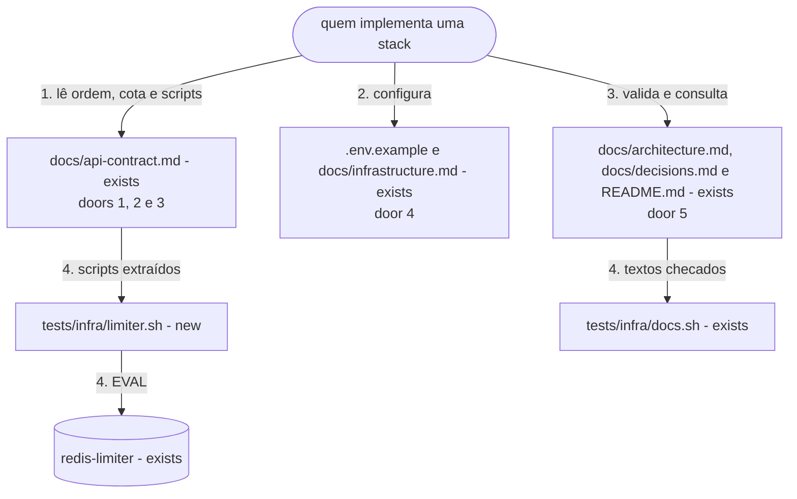
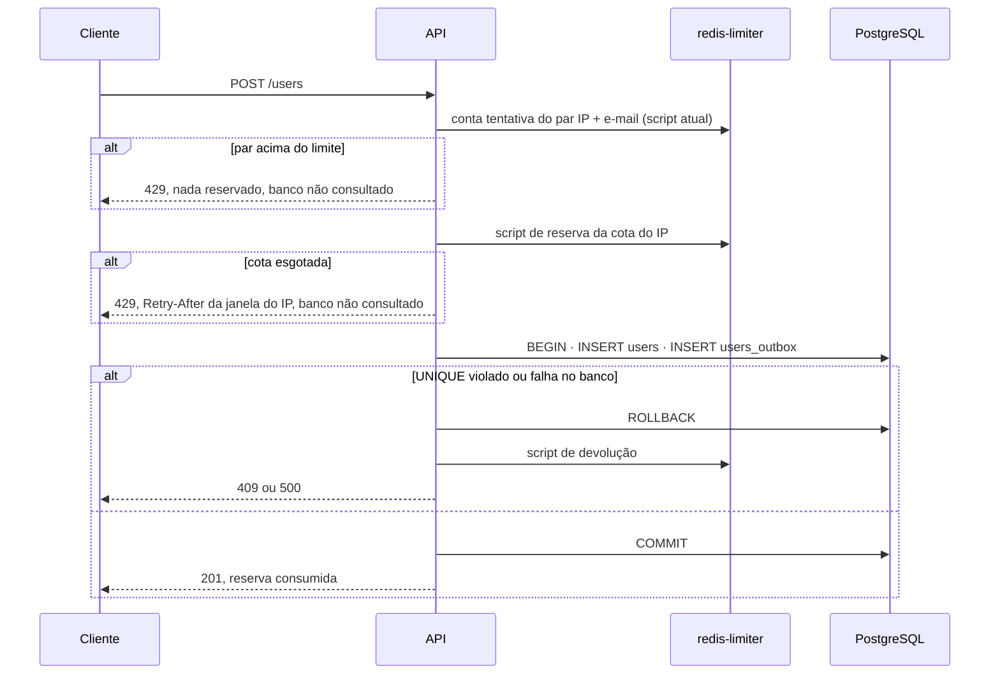
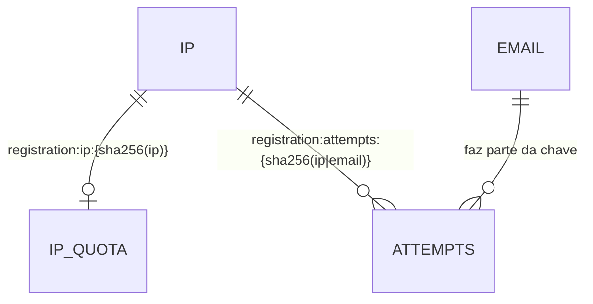
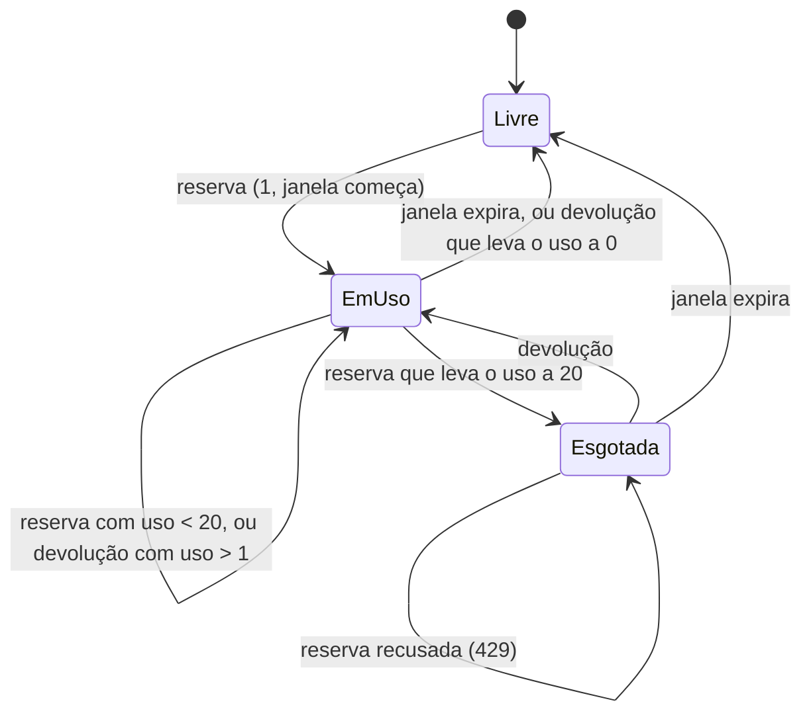

# Limite de cadastros por IP

**Approved**: pending

## Problem

O contrato de `POST /users` limita só o par IP + e-mail. Um único IP pode cadastrar milhares de
endereços alheios, e cada cadastro concluído grava um evento em `users_outbox` que vira um e-mail
para o endereço informado. Em produção, o custo seria o envio usado contra terceiros e a reputação
do remetente comprometida. O próprio contrato registra isso como limitação ("Sem limite só por
IP"). A fonte (`.design/registration-ip-limit.md`, confirmado em 2026-11-04) não traz medição,
porque nada foi lançado. Nenhuma stack existe, então o contrato é o único lugar onde a regra pode
ser fixada antes que três códigos a implementem cada um do seu jeito.

Quando isto sair, quem implementar uma stack encontra no contrato a cota de 20 cadastros
concluídos por IP por hora, sua posição na ordem de processamento, a chave, os dois scripts Lua
que as três stacks copiam, as variáveis de ambiente e os cenários 12 e 13 para provar o
comportamento. Os scripts já foram executados contra o `redis-limiter` real.

## Shape

Reusa o `redis-limiter`, a forma canônica do IP, o hash da chave, o 429 com `Retry-After` e o
`make reset-limits` do contador por IP + e-mail, sem nenhum serviço novo. A regra que muda o
resultado fica nos dois scripts Lua escritos em `docs/api-contract.md`. Os testes em
`tests/infra/` extraem esses scripts do documento e os executam contra o `redis-limiter` do
projeto comum, e os demais textos são checados por `tests/infra/docs.sh`.

1. quem implementa uma stack lê `docs/api-contract.md` (exists) › Ordem de processamento - valida,
   normaliza, conta o par IP + e-mail, reserva a cota do IP e só então grava; em › Limite por IP
   encontra a chave e as regras da cota (door 1), e em › Operação no Redis os scripts de reserva e
   de devolução, literais (doors 2 e 3)
2. `.env.example` (exists) e `docs/infrastructure.md` (exists) - `REGISTRATION_MAX_PER_IP` e
   `REGISTRATION_IP_WINDOW_SECONDS` (door 4)
3. `docs/architecture.md` (exists) - cenários 12 e 13; `docs/decisions.md` (exists) - decisão 17
   (door 5); `README.md` (exists) - tabela da API e limites conhecidos
4. out: `tests/infra/limiter.sh` (new) extrai os dois scripts de `docs/api-contract.md` e os
   executa no `redis-limiter` (exists); `tests/infra/docs.sh` (exists) checa os textos

O que cada stack fará com isso, como o contrato o descreve (sem stack nesta rodada):

**Changes underneath**

| Front | What changes |
| --- | --- |
| domain | "429" passa a ter duas causas, o par IP + e-mail e a cota do IP, com o mesmo corpo e sem `code` de topo (decisão 14 permite acrescentar um depois); "tentativa" continua sendo só a do par |
| stored data | nada a migrar - o `redis-limiter` não persiste nada, e a chave nova não colide com `registration:attempts:*` |
| readers | o formulário (ainda não construído, `.specs/features/registration-form`) passa a mostrar um texto de 429 que vale para os dois limites; `make reset-limits` já esvazia o `redis-limiter` inteiro e passa a limpar também a cota |
| docs | `docs/api-contract.md` perde a limitação "Sem limite só por IP" e ganha a cota; o README ganha a cota na tabela da API; a decisão vira a 17, porque a 15 reservada pelo design foi usada pelo golang-migrate |

New: `IP_QUOTA`, um inteiro com expiração no `redis-limiter` por IP. Nenhuma tabela do PostgreSQL
muda. One-way constraints: formato da chave (door 1); a chave nunca existe sem expiração (doors 2 e 3).

## Surface

| Route | In | Out | Status | Who |
| --- | --- | --- | --- | --- |
| `POST /users` | `name`, `email` (sem mudança) | o mesmo corpo de hoje; o `429` da cota é `{"message": "Too many registration attempts. Try again later.", "errors": []}` com `Retry-After` em segundos da janela do IP | `201`, `409`, `422`, `429` (par IP + e-mail ou cota do IP), `500` | anyone, como hoje |

## Landing

| One-way door | Literal shape | Alternative rejected |
| --- | --- | --- |
| chave da cota | `registration:ip:` + SHA-256 em hexadecimal minúsculo do IP canônico (docs/api-contract.md › IP do cliente), em UTF-8; exemplo: IP `203.0.113.10` → `registration:ip:631f08140b24b7274d12df3c37a1a80ce5876dafd7007d772e0114fddf88b682` | IP em claro na chave - grava o IP sem necessidade; prefixo de framework - a cota deixaria de valer na troca de stack |
| script de reserva | `KEYS[1]` a chave, `ARGV[1]` `REGISTRATION_MAX_PER_IP`, `ARGV[2]` `REGISTRATION_IP_WINDOW_SECONDS`; lê o uso (ausente = 0); se uso ≥ `ARGV[1]`, retorna `{0, TTL}` sem alterar nada; senão `INCR`, e `EXPIRE` com `ARGV[2]` quando o resultado é 1; retorna `{1, TTL}` | consultar antes e incrementar depois do commit - N requisições paralelas passam juntas; `INCR` e recusa acima do limite, como o contador do par - um 429 consumiria cota e travaria o IP até a janela expirar |
| script de devolução | `KEYS[1]` a chave; lê o uso; só se ele for maior que 0 faz `DECR`, que mantém a expiração; retorna `0`; uma chave ausente continua ausente | `DECR` incondicional - cria a chave sem expiração e com valor negativo quando a janela expirou entre reserva e devolução |
| variáveis | `REGISTRATION_MAX_PER_IP=20` e `REGISTRATION_IP_WINDOW_SECONDS=3600` em `.env.example`, seção `# Regras de negócio`, e na tabela de docs/infrastructure.md | valor fixo no código de cada stack - três lugares para mudar e testes que não conseguem baixar a cota |
| decisão 17 | `| [17](#17-...) | Cota de cadastros concluídos por IP | Definida |` em docs/decisions.md, com o motivo e o custo | registrar como 15 - número já ocupado pelo golang-migrate |

- Nothing else in this change is hard to reverse

## Criteria

### S1: Cota por IP no contrato (P1)

`docs/api-contract.md` descreve a cota, sua posição na ordem e os dois scripts, e os scripts se
comportam como descrito no `redis-limiter` real.

**Acceptance Criteria**

1. The `docs/api-contract.md` SHALL ter uma seção `## Limite por IP` com: identidade contada o IP canônico do cliente; chave `registration:ip:{sha256(ip)}`; cota `REGISTRATION_MAX_PER_IP` (20); janela fixa de `REGISTRATION_IP_WINDOW_SECONDS` (3600) a partir da primeira reserva; o que consome a cota só a resposta `201`; e o que devolve a reserva `409` e `500`
2. The exemplo de chave do `docs/api-contract.md` SHALL ser IP `203.0.113.10` → `registration:ip:631f08140b24b7274d12df3c37a1a80ce5876dafd7007d772e0114fddf88b682`, e esse valor SHALL ser igual ao calculado com `sha256` sobre `203.0.113.10`
3. The fluxograma e a lista de › Ordem de processamento SHALL pôr a reserva da cota do IP depois da contagem do par IP + e-mail e antes da transação, e SHALL pôr a devolução da reserva nos ramos `409` e `500` que vêm depois dela
4. The › Respostas do `docs/api-contract.md` SHALL dizer que o `429` tem duas causas, o par IP + e-mail e a cota do IP, com o mesmo corpo e `Retry-After` com os segundos restantes da janela que recusou
5. WHEN o script de reserva do documento roda 20 vezes numa chave ausente, com `ARGV` `20` e `3600` THEN cada execução SHALL retornar `1` e um TTL entre `1` e `3600`, e WHEN roda a 21ª vez THEN SHALL retornar `0` e um TTL entre `1` e `3600`, com o valor da chave ainda `20`
6. WHEN 50 execuções do script de reserva com `ARGV` `20` e `3600` chegam em paralelo numa chave ausente THEN exatamente 20 SHALL retornar `1`, e o valor final da chave SHALL ser `20`
7. WHEN o script de devolução do documento roda numa chave com valor `20` THEN o valor SHALL passar a `19` e o TTL SHALL continuar entre `1` e `3600`
8. IF o script de devolução roda numa chave ausente THEN a chave SHALL continuar ausente
   - chave nunca criada → ausente; chave que expirou depois da reserva → ausente
9. IF o script de devolução roda numa chave com valor `0` THEN o valor SHALL continuar `0`
10. WHEN uma reserva é recusada THEN o TTL retornado SHALL ser o da chave, e o documento SHALL dizer que esse TTL é o `Retry-After`
11. The chave criada pelo script de reserva SHALL ter TTL positivo depois de qualquer sequência de reservas e devoluções
    - reserva, devolução, reserva → TTL entre `1` e `3600`; 20 reservas, 20 devoluções, 1 reserva → TTL entre `1` e `3600`
12. The `docs/api-contract.md` › Limitações conhecidas SHALL não ter mais a linha "Sem limite só por IP" e SHALL ter uma linha dizendo que pessoas atrás do mesmo IP dividem a cota de 20 por hora, e que uma devolução que falha deixa uma unidade a mais até a janela expirar

### S2: Configuração, cenários e registro (P1)

Variáveis, cenários e a decisão acompanham o contrato.

**Acceptance Criteria**

13. The `.env.example` SHALL ter `REGISTRATION_MAX_PER_IP=20` e `REGISTRATION_IP_WINDOW_SECONDS=3600` na seção `# Regras de negócio`, e a tabela de docs/infrastructure.md › Variáveis de ambiente SHALL listar as duas com esses valores
14. The `docs/architecture.md` › Cenários para validar a implementação SHALL ter o cenário 12 (20 e-mails diferentes do mesmo IP chegam a `201`, o 21º recebe `429` sem gravar nada, e e-mails já cadastrados recebem `409` sem consumir cota) e o cenário 13 (50 cadastros paralelos com e-mails novos produzem exatamente 20 respostas `201`), e os cenários SHALL aparecer em ordem numérica
15. The `docs/decisions.md` SHALL ter a decisão `17` "Cota de cadastros concluídos por IP", origem `Definida`, no índice, e a seção SHALL citar `REGISTRATION_MAX_PER_IP`, `201` e `devolve`
16. The `README.md` SHALL citar a cota de 20 cadastros por IP por hora na linha `429` da tabela da API, e › Limites conhecidos SHALL dizer que pessoas atrás do mesmo IP dividem essa cota
17. The `docs/api-contract.md` › Comportamento do frontend SHALL mostrar para o `429` o texto `Muitas tentativas de cadastro. Tente novamente em {minutos} minutos.`

## Out of scope

| Excluded | Why |
| --- | --- |
| Código das stacks | nenhuma stack existe; cada uma implementa o contrato quando for construída, e os cenários 12 e 13 são o aceite dela |
| Limite por faixa de IP (/24, /64) | design: cada stack teria de calcular a faixa do mesmo jeito, para um ganho só contra quem troca de IP na mesma rede |
| Carga no banco por respostas `409` | design: não geram e-mail, e não era o dano escolhido |
| CAPTCHA | design: precisa de serviço externo e não funciona offline |
| `code` de topo que diga qual limite recusou | design (Key decision 6): a resposta não revela qual limite foi atingido |

## Assumptions

| Assumption | Chosen default | Rationale | Confirmed? |
| --- | --- | --- | --- |
| Escopo sem stacks | Esta rodada muda contrato, configuração e testes dos scripts; nenhum código de stack | não há stack para mudar, e o design pede a regra no contrato primeiro | n |
| Número da decisão | 17 | a 15 reservada no design foi usada pelo golang-migrate, e a 16 pelo container do frontend | n |
| Janela depois de devolver tudo | quando uma devolução leva o uso a 0, a próxima reserva recomeça a janela | o `EXPIRE` só roda quando o `INCR` resulta em 1; é o mesmo que a chave nunca ter sido usada | n |
| Prova dos scripts | `tests/infra/limiter.sh` extrai os blocos `lua` de › Operação no Redis e os executa por `EVAL` no `redis-limiter` | o documento é o que as stacks copiam; testar uma cópia provaria outra coisa | n |

**Open questions:** none - all resolved or logged above.

## Differences from the source

None - the product matches the source

## Sources

- `.design/registration-ip-limit.md` - binding - Key decisions 1 a 6, estados, cenários 12 e 13, variáveis
- `docs/api-contract.md` - binding - contador por IP + e-mail, forma canônica do IP, script atual, ordem de processamento
- `docs/decisions.md` - binding - numeração e formato das decisões
