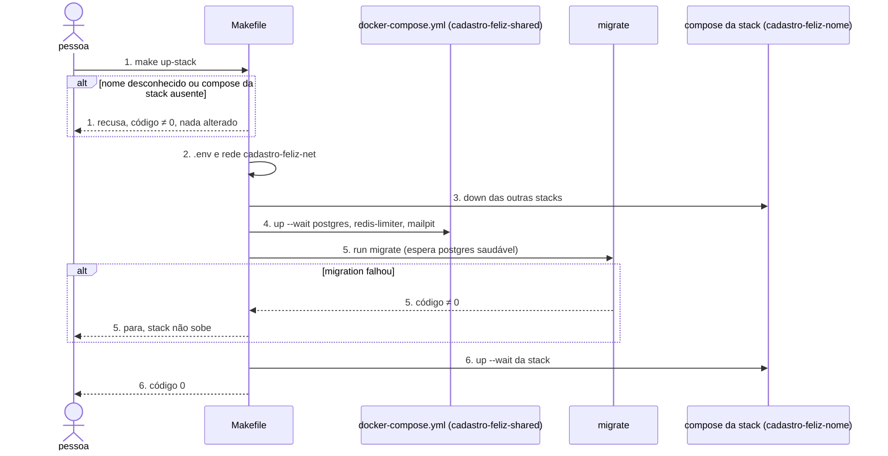
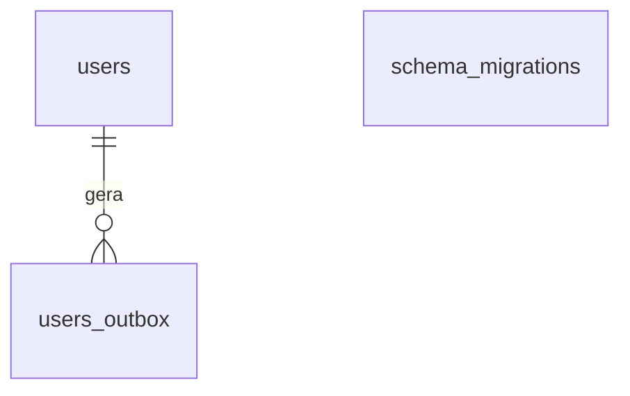

# Infraestrutura dos serviços comuns

**Approved**: 2026-11-04 - user: "aprovado, pode seguir com as sugestões"

## Problem

O repositório só tem documentação. Não existe `docker-compose.yml`, `.env.example`, `Makefile` nem
nenhuma migration, então nenhuma das três stacks pode começar: a API não tem onde gravar `users` e
`users_outbox` nem onde contar tentativas, e o worker não tem para onde mandar o SMTP. Quem
implementar a primeira stack teria de escrever também a sequência de troca de stack, que é quase
toda dos serviços comuns, e a segunda stack a reescreveria. A fonte (`.design/shared-infrastructure.md`)
não traz medição, porque ainda não há produto; a evidência é o próprio README, que diz que os
comandos "ainda não rodam".

Quando isto sair, a partir de um clone limpo `make up-shared` e `make migrate` deixam `postgres`,
`redis-limiter` e `mailpit` saudáveis com o schema de `docs/database.md` aplicado, e a primeira
stack entra no `Makefile` só criando o próprio `apis/<dir>/docker-compose.yml`.

## Shape

Reusa as imagens oficiais de PostgreSQL, Redis, Mailpit e golang-migrate, sem Dockerfile próprio, e
o SQL de `docs/database.md` sem alteração. As regras que mudam o resultado (ordem de `up-<stack>`,
recusa de stack ausente, parada quando o migrate falha) ficam no `Makefile`, e os testes em
`tests/infra/` o executam contra o Docker de verdade.

Sequência de `make up-<stack>`, que contém a de `up-shared` e a de `migrate`:

1. `make up-<stack>` -> `Makefile` (new) - traduz o nome curto (`laravel`, `nest`, `go`) para o
   compose da stack em `apis/<dir>`; recusa antes de tocar em qualquer coisa se o nome é
   desconhecido ou o arquivo não existe (door 3)
2. `Makefile` (new) - cria `.env` a partir de `.env.example` se faltar e cria a rede externa
   `cadastro-feliz-net` se faltar (door 2)
3. `Makefile` (new) - derruba os projetos das outras stacks que têm compose
4. `docker-compose.yml` (new) - projeto `cadastro-feliz-shared` sobe `postgres`, `redis-limiter` e
   `mailpit`, e o `Makefile` espera os três ficarem saudáveis (`up --wait`); persiste o volume
   `postgres-data` (door 4)
5. `migrate` (new) - container de execução única que espera o `postgres` saudável e aplica
   `database/migrations` com golang-migrate, gravando `schema_migrations` (door 1); se falha, o
   `make` sai com código diferente de zero e para aqui
6. out: o compose da stack sobe o projeto `cadastro-feliz-<nome>` e o `Makefile` espera os
   containers ficarem no ar; a stack lê `users` e `users_outbox`

**Comandos** - chamados por quem roda o projeto na própria máquina, com Docker e Compose. Código de
saída `0` no sucesso; diferente de zero nos casos indicados.

| Comando | Faz | Sai com erro quando |
| --- | --- | --- |
| `make up-shared` | cria `.env` se faltar, cria a rede e sobe os comuns saudáveis | uma porta está ocupada ou um serviço não fica saudável |
| `make migrate` | sobe os comuns se preciso e aplica as migrations pendentes | uma migration falha |
| `make up-<stack>` | sequência acima | `stack <nome> ainda não implementada`, `stack <nome> desconhecida`, migrate com falha |
| `make down-<stack>` | remove containers e fila da stack | as mesmas recusas de `up-<stack>` |
| `make down` | remove tudo, menos o volume do PostgreSQL | - |
| `make status` | lista os containers de todos os projetos `cadastro-feliz-*` | - |
| `make logs-shared`, `make logs-<stack>` | acompanha os logs (`-f`) | as mesmas recusas de `up-<stack>` |
| `make reset-limits` | esvazia o `redis-limiter` | - |
| `make test-infra` | roda `tests/infra/` contra o Docker local | um teste falha, ou já existe um ambiente `cadastro-feliz-*` |

**Changes underneath**

| Front | What changes |
| --- | --- |
| domain | nada - nenhum termo muda de significado |
| stored data | nada a migrar - o banco ainda não existe; a migration 0001 cria `users` e `users_outbox` do zero |
| readers | as três stacks, quando existirem, leem e gravam `users` e `users_outbox`; nenhuma lê `schema_migrations` |
| docs | `README.md` e `docs/infrastructure.md` dizem que `Makefile`, compose e `.env.example` não existem; passam a dizer que existem e a listar `up-shared`, `migrate` e `logs-shared` |

New: `users`, `users_outbox` e a relação entre elas, exatamente como em `docs/database.md`, e
`schema_migrations`, da ferramenta. One-way constraints: `users.email` único e minúsculo,
`users_outbox.status` restrito a quatro valores (copiados de `docs/database.md`); formato e tabela
de controle das migrations (door 1).

## Surface

None - nenhuma rota HTTP nesta rodada; os comandos do `Makefile` estão em Shape › Comandos e nos critérios de S1 a S3.

## Landing

| One-way door | Literal shape | Alternative rejected |
| --- | --- | --- |
| ferramenta de migrations | `migrate/migrate:v4.20.1`; pares `database/migrations/NNNN_<nome>.up.sql` e `NNNN_<nome>.down.sql`, numeração de 4 dígitos; controle na tabela `public.schema_migrations`; cada arquivo começa com `BEGIN;` e termina com `COMMIT;` | script com `psql -f` sobre todos os arquivos - não sabe o que já foi aplicado e falha na segunda execução; migrations do framework - excluídas pela decisão 2 |
| rede entre projetos | rede `cadastro-feliz-net` declarada `external: true` em todos os composes, inclusive o comum; só o `Makefile` cria (`docker network create`) e remove | rede criada pelo projeto comum - derrubar os comuns a removeria e desconectaria a stack ativa |
| ligação entre stack e Makefile | nome curto -> diretório -> projeto: `laravel` -> `apis/laravel` -> `cadastro-feliz-laravel`, `nest` -> `apis/nestjs` -> `cadastro-feliz-nest`, `go` -> `apis/golang` -> `cadastro-feliz-go`; o projeto é o `name:` do compose da stack | um compose único com `profiles` por stack - só compensa com stacks simultâneas, que a decisão 6 exclui |
| volume do PostgreSQL | volume nomeado `postgres-data` do projeto `cadastro-feliz-shared` (`cadastro-feliz-shared_postgres-data`), montado em `/var/lib/postgresql` | montagem em `/var/lib/postgresql/data` - no PostgreSQL 18 não persiste nada; bind mount em `./data` - dono e permissões variam por máquina |

- Nothing else in this change is hard to reverse

## Criteria

### S1: Serviços comuns saudáveis (P1)

`make up-shared` deixa banco, contador e caixa de e-mail no ar, com as portas, versões e
configurações da documentação.

**Acceptance Criteria**

1. WHEN `make up-shared` roda em um clone limpo (sem `.env`, sem a rede `cadastro-feliz-net`, sem volume) THEN o sistema SHALL criar `.env` idêntico byte a byte a `.env.example`, criar a rede `cadastro-feliz-net`, deixar `postgres`, `redis-limiter` e `mailpit` do projeto `cadastro-feliz-shared` com saúde `healthy` e sair com código `0`
2. IF `.env` já existe THEN `make up-shared` SHALL deixá-lo inalterado
   - `.env` com `DB_PASSWORD=outra` → continua `outra` depois do comando
3. WHEN `make up-shared` roda de novo com os três serviços no ar THEN o sistema SHALL manter os mesmos três IDs de container e sair com código `0`
4. The serviço `postgres` SHALL aceitar login como `cadastro_feliz`, senha `cadastro_feliz`, no banco `cadastro_feliz`, em `localhost:5432`
5. The projeto `cadastro-feliz-shared` SHALL publicar na máquina exatamente as portas `5432` e `8025`; `mailpit:1025` e `redis-limiter:6379` SHALL responder só dentro da rede `cadastro-feliz-net`
6. The serviço `redis-limiter` SHALL rodar com `maxmemory` `33554432` (32mb), `maxmemory-policy` `volatile-ttl`, `save` vazio e `appendonly` `no`
7. The serviços comuns SHALL usar exatamente as imagens `postgres:18.6-alpine`, `redis:8.10.3-alpine`, `axllent/mailpit:v1.33.0` e `migrate/migrate:v4.20.1`
8. IF a porta `5432` ou `8025` da máquina já está ocupada THEN `make up-shared` SHALL sair com código diferente de zero
   - `8025` ocupada por outro container → código diferente de zero
9. The arquivo `.env.example` SHALL conter cada variável de `docs/infrastructure.md` › Variáveis de ambiente com o seu valor padrão
   - 22 variáveis: 13 compartilhadas, 6 de regras de negócio, 3 específicas de stack

### S2: Schema aplicado pelo migrate (P1)

`make migrate` aplica `database/migrations` uma vez, e uma migration quebrada nunca deixa schema
parcial nem deixa o `make` seguir.

**Acceptance Criteria**

10. The arquivo `database/migrations/0001_create_users_and_users_outbox.up.sql` SHALL ser `BEGIN;`, seguido do bloco SQL de `docs/database.md` › Schema caractere por caractere, seguido de `COMMIT;`
11. WHEN `make migrate` roda em banco vazio THEN o sistema SHALL criar `users` e `users_outbox` com as constraints `users_email_unique`, `users_email_lowercase`, `users_outbox_status_valid`, `users_outbox_attempts_positive`, a chave estrangeira de `users_outbox.user_id` para `users.id` e os índices `users_outbox_user_id_index`, `users_outbox_pending_index`, `users_outbox_published_index`, registrar a versão `1` com `dirty = false` em `schema_migrations` e sair com código `0`
12. WHEN `make migrate` roda com todas as migrations já aplicadas THEN o sistema SHALL não alterar nada, manter a versão `1` e sair com código `0`
13. WHEN `make migrate` roda com os serviços comuns fora do ar THEN o sistema SHALL subi-los, esperar o `postgres` ficar saudável, aplicar as migrations e sair com código `0`
14. IF um arquivo de migration falha com erro de SQL THEN o sistema SHALL desfazer tudo o que esse arquivo fez, registrar a versão dele com `dirty = true`, e `make migrate` SHALL sair com código diferente de zero
    - `0002` cria a tabela `probe` e depois roda um comando inválido → `probe` não existe, `schema_migrations` tem versão `2` e `dirty = true`
15. WHEN a migration `0001` é revertida (`migrate down 1`) THEN o sistema SHALL remover `users_outbox` e `users`, sem deixar nenhuma das duas

### S3: Troca de stack pelo Makefile (P1)

O `Makefile` ordena comuns, migrate e stack, recusa stacks que não existem e trata os dados como
`docs/infrastructure.md` manda.

**Acceptance Criteria**

16. IF `make up-<stack>`, `make down-<stack>` ou `make logs-<stack>` nomeia `laravel`, `nest` ou `go` e o compose da stack em `apis/<dir>` não existe THEN o sistema SHALL imprimir `stack <nome> ainda não implementada`, sair com código diferente de zero e não alterar nada
    - `make up-go` sem compose em `apis/golang` e sem a rede → mensagem impressa, rede continua ausente, nenhum container iniciado
17. IF `make up-<x>`, `make down-<x>` ou `make logs-<x>` nomeia algo diferente de `laravel`, `nest` e `go` (e, em `logs-`, de `shared`) THEN o sistema SHALL imprimir `stack <x> desconhecida`, sair com código diferente de zero e não alterar nada
    - `make up-rails` → `stack rails desconhecida`
18. WHEN `make up-<stack>` roda com o compose da stack presente THEN o sistema SHALL criar a rede, derrubar as outras stacks, subir os comuns saudáveis, rodar o migrate e só então subir o projeto `cadastro-feliz-<nome>`, saindo com código `0` e com os containers dele no ar
19. WHEN `make up-<stack>` roda com outra stack no ar THEN o sistema SHALL remover os containers da outra stack antes de subir a pedida
    - `nest` no ar, depois `make up-go` → nenhum container de `cadastro-feliz-nest` resta, `cadastro-feliz-go` está no ar
20. IF o migrate falha durante `make up-<stack>` THEN o sistema SHALL sair com código diferente de zero e nenhum container do projeto `cadastro-feliz-<nome>` SHALL existir
21. WHEN `make down-<stack>` roda THEN o sistema SHALL remover os containers e volumes da stack e manter os containers comuns no ar, as chaves do `redis-limiter` e as linhas do PostgreSQL
22. WHEN `make down` roda THEN o sistema SHALL remover os containers de todos os projetos `cadastro-feliz-*` e a rede `cadastro-feliz-net`, manter o volume `cadastro-feliz-shared_postgres-data` e sair com código `0`
    - uma linha em `users` antes de `make down` → a mesma linha depois de `make down` e `make up-shared`; uma chave no `redis-limiter` antes → ausente depois
23. WHEN `make reset-limits` roda THEN o sistema SHALL deixar o `redis-limiter` com `DBSIZE` `0` e sair com código `0`
    - chave `registration:attempts:abc` presente antes → ausente depois
24. WHEN `make status` roda THEN o sistema SHALL listar cada container dos projetos `cadastro-feliz-*` com nome e estado e sair com código `0`
25. WHEN `make logs-shared` roda THEN o sistema SHALL acompanhar os logs dos serviços comuns, mostrando a linha do `postgres` `database system is ready to accept connections`

### S4: Documentação alinhada (P2)

A documentação descreve o que existe e registra a ferramenta de migrations.

**Acceptance Criteria**

26. The arquivo `docs/decisions.md` SHALL ter a decisão `15` "golang-migrate como ferramenta de migrations", com origem `Proposta`, o formato dos arquivos, a regra de `BEGIN;`/`COMMIT;` e o aviso de que uma migration com falha deixa a versão *dirty* até um `force` manual
27. The arquivos `README.md` e `docs/infrastructure.md` SHALL deixar de dizer que `Makefile`, compose ou `.env.example` não existem, e `docs/infrastructure.md` › Makefile SHALL listar `make up-shared`, `make migrate`, `make logs-shared` e `make test-infra`
28. The arquivo `docs/database.md` › Migrations SHALL citar o golang-migrate, o formato dos arquivos e o comando `force` que limpa uma versão *dirty*

## Out of scope

| Excluded | Why |
| --- | --- |
| Serviço e Dockerfile do `frontend` | entram com o código Next.js; um Dockerfile sem o código que ele constrói não pode ser verificado. A porta 3000 fica reservada, sem publicação |
| Composes e Dockerfiles das stacks | pertencem à rodada de cada stack |
| Alvo para apagar o banco | não está em `docs/infrastructure.md`; `docker volume rm cadastro-feliz-shared_postgres-data` resolve |
| Variável para trocar a porta 5432 | entra só se alguém tiver PostgreSQL local em conflito |
| CI | não há pipeline no repositório; os testes rodam localmente com `make test-infra` |
| Limite por IP (`.design/registration-ip-limit.md`) | design próprio, ainda não aplicado ao contrato |

## Assumptions

| Assumption | Chosen default | Rationale | Confirmed? |
| --- | --- | --- | --- |
| Número da decisão do golang-migrate | `15` | o design reservou 14, mas a decisão 14 já foi usada pela forma única de erro; `.design/registration-ip-limit.md` reservou 15 e passa a usar o próximo livre quando for aplicado | y |
| Porta do PostgreSQL | fixa em 5432, sem variável | é o que `docs/infrastructure.md` diz (default do design) | y |
| `.env.example` | um único arquivo na raiz com todas as variáveis, inclusive as de stack, lido também pelos composes das stacks | default do design | y |
| `make down` remove a rede | sim | nada mais a usa (default do design) | y |
| Nome do alvo que sobe só os comuns | `up-shared`, com `logs-shared` por simetria | default do design | y |
| Reconstrução de imagens em `up-<stack>` | só quando o Compose detecta mudança (`up --build` não é forçado) | default do design | y |
| Tag exata das imagens | `postgres:18.6-alpine`, `redis:8.10.3-alpine`, `axllent/mailpit:v1.33.0`, `migrate/migrate:v4.20.1` | mais recentes disponíveis em 2026-11-04 nas versões maiores do design; variante `alpine` por ser menor | y |
| Nome de stack desconhecido | recusa com `stack <x> desconhecida` | o design só trata stack conhecida sem compose; a regra genérica `up-%` aceitaria qualquer nome | y |
| Testes da infraestrutura | scripts bash em `tests/infra/`, rodados por `make test-infra`, contra o Docker local; destroem o ambiente `cadastro-feliz-*` e recusam rodar se ele já existe | não há test runner no repositório e o que se prova é o comportamento do Docker e do `make` | y |
| Healthchecks | `pg_isready -U $DB_USERNAME -d $DB_DATABASE`, `redis-cli ping`, e o `readyz` embutido na imagem do Mailpit | comando de prontidão de cada imagem, como o design pede | y |

**Open questions:** none - all resolved or logged above.

## Differences from the source

None - the product matches the source

## Sources

- `.design/shared-infrastructure.md` - binding - forma, decisões 1 a 7, slices e defaults desta rodada
- `docs/infrastructure.md` - binding - projetos, rede, portas, Makefile, ciclo de vida dos dados e variáveis
- `docs/database.md` - binding - SQL da migration 0001 e regra de migrations em SQL puro
- `docs/decisions.md` - binding - decisões 2, 5, 6, 11 e 14
- golang-migrate (GETTING_STARTED, FAQ) - estado *dirty*, `force`, ausência de transação automática
- docker-library/postgres - `VOLUME /var/lib/postgresql` a partir da versão 18, confirmado em `postgres:18.6-alpine`
- imagem `axllent/mailpit:v1.33.0` - healthcheck `/mailpit readyz` embutido
