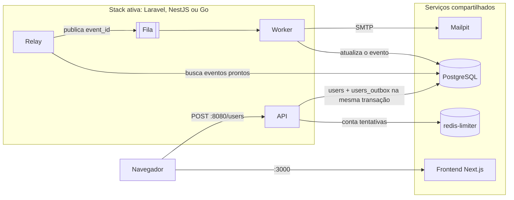

# Cadastro Feliz

Prova de conceito do padrão **Transactional Outbox**, com o mesmo caso de uso construído em três stacks: **Laravel**, **NestJS** e **Go**.

> **Status: em construção.** Os serviços compartilhados (`postgres`, `redis-limiter`, `mailpit` e `migrate`), o schema e o `Makefile` já funcionam. O frontend e as três stacks ainda estão em design, então os comandos de stack recusam com `stack <nome> ainda não implementada`.

## Caso de uso

Uma pessoa preenche nome e e-mail em um formulário público e recebe um e-mail informando que o cadastro foi concluído.

1. A pessoa envia o formulário.
2. A API grava o usuário e o evento de envio na mesma transação e responde `201`.
3. Um processo em segundo plano envia o e-mail de confirmação.

O cadastro depende só do PostgreSQL e do Redis que conta as tentativas. A fila e o servidor de e-mail podem estar fora do ar: se a API responde `201`, o evento está gravado e será processado quando eles voltarem.

## Arquitetura

O frontend, o banco, o contador de tentativas e a caixa de e-mail são comuns às três stacks. Só uma stack fica ativa por vez, sempre no mesmo endereço, então o frontend não precisa saber qual delas está respondendo.



## Stacks

| Stack | Containers | Fila | Relay |
|---|---|---|---|
| **Laravel** | `nginx`, `php-fpm`, `scheduler`, `horizon`, `redis` | Horizon sobre Redis | Comando agendado a cada segundo |
| **NestJS** | `api`, `worker`, `redis` | BullMQ sobre Redis | Agendador de jobs do BullMQ |
| **Go** | `api`, `worker`, `rabbitmq` | RabbitMQ | Goroutine com ticker |
| **Compartilhados** | `frontend`, `postgres`, `redis-limiter`, `mailpit`, `migrate` | | |

O contador de tentativas fica no `redis-limiter`, comum às três stacks. O `redis` de Laravel e NestJS guarda apenas a fila.

## API

Todas as stacks expõem o mesmo endpoint: `POST /users`, com os campos `name` e `email`.

| Status | Quando |
|---|---|
| `201` | Cadastro gravado, com usuário e evento na mesma transação |
| `409` | E-mail já cadastrado |
| `422` | Dados inválidos, incluindo e-mail com formato inválido |
| `429` | Mais de 5 tentativas do mesmo IP com o mesmo e-mail em 15 minutos; responde sem consultar o banco |
| `500` | Indisponibilidade da API |

## Como vai funcionar

> Os alvos de stack só funcionam depois que a stack tiver o próprio `docker-compose.yml`. Até lá, `make up-shared` e `make migrate` já sobem os serviços compartilhados com o schema aplicado.

O único pré-requisito é Docker com Docker Compose, além do `make`.

Subir só os serviços compartilhados e aplicar o schema:

```bash
make up-shared
```

```bash
make migrate
```

Subir uma stack, que derruba antes qualquer outra ativa:

```bash
make up-laravel
```

```bash
make up-nest
```

```bash
make up-go
```

Derrubar uma stack, mantendo os serviços compartilhados:

```bash
make down-laravel
```

```bash
make down-nest
```

```bash
make down-go
```

Derrubar tudo:

```bash
make down
```

Ver os containers e acompanhar os logs de uma stack:

```bash
make status
```

```bash
make logs-laravel
```

Limpar os contadores de tentativas, para repetir testes do `429`:

```bash
make reset-limits
```

### Endereços

| Serviço | Endereço | Disponível |
|---|---|---|
| Formulário | <http://localhost:3000> | Sempre |
| Caixa de e-mail (Mailpit) | <http://localhost:8025> | Sempre |
| API | <http://localhost:8080> | Com uma stack ativa |
| Painel do Horizon | <http://localhost:8080/horizon> | Só na stack Laravel |
| Painel do RabbitMQ | <http://localhost:15672> | Só na stack Go |

## Estrutura do repositório

```txt
cadastro-feliz/
├── README.md
├── Makefile
├── .env.example
├── docker-compose.yml        # serviços compartilhados
├── database/migrations/      # schema canônico em SQL
├── tests/infra/              # testes da infraestrutura (make test-infra)
├── docs/
├── frontend/                 # planejado: Next.js
└── apis/                     # planejado
    ├── laravel/
    ├── nestjs/
    └── golang/
```

## Documentação

| Documento | Conteúdo |
|---|---|
| [Arquitetura](docs/architecture.md) | Outbox de ponta a ponta, garantias de entrega, retentativas, cenários de falha e de validação |
| [Contrato da API](docs/api-contract.md) | Ordem de processamento, respostas, limite de tentativas e mensagens do frontend |
| [Banco de dados](docs/database.md) | Schema, migrations, ciclo de status e consultas principais |
| [Stacks](docs/stacks.md) | Containers, funcionamento do outbox e estrutura de cada stack |
| [Infraestrutura](docs/infrastructure.md) | Compose, portas, Makefile e variáveis de ambiente |
| [Decisões](docs/decisions.md) | Decisões de desenho e seus motivos |

## Limites conhecidos

- **E-mails duplicados:** a entrega é *at-least-once*, então uma queda no momento errado pode enviar o e-mail duas vezes.
- **Enumeração de e-mails:** o `409` revela que um e-mail já está cadastrado.
- **Bloqueio por quem divide o IP:** o limite conta o par IP e e-mail, então só quem está atrás do mesmo IP pode bloquear o cadastro de um e-mail alheio, por até 15 minutos.
- **Ponto único de falha:** se o `redis-limiter` cair, nenhuma stack aceita cadastros até ele voltar.

Este projeto é uma POC de estudo e não está preparado para produção.
