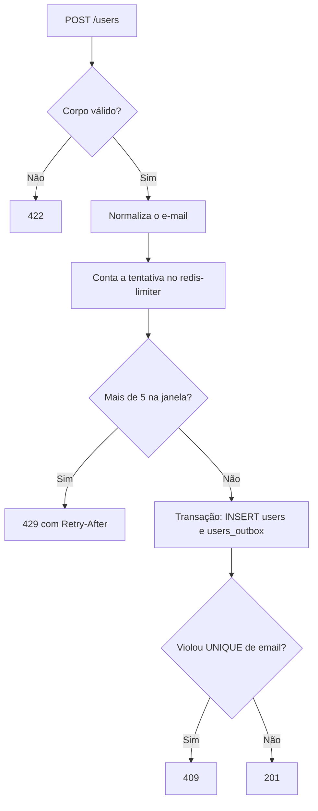

# Contrato da API

> **Status:** em design. Este documento descreve o comportamento planejado. Nada foi implementado ainda.

As três stacks expõem exatamente o mesmo contrato em `http://localhost:8080`. O frontend não sabe qual delas está respondendo.

## `POST /users`

Cadastra um usuário e registra o evento de envio do e-mail de confirmação.

### Requisição

```http
POST /users HTTP/1.1
Host: localhost:8080
Content-Type: application/json
Accept: application/json

{
  "name": "Ana Souza",
  "email": "ana@example.com"
}
```

| Campo | Regras |
|---|---|
| `name` | Obrigatório, texto, 1 a 255 caracteres depois do `trim` |
| `email` | Obrigatório, texto, formato de e-mail válido, até 254 caracteres |

A validação do e-mail é apenas sintática, sem consulta de DNS. Campos extras são ignorados.

### Ordem de processamento

A ordem faz parte do contrato, porque é ela que evita consultas desnecessárias ao banco.



1. **Validar o corpo.** Essa etapa não usa Redis nem banco.
2. **Normalizar o e-mail**, com `trim` e minúsculas.
3. **Contar a tentativa** no `redis-limiter`, pelo par IP do cliente e e-mail normalizado.
4. **Gravar** `users` e `users_outbox` na mesma transação. Não há `SELECT` prévio: a duplicidade é detectada pela constraint `UNIQUE`, o que também evita condição de corrida entre requisições simultâneas.

Qualquer indisponibilidade em qualquer etapa resulta em 500.

### Respostas

| Status | Quando | Corpo |
|---|---|---|
| `201 Created` | Cadastro gravado | `data` e `message` |
| `409 Conflict` | E-mail já cadastrado | `message` e `errors` |
| `422 Unprocessable Entity` | JSON malformado, campos ausentes ou inválidos | `message` e `errors` |
| `429 Too Many Requests` | Mais de 5 tentativas do mesmo IP com o mesmo e-mail na janela | `message`, com header `Retry-After` |
| `500 Internal Server Error` | Banco ou `redis-limiter` indisponível, ou erro inesperado | `message` |

As mensagens da API ficam em inglês. O frontend traduz cada status para o texto exibido ao usuário.

#### 201 Created

```json
{
  "data": {
    "id": "0190f3a2-7c1e-7b3a-9d5e-2f4a6b8c0d1e",
    "name": "Ana Souza",
    "email": "ana@example.com",
    "created_at": "2026-11-04T12:00:00Z"
  },
  "message": "User registered successfully."
}
```

O 201 confirma que os dados foram recebidos e o evento foi registrado. O e-mail é enviado depois, de forma assíncrona.

#### 409 Conflict

```json
{
  "message": "The email has already been taken.",
  "errors": {
    "email": ["The email has already been taken."]
  }
}
```

#### 422 Unprocessable Entity

```json
{
  "message": "The given data was invalid.",
  "errors": {
    "email": ["The email must be a valid email address."]
  }
}
```

Mensagens de validação canônicas, iguais nas três stacks:

| Campo | Regra violada | Mensagem |
|---|---|---|
| `name` | Ausente ou vazio | `The name field is required.` |
| `name` | Mais de 255 caracteres | `The name must not exceed 255 characters.` |
| `email` | Ausente ou vazio | `The email field is required.` |
| `email` | Formato inválido | `The email must be a valid email address.` |
| `email` | Mais de 254 caracteres | `The email must not exceed 254 characters.` |

Tipos incorretos recebem a mensagem de campo obrigatório. JSON malformado retorna 422 com ambos os campos marcados como obrigatórios.

#### 429 Too Many Requests

```http
HTTP/1.1 429 Too Many Requests
Retry-After: 742
Content-Type: application/json

{
  "message": "Too many registration attempts. Try again later."
}
```

`Retry-After` traz os segundos restantes até a janela expirar.

#### 500 Internal Server Error

```json
{
  "message": "Internal server error."
}
```

Nenhum detalhe interno é exposto. A causa vai para os logs.

## Limite de tentativas

| Item | Valor |
|---|---|
| Identidade contada | Par IP do cliente + e-mail normalizado |
| Armazenamento | `redis-limiter`, comum às três stacks |
| Chave | `registration:attempts:{sha256(ip + "\|" + email)}`, sem nenhum prefixo de framework |
| Limite | 5 tentativas (`REGISTRATION_MAX_ATTEMPTS`) |
| Janela | Fixa, 15 minutos a partir da primeira tentativa (`REGISTRATION_ATTEMPT_WINDOW_SECONDS`) |
| O que conta | Toda tentativa com corpo válido, inclusive a que teve sucesso |
| O que não conta | Tentativas que falham na validação (422) |
| `redis-limiter` indisponível | A API retorna 500 em vez de aceitar cadastros sem limite |

O hash evita guardar o e-mail e o IP em claro no Redis.

Como a chave combina IP e e-mail, quem repete o e-mail de outra pessoa a partir do próprio IP esgota só o próprio contador. A pessoa dona do e-mail, em outro IP, continua conseguindo se cadastrar.

### Chave

As três stacks precisam gerar exatamente os mesmos bytes, senão o limite deixa de valer na troca de stack.

1. Monte o texto `{ip}|{email}`, em UTF-8, com o IP na forma canônica abaixo e o e-mail já normalizado (`trim` e minúsculas).
2. Calcule o SHA-256 desse texto e escreva em hexadecimal minúsculo.
3. Prefixe com `registration:attempts:`.

| Entrada | Chave |
|---|---|
| IP `203.0.113.10`, e-mail `ana@example.com` | `registration:attempts:da657b591c8d33639918ea46be3b50e2bb1173313d08cf019556c130426a63a8` |

Esse exemplo serve de teste nas três stacks.

### IP do cliente

| Regra | Valor |
|---|---|
| Origem | Endereço da conexão TCP que chegou à aplicação |
| Proxy confiável | Só o `nginx` da stack Laravel. O `php-fpm` lê o IP que esse `nginx` repassa e não confia em proxy nenhum além dele |
| `X-Forwarded-For` enviado pelo cliente | Ignorado nas três stacks. Aceitar esse header permitiria trocar de IP a cada requisição e contornar o limite |
| IPv4 mapeado em IPv6 (`::ffff:203.0.113.10`) | Convertido para IPv4 (`203.0.113.10`) |
| IPv6 | Forma comprimida e em minúsculas (RFC 5952), sem zona (`%eth0`) |

Em ambiente local, a requisição do navegador chega ao container pelo gateway da rede Docker, então todas as pessoas da máquina aparecem com o mesmo IP. Como as três stacks estão na mesma rede `cadastro-feliz-net`, esse IP é o mesmo em todas, e o limite continua valendo na troca de stack.

### Operação no Redis

Como o contador é compartilhado, a operação também faz parte do contrato: as três stacks precisam usar a mesma chave e o mesmo script. O script roda de forma atômica no Redis, o que garante que a chave nunca fique sem expiração.

```lua
local attempts = redis.call('INCR', KEYS[1])
if attempts == 1 then
  redis.call('EXPIRE', KEYS[1], ARGV[1])
end
return { attempts, redis.call('TTL', KEYS[1]) }
```

- **Entrada:** `KEYS[1]` é a chave, e `ARGV[1]` é `REGISTRATION_ATTEMPT_WINDOW_SECONDS`.
- **Saída:** o número da tentativa e os segundos restantes da janela.
- **Decisão:** se o número da tentativa for maior que `REGISTRATION_MAX_ATTEMPTS`, a API responde 429 e usa os segundos restantes no header `Retry-After`.

Cada stack mantém uma cópia desse script. Este documento é a referência para todas elas.

Sequência com o mesmo e-mail, a partir do mesmo IP, dentro da janela:

| Tentativa | Situação | Resposta | Consulta o banco? |
|---|---|---|---|
| 1ª | E-mail novo | 201 | Sim |
| 2ª a 5ª | E-mail já cadastrado | 409 | Sim |
| 6ª em diante | Limite excedido | 429 | Não |

## Limitações conhecidas

- **Enumeração de e-mails:** o 409 revela que um e-mail já está cadastrado.
- **Bloqueio por quem divide o IP:** quem está atrás do mesmo IP (a mesma rede com NAT, por exemplo) ainda pode bloquear o cadastro de um e-mail alheio por até 15 minutos. Pessoas em outros IPs não são afetadas.
- **Troca de IP contorna o limite:** cada IP novo ganha mais 5 tentativas para o mesmo e-mail.
- **Sem limite só por IP:** muitas tentativas de um IP com e-mails diferentes não são barradas.
- **Ponto único de falha:** se o `redis-limiter` cair, nenhuma stack aceita cadastros até ele voltar.

Essas limitações são aceitas nesta POC, cujo foco é o padrão outbox.

## Exemplo

```bash
curl -i -X POST http://localhost:8080/users \
  -H 'Content-Type: application/json' \
  -H 'Accept: application/json' \
  -d '{"name":"Ana Souza","email":"ana@example.com"}'
```

## Comportamento do frontend

O frontend é um formulário público com os campos nome e e-mail, em `http://localhost:3000`.

| Resultado | Mensagem exibida |
|---|---|
| 201 | Recebemos seus dados! Em instantes você receberá um e-mail de confirmação. |
| 409 | Este e-mail já está cadastrado. |
| 422 | Erros de validação junto de cada campo. |
| 429 | Muitas tentativas com este e-mail. Tente novamente em {minutos} minutos. |
| 500 | Não foi possível concluir seu cadastro. Tente novamente em instantes. |
| Falha de rede | Serviço indisponível no momento. Tente novamente em instantes. |

A falha de rede é o que o navegador recebe quando nenhuma stack está no ar. Para ler o `Retry-After` no navegador, a API precisa expor esse header na configuração de CORS.
