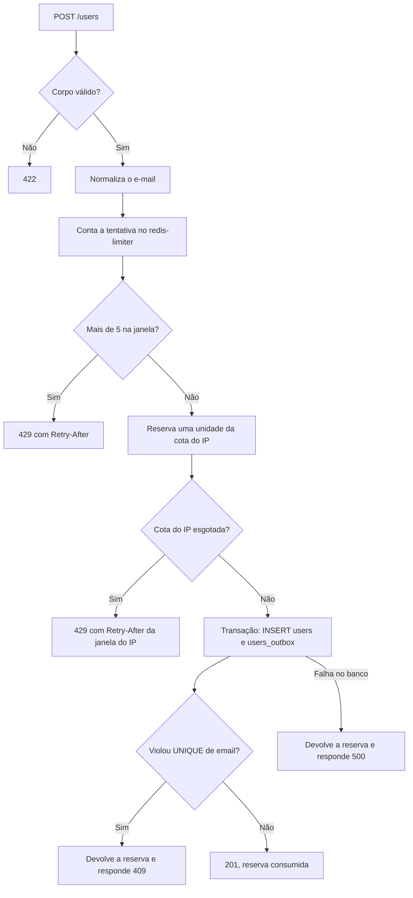

# Contrato da API

> **Status:** em construção. A stack Laravel implementa `POST /users` e [`GET /health`](#get-health), testados por `make test-laravel` e `make test-infra`, e a stack NestJS também, testados por `make test-nest` e `make test-infra`. Cada `201` grava o usuário e o evento na mesma transação. Go ainda não tem os endpoints. O [comportamento do frontend](#comportamento-do-frontend) já está implementado em `frontend/` e é testado por `make test-frontend`. O limitador de cada stack é testado pela suíte dela e pelos casos de `make test-infra`.

As três stacks expõem exatamente o mesmo contrato em `http://localhost:8080`. O frontend não sabe qual delas está respondendo.

## `POST /users`

Cadastra um usuário e registra o evento de envio do e-mail de confirmação.

### Requisição

```http
POST /users HTTP/1.1
Host: localhost:8080
Content-Type: application/json
Accept: application/json

{
  "name": "Ana Souza",
  "email": "ana@example.com"
}
```

| Campo | Regras |
|---|---|
| `name` | Obrigatório, texto, 1 a 255 caracteres depois do `trim` |
| `email` | Obrigatório, texto, formato de e-mail válido, até 254 caracteres |

A validação do e-mail é apenas sintática, sem consulta de DNS. Campos extras são ignorados.

### Ordem de processamento

A ordem faz parte do contrato, porque é ela que evita consultas desnecessárias ao banco.



1. **Validar o corpo.** Essa etapa não usa Redis nem banco.
2. **Normalizar o e-mail**, com `trim` e minúsculas.
3. **Contar a tentativa** no `redis-limiter`, pelo par IP do cliente e e-mail normalizado.
4. **Reservar uma unidade da cota do IP** no `redis-limiter`, numa única operação atômica (veja [Limite por IP](#limite-por-ip)). Com a cota esgotada, responde 429 sem consultar o banco.
5. **Gravar** `users` e `users_outbox` na mesma transação. Não há `SELECT` prévio: a duplicidade é detectada pela constraint `UNIQUE`, o que também evita condição de corrida entre requisições simultâneas.
6. **Devolver a reserva** quando a resposta depois dela é 409 ou 500. Só o 201 consome a cota.

Qualquer indisponibilidade em qualquer etapa resulta em 500.

### Respostas

| Status | Quando | Corpo |
|---|---|---|
| `201 Created` | Cadastro gravado | `data` e `message` |
| `409 Conflict` | E-mail já cadastrado | `message` e `errors` com o item `already_taken` |
| `422 Unprocessable Entity` | JSON malformado, campos ausentes ou inválidos | `message` e `errors` com os erros de campo |
| `429 Too Many Requests` | Mais de 5 tentativas do par IP + e-mail na janela, ou cota do IP esgotada (20 cadastros por hora) | `message` e `errors` vazio, com header `Retry-After` da janela que recusou |
| `500 Internal Server Error` | Banco ou `redis-limiter` indisponível, ou erro inesperado | `message` e `errors` vazio |

#### Forma do corpo de erro

Toda resposta de erro tem a mesma forma:

| Membro | Tipo | Regras |
|---|---|---|
| `message` | Texto | Sempre presente. Descreve o erro em inglês, para diagnóstico |
| `errors` | Lista | Sempre presente e nunca nula. Fica vazia quando não há erro de campo |
| `errors[].field` | Texto | Campo da requisição: `name` ou `email` |
| `errors[].code` | Texto | Regra violada: `required`, `too_long`, `invalid_format` ou `already_taken` |
| `errors[].message` | Texto | Mensagem canônica em inglês, para diagnóstico |

`data` só aparece em sucesso, e `errors` só em erro. No nível de cima, quem identifica o caso é o status HTTP.

O contrato estável é o par `field` + `code`. O frontend usa esse par para escolher o texto em português e não compara nem exibe `message`. Um valor novo de `code` é uma mudança de contrato.

#### 201 Created

```json
{
  "data": {
    "id": "0190f3a2-7c1e-7b3a-9d5e-2f4a6b8c0d1e",
    "name": "Ana Souza",
    "email": "ana@example.com",
    "created_at": "2026-11-04T12:00:00Z"
  },
  "message": "User registered successfully."
}
```

O 201 confirma que os dados foram recebidos e o evento foi registrado. O e-mail é enviado depois, de forma assíncrona.

#### 409 Conflict

```json
{
  "message": "The email has already been taken.",
  "errors": [
    {
      "field": "email",
      "code": "already_taken",
      "message": "The email has already been taken."
    }
  ]
}
```

#### 422 Unprocessable Entity

```json
{
  "message": "The given data was invalid.",
  "errors": [
    {
      "field": "email",
      "code": "invalid_format",
      "message": "The email must be a valid email address."
    }
  ]
}
```

Códigos e mensagens de validação canônicos, iguais nas três stacks:

| Campo | Regra violada | Código | Mensagem |
|---|---|---|---|
| `name` | Ausente ou vazio | `required` | `The name field is required.` |
| `name` | Mais de 255 caracteres | `too_long` | `The name must not exceed 255 characters.` |
| `email` | Ausente ou vazio | `required` | `The email field is required.` |
| `email` | Formato inválido | `invalid_format` | `The email must be a valid email address.` |
| `email` | Mais de 254 caracteres | `too_long` | `The email must not exceed 254 characters.` |

Tipos incorretos recebem o código `required`. JSON malformado retorna 422 com um item `required` para `name` e outro para `email`.

#### 429 Too Many Requests

```http
HTTP/1.1 429 Too Many Requests
Retry-After: 742
Content-Type: application/json

{
  "message": "Too many registration attempts. Try again later.",
  "errors": []
}
```

`Retry-After` traz os segundos restantes até a janela que recusou expirar: a do par IP + e-mail ou a da cota do IP. O corpo é o mesmo nos dois casos, e a resposta não revela qual limite foi atingido.

#### 500 Internal Server Error

```json
{
  "message": "Internal server error.",
  "errors": []
}
```

Nenhum detalhe interno é exposto. A causa vai para os logs.

## Limite de tentativas

| Item | Valor |
|---|---|
| Identidade contada | Par IP do cliente + e-mail normalizado |
| Armazenamento | `redis-limiter`; o formato gravado é de cada stack (decisão 28) |
| Chave | `registration:attempts:{sha256(ip + "\|" + email)}` |
| Limite | 5 tentativas (`REGISTRATION_MAX_ATTEMPTS`) |
| Janela | Fixa, 15 minutos a partir da primeira tentativa (`REGISTRATION_ATTEMPT_WINDOW_SECONDS`) |
| O que conta | Toda tentativa com corpo válido, inclusive a que teve sucesso |
| O que não conta | Tentativas que falham na validação (422) |
| `redis-limiter` indisponível | A API retorna 500 em vez de aceitar cadastros sem limite |

O hash evita guardar o e-mail e o IP em claro no Redis.

Como a chave combina IP e e-mail, quem repete o e-mail de outra pessoa a partir do próprio IP esgota só o próprio contador. A pessoa dona do e-mail, em outro IP, continua conseguindo se cadastrar.

### Chave

A chave guarda só o hash, nunca o IP ou o e-mail em claro. O contador é de cada stack (decisão 28), e a troca de stack não leva o limite junto.

1. Monte o texto `{ip}|{email}`, em UTF-8, com o IP na forma canônica abaixo e o e-mail já normalizado (`trim` e minúsculas).
2. Calcule o SHA-256 desse texto e escreva em hexadecimal minúsculo.
3. Prefixe com `registration:attempts:`.

| Entrada | Chave |
|---|---|
| IP `203.0.113.10`, e-mail `ana@example.com` | `registration:attempts:da657b591c8d33639918ea46be3b50e2bb1173313d08cf019556c130426a63a8` |

Esse exemplo serve de teste nas três stacks.

### IP do cliente

| Regra | Valor |
|---|---|
| Origem | Endereço da conexão TCP que chegou à aplicação |
| Proxy confiável | Só o `nginx` da stack Laravel. O `php-fpm` lê o IP que esse `nginx` repassa e não confia em proxy nenhum além dele |
| `X-Forwarded-For` enviado pelo cliente | Ignorado nas três stacks. Aceitar esse header permitiria trocar de IP a cada requisição e contornar o limite |
| IPv4 mapeado em IPv6 (`::ffff:203.0.113.10`) | Convertido para IPv4 (`203.0.113.10`) |
| IPv6 | Forma comprimida e em minúsculas (RFC 5952), sem zona (`%eth0`) |

Em ambiente local, a requisição do navegador chega ao container pelo gateway da rede Docker, então todas as pessoas da máquina aparecem com o mesmo IP. Como as três stacks estão na mesma rede `cadastro-feliz-net`, esse IP é o mesmo em todas.

### Contagem

A stack incrementa o contador e compara o valor devolvido com `REGISTRATION_MAX_ATTEMPTS`, numa única operação atômica no Redis. Verificar antes e incrementar depois deixaria N requisições paralelas passarem juntas: não use esse formato.

- **Janela fixa:** só o incremento que cria o contador define a expiração, de `REGISTRATION_ATTEMPT_WINDOW_SECONDS`; as tentativas seguintes não a renovam.
- **Expiração sempre presente:** nenhum contador fica sem expiração.
- **Decisão:** acima de `REGISTRATION_MAX_ATTEMPTS`, a API responde 429 e usa os segundos restantes da janela no header `Retry-After`, no mínimo 1. No último meio segundo da janela o resto arredonda para 0, e um `Retry-After: 0` mandaria tentar de novo antes de a janela expirar.

Como cada stack executa isso no Redis é decisão dela (decisão 28).

Sequência com o mesmo e-mail, a partir do mesmo IP, dentro da janela:

| Tentativa | Situação | Resposta | Consulta o banco? |
|---|---|---|---|
| 1ª | E-mail novo | 201 | Sim |
| 2ª a 5ª | E-mail já cadastrado | 409 | Sim |
| 6ª em diante | Limite excedido | 429 | Não |

## Limite por IP

Cada IP tem uma cota de cadastros concluídos por janela. O contador por IP + e-mail barra a repetição do mesmo e-mail; a cota barra um único IP que cadastra muitos e-mails diferentes, porque cada cadastro concluído gera um e-mail para o endereço informado.

| Item | Valor |
|---|---|
| Identidade contada | IP do cliente, na forma canônica de [IP do cliente](#ip-do-cliente) |
| Armazenamento | `redis-limiter`; o formato gravado é de cada stack (decisão 28) |
| Chave | `registration:ip:{sha256(ip)}` |
| Cota | 20 cadastros (`REGISTRATION_MAX_PER_IP`) |
| Janela | Fixa, 1 hora a partir da primeira reserva (`REGISTRATION_IP_WINDOW_SECONDS`, 3600) |
| Quando reserva | Depois do contador por IP + e-mail e antes da transação. Um 429 do par não reserva |
| O que consome a cota | Só o cadastro concluído (`201`) |
| O que devolve a reserva | `409` e `500` respondidos depois da reserva |
| Cota esgotada | 429 com o mesmo corpo do contador por IP + e-mail, sem consultar o banco |
| `redis-limiter` indisponível | A API retorna 500, como no contador por IP + e-mail |

A verificação e a reserva são uma única operação atômica, feita antes de abrir a transação. Consultar a cota antes e incrementar depois do commit deixaria N requisições paralelas passarem juntas: não use esse formato.

### Chave da cota

1. Pegue o IP na forma canônica de [IP do cliente](#ip-do-cliente), em UTF-8.
2. Calcule o SHA-256 desse texto e escreva em hexadecimal minúsculo.
3. Prefixe com `registration:ip:`.

| Entrada | Chave |
|---|---|
| IP `203.0.113.10` | `registration:ip:631f08140b24b7274d12df3c37a1a80ce5876dafd7007d772e0114fddf88b682` |

Esse exemplo serve de teste nas três stacks.

### Reserva e devolução

O comportamento é o contrato; como cada stack executa isso no Redis é decisão dela (decisão 28).

- **Reserva:** a stack incrementa o contador e compara o valor devolvido com `REGISTRATION_MAX_PER_IP`. Acima da cota, desfaz o próprio incremento e responde 429, com os segundos restantes da janela no header `Retry-After`, no mínimo 1. Uma reserva recusada deixa o contador como estava.
- **Janela fixa:** só o incremento que cria o contador define a expiração, de `REGISTRATION_IP_WINDOW_SECONDS`; as outras reservas e as devoluções não a renovam.
- **Devolução:** devolve uma unidade sem mudar a expiração.
- **Contador nunca negativo nem sem expiração:** se a janela expirou entre a reserva e a devolução, ou entre a reserva recusada e o desfazer, o contador não fica abaixo de zero nem sem expiração.

Sequência a partir do mesmo IP, com e-mails novos, dentro da janela:

| Cadastro | Resposta | Consulta o banco? |
|---|---|---|
| 1º ao 20º | 201 | Sim |
| 21º em diante | 429 | Não |
| E-mail já cadastrado, com cota livre | 409, a reserva é devolvida | Sim |

## `GET /health`

Diz se a API alcança as dependências de que o cadastro precisa: o PostgreSQL (`database`) e o `redis-limiter` (`limiter`). Não grava nada e não tem autenticação. É igual nas três stacks (decisão 19).

```http
GET /health HTTP/1.1
Host: localhost:8080
```

| Status | Quando | Corpo |
|---|---|---|
| `200` | As duas dependências respondem | `{"status":"ok","checks":{"database":"ok","limiter":"ok"}}` |
| `503` | Alguma dependência falha | `{"status":"fail","checks":{"database":"ok","limiter":"fail"}}`, com `fail` em cada check que falhou |

- **Mesma forma nos dois status:** `status` é `ok` só quando todos os checks são `ok`, e o corpo não tem nenhuma outra chave. Os valores de cada check são só `ok` e `fail`; o motivo de uma falha vai para o log da stack, nunca para o corpo.
- **Resposta rápida:** cada check desiste em 1 s, então `/health` responde em menos de `3 s` mesmo com uma dependência travada.
- **Sem cache:** as duas respostas têm `Content-Type: application/json` e `Cache-Control: no-store`.
- **Saúde do container:** o container da API está saudável quando `/health` responde, com `200` ou `503`. Uma dependência fora do ar aparece no corpo, e a stack continua no ar.

## Limitações conhecidas

- **Enumeração de e-mails:** o 409 revela que um e-mail já está cadastrado.
- **Bloqueio por quem divide o IP:** quem está atrás do mesmo IP (a mesma rede com NAT, por exemplo) ainda pode bloquear o cadastro de um e-mail alheio por até 15 minutos. Pessoas em outros IPs não são afetadas.
- **Troca de IP contorna o limite:** cada IP novo ganha mais 5 tentativas para o mesmo e-mail.
- **Cota dividida por quem tem o mesmo IP:** pessoas atrás do mesmo IP (a mesma rede com NAT, por exemplo) dividem a cota de 20 cadastros por hora.
- **Devolução que falha:** se a devolução da reserva falhar, ou a API cair entre a reserva e a resposta, a cota fica com uma unidade a mais até a janela expirar.
- **Ponto único de falha:** se o `redis-limiter` cair, nenhuma stack aceita cadastros até ele voltar.
- **Respostas fora do contrato:** 404, 405, `Content-Type` errado e corpo que não é objeto não têm formato definido, e cada framework responde do seu jeito. A stack Laravel responde esses casos em JSON, mas sem a forma da decisão 14.
- **Quantidade de erros por campo:** um e-mail longo e inválido pode trazer um ou dois itens em `errors`, conforme a stack, então o texto exibido pode variar entre elas.

Essas limitações são aceitas nesta POC, cujo foco é o padrão outbox.

## Exemplo

```bash
curl -i -X POST http://localhost:8080/users \
  -H 'Content-Type: application/json' \
  -H 'Accept: application/json' \
  -d '{"name":"Ana Souza","email":"ana@example.com"}'
```

## Comportamento do frontend

O frontend é um formulário público com os campos nome e e-mail, em `http://localhost:3000`.

O formulário não valida nada no navegador: envia nome e e-mail exatamente como foram digitados, sem `trim`, e todo erro de campo exibido vem da API (decisão 18 de [decisions.md](decisions.md)). Só uma requisição sai por vez, e os campos mantêm o que foi digitado depois de qualquer resposta.

| Resultado | Mensagem exibida |
|---|---|
| 201, com qualquer corpo | Recebemos seus dados! Em instantes você receberá um e-mail de confirmação. |
| 409 ou 422 | Texto da tabela abaixo, junto de cada campo. |
| 409 ou 422 sem nenhum item de `name` ou `email`, ou com corpo fora da forma única | Mesmo texto do 500. |
| 429 | Muitas tentativas de cadastro. Tente novamente em {minutos} minutos. |
| 429 sem `Retry-After` legível | Muitas tentativas de cadastro. Tente novamente mais tarde. |
| 500 | Não foi possível concluir seu cadastro. Tente novamente em instantes. |
| Outro status | Mesmo texto do 500. |
| Falha de rede | Serviço indisponível no momento. Tente novamente em instantes. |

O 201 é sucesso sem que o corpo seja lido: o cadastro já foi gravado, e mostrar um erro levaria a pessoa a reenviar e receber um 409.

Os minutos do 429 são os segundos do `Retry-After` divididos por 60 e arredondados para cima, no mínimo 1: `742` mostra 13 minutos, e de `0` a `60` mostra `1 minuto`, no singular. Um `Retry-After` legível é um inteiro decimal maior ou igual a zero; qualquer outro valor, ou a ausência do header, mostra o texto sem prazo.

Cada campo mostra o texto do seu primeiro item em `errors`:

| Campo | Código | Texto |
|---|---|---|
| `name` | `required` | Informe seu nome. |
| `name` | `too_long` | O nome deve ter no máximo 255 caracteres. |
| `email` | `required` | Informe seu e-mail. |
| `email` | `invalid_format` | Informe um e-mail válido. |
| `email` | `too_long` | O e-mail deve ter no máximo 254 caracteres. |
| `email` | `already_taken` | Este e-mail já está cadastrado. |

Um par de campo e código sem texto conhecido mostra `Verifique este campo.`

A falha de rede é o que o navegador recebe quando nenhuma stack está no ar. Para ler o `Retry-After` no navegador, a API precisa expor esse header na configuração de CORS.
