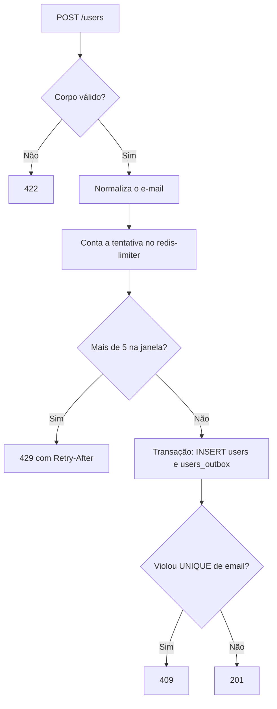

# Contrato da API

> **Status:** em design. Este documento descreve o comportamento planejado. Nada foi implementado ainda.

As três stacks expõem exatamente o mesmo contrato em `http://localhost:8080`. O frontend não sabe qual delas está respondendo.

## `POST /users`

Cadastra um usuário e registra o evento de envio do e-mail de confirmação.

### Requisição

```http
POST /users HTTP/1.1
Host: localhost:8080
Content-Type: application/json
Accept: application/json

{
  "name": "Ana Souza",
  "email": "ana@example.com"
}
```

| Campo | Regras |
|---|---|
| `name` | Obrigatório, texto, 1 a 255 caracteres depois do `trim` |
| `email` | Obrigatório, texto, formato de e-mail válido, até 254 caracteres |

A validação do e-mail é apenas sintática, sem consulta de DNS. Campos extras são ignorados.

### Ordem de processamento

A ordem faz parte do contrato, porque é ela que evita consultas desnecessárias ao banco.



1. **Validar o corpo.** Essa etapa não usa Redis nem banco.
2. **Normalizar o e-mail**, com `trim` e minúsculas.
3. **Contar a tentativa** no `redis-limiter`.
4. **Gravar** `users` e `users_outbox` na mesma transação. Não há `SELECT` prévio: a duplicidade é detectada pela constraint `UNIQUE`, o que também evita condição de corrida entre requisições simultâneas.

Qualquer indisponibilidade em qualquer etapa resulta em 500.

### Respostas

| Status | Quando | Corpo |
|---|---|---|
| `201 Created` | Cadastro gravado | `data` e `message` |
| `409 Conflict` | E-mail já cadastrado | `message` e `errors` com o item `already_taken` |
| `422 Unprocessable Entity` | JSON malformado, campos ausentes ou inválidos | `message` e `errors` com os erros de campo |
| `429 Too Many Requests` | Mais de 5 tentativas com o mesmo e-mail na janela | `message` e `errors` vazio, com header `Retry-After` |
| `500 Internal Server Error` | Banco ou `redis-limiter` indisponível, ou erro inesperado | `message` e `errors` vazio |

#### Forma do corpo de erro

Toda resposta de erro tem a mesma forma:

| Membro | Tipo | Regras |
|---|---|---|
| `message` | Texto | Sempre presente. Descreve o erro em inglês, para diagnóstico |
| `errors` | Lista | Sempre presente e nunca nula. Fica vazia quando não há erro de campo |
| `errors[].field` | Texto | Campo da requisição: `name` ou `email` |
| `errors[].code` | Texto | Regra violada: `required`, `too_long`, `invalid_format` ou `already_taken` |
| `errors[].message` | Texto | Mensagem canônica em inglês, para diagnóstico |

`data` só aparece em sucesso, e `errors` só em erro. No nível de cima, quem identifica o caso é o status HTTP.

O contrato estável é o par `field` + `code`. O frontend usa esse par para escolher o texto em português e não compara nem exibe `message`. Um valor novo de `code` é uma mudança de contrato.

#### 201 Created

```json
{
  "data": {
    "id": "0190f3a2-7c1e-7b3a-9d5e-2f4a6b8c0d1e",
    "name": "Ana Souza",
    "email": "ana@example.com",
    "created_at": "2026-11-04T12:00:00Z"
  },
  "message": "User registered successfully."
}
```

O 201 confirma que os dados foram recebidos e o evento foi registrado. O e-mail é enviado depois, de forma assíncrona.

#### 409 Conflict

```json
{
  "message": "The email has already been taken.",
  "errors": [
    {
      "field": "email",
      "code": "already_taken",
      "message": "The email has already been taken."
    }
  ]
}
```

#### 422 Unprocessable Entity

```json
{
  "message": "The given data was invalid.",
  "errors": [
    {
      "field": "email",
      "code": "invalid_format",
      "message": "The email must be a valid email address."
    }
  ]
}
```

Códigos e mensagens de validação canônicos, iguais nas três stacks:

| Campo | Regra violada | Código | Mensagem |
|---|---|---|---|
| `name` | Ausente ou vazio | `required` | `The name field is required.` |
| `name` | Mais de 255 caracteres | `too_long` | `The name must not exceed 255 characters.` |
| `email` | Ausente ou vazio | `required` | `The email field is required.` |
| `email` | Formato inválido | `invalid_format` | `The email must be a valid email address.` |
| `email` | Mais de 254 caracteres | `too_long` | `The email must not exceed 254 characters.` |

Tipos incorretos recebem o código `required`. JSON malformado retorna 422 com um item `required` para `name` e outro para `email`.

#### 429 Too Many Requests

```http
HTTP/1.1 429 Too Many Requests
Retry-After: 742
Content-Type: application/json

{
  "message": "Too many registration attempts. Try again later.",
  "errors": []
}
```

`Retry-After` traz os segundos restantes até a janela expirar.

#### 500 Internal Server Error

```json
{
  "message": "Internal server error.",
  "errors": []
}
```

Nenhum detalhe interno é exposto. A causa vai para os logs.

## Limite de tentativas

| Item | Valor |
|---|---|
| Identidade contada | E-mail normalizado |
| Armazenamento | `redis-limiter`, comum às três stacks |
| Chave | `registration:attempts:{sha256(email)}`, sem nenhum prefixo de framework |
| Limite | 5 tentativas (`REGISTRATION_MAX_ATTEMPTS`) |
| Janela | Fixa, 15 minutos a partir da primeira tentativa (`REGISTRATION_ATTEMPT_WINDOW_SECONDS`) |
| O que conta | Toda tentativa com corpo válido, inclusive a que teve sucesso |
| O que não conta | Tentativas que falham na validação (422) |
| `redis-limiter` indisponível | A API retorna 500 em vez de aceitar cadastros sem limite |

O hash evita guardar o e-mail em claro no Redis.

### Operação no Redis

Como o contador é compartilhado, a operação também faz parte do contrato: as três stacks precisam usar a mesma chave e o mesmo script. O script roda de forma atômica no Redis, o que garante que a chave nunca fique sem expiração.

```lua
local attempts = redis.call('INCR', KEYS[1])
if attempts == 1 then
  redis.call('EXPIRE', KEYS[1], ARGV[1])
end
return { attempts, redis.call('TTL', KEYS[1]) }
```

- **Entrada:** `KEYS[1]` é a chave, e `ARGV[1]` é `REGISTRATION_ATTEMPT_WINDOW_SECONDS`.
- **Saída:** o número da tentativa e os segundos restantes da janela.
- **Decisão:** se o número da tentativa for maior que `REGISTRATION_MAX_ATTEMPTS`, a API responde 429 e usa os segundos restantes no header `Retry-After`.

Cada stack mantém uma cópia desse script. Este documento é a referência para todas elas.

Sequência com o mesmo e-mail dentro da janela:

| Tentativa | Situação | Resposta | Consulta o banco? |
|---|---|---|---|
| 1ª | E-mail novo | 201 | Sim |
| 2ª a 5ª | E-mail já cadastrado | 409 | Sim |
| 6ª em diante | Limite excedido | 429 | Não |

## Limitações conhecidas

- **Enumeração de e-mails:** o 409 revela que um e-mail já está cadastrado.
- **Bloqueio por terceiros:** como o limite é por e-mail, qualquer pessoa pode bloquear temporariamente o cadastro de um endereço alheio, por no máximo 15 minutos.
- **Sem limite por IP:** muitas tentativas com e-mails diferentes não são barradas.
- **Ponto único de falha:** se o `redis-limiter` cair, nenhuma stack aceita cadastros até ele voltar.
- **Respostas fora do contrato:** 404, 405, `Content-Type` errado e corpo que não é objeto não têm formato definido, e cada framework responde do seu jeito.
- **Quantidade de erros por campo:** um e-mail longo e inválido pode trazer um ou dois itens em `errors`, conforme a stack, então o texto exibido pode variar entre elas.

Essas limitações são aceitas nesta POC, cujo foco é o padrão outbox.

## Exemplo

```bash
curl -i -X POST http://localhost:8080/users \
  -H 'Content-Type: application/json' \
  -H 'Accept: application/json' \
  -d '{"name":"Ana Souza","email":"ana@example.com"}'
```

## Comportamento do frontend

O frontend é um formulário público com os campos nome e e-mail, em `http://localhost:3000`.

| Resultado | Mensagem exibida |
|---|---|
| 201 | Recebemos seus dados! Em instantes você receberá um e-mail de confirmação. |
| 409 ou 422 | Texto da tabela abaixo, junto de cada campo. |
| 429 | Muitas tentativas com este e-mail. Tente novamente em {minutos} minutos. |
| 500 | Não foi possível concluir seu cadastro. Tente novamente em instantes. |
| Outro status, ou corpo fora da forma do contrato | Mesmo texto do 500. |
| Falha de rede | Serviço indisponível no momento. Tente novamente em instantes. |

Cada campo mostra o texto do seu primeiro item em `errors`:

| Campo | Código | Texto |
|---|---|---|
| `name` | `required` | Informe seu nome. |
| `name` | `too_long` | O nome deve ter no máximo 255 caracteres. |
| `email` | `required` | Informe seu e-mail. |
| `email` | `invalid_format` | Informe um e-mail válido. |
| `email` | `too_long` | O e-mail deve ter no máximo 254 caracteres. |
| `email` | `already_taken` | Este e-mail já está cadastrado. |

Um par de campo e código sem texto conhecido mostra `Verifique este campo.`

A falha de rede é o que o navegador recebe quando nenhuma stack está no ar. Para ler o `Retry-After` no navegador, a API precisa expor esse header na configuração de CORS.
