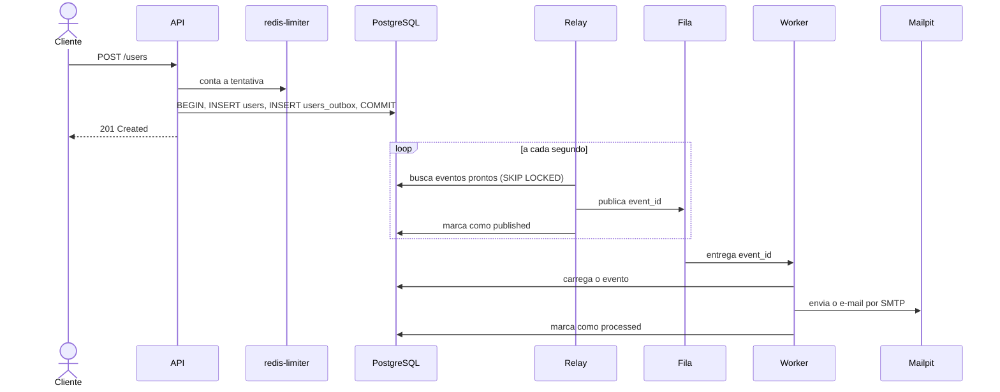

# Arquitetura

> **Status:** em construção. O schema, os serviços compartilhados e o formulário já existem. A API, o relay e o worker descritos aqui ainda não foram implementados em nenhuma stack, então este documento descreve o comportamento planejado para eles.

## O problema

Depois de salvar o usuário, a API precisa disparar um e-mail. Banco e fila são sistemas diferentes e não compartilham uma transação, então fazer as duas escritas diretamente na requisição deixa uma janela de inconsistência:

- Se a API salva o usuário e cai antes de publicar na fila, o e-mail nunca sai.
- Se a API publica na fila e a transação falha depois, o e-mail sai para um cadastro que não existe.

## A solução: Transactional Outbox

A API não fala com a fila. Na **mesma transação** do cadastro, ela grava o evento na tabela `users_outbox`. Ou as duas linhas são confirmadas, ou nenhuma é. Um processo separado, o **relay**, lê a tabela e publica os eventos na fila.



## Componentes

| Componente | Responsabilidade | Não faz |
|---|---|---|
| API | Valida, conta tentativas e grava `users` e `users_outbox` na mesma transação | Não publica na fila nem envia e-mail |
| Relay | Busca eventos prontos, publica na fila e marca como `published` | Não envia e-mail |
| Fila | Transporta o `event_id` até o worker | Não é a fonte da verdade; pode perder mensagens sem perder eventos |
| Worker | Carrega o evento, envia o e-mail e registra o resultado | Não decide retentativa pelo mecanismo da fila |
| PostgreSQL | Fonte da verdade de usuários e eventos | |
| `redis-limiter` | Guarda o contador de tentativas, comum às três stacks | Não guarda filas nem dados de negócio |

A API só se conecta ao PostgreSQL e ao `redis-limiter`. Ela nem abre conexão com a fila, e é isso que mantém o cadastro funcionando quando a fila está fora do ar.

## Relay

O relay roda a cada segundo e, dentro de uma transação:

1. Seleciona um lote de eventos prontos com `FOR UPDATE SKIP LOCKED`, para que duas instâncias não peguem as mesmas linhas.
2. Publica uma mensagem na fila para cada evento.
3. Marca os eventos como `published` e confirma a transação.

Um evento está pronto em dois casos:

- Está em `pending` e `available_at` já passou.
- Está em `published` há mais tempo que `OUTBOX_REPUBLISH_AFTER_SECONDS`, o que indica uma mensagem possivelmente perdida.

O segundo caso é o que permite à fila perder mensagens, por exemplo quando uma stack é derrubada com a fila cheia. O valor precisa ser maior que o tempo máximo de execução de um job, para não republicar um evento ainda em andamento.

## Mensagem na fila

O conteúdo de negócio da mensagem é apenas o identificador do evento:

```json
{ "event_id": "0190f3a2-7c1e-7b3a-9d5e-2f4a6b8c0d1e" }
```

Nome e e-mail ficam no PostgreSQL e não passam pelo Redis nem pelo RabbitMQ. O envelope da mensagem varia conforme a biblioteca de cada stack, o que não causa problema porque as filas não são compartilhadas entre stacks.

## Worker

Para cada mensagem, o worker:

1. Carrega o evento pelo `event_id`.
2. Ignora a mensagem se o status for terminal (`processed` ou `failed`).
3. Envia o e-mail com `Message-ID` derivado do `event_id`.
4. Marca o evento como `processed`.

O worker não segura lock nem transação durante o envio SMTP.

O worker aceita eventos em `pending` além de `published`, porque a mensagem pode chegar antes do commit do relay. Nesse caso, o `UPDATE` final do worker espera o lock do relay e só é aplicado depois do commit, então o status termina corretamente em `processed`.

### E-mail enviado

O texto é igual nas três stacks:

- **Assunto:** `Seu cadastro foi concluído`
- **Corpo:** `Olá, {name}! Seu cadastro no Cadastro Feliz foi concluído com sucesso.`

## Retentativas

As retentativas ficam no banco, e não no recurso nativo de cada fila, para que as três stacks se comportem igual. Quando o envio falha, o worker incrementa `attempts`, grava `last_error` e confirma a mensagem na fila. Em seguida:

- **Antes do limite:** o evento volta para `pending`, com `available_at = now() + base * 2^(attempts - 1)`.
- **Ao atingir `OUTBOX_MAX_ATTEMPTS`:** o evento vai para `failed` e não é mais processado.

Com os valores padrão (base de 30 segundos e 5 tentativas), as esperas são de 30, 60, 120 e 240 segundos. Reprocessar um evento em `failed` é uma ação manual no banco, descrita em [database.md](database.md#reprocessar-um-evento-em-failed).

Republicar uma mensagem perdida não conta como tentativa, porque nenhum envio falhou.

## Garantias e limites

- **Atomicidade:** usuário e evento são gravados juntos ou não são gravados.
- **Entrega *at-least-once*:** todo evento confirmado é publicado e tentado até `processed` ou `failed`.
- **Duplicidade possível:** não há *exactly-once*. Se o processo cair entre o envio SMTP e a gravação de `processed`, o e-mail sai de novo. O mesmo pode ocorrer se uma republicação coincidir com um job ainda em execução. O `Message-ID` estável permite identificar as duplicatas, mas não as impede.
- **Ordem:** não há garantia de ordem entre eventos, e o caso de uso não precisa dela.

## Cenários de falha

| Falha | O que acontece | Efeito para o cliente |
|---|---|---|
| API cai antes do `COMMIT` | Rollback: nem usuário nem evento são gravados | Erro ou 500; pode tentar de novo |
| API cai depois do `COMMIT` e antes de responder | Usuário e evento existem, e o e-mail é enviado normalmente | Sem resposta; uma nova tentativa recebe 409 |
| Fila indisponível (`redis` da stack ou RabbitMQ) | Eventos ficam em `pending` até a fila voltar; a API não depende dela | Cadastro continua com 201; o e-mail atrasa |
| `redis-limiter` indisponível | A API para de aceitar cadastros, mas o relay e o worker continuam | 500; eventos já gravados seguem normalmente |
| Relay cai depois de publicar e antes do `COMMIT` | O evento continua `pending` e é publicado de novo | Possível e-mail duplicado |
| Mensagem perdida ou stack derrubada | O evento em `published` é republicado após o tempo limite | E-mail atrasa |
| SMTP indisponível | Retentativas com backoff; `failed` ao atingir o limite | Cadastro continua com 201; e-mail atrasa ou não sai |
| Worker cai entre o envio SMTP e `processed` | A mensagem é reprocessada ou republicada | Possível e-mail duplicado |

## Troca de stack

Como o banco é único e o formato do evento é o mesmo, a stack seguinte assume eventos deixados pela anterior: linhas em `pending` são publicadas de imediato, e linhas em `published` são republicadas depois do tempo limite.

O contador de tentativas também acompanha a troca, pois o `redis-limiter` é compartilhado: um par IP e e-mail bloqueado em uma stack continua bloqueado nas outras até a janela expirar. Para repetir testes do 429, use outro e-mail ou `make reset-limits`.

## Cenários para validar a implementação

Estes cenários valem para cada stack e servem de critério de aceite quando o código existir.

1. **Fluxo feliz:** enviar o formulário, receber 201 e ver o e-mail no Mailpit em poucos segundos.
2. **Limite de tentativas:** repetir o mesmo e-mail a partir do mesmo IP e obter 201, 409 quatro vezes e depois 429 com `Retry-After`, sem consultas ao banco no 429.
3. **Validação:** enviar e-mail inválido ou nome vazio e obter 422, sem gravar nada e sem contar tentativa.
4. **Atomicidade:** forçar um erro no `INSERT` do outbox e confirmar que o usuário também não foi gravado.
5. **SMTP fora do ar:** parar o Mailpit, cadastrar (201), ver `attempts` subir e religar o Mailpit para o e-mail chegar.
6. **Troca de stack:** parar o worker, cadastrar, trocar de stack e ver o e-mail sair pela nova stack.
7. **Stack derrubada:** com nenhuma stack ativa, o frontend mostra a mensagem de serviço indisponível.
8. **Fila fora do ar:** parar a fila, cadastrar (201), ver o evento em `pending` e religar a fila para o e-mail chegar.
9. **Limite entre stacks:** atingir o 429 em uma stack, trocar de stack e continuar recebendo 429 com o mesmo e-mail e o mesmo IP.
10. **Contador fora do ar:** parar o `redis-limiter`, cadastrar e obter 500, sem gravar nada no banco.
11. **Limite por IP e e-mail:** atingir o 429 com um e-mail a partir de um IP e cadastrar o mesmo e-mail a partir de outro IP, sem receber 429.
12. **Cota por IP:** cadastrar 20 e-mails diferentes a partir do mesmo IP (201), receber 429 no 21º sem gravar nada, e confirmar que e-mails já cadastrados, a partir do mesmo IP, recebem 409 sem consumir cota.
13. **Cota com requisições paralelas:** enviar 50 cadastros paralelos com e-mails novos, a partir do mesmo IP e com a cota vazia, e obter exatamente 20 respostas 201 e 30 respostas 429, com 20 linhas em `users_outbox`.

Em Laravel, o relay roda em um container separado do worker, então o evento do cenário 6 fica em `published`. Em NestJS e Go, o relay está no próprio worker, e o evento fica em `pending`.
