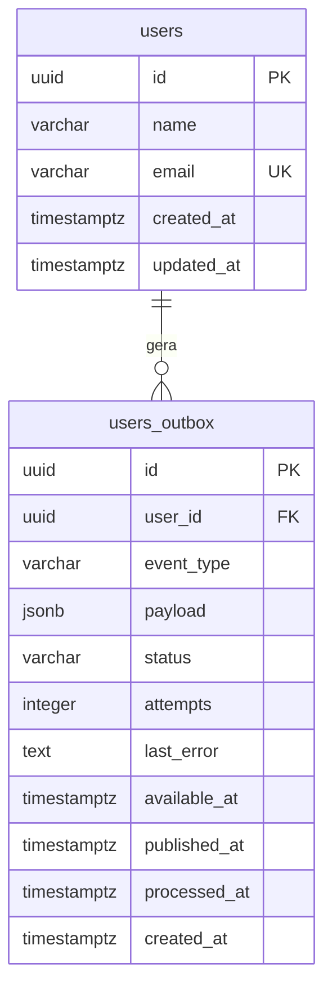
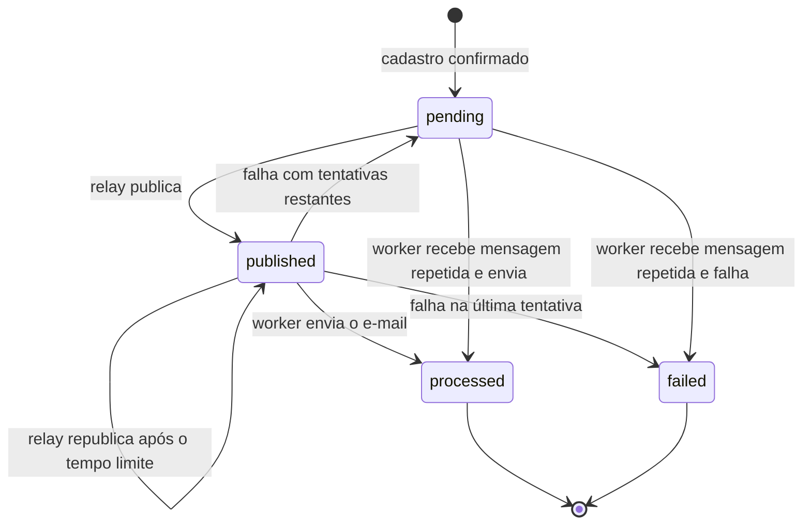

# Banco de dados

> **Status:** em design. O SQL abaixo é a referência para as futuras migrations. Nenhuma migration foi criada ainda.

## Visão geral

As três APIs usam **um único banco e um único schema** em um só container PostgreSQL. Isso mantém as stacks intercambiáveis: um e-mail cadastrado por uma vale para as outras, e um evento pendente de uma stack pode ser enviado pela seguinte.

## Migrations

As migrations são **SQL puro** em `database/migrations`, e são a única fonte do schema. Um container `migrate`, de execução única, as aplica antes de qualquer stack subir.

Nenhuma stack gerencia o schema:

- O Laravel não roda `artisan migrate` e não usa as migrations padrão do framework. Filas, cache e sessões não usam tabelas.
- O NestJS e o Go também não têm migrations próprias.

Essa regra evita que uma ferramenta altere tabelas que as outras duas stacks também usam.

## Schema



```sql
CREATE TABLE users (
    id         uuid         PRIMARY KEY DEFAULT gen_random_uuid(),
    name       varchar(255) NOT NULL,
    email      varchar(254) NOT NULL,
    created_at timestamptz  NOT NULL DEFAULT now(),
    updated_at timestamptz  NOT NULL DEFAULT now(),
    CONSTRAINT users_email_unique UNIQUE (email),
    CONSTRAINT users_email_lowercase CHECK (email = lower(email))
);

CREATE TABLE users_outbox (
    id           uuid         PRIMARY KEY DEFAULT gen_random_uuid(),
    user_id      uuid         NOT NULL REFERENCES users (id),
    event_type   varchar(100) NOT NULL,
    payload      jsonb        NOT NULL,
    status       varchar(20)  NOT NULL DEFAULT 'pending',
    attempts     integer      NOT NULL DEFAULT 0,
    last_error   text,
    available_at timestamptz  NOT NULL DEFAULT now(),
    published_at timestamptz,
    processed_at timestamptz,
    created_at   timestamptz  NOT NULL DEFAULT now(),
    CONSTRAINT users_outbox_status_valid
        CHECK (status IN ('pending', 'published', 'processed', 'failed')),
    CONSTRAINT users_outbox_attempts_positive CHECK (attempts >= 0)
);

CREATE INDEX users_outbox_user_id_index
    ON users_outbox (user_id);

CREATE INDEX users_outbox_pending_index
    ON users_outbox (available_at) WHERE status = 'pending';

CREATE INDEX users_outbox_published_index
    ON users_outbox (published_at) WHERE status = 'published';
```

Por que essas escolhas:

- **`users_email_lowercase`:** com três aplicações escrevendo na mesma tabela, a constraint garante que uma falha de normalização não crie duplicatas que diferem só por maiúsculas.
- **Índices parciais:** a tabela cresce com eventos `processed`, mas o relay só procura `pending` e `published`. Assim, os índices ficam pequenos e a busca continua rápida.

## Evento `user.registered`

```json
{
  "user_id": "0190f3a2-7c1e-7b3a-9d5e-2f4a6b8c0d1e",
  "name": "Ana Souza",
  "email": "ana@example.com",
  "occurred_at": "2026-11-04T12:00:00Z"
}
```

O `payload` tem o mesmo formato em todas as stacks, o que permite a uma stack processar eventos criados por outra. Ele guarda dados pessoais, então uma evolução para produção precisaria definir retenção e limpeza dos eventos `processed` (LGPD). Esta POC não faz limpeza nem exclusão de usuários.

## Ciclo de status



| Status | Significado |
|---|---|
| `pending` | Aguardando publicação pelo relay, a partir de `available_at` |
| `published` | Publicado na fila, aguardando o worker |
| `processed` | E-mail enviado (estado terminal) |
| `failed` | Tentativas esgotadas (estado terminal) |

## Consultas principais

Estas consultas definem o comportamento esperado. Cada stack pode escrevê-las com a própria ferramenta, desde que o efeito seja o mesmo.

### Cadastro

```sql
BEGIN;

INSERT INTO users (name, email)
VALUES ($1, $2)
RETURNING id, name, email, created_at;

INSERT INTO users_outbox (user_id, event_type, payload)
VALUES ($3, 'user.registered', $4);

COMMIT;
```

### Busca do relay

```sql
SELECT id
FROM users_outbox
WHERE (status = 'pending' AND available_at <= now())
   OR (status = 'published' AND published_at <= now() - make_interval(secs => $1))
ORDER BY created_at
LIMIT $2
FOR UPDATE SKIP LOCKED;
```

Depois de publicar, na mesma transação:

```sql
UPDATE users_outbox
SET status = 'published', published_at = now()
WHERE id = ANY($1);
```

### Conclusão no worker

```sql
UPDATE users_outbox
SET status = 'processed', processed_at = now(), last_error = NULL
WHERE id = $1;
```

### Falha no worker

```sql
UPDATE users_outbox
SET attempts     = attempts + 1,
    last_error   = $2,
    status       = CASE WHEN attempts + 1 >= $3 THEN 'failed' ELSE 'pending' END,
    available_at = now() + make_interval(secs => $4 * power(2, attempts))
WHERE id = $1
  AND status NOT IN ('processed', 'failed');
```

Em `SET`, o PostgreSQL usa os valores anteriores da linha, então `attempts` nas expressões é o valor antes do incremento. A primeira falha espera `$4` segundos, e a segunda espera o dobro.

### Reprocessar um evento em `failed`

```sql
UPDATE users_outbox
SET status = 'pending', attempts = 0, available_at = now()
WHERE id = $1 AND status = 'failed';
```
